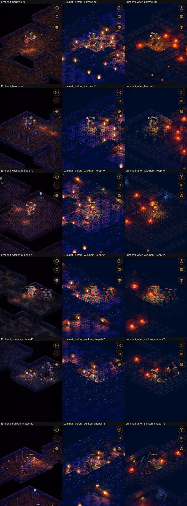
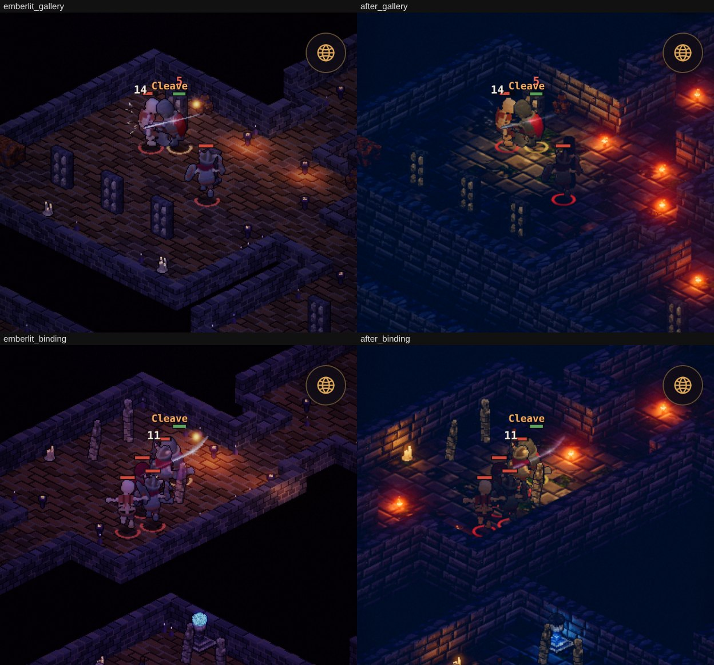
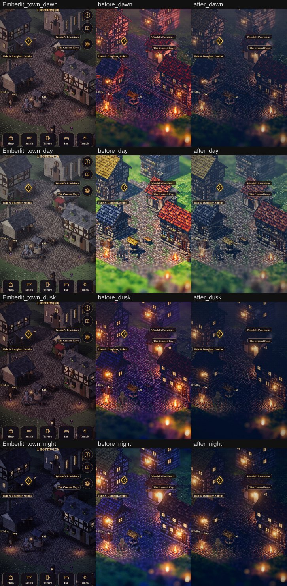
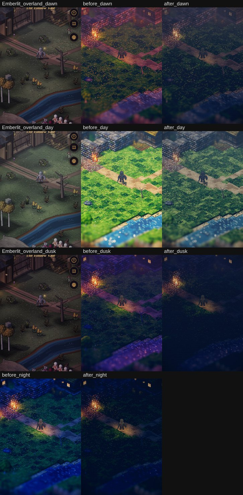
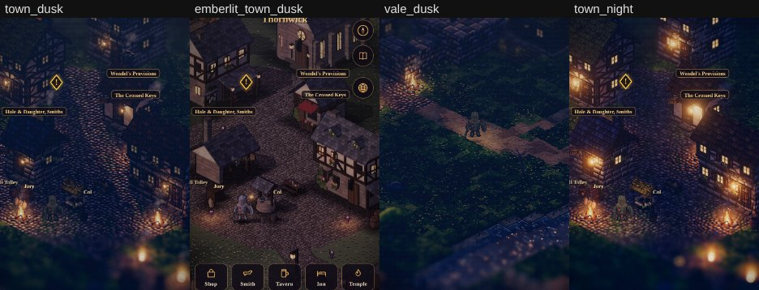

# Art critic pass 19: the Hollow Vale on Luminati

**Implemented (2026-11-01).** The owner: *"continue - run through all of these, validate - run art critics. The only
modification to this plan - focus only on the Hollow Vale Map - we will continue to iterate until we get everything
right - then expand to other areas."*

This pass covers [the port plan](./luminati-port-plan.md)'s steps 2 to 7, for the Vale only: Thornwick, the Hollow
Vale, and its dungeons (the Old Barrows, Wickham Keep, the Sunken Chapel). Emberlit's look is the reference, as the
owner approved it. The other regions are drawn as before until the Vale is right.

The critique was run twice:
- **My own read**, each time against the same rooms in Emberlit.
- **An independent critic** (a fresh reviewer given only the contact sheets and the owner's direction, not my
  reading). It ranked ten findings. The ones fixed here are marked ✓ below. The rest are left, with reasons.

All captures are 390 × 844 in headless Chromium (software GL) on the manual clock:
- the dungeons by `tools/dungeon/capture.mjs` (now `RENDERER=luminati FLOOR=N PLACES=room TOD=dusk`), the same seed
  and room in each row;
- the times of day with a page load an hour, since the game holds the URL's hour each frame.

## What was wrong

Luminati, as the trial build and step 2 had it:

1. **The dungeons were lit violet everywhere.** A floor was built at a fixed hour, and Luminati's palette at that hour
   is its purple dusk or blue night. Every wall read a saturated violet, and every floor alike.
2. **The rock beyond the walls was a lit plane.** Anything not floor was a full-height wall, so the level read as a sea
   of wall-tops. Emberlit draws black there.
3. **No kit's furniture.** Braziers were wall torches, chests were crates, shrines were lampposts, and every stairwell
   tile was a lamppost. Nothing of art critic pass 18 (the dig, the gallery, the bailey, the nave, the binding)
   showed.
4. **The Vale outdoors was a bright summer:** a saturated green under a blue noon, with a bright blue night.
5. **The effects' light** showed through walls, nothing marked the foe the party was set on, and a tap on a shop had
   to land on Emberlit's invisible sprite.

## What was done

**Dungeons** (`src/render3d/convert.js` `dungeon()`, `stairs()`, `ambientOf`):
- **Each kit's stone.**
  - Floors: the dig's earth, the bailey's cobbles, the cellar's rock, the nave's flags.
  - Walls: dressed stone (crag tops, stone-brick faces), or rock for the cave and the Cult's cut.
  - Pools: wet stone.
  - Only a ring of wall stands round the floor; the rest is void.
- **Emberlit's light underground.**
  - The dungeon ambient (`AMB_BASE`) through the kit's tint squared (`KIT_TINT`, now shared from `palette.js`). At
    its own strength every floor read one navy.
  - No sun. Luminati's lamps at half. A near-black backdrop, which the fog takes too.
  - No depth of field underground: it blurred the lower rooms' fires into orbs.
- **The furniture.**
  - **Luminati's 3D, where it has the thing:** stone braziers with small fires and a light each, crate stacks,
    barrels, sacks, boulders, basalt stalagmites and pillars, bones, spoil and pews.
  - **Our voxel props for the kits' own pieces:** standards, banners, saints, the bound, the font, sarcophagi, urn
    shelves, tents, bunks, chests, shrines.
    - Built in the page as Emberlit builds them (`hybrid.js`, the same variant on the same tile).
    - An opened chest or a used shrine is stood again as it is.
  - A light at each prop Emberlit lights.
- **The stairs** are Luminati's own stair tiles, a lit flight up and a sunk well down. This was a separate fix the
  same day.

**The Vale outdoors** (`tools/render3d/world.js`):
- **Luminati's 24 hours graded toward Emberlit's looks** (`render/daylight.js` `LOOKS`):
  - colours greyer, the sky darker rather than whiter;
  - the sun 0.72×;
  - the fill softer by day, the nights only a little dimmer;
  - dusk lifted.
- **The sim's dusk is Luminati's golden hour and sunset** (`hybrid.js` `PART_HOURS` `[5, 7.5, 17, 19.6, 29]`).
  Emberlit's dusk is a warm low sun. Held across Luminati's purple dusk it was darker than night.
- **The picture graded** in the Vale. Saturation runs from 0.74 by day to 0.92 by night, against Luminati's 1.3.
  Exposure is 0.84 to 0.9, under a heavy vignette.
- **The Vale's own turf:** mostly Luminati's dark grass, since Emberlit's Vale is olive.
- **The fog.** The sim's fog thickens the air only a little, since Emberlit's overlay drifts its banks over it, and
  the palette's fog is thinned by day.

**The fights and the town** (steps 2 and 4):
- The effects' light is cut by walls nearer the camera, from Luminati's own depth buffer.
- The foe a tap sets the party on is marked.
- A tap on a service's building opens it as Luminati draws it.

**The independent critic's findings, fixed here:**
- ✓ **#1, our props leaned and were too narrow.** The kept art was turned to the camera once, when placed, before the
  camera was set. It's now turned every frame, as the figures are.
- ✓ **#3, figures outside a lamp's pool went black.** Their self-light is 0.2, up from 0.12.
- ✓ **#4, the void was navy.** It's now black.
- ✓ **#5, every floor read one navy.** The kit tint is squared.
- ✓ **#6, the braziers were too big and red.** Size 0.36 (from 0.7, then 0.45), lamps at half.
- ✓ **#7, depth of field made fire-orbs.** Off underground.
- ✓ **#9, the overland day.** Graded, with dark grass.
- ✓ **#10, the town's veil and the dusk ramp.** Thinner fog by day; dusk is now a sunset.

*Six floors (the dig, the gallery, the bailey, the cellar, the nave, the binding). Emberlit | Luminati before |
after. The "after" column is from before the props fix below.*

*After the props fix: the urn shelves and the bound stand upright in their rows.*

 

*Thornwick and the Hollow Vale at dawn, day, dusk and night: Emberlit | Luminati before | after (before the dusk
remap below).*

*Dusk after the remap, beside Emberlit's dusk and Luminati's night.*

## Measured

Sum of RGB at one point, read off Luminati's drawing buffer. These are the browser checks:

| | Bare | Effect in front | Effect behind a wall | Light moved on |
|---|---|---|---|---|
| A wall's top in the Barrows | 62–108 | 755–765 | 215–259 (0.22×) | — |
| A floor point, a bright square of light | 169–179 | 765 | — | 176–187 (flicker) |

Luminati's ground under the dungeon stairs: the floor 1.0, the well 0, the top of the way up 2.19.

What each Vale scene fetches of the Luminati bundle, gzipped:

| Scene | Fetched | Target (§2) |
|---|---|---|
| Thornwick | 698 KB | 450 KB |
| The Vale | 700 KB | 450 KB |
| Each Vale dungeon | 698 KB | 450 KB |

The rest of step 6 waits for the owner's iPhone.

## Left as they are

- **The crypt floors are grey flags; Emberlit's read a warm reddish-brown brick.** The gallery, the muster, the nave
  and the binding want a warmer floor texture. Next iteration.
- **Our props are flat, lit as the figures are.** Emberlit's are normal-mapped, so they read darker and harder.
- **A room's inner block is a solid wall.** The Barrows' dig has a court of rock in its middle that Emberlit draws as
  a dark pit with low walls. The critic's #8.
- **Kit pieces to check on the phone** (the critic's #8):
  - the bailey's bell tents;
  - the nave's pews and standing water;
  - the cellar's stalagmites (basalt spires, dark against dark).

  They're built (`test/render3d.test.mjs` checks each kit's pieces), but small at this zoom.
- **The overland's water is a vivid blue with sparkle,** against Emberlit's dark river. The critic's #9.
- **Thornwick's red roofs are more saturated than Emberlit's slate.** The critic's #10.
- **The service plaques** are Emberlit's, at its sprite heights. They land near Luminati's roofs, not on them.
- **The two big caverns' far corners** stay outside their level.

## Tests

- `test/render3d.test.mjs` (18 tests):
  - the nine Vale kits: braziers as fire, the kits' own props as ours, lights, hours and stone;
  - the stairs in four sites;
  - the Vale's dark grass;
  - dusk and night's hours.
- Browser, Luminati block:
  - Thornwick's five services tapped as drawn;
  - the Barrows fight (light, rings, the focus marker);
  - walls cutting light;
  - the stairs' heights;
  - no trails.
- The M3 flow runs on both renderers (25 checks).
- `npm run check` passes.
