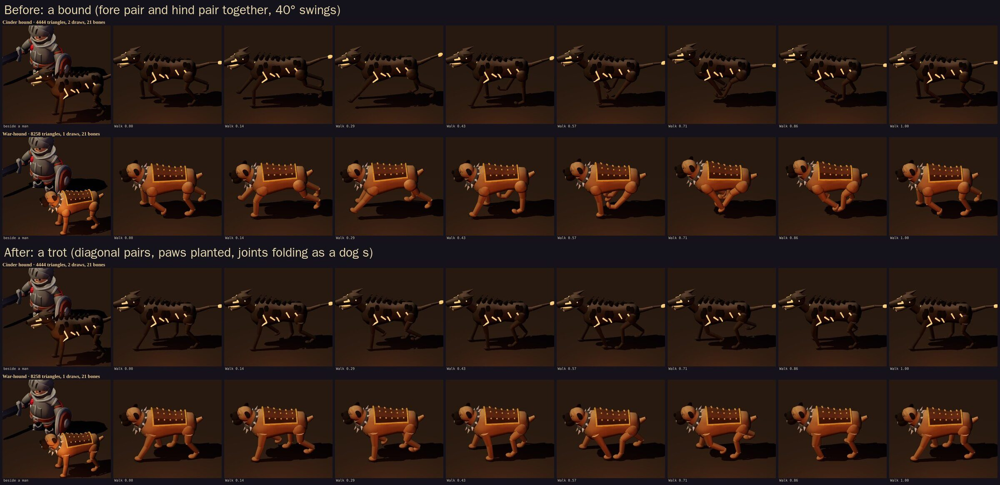
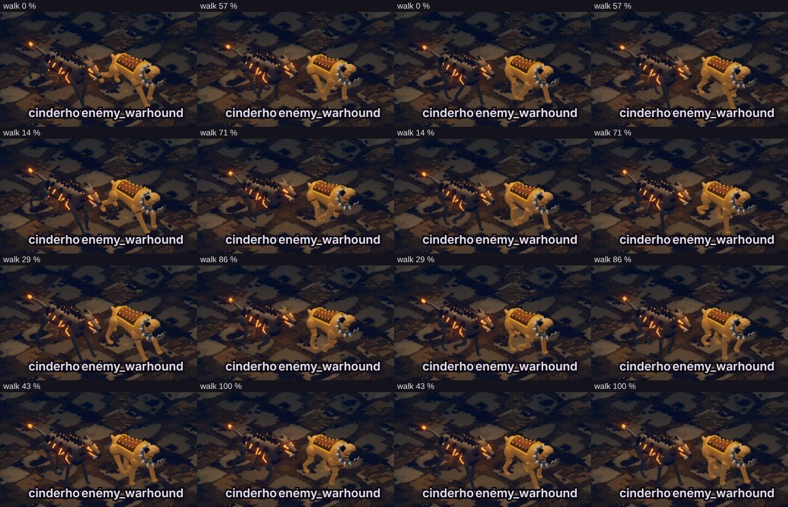

# Critic pass: the dogs' walk and build

*2026-11-28 · **Implemented**. The owner: "dog like NPCs walk funny, do an art and model critique pass".*

The game has two dogs, and both are built in code (`tools/actor-lab/creatures.js`):

- **The cinder hound** (the Reach: the Slag Tunnels' den, the Cinderworks, the Magma Vault).
- **The Gull Fleet's war-hound** (the Tidemark: the Gull Isles, the Brine Cross siege).

They share one rig and one set of clips (`dogClips`). The fix is in that shared code, so both dogs walk alike.

## 1. What was wrong

The critique was scored as an animator would score it, from eight frames of the walk on the sheet and in the game.

| # | Problem | What it looked like |
|---|---|---|
| 1 | **A bound, not a walk.** Both forelegs swung together and both hind legs together, half a cycle apart. | A rabbit's hop, or a rocking horse's: the front pair reaching while the back pair pushed. No dog moves at a walking pace like that. |
| 2 | **Swings of ±0.7 rad (40°) from plumb.** | The legs splayed fore and aft in every frame, the "hobby horse" in the in-game shot. |
| 3 | **The feet ran three times faster than the dog.** Measured, the old walk sweeps a planted paw 6.91 tiles a cycle (6.41 for the war-hound). The game stepped it by the townsfolk's 2.2, the fallback for any atlas with no measured stride. | The legs churned at about three times the rate the ground went by, and the paws skated. |
| 4 | **The hind knee bent the wrong way.** The shank was turned forward of the stifle in its swing, so the hind leg straightened into a pole instead of folding. | A stilt, the paw dragged through the floor. |
| 5 | **The paws never turned.** A rounded paw tilted with its leg and rocked on its sole, sliding about 5 cm a step even when the stride was right. | Feet that don't grip. |
| 6 | **The body pitched ±0.08 rad a stride and bobbed** with the legs. | A seesaw. |
| 7 | **Ten keys a cycle.** The clip was keyed at 24 a second over 0.4 s, so the planted phase fell between keys. | The stance cut short; the paw slid in the last key. |
| 8 | **The model: ball joints.** The haunches (and the war-hound's shoulders) were spheres stood 4–7 cm off the flank. | An action figure's joints, read from the play camera as balls on sticks. |

## 2. What changed

### The walk is a trot (`dogClips`)

- **Diagonal pairs.** The near fore moves with the off hind, the hind a breath (0.03 of a cycle) behind. Each paw is down for 56 % of the cycle.
- **An even sweep.** While a paw is down it is swept back under the body an even distance a frame. Each leg's angle is solved from where its paw should be, using the leg's top joint and its wrist or hock (`arc`). The hind's hock stands behind the hip, so the hind turns on an offset arc; solving for it puts all four paws at one speed.
- **The paws stay level** while they are down (counter-turned to the leg), so they no longer rock and slide.
- **The joints fold as a dog's do.** The foreleg's middle joint is its wrist: it folds back and the paw curls under. The hind's stifle folds the shank back and the hock tips the paw up.
- **The back stays level.** The body sinks only by what the swept legs lose in reach (the mean of the planted legs), so a planted paw neither leaves the floor nor digs in. It rolls 0.025 rad over the planted pair, and the head holds steady with a slight nod.
- **The swing is ±0.165 units** either side of plumb, not ±0.7 rad.
- **Keyed at 90 a second.** That is 37 keys a cycle instead of 10.

### The stride is measured, not borrowed

`tools/actor-lab/lab.js` `strideOf` used to measure only KayKit walks. It now also reads a four-legged creature built in code:

- the paws are the vertices weighted to `paw±1` / `foot±1` (`pawsOf`);
- a paw counts as down when it is within 2.5 cm of the floor *and* moving back, so a swing coming in low isn't read as part of the stance.

All four legs agree to 0.0005 (0.589 units a cycle, each leg alike).

| Dog | Stride before (used / real) | Stride after | Sim speed | Cadence |
|---|---|---|---|---|
| Cinder hound | 2.2 (fallback) / 6.91 | **2.62** tiles a cycle | 4.4 tiles/s | 1.68 strides/s |
| War-hound | 2.2 (fallback) / 6.41 | **2.49** tiles a cycle | 4.3 tiles/s | 1.73 strides/s |

1.7 strides a second is a big dog's trot. The atlases carry the new `stride` (`assets/actors/*.json`, written by `bake.cjs`). The renderer already prefers a measured stride (`renderer.js` `strideOf`), so the planted paws now hold still on the ground.

### The model

- **The haunches** (both dogs) are set into the flank and run down the thigh. They used to be a ball stood off it.
- **The war-hound's shoulders** run into the chest's side and down the upper arm.
- The triangle counts are unchanged: 4,444 and 8,258.

### Unchanged

The other clips: Idle, Attack, Attack2, Hit, Death and the howl. The Heavy's spring uses the trot's leg pose, so it now folds the right way too. No sim change, so balance and replays are untouched.

## 3. Scores

Scored as an animator and an art director would score them, at play scale (the Stage, the game's camera, a phone's zoom).

| | Before | After |
|---|---|---|
| The walk reads as a dog's | 3 | 8 |
| Feet planted (no skate) | 2 | 8 |
| Joints bend the right way | 3 | 8 |
| Body carriage | 4 | 8 |
| The build (joints, silhouette) | 5 | 7 |

## 4. Left for another pass

- **The idle stands like a table.** The legs are dead straight and square under the body. A dog shifts its weight, and one paw rests a little forward.
- **The legs are tubes.** A dog's foreleg has a pastern angle above the paw and a little taper; the war-hound's legs read as capsules. This is a remodel of the legs' parts, not the rig.
- **The cinder hound's laid-back ears read as horns** from above. That may be wanted for a hound of the Furnace, so it's left for the owner.
- **The grave rat** has a different set of clips and wasn't touched. Its next bake will measure its own stride the same way, which may change how fast its legs turn in play; check it then.
- **A real phone.** The captures are from headless Chromium at the game's camera; nothing has been checked on a device yet.

## 5. How it was checked

- `node tools/actor-lab/creatures-sheet.cjs out.jpg --only hound,warhound --clips Walk --frames 8`: the walk, before and after.
- `node tools/capture/stage.mjs --show cast --cast creature_cinderhound,enemy_warhound --clips walk --frames 8 --per 2 --dir 1`: in the game, before and after.
- `node tools/actor-lab/bake.cjs creature_cinderhound enemy_warhound --anchors`: the stride, before (6.91 / 6.41, the game using 2.2) and after (2.62 / 2.49).
- Re-baked: `bake.cjs creature_cinderhound enemy_warhound` (the atlases).
- Rebuilt: `tools/render3d/build.mjs` (Luminati builds the dogs from `creatures.js`).
- `npm run check`.
