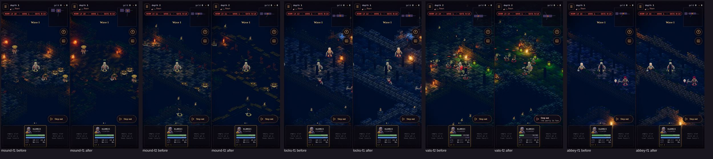

# Art critic pass: the Fens' dungeons

**Implemented** (2026-11-16): `src/render3d/convert.js` (`KIT_LOOK` mound, locks, vats, abbey; `THEME_LOOK` mire,
sluice, poison, water; the legend's `t u w z p`), `tools/render3d/world.js` (the textures `fen_mud`, `wet_flag`,
`sick_flag`, `abbey_flag`) and the rebuilt `src/vendor/luminati-80e1aa6/`, `test/render3d.test.mjs`.

Found during the Reach's pass ([art-critic-pass-reach.md](./art-critic-pass-reach.md)), and fixed when the owner said
*"do all of this"*.

**The finding.** No Fens floor had a look of its own:
- convert.js picked a floor's stone by `KIT_LOOK[kit] || THEME_LOOK[theme] || DEFAULT_LOOK`;
- the Fens' kits (`mound`, `locks`, `vats`, `abbey`) and themes (`mire`, `sluice`, `water`, `poison`) were in neither
  table.

So every room of the Toadking's Mound, the Canal Locks and the Drowned Abbey drew in the default: grey stone tiles, a
moss scatter, `moss_stone` / cliff walls, hour 19.4. Only the ambient fill differed, through palette.js `KIT_TINT`. In
play, the four looked like one dungeon.

## The looks (world doc §3.2)

| Kit (theme) | Place | Floor | Walls | Dug rooms |
|---|---|---|---|---|
| `mound` (`mire`) | the Toadking's island of upturned boats, mud and reeds | `fen_mud`, olive-black mud with a wet glint; planks laid over it (`b`, one tile in ten) | `u`: the dark planks of upturned hulls, reed on their tops | `E`: earth banks turfed over |
| `locks` (`sluice`) | the lock-keepers' halls, wet stone and windlasses | `wet_flag`, slick blue-grey flags with a sheen; cobbles | `B`: pale stone brick | `W`: cut stone |
| `vats` (`poison`) | Vat Seven's sick green vats | `sick_flag`, flags stained sick green, slime in the joints; wet flags | `W`: cut stone | `W` |
| `abbey` (`water`) | the drowned abbey's flooded cloister | `abbey_flag`, pale cloister flags gone green-grey; moss | `C`: the chapel's sandstone under moss (the Vale's nave's sister) | `C` |

**Unchanged:**
- The standing water (`P`: the sim's pools).
- The furniture, the lights and the ambient tints (`KIT_TINT`).

The textures are Luminati's `stone_tiles` and `dirt` repainted through a ramp by luminance, so their relief is kept.
They are core textures, so a Fens floor loads no extra kit. Their values sit mid-range, because underground the fill is
a dim violet and dark stone goes black (the Reach's pithead, round 3).

## Rounds

### Round 1

The four looks went in.

**Critique:**
- The four places are now four places:
  - the Mound reads as mud and wood;
  - the Locks as a pale-brick hall on wet flags;
  - the Vats as stained green stone round their green vats;
  - the Abbey as a pale, cold cloister.
- Three floors read darker than before:
  - the Mound 24.6 → 19.1;
  - the Locks 20.7 → 22.2;
  - the Abbey (floor 1) 17.9 → 19.5.
- The mud and the Locks' flags were painted too dark for underground.

### Round 2

The mud and the three flags were lifted about a third.

**Critique (world-band luminance, before → after):**

| Floor | Before | After |
|---|---|---|
| The Mound, floor 1 | 24.6 | 20.7 |
| The Locks | 20.7 | 23.9 |
| Vat Seven | 29.6 | 27.5 |
| The Abbey, floor 2 | — | 24.3 |

- The Mound stays the darkest. Mud is dark, and its walls are hulls.
- The hero and the reedmen and toads read on it as before.
- The Locks' pale brick walls are now the brightest stone in the Fens.

## Measured

Draws and triangles a frame, counted at the context, in the first fighting room of each floor, before → after:

| Floor | Before | After |
|---|---|---|
| The Toadking's Mound, floor 1 | 126 / 305 k | 131 / 326 k |
| The Toadking's Mound, floor 2 | 143 / 339 k | 148 / 344 k |
| The Canal Locks | 136 / 268 k | 136 / 267 k |
| Vat Seven | 142 / 241 k | 145 / 241 k |
| The Drowned Abbey | 123 / 273 k | 125 / 273 k |

- These are textures and tiles, with no new objects. The few draws' difference is the room's figures at the moment shot.
- The Mound's extra triangles are its hull walls' plank sides.

## Not done

- The Mound's walls are planks along their whole length. True upturned boats as wall pieces would be a kit model (our
  buildkit) per wall run, more draws, and they were not tried.
- The furniture is the sim's (`dressPlanned`), unchanged.
