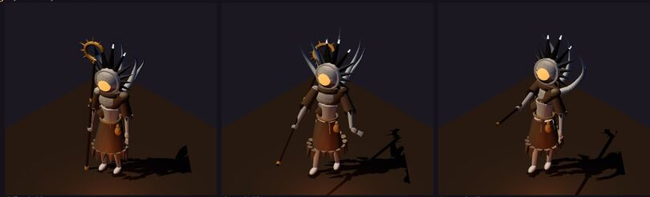
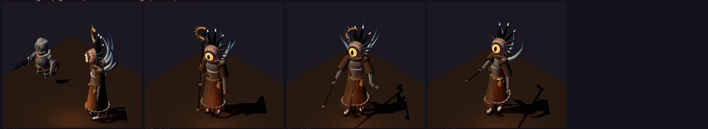
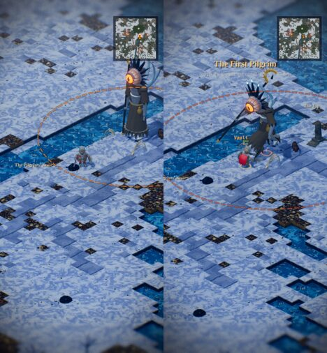
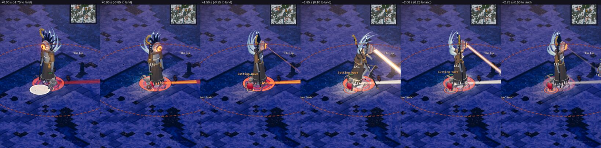

# Critic pass: the First Pilgrim

**Implemented** (2026-11-24). The Pale Heights' region boss, GDD v1.147 §19.11, world doc v1.67 §10.2. The owner asked:
*"New overworld boss for the heights.. iterate and critic until it looks great. Appears at the bottom of every hour"*,
and sent a reference: an eyeball-headed giant with a spiked eye-ring, tentacles, a spiked crescent staff, twin eye-beams
and a red sigil on the ground.

We don't copy the reference's character. What we took is its grammar:
- one great eye for a head;
- a ring of spines round it;
- something growing out of the back;
- a hooked, spiked staff;
- beams from the eye;
- a sigil underfoot.

All of it is fitted to our canon's First Pilgrim. He found the Ember and looked too long, so the Ember's light is in his eye.
The crater's black glass rings it, and the ice at the Lip holds him. His robe and crook are a pilgrim's.

Code:
- `tools/actor-lab/creatures.js` `pilgrim()`, on KayKit's rig (variant CR12, bake `boss_first_pilgrim`);
- `tools/render3d/world.js`: the gaze's lanes, beams, sigil and flare;
- `src/render3d/hybrid.js` tellsOf: the lane's width;
- `src/render/anim.js`: the cast swing;
- `src/render/renderer.js`, `src/render/fx.js`: mapping, size, stride, sparks;
- captures from `tools/actor-lab/creatures-sheet.cjs --only pilgrimf,pilgrim` and `tools/capture/pilgrim.mjs`.

## Model rounds (the creature sheet)

| Round | What read wrong | Change |
|---|---|---|
| P0 |  The eye read as a grey helmet or a porthole: the lids and a rim covered the iris, and the pupil was inside the iris, unseen. The body was a stick puppet in a kilt. The crook's hook was nearly a full ring, a sun wreath. The ice read as pale blades. | — |
| P1 | — | The eye forward in a thin lid. The pupil a slit in front of a dark-edged iris. The robe's body over the back and sides, open on the ribs, to the shins. The limbs half again as thick. The hook a crescent (1.1π) with its spikes on the outer edge. The ice bluer. |
| P2 | The eye now read as a googly toy's: clean white, round, cute. The skin was so pale under light that it read as a shirt, and the robe was a bell. | The globe bloodshot toward its rim, 14 veins. The skin a colder, darker grey-blue. The robe narrower at the hem. A heavy lid lowered over the iris's top: a stare. |
| P3 | The lid, a cap over the top of the globe, read as a grey helmet from the game's camera, which looks down on it. | A narrow dark lid crescent and a heavy lid edge across the iris's top. The globe's back is flesh, not sclera. |
| P4 | In the walk the ice strands flared forward over his head. | The walk's sway halved and leant back. |

**Numbers:** 13,804 triangles, 4 draws, 56 bones (Furnace Nine: 4,257, 2, 41). One figure, standing alone at the Lip.

## In the game (390 × 844, the manual clock)

| Round | What read wrong | Change |
|---|---|---|
| G0 | The gaze drawn as a circle 18 tiles across: the renderer took any tell it didn't know for a stamp. | A lane per beam, filling outward from his feet as it winds, with a dark edge. A thin aim line from the eye in the wind's last 40 %. Landed, the beam, a white-hot core in an orange glow, gone in 0.6 s. A red sigil turning at his feet while he looks. |
| G1 | The beam came from a fixed height, his chest, and the sigil (1.75 units) hid under his robe's hem. | The sigil out past the hem: 2.75 units, a faint fill, its glyphs turning both ways. |
| G2 | His cast (`Spellcast_Long`) leans him, so a fixed height still missed the eye. | The beam starts at the eye: the eye mesh's front-most vertex, skinned each frame (`applyBoneTransform`). |
| G3 | — | The eye flares as the beam fires: the blast light at the eye, the ground round him lit orange. |

The beam fires from the eye down to the lane's far end, and the lane under it burns white at the landing. With the
dark-edged lane, the red sigil and the aim line, a player has the gaze's 1.8 s to step out. The AI steps out the same
way (`openGround`).

## Measured (the sim)

From `regionboss.mjs --boss first_pilgrim`, autobattle at 75, 2 seeds per head count.

| Companies | Won | Median minutes | Downs a run |
|---|---|---|---|
| 2 | 2/2 | 7.8 | 0 |
| 3 | 2/2 | 7.3 | 0 |
| 4 | 2/2 | 7.7 | 0 |
| 5 | 2/2 | 5.9 | 0 |

Furnace Nine at 30, the same runs: 5.1 / 9.1 / 7.8 / 5.0 minutes, 0–1 downs.
