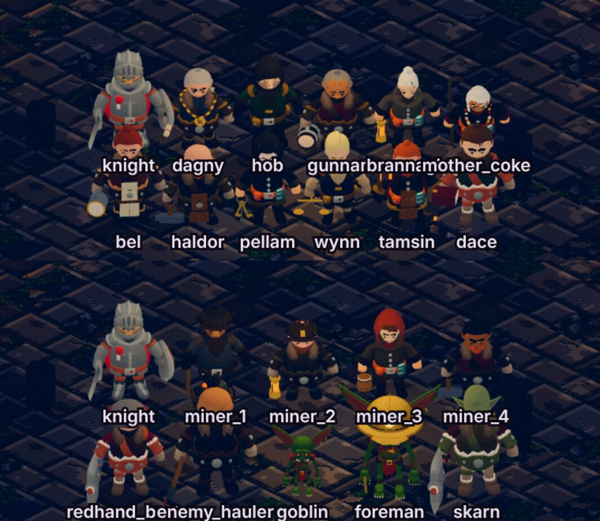
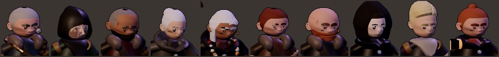
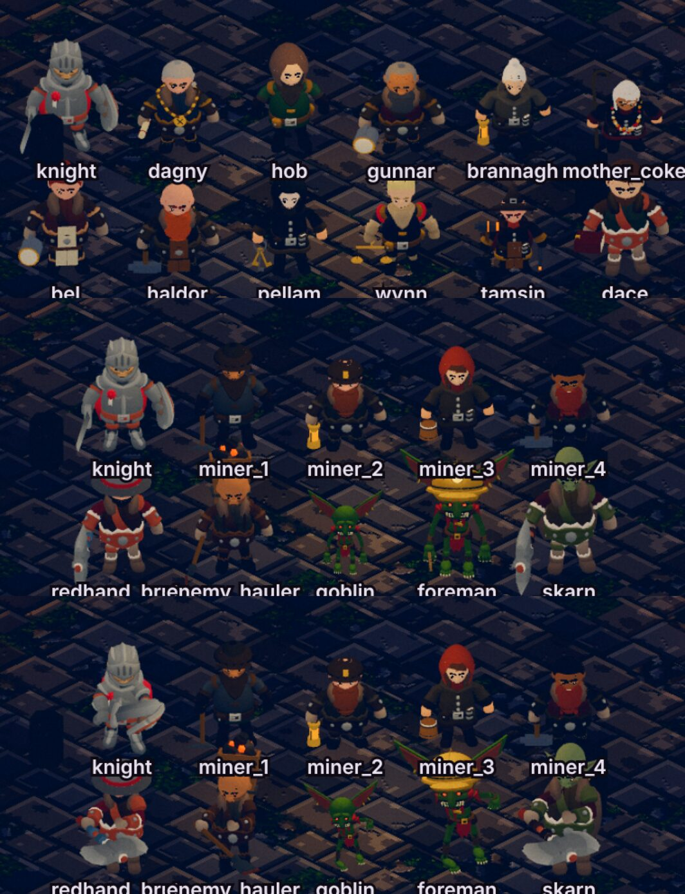
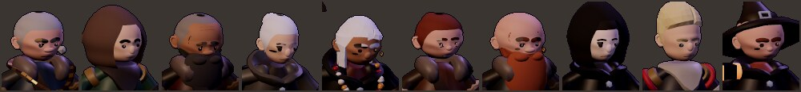

# Art critic pass: the Cinder Reach's cast

The owner, on [reach-plan.md](./reach-plan.md): make the Reach playable, with "new NPC models" and critic passes.
This pass builds and reviews the people and foes of Act III (world doc v1.53 §3.3):

- **Ashgate's named people:** Charter-Reeve Dagny Coalbrook, Hob, Gunnar Slagg, Old Brannagh, Mother Coke, Bel
  Ruddle, Haldor Ironmonger, Widow Pellam and Wynn Sallow (`npc_dagny` … `npc_wynn`, variants N18–N26).
- **Ashgate's crowd:** four miners and mill-hands (`npc_miner_1..4`, MN1–MN4), who take the villagers' place in
  any town of the Reach (`renderer.js` `crowdLook`).
- **The found companion:** Tamsin Coalbrook, mage-smith (`hero_tamsin`, CP3).
- **The Cold Seam's foes:** the slag hauler (`enemy_hauler`, RE1, sim kind `hauler`) and **Gritch, called the
  Foreman** (`boss_foreman`, CR9, sim kind `foreman`), the code-built goblin in a dead foreman's brass lamp-hat.

**Status: Implemented** (2026-11-16).

## How it was measured

- **The Stage on Luminati** (`node tools/capture/stage.mjs --show cast --cast …`): every new actor in a real
  dungeon room, beside the knight (a man's height), Dace Pike (a townsman of the Fens), the Vale's goblin, the
  Redhand brute and Old Skarn. Idle, and the foes' attack and heavy blow. The crops are ×2 of a dpr-2 capture, so a
  figure is about the size it is on a phone.
- **The windows' art**: the portrait (`.face.png`) and the character-window figure (`.fig.png`), from `bake.cjs`.
- **The Foreman close up**: `node tools/actor-lab/creatures-sheet.cjs --only foremanf,foreman` (two new rows),
  from the game's camera and through every clip.
- **The swatches**: before choosing colours, each tile of the Barbarian, Rogue and Mage textures was painted
  magenta in turn and rendered, so every repaint below names the part it changes.

Scores are out of 10: **silhouette** (does it read as itself at 56 px, in shape alone), **palette** (does it sit in
the Reach's ash, slag, rust and ember, and stand out from its neighbours) and **story** (does it say who they are).

## Round 1: the first build

| Actor | Sil. | Pal. | Story | What was wrong |
|---|---|---|---|---|
| Dagny | 7 | 7 | 7 | Short and broad reads; the chain of office a bright V. Good. |
| Hob | 5 | 4 | 4 | Rogue_Hooded's own hood has a mask over the mouth: a thief, not a fixer. Near-black against the floor. |
| Gunnar | 5 | 5 | 6 | The kit's Mug is a white-striped drum held to the face. His soot beard disappears under the chin. |
| Brannagh | 7 | 5 | 7 | The lamp reads. The Mage kit's **orange belt and teal phials** shout on a plain shawl. |
| Mother Coke | 6 | 4 | 6 | Beads read close up; orange belt and phials again; near-black at play size. |
| Bel | 6 | 6 | 6 | Apron and mug read. |
| Haldor | 5 | 6 | 5 | The face kit's "full" beard is a scarf at the chin and is hidden from the camera: a bald man in an apron. |
| Pellam | 6 | 5 | 6 | Hood and keys; the Mage kit's belt again. |
| Wynn | 6 | 6 | 5 | Scales read. The sleeve garters are inside the sleeve. |
| Tamsin | 6 | 6 | 5 | A smith (apron, hammer, tongs). Nothing says mage. |
| Miners | 6 | 5 | 6 | Cap, lamp-cap, kerchief and pick read. The dwarf-folk have no beard from above. |
| Hauler | 5 | 3 | 5 | Big, but the hod sits low behind his back and is lost; brown-black all over. |
| Foreman | 9 | 8 | 8 | The hat is the read at once. But set square on, its brim hides his whole face from the camera. |

## Round 2: what changed

- **The Mage kit's belt and phials put out** (tiles 5,0 6,0 2,2 6,2 repainted to leather and stone) on every robe:
  Brannagh, Mother Coke, Pellam, the mill-hand and Tamsin.
- **The dwarf-folk's beards** (`props.js` `greatBeard`: `beardcopper`, `beardbraids`, `beardrust`,
  `beardchestnut`): a long bib from the jaw over the breast, worn on the head under the face's own beard. The
  Slagborn braid theirs and ring them in brass. `wear` takes a list now (`figure.js`), so a miner wears a lamp-cap
  and a beard.
- **Gunnar** holds the pewter mug (Maudry's), not the kit's.
- **Hob** in the plain Rogue with the rogue's open hood worn as a helm (`gear: { helm: hood }`, fitted to the painted
  head): his face shows, smirking; a brown hood over a bottle-green coat.
- **Wynn's garters** bigger and redder, on the upper arms.
- **Tamsin** wears the Mage hat in her coat's soot, so the mage reads at once over the smith's apron, hammer and
  tongs. Her hammer is her focus: its faces and a seam round its head glow.
- **The hauler's hod** raised up over his shoulders and its wood lightened; his shirt is ash-grey.
- **The Foreman's hat** smaller (r 0.155 → 0.145) and pushed back on his head (0.32 rad).

| Actor | Sil. | Pal. | Story | Left over |
|---|---|---|---|---|
| Haldor | 8 | 8 | 8 | — the copper spade beard is the read |
| Gunnar | 7 | 7 | 8 | grey braided beard, hidden mug |
| Hob | 6 | 6 | 7 | the hood's mask (fixed in this round's second half: the open hood) |
| Tamsin | 7 | 7 | 7 | mage and smith both |
| Hauler | 6 | 5 | 6 | the hod now over the shoulders, embers lit |
| Foreman | 9 | 8 | 8 | close up, the brim still a sun hat's |

## Round 3: the Foreman, and the shipped bake

- **The brim** narrowed to a hard hat's (×1.32 → ×1.16 the crown) and the hat tipped further back (0.4 rad): his
  red eyes and grin show under it from the game's camera.
- Everything baked for real (`bake.cjs`), `models.mjs` (cast.json) and the Luminati vendor rebuilt.

| Actor | Sil. | Pal. | Story | Read at 56 px |
|---|---|---|---|---|
| Dagny | 8 | 8 | 8 | short, broad, grey, the brass chain and seal, the charter |
| Hob | 7 | 7 | 7 | lean, a brown hood, green coat, brass buttons |
| Gunnar | 8 | 7 | 8 | heavy, a braided iron-grey beard, a wine coat gone dull, the mug |
| Brannagh | 8 | 8 | 9 | stooped, white bun, olive shawl, a lit miner's lamp |
| Mother Coke | 7 | 7 | 8 | the smallest, bent, soot-black, three strings of beads, a crook |
| Bel | 7 | 7 | 7 | broad, auburn, a linen apron, a mug |
| Haldor | 9 | 8 | 9 | short, broad, bald, a great copper beard, apron, hammer |
| Pellam | 7 | 7 | 7 | a black hood and dress, the keys |
| Wynn | 7 | 7 | 8 | blond, shirt-sleeves, red garters, the brass scales |
| Tamsin | 8 | 8 | 8 | a soot mage's hat, copper and freckles, a smith's apron, a glowing hammer, a billet in the tongs |
| Miners | 7 | 7 | 7 | two men, two dwarf-folk; cap and pick, lamp-cap and lamp, a rust kerchief and pail, a braided rust beard |
| Hauler | 7 | 6 | 7 | a head over a man, the hod of slag over his head, its embers lit, a coal shovel |
| Foreman | 9 | 9 | 9 | a goblin under a lamp-hat made for a man, its lamp lit, ears out under the brim, a tally-stick |

Numbers: the Foreman is 13,324 triangles in 3 draws (the goblin's 10,884 in 2: the lamp's glass is a glow of its
own colour, `creatures.js` `Rig.mesh`). The dwarf-folk are KayKit's Barbarian (Tamsin and the crowd's mill-hand the
Mage) on a `frame` of their own: thighs 0.7 and shins 0.72 of the heroic, the hips 1.16 wide and 1.12 deep (a scale
may be `[x, y, z]` now), the head given its width back, and fitted at 0.72–0.82 of a man.

## Still open

- **Hob** in play shows his hood's shadow under his chin, which can read as a dark beard.
- **Mother Coke and Old Brannagh** are close in shape (old, bent, robed, white-haired); their props (beads and crook,
  lamp) and size keep them apart, not the outline.
- **Tamsin's hat** hides her copper hair; only the fringe of freckles and the topknot's colour in the portrait say
  Coalbrook. If she takes a staff or wand as gear, it replaces the hammer (as any member's weapon does).
- Not seen in Ashgate itself yet (the town is being built alongside); these were judged in a dungeon room.

## Files

`tools/actor-lab/variants.json` (N18–N26, MN1–MN4, CP3, RE1, CR9), `faces.json` (15 faces), `bake.json`,
`props.js` (chain, charter, hod, shovel, pickaxe, minerlamp, minercap/lampcap, beads, garter, scales, emberhammer,
tongs, linenapron, kerchief, widowhood, the four beards), `faces.js` (a `soot` mark, NPCs only), `creatures.js`
(`foremanKit`; a glow a colour), `figure.js` (`frame` scales per axis; `wear` lists), `creatures-sheet.cjs` (the
Foreman's rows); `assets/actors/*` and `assets/models/cast.json` rebaked; `src/render/renderer.js` (`hauler`,
`foreman`, the Reach's crowd), `src/render/fx.js` (the hauler's shovel, the Foreman's claws, Tamsin's casts).
