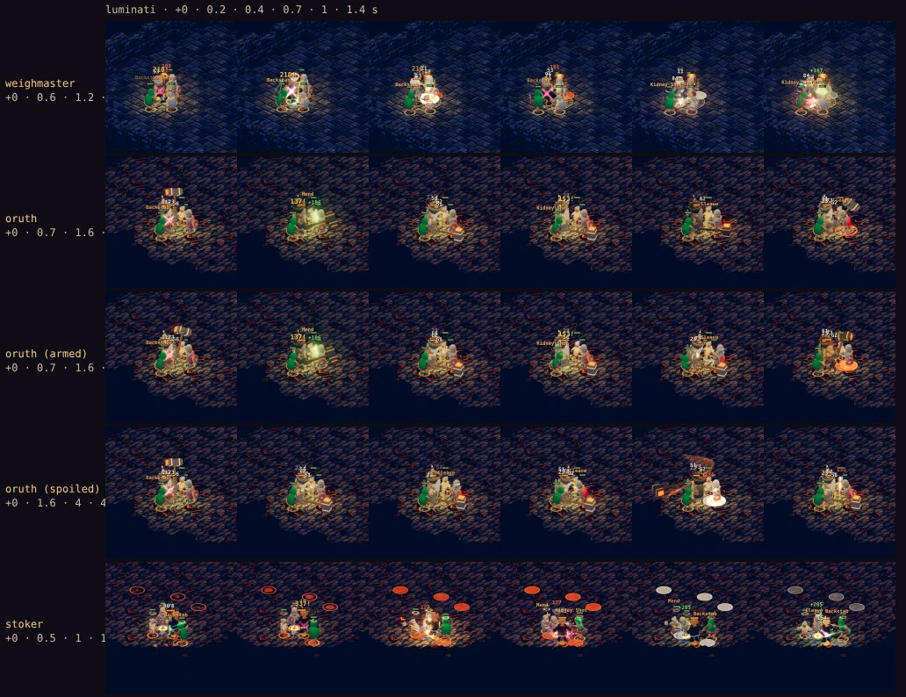
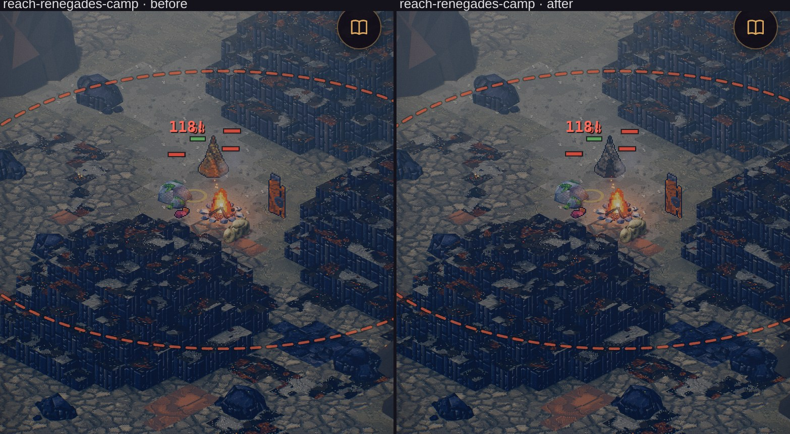
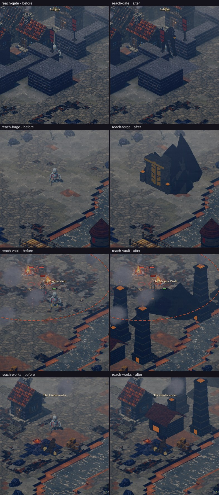
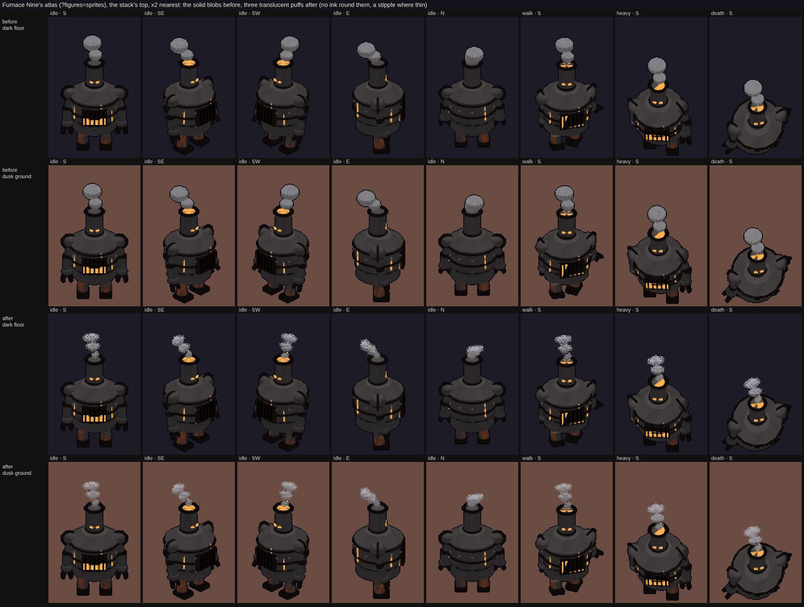
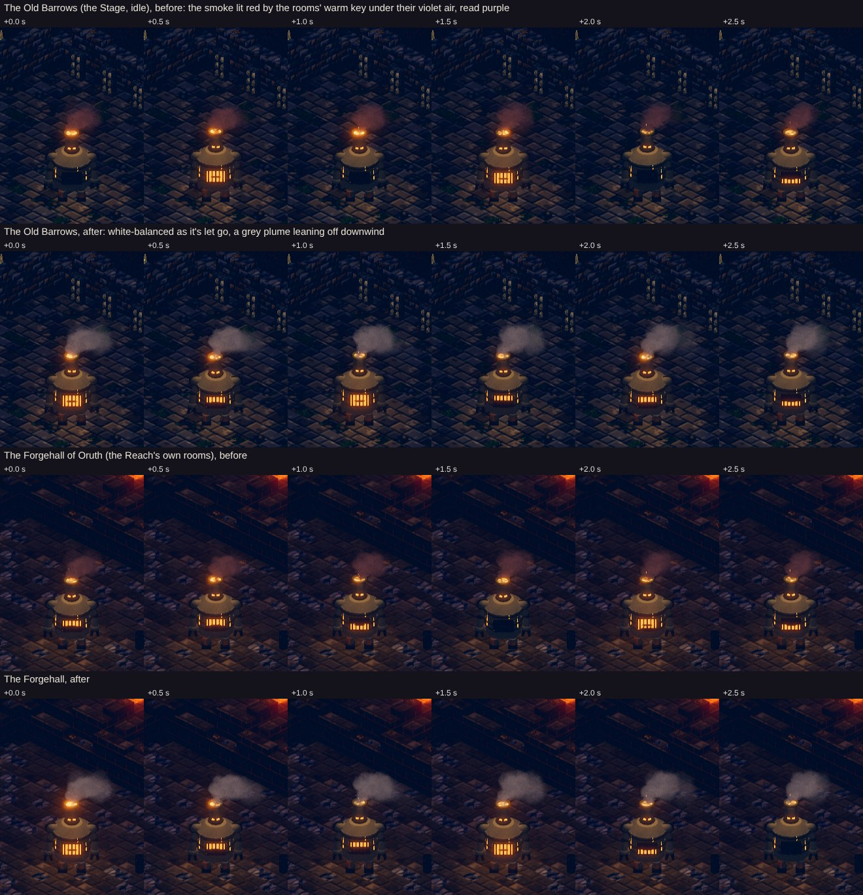
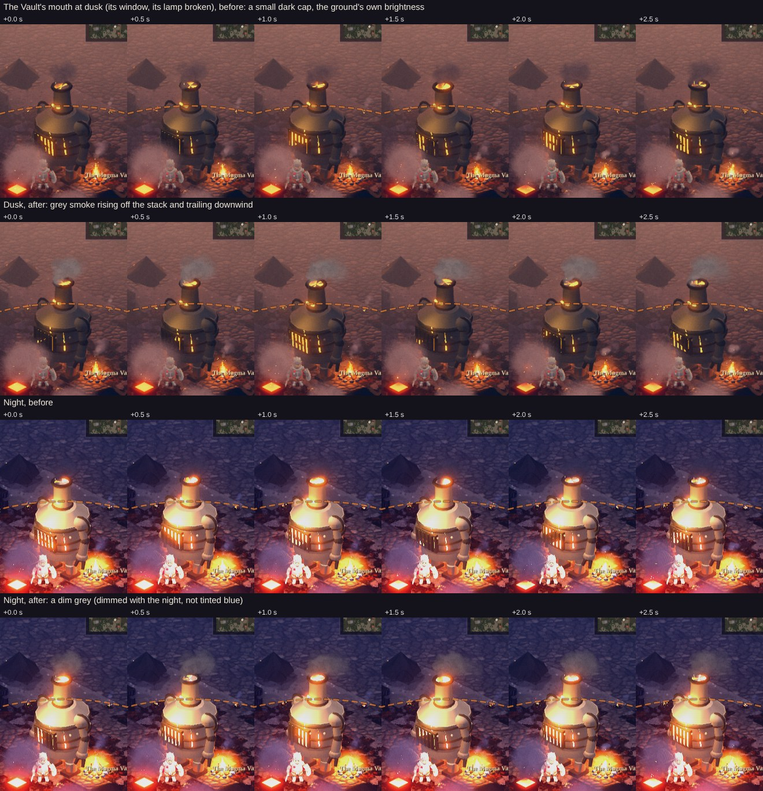
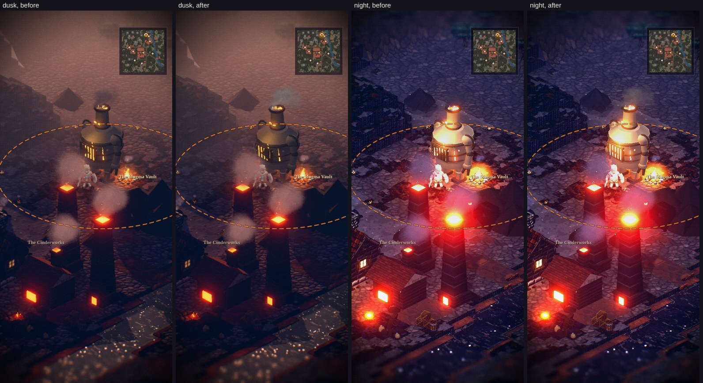

# Art critic pass: the Cinder Reach's effects and its two gaps

The owner's four asks for Act III, after [art-critic-pass-reach-cast.md](./art-critic-pass-reach-cast.md) and
[art-critic-pass-reach.md](./art-critic-pass-reach.md):

- **A. Oruth's anvil.** His mechanic was a banner and his hammer's sparks.
- **B. The Weighmaster's pan.** His weighing was the generic red tell.
- **C. Furnace Nine's smoke.** It was solid geometry carried round with its head.
- **D. Two art gaps.** The Reach's camps pitched the Vale's canvas, and the Reach's new kit pieces had no baked cards.

Nothing in the sim changed. Every look reads events and state the sim already had:

- `bossForge`, `bossAnvil`, `bossScales`, `tellLand` and `battle.tells`.
- Light goes through `fx.js`'s primitives (`skillfx.js` moments), as the boss pass's do.
- 3D goes through Luminati's own particle bursts and one pooled mesh (`tools/render3d/world.js`).

## What changed

### A. Oruth at his anvil (`skillfx.js` `boss_forge`, `boss_arm`, `boss_spoil`; `renderer.js` `forgeBeat`)

The work is drawn for the event's whole `t` (`ANVIL_T`, 4 s). It is followed while he stands and ends early when
`bossAnvil` comes (`sfx.end`). The anvil stands in front of him (`FORGE_AT`: 0.7, 0.5 tiles toward the camera).

**While he forges:**
- The forge's glow lies on the floor and up his front.
- The anvil is drawn in its heat: its face, horn, heel and waist.
- The piece on it is white-hot, cooling between blows.
- A blow lands every 0.6 s from 0.35 s (`FORGE_BEAT`). Each blow:
  - a flash;
  - twelve sparks thrown up off the face and falling;
  - a moment of the room lit (`blast`, 0.28 s at 0.85);
  - Luminati's own streak sparks (`emberForgeSparks`, a burst of 12).
- Heat rises off the piece.

**When the work ends, one of two things:**
- **Armed.** A streak of heat runs to the risen wight. At the wight:
  - a column of forge-fire, flames at its feet and a ring;
  - its new blade's glint;
  - sparks, and a column of Luminati's sparks (`emberArmSparks`, 22);
  - a light on the room.
- **Spoiled.** A dull red crack comes off the anvil, then a puff of smoke rises, caught in the forge's dying glow
  (light can't darken). Luminati adds its own grey smoke (`emberSpoilSmoke`, 16) and the piece's embers falling dead
  (`emberSpoilEmbers`, 8).

### B. The Weighmaster's pan (`world.js` tells `scales`, `panMesh`; `skillfx.js` `boss_scales`, `boss_pan`)

The red tell stays, since red means "get out" in every fight. Over it:

- **The pan.** A brass scale-pan on three chains to a ring, the chain going up out of sight. It hangs 2.8 units over
  the one weighed and comes down through the 2.2 s wind (`1 − p³`: slow, then a drop). It lands as the tell lands,
  rests 0.2 s, then is hauled back up.
  - It is one merged mesh, 704 triangles, pooled.
  - It casts a shadow that closes on its mark.
  - Its brass glints as it comes and flashes on landing.
- **A brass ring** inside the red, the pan's footprint.
- **As he weighs:** a brass glint over him, a thread of brass to the one weighed, and a balance's beam tipping over
  their head.
- **As it lands:** a brass flash off the rim, a ring out over the floor, dust, and the Toadking's stamp jolt.

**The Stoker's vents**, the cheap extra the owner offered:
- Their circle glows slag-orange with a hotter heart that beats, not the Kingstone's red.
- As each lets go: a spurt of slag, a ring, gobs falling back, and Luminati's slag streaks and a breath of smoke.

### C. Furnace Nine's smoke (`creatures.js` `furnace`; `world.js` `puffStack`)

The two solid grey blobs are gone (its atlas has a still of the new smoke instead: see
[Furnace Nine's loose ends](#furnace-nines-loose-ends)). The figure stays the same size: its size is fitted to its box
(`figure.js` `fitPpu`), so a zero-area triangle keeps the old top. The stack now breathes:

- **Where.** The emitter is the stack's lip: the highest vertex of its fire, skinned each frame
  (`applyBoneTransform`), so it follows the clips.
- **Smoke.** One lit smoke particle every 0.14 s (`emberStackSmoke`: grey, 3.6 to 5.2 s, swelling ×3.8 as of the loose
  ends' round 7, its colour white-balanced as it's let go: `greyPuff`). Each is a burst left where it was let go, to
  rise, swell and go with the wind. An emitter's particles would follow it rigidly instead.
- **Sparks.** One every fifth puff.
- **Pools.** Both share pools Luminati already has, so there is no new program:
  - the smoke shares `deathPoof`'s pool (smoke, normal blending, lit);
  - the sparks share `hitSpark`'s pool (a streak, additive).

### D1. The Reach's tents (`gsprite.js` `voxTent(canvas, trim)`, `tent_reach`; `palette.js` `ash`, `soot`; `convert.js`)

On the Reach's overland a camp's tent is `tent_reach`: the same bell tent in canvas gone grey with ash, its hem and
pole soot-black. It is the renegades' camp's tent; the haulers pitch none. Its colour spread (mean max − min of its
channels) is under 0.6 of the Vale's (`test/reachfx.test.mjs`).

### D2. The Reach's kit cards (`town.json` reach_*; `bake-env.cjs --sets`, `nofoot`)

The nine pieces now live in `town.json`'s `reach` set:

- `reach_gatewheel`, `reach_stack`, `reach_works`, `reach_pithead`;
- `reach_assayhouse`, `reach_forgedoor`, `reach_ninthdoor`, `reach_vaultmouth`, `reach_slagheap`.

Before, they were a list in `world.js` with no card. Now they are baked into `assets/env/town-reach` (2048 × 624 →
2048 × 823). `world.js` takes them for 3D from `town.json`, as every other kit piece.

**What `?landmarks=sprites` and `doors` show:**
- `?landmarks=sprites` shows their cards where it showed nothing.
- `?landmarks=doors` shows them too, as cards (it skips them in 3D).

**Footprints are unchanged.** They are marked `nofoot`, so the bake writes no footprint for them: they stand on the
sim's own gatehouse, smithy, mine and ruins. `src/sim/envfoot.js` is byte-for-byte the same.

**The bake:**
- `bake-env.cjs --sets town-reach` baked that atlas alone (3.7 s). The other atlases' footprints are read back from
  their JSON.
- The 28 cards already there kept their size, origin, footprint, top and glow exactly (checked field by field).

## Measured

**Furnace Nine alone on the Stage** (`tools/capture/furnace-smoke.mjs`, median of 30 frames, counted at the WebGL
context, every pass):

| | draws, frame | triangles, frame | its share: draws | its share: triangles |
|---|---|---|---|---|
| before (solid smoke) | 89 | 227 068 | 4 | 9 448 |
| after (drifting smoke) | 91 | 226 196 | 6 | 8 576 |

What the numbers mean:
- **Triangles.** The blobs' triangles in every pass are gone (−872 a frame). About 35 live smoke quads and a few
  sparks take their place.
- **Draws.** +2: the two burst pools, one instanced draw each.
- **Size.** The furnace's size is unchanged (its box, and so its pixels a unit).

**The pan:** 704 triangles, one draw and its shadow, only while a weighing is under way (2.2 s in every 11 s).

**The bosses** (`tools/capture/bosses.mjs --dpr 2`, the same seed and party on both checkouts, so the frames line
up):

| | event | time | level | outcome |
|---|---|---|---|---|
| Weighmaster | `bossScales` | 12.7 s | 24 | |
| Oruth | `bossForge` | 19.7 s | 27 | spoiled (the party strikes him past 5 %) |
| Oruth (armed) | `bossForge` | 19.7 s | 27 | a wight armed (health held while he works) |
| Oruth (spoiled) | `bossForge` | 19.7 s | 27 | spoiled (struck past the mark at 2 s) |
| Stoker | `bossVents` | 11.7 s | 30 | |

**Checks:**
- `npm run check`: typecheck, lint, content, 707 node tests (`test/reachfx.test.mjs` new), SMOKE_OK and
  RENDER_SMOKE_OK.
- The vendor was rebuilt (`node tools/render3d/build.mjs`). Only `luminati.js`, `BUILD.txt` and `version.json` moved.

## Rounds

**The pan.**
- It reads as brass at play size: the dish and its rim, with the chain up out of frame telling where it hangs.
- In the Weighmaster's melee it hangs over the knot of the party, clear of the figures until it lands.
- At 1.7 tiles it is the tell's size exactly (the tell's own radius, halved into units: what's drawn is what's hit).

**Oruth.**
- Round 1's spoiled smoke was dark grey (`#2a2422`) and its 2D glow faint: on the Forgehall's char floor it didn't
  read.
- Round 2: the grey was lifted (`#4e4641` → `#76716c`), the glow raised (0.34 → 0.5, gain 0.9 → 1.2) and the crack
  widened. Now a brown-grey puff rises off him at +0.3 s.

**Furnace Nine.**
- Round 1's soot (`#2e2926`) was black on the Stage's dark floor, invisible.
- Round 2 (`#6e5e54`) turned pink under the room's violet fill.
- Round 3 (`#5c5753` → `#7a7876`, the shipped colour) reads as a grey plume leaning off the stack.

Rounds 4 to 7 are the loose ends' (below): grey under any light, and outdoors.

## Furnace Nine's loose ends

The first pass left three: its baked atlas still had the solid blobs, indoors the smoke read purple, and nobody had
seen it outdoors.

### 1. A still of the smoke in its atlas (`bake.json` `creature`; `creatures.js` `Rig.soft`; `lab.js` `downSoft`)

**Which images.** Furnace Nine has an atlas and nothing else. `bake.json` gives it no portrait and no
character-window figure, as it gives no boss one, and nothing in the UI draws a boss's portrait. The atlas is the
one still: `?figures=sprites`, and what the game falls back to if its model can't be drawn.

**Only the bake.** The furnace's `bake.json` entry has `"creature": { "smoke": true }`. `bake.cjs` lays it over the
variant's creature spec for the bake alone. `models.mjs` takes the variant's own spec, so `cast.json` and the game's
model are unchanged (`test/reachfx.test.mjs` holds both).

**The smoke.** `smoke: true` builds the world's puffs caught in a moment:
- Three puffs off the lip, each higher, bigger, thinner and further back on the wind than the last, with gaps
  between them and two sparks among them.
- Each puff is two to four lobes. Each lobe is a shell over a heart of the same opacity (0.74, 0.64 and 0.54, low to
  high), so a lobe is thick in the middle and thin at its rim, and thicker again where lobes overlap.
- The lobes are a mesh of their own: `Smoke`, translucent, writing no depth (`Rig.soft`).
- All of it sits under the old blobs' top, so the figure keeps its box and its size. Round 1 had a lobe 0.011 over
  that top, and every pixel of the figure moved. The test now holds the top.

**The bake.** The atlas's alpha is a mask: a pixel is solid or it isn't, and solid pixels are outlined in ink.
- A pixel the smoke alone covers is kept where its mean opacity beats a 4 × 4 Bayer threshold. The hearts come out
  solid and the rims a stipple the world shows through.
- No ink is drawn round the smoke.
- A figure with no soft part takes the old path. `hero_knight`, `creature_golem` and `boss_ratking` bake
  byte-identical with and without the change.

**Measured** (`bake.cjs boss_furnace_nine`, 27 s):
- The cells are 114 × 320 as before, and the JSON is the same but for the images' hash.
- Against a bake of the same code without the smoke:
  - idle, walk, attack and heavy differ only over the stack's lip (0 pixels below it);
  - attack2, hit and death differ by a few hundred pixels below it, where the stack tips and its smoke falls beside it.
- Opaque pixels in the atlas: 2 559 709 → 2 472 711 (the blobs' area less the puffs').

**Rounds:**
1. One opacity a lobe (0.62, 0.46, 0.32): a sparse checker, the puffs half the blobs' size.
2. A heart in each lobe, the lobes bigger: still a mesh.
3. Opacities 0.74, 0.64 and 0.54, and lighter tops (`#b4b0aa`): solid hearts, stippled rims. Shipped.

### 2. Grey under any light (`world.js` `greyPuff`)

**Why it read purple.** Luminati's particle shader lights a lit burst as its colour × (amb + sun × 0.75), amb its
own grey-blue by the night.
- Underground the scene's sun is off (`convert.js` `ambientOf`: sun 0), but the uniform the particles read is not.
  It is a warm key: (1.11, 0.56, 0.52) in the Old Barrows and the Forgehall alike.
- So the shader turned `#5c5753` red-brown (`#61413c`). The room's violet air over it made it purple: the smoke
  added red and blue over green to what was behind it.

**The fix.** Each puff is let go white-balanced against the light it's let go in:
- `STACK_GREY` (0.75) of the light's hue is taken off. A quarter is kept, so at dusk the smoke takes the dusk as the
  works' chimney smoke beside it does.
- Its brightness is kept (Rec. 709 luma), so it sits dark in a dark room and dims at night as everything round it
  does.
- `STACK_GAIN` (2): no channel is more than doubled under a light that has next to none of it (the night's blue).
- Nothing is allocated. The burst's colour is the cached preset config's (Luminati's `_burstConfig`, a private
  method). It is set before each puff. Without that method the smoke keeps its preset's colour.

The sparks are untouched: unlit, additive, warm.

### 3. Outdoors, where it stands (`furnace-smoke.mjs --where mouth`)

**How it's reached.** The Reach's overland with `?dev&ring=furnace`, its lamp broken (`state.lampsBroken`), the
window told to the sim, and the hero five tiles south of it. At level 1 it doesn't stir for him, so it stands.

**A dev hook bug.** In the first quarter of an hour, `?dev&ring=furnace` told the sim the Kingstone's window, which
was really open and first in the list. The mouth went back to its furnace-priests, whose camp fight wiped the hero
home to Ashgate. `ring.js` `clock()` now takes the held window first (localhost only).

**What was wrong outdoors:**
- At dusk the smoke was a small dark cap on the stack. Lit `#57443f`, it was as bright as the ground behind it,
  (100, 80, 80).
- The Cinderworks' chimney smoke in the same frame read far stronger than the boss's.
- The wind is Luminati's: (1, 0.35) at strength 1, indoors too. At `windInfluence` 0.55 the plume leaned 5 px.

**Rounds:**
4. Neutralise 85 % of the light's hue. Grey indoors, but dimmer: the light's luma is 0.67.
5. `#78736e`, `windInfluence` 0.55 → 0.85. It leans.
6. Bigger (0.55 to 0.85, ×4.5), alpha 0.64, `STACK_GREY` 0.75. It reads outdoors, but as a cloud capping the stack.
7. More rise (1.1 → 1.45 a second) and less swell (×3.8). It trails up and off the stack downwind. Shipped
   (`#7e7974`).

### Measured (the loose ends)

At +2.5 s, the frame drawn with Luminati's particles and without, over the stack (`furnace-smoke.mjs`, numbers-*.json):
- **add**: what the smoke adds to red, green and blue there;
- **violet**: its red and blue over its green (> 0 purple);
- **lit**: the shader's own colour for the last puff;
- **lean**: how far right of the furnace the smoke lies, CSS px.

| | before: add | violet | lit | lean | after: add | violet | lit | lean |
|---|---|---|---|---|---|---|---|---|
| The Old Barrows (Stage) | 10.5, 5.1, 6.0 | +3.1 | `#61413c` | 5.5 | 18.4, 23.3, 22.8 | −2.7 | `#70625d` | 10.3 |
| The Forgehall (Stage) | 24.8, 13.4, 11.7 | +4.9 | `#61413c` | 13.5 | 33.8, 35.4, 31.3 | −2.8 | `#70625d` | 19.4 |
| The Vault's mouth, dusk | −22.6, −10.9, −2.1 | −1.5 | `#57443f` | 5.4 | −7.0, 11.5, 17.7 | −6.1 | `#6c635e` | 12.0 |
| The Vault's mouth, night | −24.3, −8.8, −0.2 | −3.5 | `#1e2028` | −5.6 | 0.2, 10.3, 7.6 | −6.4 | `#302f31` | 7.3 |

What the numbers say:
- **Indoors.** Before, the smoke added red and blue over green: purple. After, it adds the three about evenly: grey,
  a little cool under the rooms' air.
- **Outdoors.** Before, the smoke was a dark warm cap, darker than the ground in every channel. After, it lightens the
  red ground's green and blue: it reads grey against it.
- **Colour.** The shader's own colour went from red-brown (HSL saturation 0.24) to a grey with a quarter of the light
  left in it (0.09). At dusk it went 0.16 → 0.07, and at night 0.14 → 0.02.
- **Lean.** The plume lies further downwind in every scene, about twice as far.

**Cost.** Unchanged: the same particles, the same two pools.

| The Old Barrows' Stage, median of 30 frames | frame: draws | frame: triangles | the furnace's share |
|---|---|---|---|
| before | 91 · 85 empty | 226 196 · 217 620 empty | 6 draws, 8 576 triangles |
| after | 91 · 85 empty | 226 196 · 217 620 empty | 6 draws, 8 576 triangles |
| the Forgehall, before and after | 96 · 90 empty | 220 130 · 211 554 empty | 6 draws, 8 576 triangles |

## Not done

- **At night at the Vault's mouth**, the furnace's body reads cream, near white, before and after. That is its
  figure's light at night, not the smoke's, and was left as it was.
- **A fight at the mouth** wasn't captured. The hero stands at level 1, and the smoke is the same in a fight.
