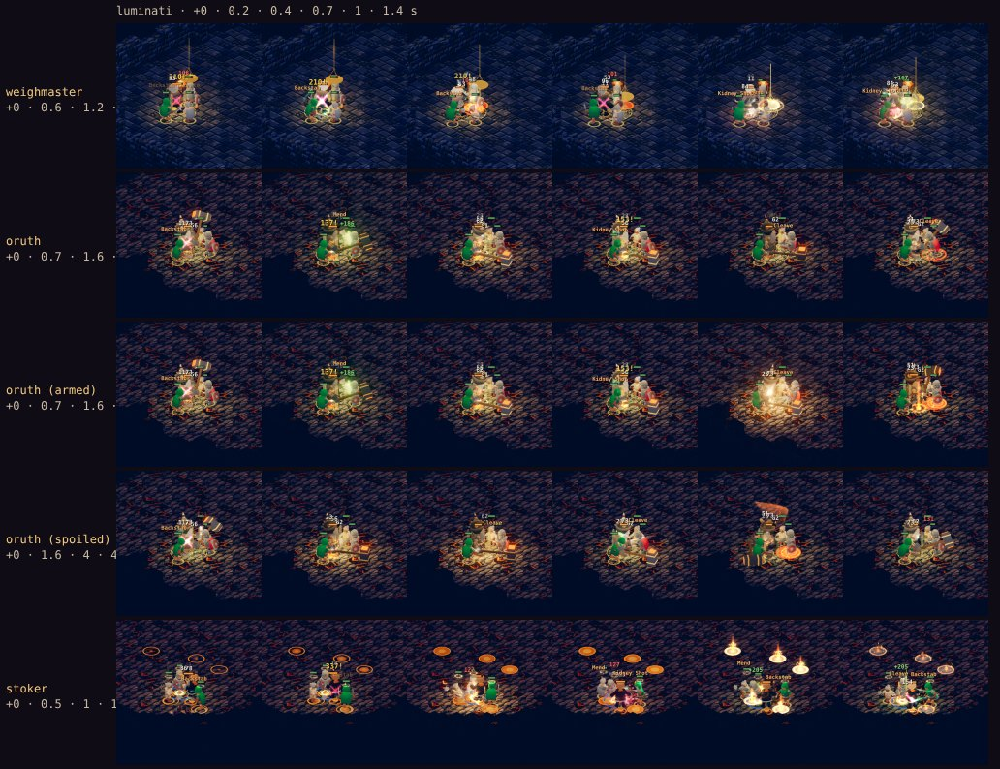
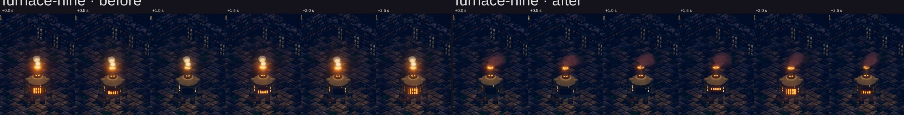

# Art critic pass: the Cinder Reach's effects and its two gaps

The owner's four asks for Act III, after [art-critic-pass-reach-cast.md](./art-critic-pass-reach-cast.md) and
[art-critic-pass-reach.md](./art-critic-pass-reach.md):

- **A. Oruth's anvil.** His mechanic was a banner and his hammer's sparks.
- **B. The Weighmaster's pan.** His weighing was the generic red tell.
- **C. Furnace Nine's smoke.** It was solid geometry carried round with its head.
- **D. Two art gaps.** The Reach's camps pitched the Vale's canvas, and the Reach's new kit pieces had no baked cards.

Nothing in the sim changed. Every look reads events and state the sim already had:

- `bossForge`, `bossAnvil`, `bossScales`, `tellLand` and `battle.tells`.
- Light goes through `fx.js`'s primitives (`skillfx.js` moments), as the boss pass's do.
- 3D goes through Luminati's own particle bursts and one pooled mesh (`tools/render3d/world.js`).

## What changed

### A. Oruth at his anvil (`skillfx.js` `boss_forge`, `boss_arm`, `boss_spoil`; `renderer.js` `forgeBeat`)

The work is drawn for the event's whole `t` (`ANVIL_T`, 4 s). It is followed while he stands and ends early when
`bossAnvil` comes (`sfx.end`). The anvil stands in front of him (`FORGE_AT`: 0.7, 0.5 tiles toward the camera).

**While he forges:**
- The forge's glow lies on the floor and up his front.
- The anvil is drawn in its heat: its face, horn, heel and waist.
- The piece on it is white-hot, cooling between blows.
- A blow lands every 0.6 s from 0.35 s (`FORGE_BEAT`). Each blow:
  - a flash;
  - twelve sparks thrown up off the face and falling;
  - a moment of the room lit (`blast`, 0.28 s at 0.85);
  - Luminati's own streak sparks (`emberForgeSparks`, a burst of 12).
- Heat rises off the piece.

**When the work ends, one of two things:**
- **Armed.** A streak of heat runs to the risen wight. At the wight:
  - a column of forge-fire, flames at its feet and a ring;
  - its new blade's glint;
  - sparks, and a column of Luminati's sparks (`emberArmSparks`, 22);
  - a light on the room.
- **Spoiled.** A dull red crack comes off the anvil, then a puff of smoke rises, caught in the forge's dying glow
  (light can't darken). Luminati adds its own grey smoke (`emberSpoilSmoke`, 16) and the piece's embers falling dead
  (`emberSpoilEmbers`, 8).

### B. The Weighmaster's pan (`world.js` tells `scales`, `panMesh`; `skillfx.js` `boss_scales`, `boss_pan`)

The red tell stays, since red means "get out" in every fight. Over it:

- **The pan.** A brass scale-pan on three chains to a ring, the chain going up out of sight. It hangs 2.8 units over
  the one weighed and comes down through the 2.2 s wind (`1 − p³`: slow, then a drop). It lands as the tell lands,
  rests 0.2 s, then is hauled back up.
  - It is one merged mesh, 704 triangles, pooled.
  - It casts a shadow that closes on its mark.
  - Its brass glints as it comes and flashes on landing.
- **A brass ring** inside the red, the pan's footprint.
- **As he weighs:** a brass glint over him, a thread of brass to the one weighed, and a balance's beam tipping over
  their head.
- **As it lands:** a brass flash off the rim, a ring out over the floor, dust, and the Toadking's stamp jolt.

**The Stoker's vents**, the cheap extra the owner offered:
- Their circle glows slag-orange with a hotter heart that beats, not the Kingstone's red.
- As each lets go: a spurt of slag, a ring, gobs falling back, and Luminati's slag streaks and a breath of smoke.

### C. Furnace Nine's smoke (`creatures.js` `furnace`; `world.js` `puffStack`)

The two solid grey blobs are gone (`smoke: true` in the creature spec puts them back for a still card). The figure
stays the same size: its size is fitted to its box (`figure.js` `fitPpu`), so a zero-area triangle keeps the old
top. The stack now breathes:

- **Where.** The emitter is the stack's lip: the highest vertex of its fire, skinned each frame
  (`applyBoneTransform`), so it follows the clips.
- **Smoke.** One lit smoke particle every 0.14 s (`emberStackSmoke`: soot grey, 3.6 to 5.2 s, swelling ×4). Each is
  a burst left where it was let go, to rise, swell and go with the wind. An emitter's particles would follow it
  rigidly instead.
- **Sparks.** One every fifth puff.
- **Pools.** Both share pools Luminati already has, so there is no new program:
  - the smoke shares `deathPoof`'s pool (smoke, normal blending, lit);
  - the sparks share `hitSpark`'s pool (a streak, additive).

### D1. The Reach's tents (`gsprite.js` `voxTent(canvas, trim)`, `tent_reach`; `palette.js` `ash`, `soot`; `convert.js`)

On the Reach's overland a camp's tent is `tent_reach`: the same bell tent in canvas gone grey with ash, its hem and
pole soot-black. It is the renegades' camp's tent; the haulers pitch none. Its colour spread (mean max − min of its
channels) is under 0.6 of the Vale's (`test/reachfx.test.mjs`).

### D2. The Reach's kit cards (`town.json` reach_*; `bake-env.cjs --sets`, `nofoot`)

The nine pieces now live in `town.json`'s `reach` set:

- `reach_gatewheel`, `reach_stack`, `reach_works`, `reach_pithead`;
- `reach_assayhouse`, `reach_forgedoor`, `reach_ninthdoor`, `reach_vaultmouth`, `reach_slagheap`.

Before, they were a list in `world.js` with no card. Now they are baked into `assets/env/town-reach` (2048 × 624 →
2048 × 823). `world.js` takes them for 3D from `town.json`, as every other kit piece.

**What `?landmarks=sprites` and `doors` show:**
- `?landmarks=sprites` shows their cards where it showed nothing.
- `?landmarks=doors` shows them too, as cards (it skips them in 3D).

**Footprints are unchanged.** They are marked `nofoot`, so the bake writes no footprint for them: they stand on the
sim's own gatehouse, smithy, mine and ruins. `src/sim/envfoot.js` is byte-for-byte the same.

**The bake:**
- `bake-env.cjs --sets town-reach` baked that atlas alone (3.7 s). The other atlases' footprints are read back from
  their JSON.
- The 28 cards already there kept their size, origin, footprint, top and glow exactly (checked field by field).

## Measured

**Furnace Nine alone on the Stage** (`tools/capture/furnace-smoke.mjs`, median of 30 frames, counted at the WebGL
context, every pass):

| | draws, frame | triangles, frame | its share: draws | its share: triangles |
|---|---|---|---|---|
| before (solid smoke) | 89 | 227 068 | 4 | 9 448 |
| after (drifting smoke) | 91 | 226 196 | 6 | 8 576 |

What the numbers mean:
- **Triangles.** The blobs' triangles in every pass are gone (−872 a frame). About 35 live smoke quads and a few
  sparks take their place.
- **Draws.** +2: the two burst pools, one instanced draw each.
- **Size.** The furnace's size is unchanged (its box, and so its pixels a unit).

**The pan:** 704 triangles, one draw and its shadow, only while a weighing is under way (2.2 s in every 11 s).

**The bosses** (`tools/capture/bosses.mjs --dpr 2`, the same seed and party on both checkouts, so the frames line
up):

| | event | time | level | outcome |
|---|---|---|---|---|
| Weighmaster | `bossScales` | 12.7 s | 24 | |
| Oruth | `bossForge` | 19.7 s | 27 | spoiled (the party strikes him past 5 %) |
| Oruth (armed) | `bossForge` | 19.7 s | 27 | a wight armed (health held while he works) |
| Oruth (spoiled) | `bossForge` | 19.7 s | 27 | spoiled (struck past the mark at 2 s) |
| Stoker | `bossVents` | 11.7 s | 30 | |

**Checks:**
- `npm run check`: typecheck, lint, content, 707 node tests (`test/reachfx.test.mjs` new), SMOKE_OK and
  RENDER_SMOKE_OK.
- The vendor was rebuilt (`node tools/render3d/build.mjs`). Only `luminati.js`, `BUILD.txt` and `version.json` moved.

## Rounds

**The pan.**
- It reads as brass at play size: the dish and its rim, with the chain up out of frame telling where it hangs.
- In the Weighmaster's melee it hangs over the knot of the party, clear of the figures until it lands.
- At 1.7 tiles it is the tell's size exactly (the tell's own radius, halved into units: what's drawn is what's hit).

**Oruth.**
- Round 1's spoiled smoke was dark grey (`#2a2422`) and its 2D glow faint: on the Forgehall's char floor it didn't
  read.
- Round 2: the grey was lifted (`#4e4641` → `#76716c`), the glow raised (0.34 → 0.5, gain 0.9 → 1.2) and the crack
  widened. Now a brown-grey puff rises off him at +0.3 s.

**Furnace Nine.**
- Round 1's soot (`#2e2926`) was black on the Stage's dark floor, invisible.
- Round 2 (`#6e5e54`) turned pink under the room's violet fill.
- Round 3 (`#5c5753` → `#7a7876`, the shipped colour) reads as a grey plume leaning off the stack.

Its own fight is outdoors at the Vault's mouth, where Luminati's wind takes it (`windInfluence` 0.55). That can't be
staged from a fresh slot: the window opens only once the Stoker's lamp is broken.

## Not done

- **The furnace's baked atlas** (`assets/actors/boss_furnace_nine`: `?figures=sprites`, its portrait and
  character-window figure) still has its smoke blobs. A still card's smoke can't drift. A re-bake would drop them;
  put `smoke: true` in its creature spec first if the card should keep them.
- **Furnace Nine outdoors** is not captured. See the last round.
