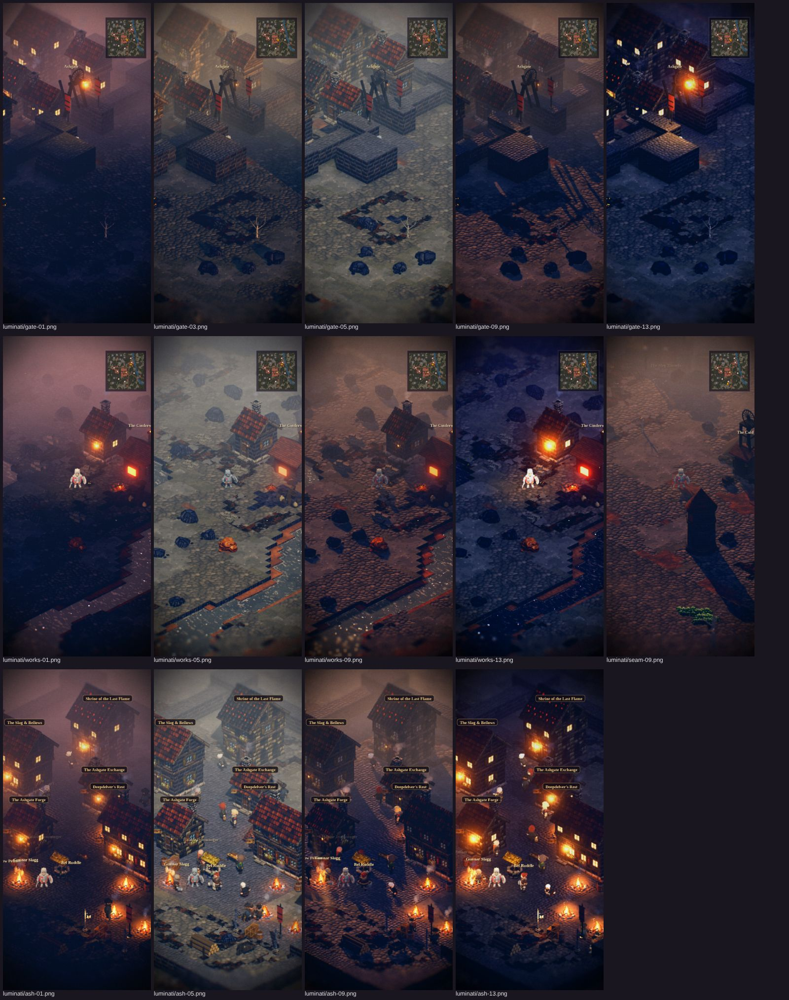

# Art critic pass: the Cinder Reach

**Implemented** (2026-11-16): `src/render3d/convert.js` (the `ash` biome, the Reach's legend, its houses, works and
dungeon looks), `tools/render3d/world.js` (the Reach's textures, sky, grade, water, outer ground, dust and its kit
pieces) and the rebuilt `src/vendor/luminati-80e1aa6/`, `tools/actor-lab/buildkit.js` (the gate wheel, the stack, the
furnace hall, the pithead), `src/render3d/hybrid.js` (the Reach's brightness by the hour), `test/render3d.test.mjs`.

The owner, on the Reach plan ([reach-plan.md](./reach-plan.md)): *"Be sure to dress the overworld and dungeons to the
theme, run critic passes in the area."* The canon is [emberfall-world.md](./emberfall-world.md) §3.3:

> Black hills of slag west of the capital, and the imperial foundries in them. Someone has lit the furnaces again.

Ashgate is a hard mining town, walled in black slag brick, with a pithead wheel over its gate. The open ground is
ash-dusted scrub, cracked earth and red rock. There is the Ashwater, the Cinderworks' stacks among slag heaps, rust-red
tailings ponds, and a dead volcano over Kell's Rest.

## How it was measured

- **Shots at the game's camera, on a phone's frame** (390 × 844, DPR 1, `?dev&manual&world=on`, the hero placed at each
  place, 160 frames settled). The places: Ashgate's gate, the Cinderworks, the tailings, the Cold Seam, Kell's Rest,
  Ashgate's square. Each was shot by day, by dusk and by night, through the Cold Seam's two floors, and in a Fens
  dungeon for comparison. **Before** is the lead's set from this morning and a `git archive HEAD` copy served beside the
  working tree.
- **Mean luminance, saturation and colour** of the world band: y 70–540 and x 0–330, under the top bar, over the
  cards, and clear of the buttons.
- **Draws and triangles a frame**, counted at the WebGL context (every pass, shadows and post included; figperf.mjs's
  counter), averaged over four frames at each shot.
- **The textures** were painted headless (Luminati's `TextureLibrary` under node) into swatch sheets before they went in.

Six rounds of shots in all: before, round 1, then four more. The critique below is ranked.

## Before: what was wrong (ranked)

1. **The ground was the Sahara.** The Reach drew in Luminati's `desert` biome: arid dirt, dry grass, cracked earth and
   red sand, all orange-yellow. The world band's mean colour was rgb 174,134,90 at the Cinderworks, saturation 0.48.
   Nothing said slag, ash or char.
2. **Every building was the same blue-slate cottage.** That covered Ashgate's square, Kell's Rest, the Assay Yards, and
   the Cinderworks as two cottages.
   - **Why the kit's `reach` style never showed:** convert.js sends every house-like piece (`_house_`, `_smith_`,
     `_tavern_` …) to Luminati's own house builder (`HOUSES`, `REGION_LOOK.reach`: stone brick and blue slate). It
     raises the walls, towers and gatehouses as stone terrain. The buildkit's `reach` pieces (town.json) are only ever
     the baked cards, and those show under `?landmarks=sprites` alone.
   - **The Cinderworks' "stacks"** were two `reach_tower_1` raised as 4 × 4-tile blocks.
   - **The Cold Seam was the Vale's mine**, `mine_0`: a mossy green outcrop.
   - **There was no wheel over the gate.**
3. **The Ashwater was a clear mountain blue,** Luminati's default water.
4. **The plants were wrong for the place.** Junipers stood green, rocks were orange `redrock` boulders, and the hills
   were red rock.
5. **Nothing was alive.** There was no smoke, no glow, no ash in the air. By night the Cinderworks was a blue scene
   (luminance 39, rgb 39,37,56).
6. **Dusk went deep red.** The tailings shot was rgb 107,37,49 at saturation 0.67, and the pond read purple. Ashgate's
   square at dusk was rgb 85,38,56.

## What changed

### The ground: the `ash` biome (convert.js `BIOMES.ash`, `BIOME_OF.reach`)

- **The open ground** is laid in broad patches of smooth value noise, not tile by tile. The patches run in order of
  value, light to dark: ash, scrub, cracked dark earth, char, cracked earth again, basalt. Each patch meets the next a
  step darker.
- **The scree patches** (`G.SCREE`) are cracked earth with iron-dark red rock in a third of them.
- **Roads** are cracked dark earth. The town's cobbles are charcoal. Banks are rust-stained mud.
- **The hills** are basalt, with basalt cliff sides.
- **Trees** are all dead wood.
- **Rocks** are black, and red only where the ground is red rock.
- **Six textures of our own** are registered in world.js and painted when a level names them:
  - `slag_brick`: black glassy brick in ash-grey mortar, with rust weeping and flecks of slag glass;
  - `roof_rust`: rust tile under soot;
  - `cinder_earth`, `cinder_cobble`, `rust_rock`, `ash_scrub` and `ash_drift`: Luminati's cracked earth, cobblestone,
    red rock, dry grass and ash repainted. Their relief is kept and their colour runs through a ramp by luminance.
- **Luminati's arid climate stays.** It brings its set-piece kit, the `ash`, `scorched` and `basalt` textures and the
  dust. Its sky, water, outer ground and dust are graded per level (below).

### Buildings and works

- **Ashgate's houses** (`REGION_LOOK.reach`) are slag brick under rust tile. One roof in four has gone to soot
  (`roof_charred`, its faint ember cracks). Some two-storey houses have a dark timber upper storey. The shrine and the
  forge are in soot-black stone (`charred_wall`).
- **The walls and towers** are raised in slag brick, topped with charcoal cobbles.
- **Four kit pieces of our own** (buildkit.js) stand in 3D on the sim's own footprints. They are registered in
  world.js `KIT`, not town.json, so no card is baked and `envfoot.js` is unchanged.
  - **`gatewheel`:** the pithead wheel over Ashgate's gate. A timber A-frame stands on the gatehouse's two towers, with
    the iron wheel over the way in, its rope, and a lantern. It shows in both the town and the overland.
  - **`stack`:** a furnace stack, 9.3 units high. It has a slag-brick plinth, a square taper with three iron bands, and
    the fire showing in its mouth and stoke-hole. Three stand: the Cinderworks' two and Furnace Nine's over the Magma
    Vault. Each has heavy soot smoke and sparks from its lip, and a nightly glow on every other stack.
  - **`works`:** the Cinderworks' furnace hall, in place of the smithy at `REACH.works`. A slag-brick hall under rust
    tile is open to its yard, where the furnace's mouth glows. It has its own stack, smoking, coal and an anvil, and an
    ember bed burning in the yard with its light.
  - **`pithead`:** the Cold Seam, in place of `mine_0`. A timber headframe over the shaft has the winding wheel at its
    top. Beside it stands the engine house, with its stack and a rope to the wheel. Black spoil is heaped behind. The
    shaft-house door is on +z, where the Vale mine's adit was. Rails and an ore cart run out of it.
- **The dead beacon towers** on the roads (round 2) are the kit's drum tower stood on the ground, not a raised slab.
- **Ember vents:** up to 24 small ember beds smoulder in the char, out in the open and off the roads. A third of them
  smoke. None has a light of its own.

### Air, water and light (world.js)

- **`ASH_KEYFRAMES`:** Luminati's arid 24 hours, greyed toward ash.
  - The sky is grey, its horizon a dirty ochre.
  - The sun is a little weaker and whiter.
  - The air is thicker: 1.1 × the arid fog.
  - At dusk the sun is a smoky amber, not `#ff7040`, and the shade is grey, not violet.
  - By night the fill and the moon are slate, not the arid sky's saturated blue.
- **`REACH_GRADE`:** saturation 0.86, contrast 1.05.
- **Brightness:** the Reach's exposure follows the game's brightness by the hour (`gradeByHour`). Before, only the
  Vale's did. `hybrid.js` `REACH_BRIGHT`: on the overland dusk ×1.08 and night ×2.3; in the town dusk ×1.05 and night
  ×1.35.
- **The Ashwater is murky.** Rust silt in the shallows, slate in the deep, the crests and foam grey-brown.
- **The land past the map's edge** is cracked dark earth, not orange dirt.
- **The camera's dust motes** are ash grey, not the desert's gold.

### Dungeons (convert.js `KIT_LOOK`, `THEME_LOOK`, `AMB_TINT`)

| Kit / theme | Floor | Walls | Fill |
|---|---|---|---|
| `pithead` (the Cold Seam, floor 1) | packed earth, rock | the Deepdelvers' cut stone (`W`); dug rooms raw earth | warm lamplight |
| `warren` (floor 2; also the Scrag Warren's theme) | dirt, cracked dark earth | raw earth | warm |
| `ember` (the Cinderworks) | rock, char | slag brick | hot |
| `lava` (the Magma Vault) | rock, basalt | basalt | hotter |

Before, the Cold Seam fell to `THEME_LOOK.cave`, the Wickham cellar's mossy stone.

## The rounds

### Round 1

The `desert` biome was swapped for `ash`, with the houses, the four kit pieces, the sky, the water and the dust.

**Critique:**
- The idea read at once: a soot-dark land with rust roofs and a wheel on the gate.
- Two things were the loudest in the frame:
  - Luminati's red rock, orange and in blocky mosaics, in the scree patches;
  - its dry grass, bright yellow.
- The turf was chosen tile by tile with jitter, so white ash and black char met in a checkerboard.
- A road's beacon tower was a black 4 × 4 slab in front of the Cold Seam.
- Dusk was still red. Night was a saturated blue (luminance 23, saturation 0.78).

### Round 2

- `rust_rock` and `ash_scrub` (repainted dark).
- The red rock cut to a third of the scree, and rocks red only on it.
- The noise lattice widened, the jitter cut, and the patches set in order of value.
- Beacons became the kit's drum tower.
- The dusk sun amber, the night fill toward slate.

**Critique:**
- The ground is a land now: cracked dark earth, ash drifts, rust banks along a grey Ashwater. The hero reads on all of
  it (silver and red on charcoal).
- The tailings at dusk are a warm grey-brown (rgb 65,52,60), not red.
- Still wrong:
  - The ash drifts, near white, read as pale tiles.
  - The top of a day frame was milky with fog.
  - Night was still blue and dark (23).

### Round 3

- The fog 1.25 → 1.1.
- The night moon greyer.
- `REACH_BRIGHT`.
- The pithead's look.

**Critique:**
- The brightness did nothing, because world.js only applied the game's brightness on the Vale's grade. Fixed:
  `gradedReach`.
- The pithead in cinder earth under basalt walls went to black underground: luminance 15, rgb 8,15,38, its floor lost.
  Underground's dim violet fill needs mid-value stone, so the floor is now packed earth and rock and the walls cut
  stone (26, rgb 28,24,40, warm under its lanterns).

### Round 4

- `ash_drift`: the ash a step darker.
- Night 1.6 → 2.3 on the overland.

**Critique:**
- The ash patches blend now, with no mosaic.
- The day sits at 79–88, a little over the Vale's 75: the Reach is dark ground under a pale sky.
- The Cinderworks by night is 37 (the Vale overland's 48, the owner's 40), its furnace mouth and stacks the brightest
  things in the frame.

## Measured

**The world band:**

| Shot | Before: lum / sat / rgb | After: lum / sat / rgb |
|---|---|---|
| Ashgate's gate, day | 122 / 0.38 / 141,119,98 | 79 / 0.23 / 77,79,86 |
| The Cinderworks, day | 139 / 0.48 / 174,134,90 | 88 / 0.17 / 93,86,88 |
| The Cold Seam, day | 136 / 0.41 / 165,131,95 | 87 / 0.17 / 88,87,89 |
| Ashgate's square, day | 118 / 0.31 / 129,116,102 | 72 / 0.33 / 74,71,78 |
| The tailings, dusk | 53 / 0.67 / 107,37,49 | 53 / 0.40 / 62,49,58 |
| Ashgate's square, dusk | 50 / 0.62 / 85,38,56 | 47 / 0.44 / 56,44,52 |
| The Cinderworks, night | 39 / 0.53 / 39,37,56 | 37 / 0.64 / 49,32,50 |
| The Cold Seam's pithead, underground | (round 3) 15 / 0.93 / 8,15,38 | 26 / 0.70 / 28,24,40 |

**Draws and triangles a frame:** the phone budget, against the Fens (counted at the context).

| Shot | Before | After |
|---|---|---|
| Ashgate's gate | 240 / 454 k | 224 / 427 k |
| The Cinderworks | 161 / 711 k | 207 / 602 k |
| The Cinderworks, night | 176 / 725 k | 222 / 623 k |
| Ashgate's square (day / dusk) | 279 / 510 k | 400 / 602 k (dusk 417 / 597 k) |
| The Cold Seam's pithead (floor 1) | — | 136 / 289 k |
| *The Fens' overland* | *297 / 808 k* | |
| *Saltmere's square* | *493 / 622 k* | |

- **The Cinderworks** gains 46 draws: three stacks, the hall, their smoke and sparks, the vents. Its triangles fall, as
  the junipers and boulders go.
- **Ashgate's square** varies with who is in the square at the moment shot: 276 / 494 k in round 1's daytime shot, 400
  in the final one. It stays under Saltmere's 493.
- No Reach shot is over the Fens' numbers.

## Not done, and asked of others

- **The sim's Ashgate town scene** is the generic town's outskirts: oaks, groves, a farm, sheep, hens, wheat,
  pumpkins, hay.
  - The trees draw as dead wood. Wheat and pumpkins are not drawn in the Reach.
  - The farm, the sheep, the hens and the haystacks remain. They are the lead's (`outdoor.js`).
- **`buildReach`** could name its stacks (`reach_stack_N`): convert.js already takes any `_stack_` id as a stack. Today
  they are found as towers within 16 tiles of `REACH.works` or `REACH.vault`. It could also give the works more slag
  heaps. These are listed in the report to the lead.
- **No baked cards** for the four new pieces: `?landmarks=sprites` leaves them out.
- **The Fens' dungeons are unstyled.** Their kits (`mound`, `locks`, `vats`, `abbey`) and themes (`mire`, `sluice`,
  `water`, `poison`) have no `KIT_LOOK` or `THEME_LOOK`. Every Fens floor draws in `DEFAULT_LOOK`: stone tiles with a
  moss scatter, `moss_stone` / cliff walls, hour 19.4. Only the ambient fill differs, through palette.js `KIT_TINT`.
  Confirmed in play (the Canal Locks, above). Not fixed here.
- **Night** is still a slate-blue scene with orange points, as every land's is.

## Round 5: the light by the hour (the owner, from the phone)

> "Cinder reach is too dark at dawn.. check other times too"

The rounds before measured each part of the day at its middle only, and two of their gate shots were taken during the
fade-in after a trip (the arrival banner over a dimmed frame). Measured again across the whole day, sixteen points from
dawn breaking, after another shot on the same land (tools/capture/rig.mjs, `tod` 0 … 15⁄16, world-band luminance):
the open land outside Ashgate's gate sat at 24–28 through dawn and 10–18 from dusk to the small hours, against the
Vale's 39–68 and 42–53. Two causes: the ground's ramps were near charcoal (the cinder earth's lightest #6c5f53, most of
it #2x–#3x, a third of the Vale's grass), and the hour's brightness lifted only the Reach's night.

- **The ground lifted toward a mid ash** (world.js `LIFT`: ×1.55 and a fifth of the way to #8e877c), the slag brick left
  dark so the town still stands black on it; the sun and the ground's bounce less taken away in the ash sky.
- **The hour's brightness** (hybrid.js `REACH_BRIGHT`, dawn · day · dusk · night): overland 1 · 1 · 1.08 · 2.3 →
  1.2 · 0.68 · 1.12 · 2.6 (noon 0.78 → 0.68 after the Cold Seam's shots: the open ash went milky at 100; now 65–92); Ashgate 1 · 1 · 1.05 · 1.35 → 1.2 · 0.9 · 1.25 · 1.35.

| sample (of 16) | 0 dawn breaking | 2 | 5 noon | 9 dusk | 13 night |
|---|---|---|---|---|---|
| the Vale | 39 | 63 | 84 | 53 | 48 |
| outside Ashgate's gate | 31 | 60 | 76 | 41 | 35 |
| the Cinderworks | 39 | 76 | 95 | 62 | 44 |
| the Cold Seam's pithead | 32 | 77 | 100 | 66 | 37 |
| Ashgate's square | 47 | 67 | 84 | 50 | 49 |

