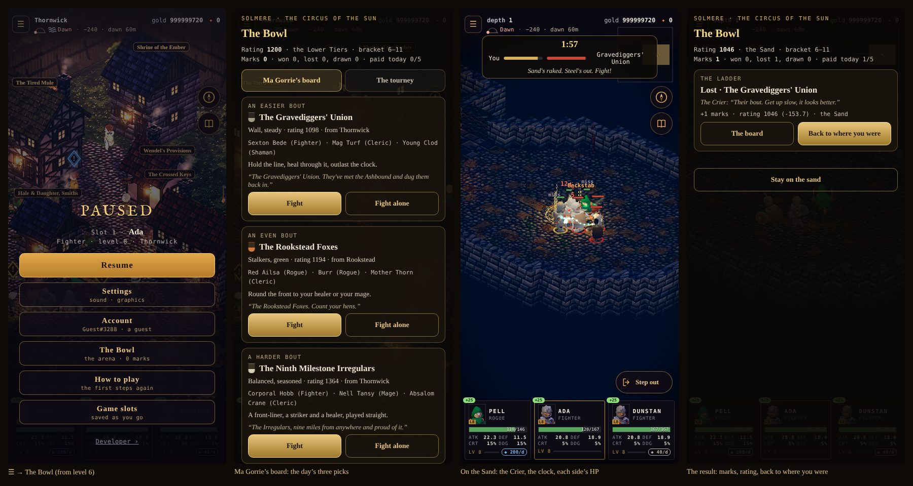
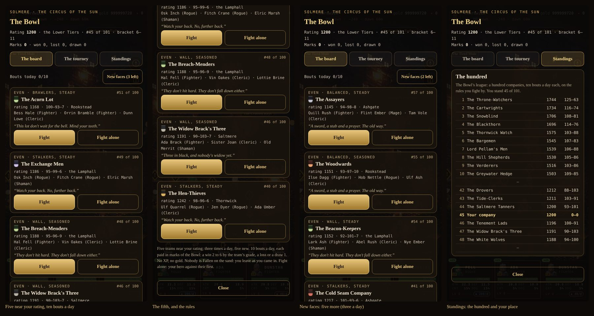
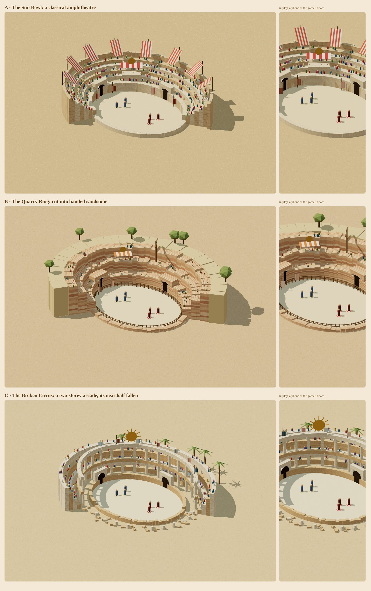

# The Bowl: an arena and tournaments (a proposal)

**Status: Implemented in part (2026-11-13; GDD v1.85–v1.86, §10–§11 below).** The owner's decisions are in §9; what's built and
how it measured is §10. Built: the bout (one brain for both sides), the Sand, the written roster and its generator, the
ladder and marks, the day's tourney, the hero alone; not yet: watching a rival bout, the dressing (crowd, bell), online.

**Proposal (2026-11-13).** The owner: *"Design a pvp arena and tournament system.. for now using generated
player groups of various skills and levels.. for now accessible via the menu. Make a proposal and a mockup of the
arena, 1 room."* The mockup: [bowl-arena-mockup.html](./bowl-arena-mockup.html) (the room, and the screens round it).

It builds on canon that's already written:

| Source | What it already says |
|---|---|
| World doc §3.9, §12 | **The Bowl**, the imperial *Circus of the Sun* in Solmere, half its tiers fallen in, run by **Ma Gorrie** (who takes the bets), with **the Crier**, an Ashbound herald who still calls the bouts. It pays **marks of the Bowl**, for a heirloom shop defined later. |
| World-map proposal §4.1 | Async company against company first, live later. Server-picked opponents, one try a pairing a day, levels evened by bracket, crowd control halved against companies, and **written rival companies** offline (*the Widow Brack's Three*, *the Coalbrook Boys*, *Hesk's Cousins*). |
| Development plan §2.12 | Phase A, the **Async Arena** (your party against a snapshot party, validated, with a rating). Phase D, the **Live Arena** (seasons, Glicko-2). |
| Architecture §8 | An `arena_snapshots` table; the validator replays an arena match like any claim. |

This proposal makes that concrete: one room, the rules of a bout, the generated companies, a ladder and a tournament,
reached from the menu now and from Solmere when Solmere is built. It is built so that real players' companies drop in
later through the same code.

---

## 1. What the player does

1. **☰ → The Bowl.** For now, from anywhere, in or out of a dungeon (the fight under the menu waits until you go). Ma
   Gorrie's board: your company's rating and tier, your marks, today's paid bouts (2 of 5), and three rival companies
   to pick from: one easier, one even, one harder.
2. **Scout a rival:** their name and banner, their manner (how they fight), three members with class and level, their
   rating, and Ma Gorrie's odds. Set your stance and loadout as you would before a dungeon.
3. **Into the Sand.** The coach takes you to the Bowl (a short card, no travel time). Your company comes in at the
   near gate, theirs at the far one. The Crier calls the bout. It's the autobattle you know, against a company that
   fights by the same rules: tap a rival to focus your party on them, steer your hero with the stick.
4. **The Crier calls it:** a company standing, or the better-standing one at the time limit. Marks, rating, the
   Crier's line, then **Back to where you were** (the menu door returns you exactly there).
5. **Once a week, the Feast-day Tourney:** eight companies, three rounds, seeded by rating, a purse of marks by the
   round you reach and a banner on your company card for the week.

## 2. The room: the Sand

One room, the canon's half-fallen circus, built to the level-design rules (`docs/level-design-rules.md`).

- **The floor:** an oval of raked sand, **44 × 34 tiles**: a large room (40–62 across, the contract's arena size).
  The middle is open. Nothing stands in the sand but two old stains and the companies' marks (two scuffed lines, 16
  tiles apart).
- **The ring wall:** knee-high on the near side (the camera looks from the south-east: §4.1, a wall with floor
  up-screen of it is cut low), full height on the far side, so the whole floor reads.
- **The tiers:** stepped seating behind the far wall, four tiers rising, **the crowd** on them as cards (cheap: two
  draws, a sway). The near-east tiers are fallen in (canon: half the tiers): a slope of rubble, a broken arch.
- **The Sun's Box:** at the far wall's middle, a canopied stand under a gilt sun-disc. Ma Gorrie sits there with her
  slate, and **the Crier** stands at its rail, an Ashbound herald with a bell. His bell rings each bout in and out.
- **Two gates:** **the Sun Gate** at the far end (the rival's: they come in facing the camera, so you see who you're
  fighting) and **the Dust Gate** at the near end (yours). Each is a portcullis arch; theirs flies their banner.
- **Light:** eight braziers on the ring wall, two banners of the sun on the far wall between them. Dusk is the
  Bowl's hour (feast-day bouts are lit), so the dusky palette holds.
- **The kit:** `tools/actor-lab/buildkit.js` already has arches, portcullis and stone. New pieces: tier blocks (a
  stepped run), the Sun's Box (canopy, rail, disc) and the crowd cards. Built as an authored plan (`plans.js`: one
  `round` space, the oval), so the room is the same every bout.

## 3. A bout: the rules

| Rule | What it is | Why |
|---|---|---|
| **Sides** | Your company as fielded (the hero and up to two) against a rival company of three | The party is the strategy (GDD pillar 6) |
| **Levels evened** | Both companies fight at their **bracket's top** level. Gear stays as it is | Canon. Your build and kit decide it, not a grind |
| **Brackets** (for now) | 1–5, 6–11, 12–14, then canon's 15–29, 30–44, 45–59, 60–75 (`tower.js` `BRACKETS` above 12) | Reached from the menu at any level, so the low ones are needed until Solmere gates it at 15 |
| **Start** | Full HP and MP. The Crier's call (3 s); both companies at their marks, 16 tiles apart | A clean start, nothing carried in |
| **Your hands** | Focus (tap a rival), steering, stance and loadout set before. Skills autocast as anywhere | The same controls as every fight |
| **Their hands** | The same member AI as your companions, turned round, its targeting by their **manner** (§4) | One brain for both sides: fair, and less code |
| **Crowd control** | Lasts **half as long** on a company's member | Canon. Stuns that win a room would win every bout |
| **Healing** | Healing received **× 0.75** | Two healers otherwise never lose (to be measured: §7) |
| **Shrine boons** | Not carried in | A bout is the company, not the floor they came from |
| **End** | A company with nobody standing loses. At **2:00** the Crier calls it: the higher share of its whole HP standing wins (a draw within 2 %) | Bouts stay short: about a minute |
| **Safe** | Down in the Bowl is down, **never Fallen**: no temple, no Weakened, no cost | The Bowl is sport. Losing costs rating, not gold |
| **Pays** | **Marks of the Bowl** only (no XP, no gold drops), the first 5 bouts a day. More are allowed, unpaid | Like the Mere Tower: it doesn't compete with the bands. The cap stops farming |

## 4. The rival companies (generated, for now)

**Text is authored; strength is rolled.** The rules forbid runtime text, so every company's **name, banner, manner and
the Crier's lines** come from an authored roster, `content/arena/companies.json` (schema-checked like the rest). The
generator assigns only numbers, from a seed: who fills which bracket, their levels, gear, build and skill.

- **The roster:** about 40 companies to start, canon's three among them, each with a banner (two colours and a
  charge), a manner, a home (Saltmere, Ashgate, the Lamphall…) and two lines for the Crier, one as they come in and
  one when they fall. For example:
  - *the Widow Brack's Three* (Wall: a fighter and two clerics; "Three in black, and nobody's widow yet").
  - *the Coalbrook Boys* (Brawlers: three in front; "The Boys from the pits. Mind your shins").
  - *Hesk's Cousins* (Stalkers: rogues and a bow; "Cousins of the Admiral, they tell me. I wouldn't ask").
  - *the Lantern Lads*, *Mabry's Mudlarks*, *the Ninth Milestone Irregulars*, *Sister Orla's Penitents*, and so on.
- **A manner** is how a company fights. It sets their make-up and their AI's priorities:

  | Manner | Make-up | What its AI favours |
  |---|---|---|
  | **Brawlers** | two or three front-liners | Close fast, hit the nearest |
  | **Stalkers** | rogues and a bow | Go round the front to your healer or mage |
  | **Wall** | a fighter and two healers | Hold the line, heal through, outlast the clock |
  | **Spellbinders** | mages and a shaman | Crowd control first, then burst |
  | **Balanced** | a front-liner, a striker, a healer | The right party, played straight |

- **Skill** is five grades of how well a company is built and played. It's what "players of various skills" means
  until there are players:

  | Grade | Gear (against its level) | Build | Play |
  |---|---|---|---|
  | **Green** | Common, 3–5 levels old, no upgrades | Attributes scattered, a random four skills | Hits the nearest; spends MP on cooldown |
  | **Steady** | Fine at level | Attributes to its class, a sensible four | Focuses the hurt |
  | **Seasoned** | Fine or Rare at level, +1 to +2 | Class-true, perks to match | Its manner's priorities, interrupts sometimes |
  | **Hardened** | Rare at level, +3 | Tuned to its manner | Saves its big skills for a cluster, interrupts |
  | **Champion** | Rare and Heirloom, +4 | Best in slot for its manner | Everything above, kites, swaps focus to a low healer |

- **Rating:** each generated company carries one (grade × bracket, with a seeded spread), so the board can offer one
  easier, one even and one harder. Your own rating is **Glicko-2** (as the dev plan names), starting at 1200.
- **Deterministic:** a company's numbers come from `streamSeed(weekSeed, bracket, companyId)`. Everyone sees the same
  field in a week (a fair board later), and the server can rebuild any bout from its seeds and your commands.

## 5. The ladder and the tourney

**The ladder** is Ma Gorrie's board, one a bracket:

- **Tiers by rating**, named for where the Bowl sits you:

  | Tier | Rating |
  |---|---|
  | **Sweepers** | under 1000 |
  | **the Sand** | 1000–1199 |
  | **the Lower Tiers** | 1200–1399 |
  | **the Upper Tiers** | 1400–1599 |
  | **the Sun's Box** | 1600 and up |

- **Three picks a day:** easier, even, harder, by rating. A beaten pick is replaced; one try a pairing a day (canon).
- **Marks:** a win pays by the rival's grade (Green 2, Steady 3, Seasoned 4, Hardened 5, Champion 6), a loss pays 1.
  The first five bouts a day pay.

**The Feast-day Tourney** is weekly, as canon's feast-days fill the Bowl:

- **Eight companies,** single elimination, three rounds: you and the seven nearest your rating in your bracket. It's
  seeded, so the favourite meets the outsider first.
- **Entry:** free once a week. Your company is locked for the tourney, but stance and loadout may change between rounds.
  Full HP between rounds.
- **The other bouts** are fought by the same sim, headless and deterministic. You can **watch** one (the room with
  two rival companies in it) or skip it.
- **Purse:**

  | Round reached | Marks |
  |---|---|
  | Quarter-final | 3 |
  | Semi-final | 6 |
  | Final | 10 |
  | Champion | 16 |

  The **champion's banner** goes on your company card for the week, with the Crier's line for a champion.
- **Later:** a monthly **Grand Tourney** of sixteen, by invitation from the Sun's Box tier, and seasons (dev plan
  Phase D).

## 6. How it's built

| Piece | What | Where |
|---|---|---|
| **One brain, two sides** | The member AI (targeting, skills, movement) takes its allies and foes as arguments, so a rival company runs the same code your companions do. **The biggest piece:** `battle.js` is written party against foes throughout | `src/sim/battle.js`, extracted to `src/sim/brain.js` |
| **The bout** | A scene `bowl`: one authored room, two companies, the rules of §3, events `boutStart`, `boutCall`, `boutEnd` | `src/sim/bowl.js` |
| **The companies** | The authored roster, plus the seeded generator (levels, gear by grade, build, loadout, manner) | `content/arena/companies.json`, `src/sim/rivals.js` |
| **Rating, ladder, tourney** | Glicko-2, the daily picks, the bracket, the purse | `src/sim/bowl.js` |
| **Commands** | `bowlOpen`, `boutStart {rival}`, `tourneyEnter`, `tourneyNext`, `bowlLeave`. Each validated: bracket, daily try, tourney state, not mid-bout | `src/sim/core.js` |
| **Save** | `state.bowl { rating, rd, vol, marks, day, paid, fought[], tourney, record[] }` and where you were (to go back). A version bump | `src/persist/save.js` |
| **Rewards** | Marks come only from a sim rule at a bout's end (fair play, AGENTS.md rule 3). A dev game's bouts count locally and never on a shared board | |
| **The room** | The plan (`plans.js`, one `round` space), its kit (tiers, the Sun's Box, crowd cards, gates), Luminati | `src/sim/plans.js`, `tools/actor-lab/buildkit.js`, `tools/render3d/world.js` |
| **The rivals on screen** | Generated heroes in their own looks (appearance), each with a name plate in their banner's colour | `src/render/renderer.js` |
| **UI** | The Bowl board, scouting card, bout HUD (their cards at the top, yours at the bottom), the result, the tourney bracket. ☰ gets **The Bowl** | `src/ui/bowl.js`, `src/ui/title.js` |
| **Online, later** | The same bout with a snapshot company (`arena_snapshots`, a verified hero's company) in the generated one's place; the validator replays it | Supabase, `sim/replay.js` |

## 7. Measuring it (before it ships)

A harness, `tools/balance/bowl.mjs`: company against company, N seeds, at a bracket's top.

- **Mirror match:** a company against itself, 200 seeds. **50 % ± 3**: neither gate nor side has an edge.
- **Grade ladder:** at equal manner, each grade beats the one under it **65–75 %** of the time.
- **The picks:** your company (the contract's right party at level, Fine gear) wins the easier pick about **75 %**,
  the even one about **50 %**, the harder about **30 %**.
- **Manners:** no manner wins over **60 %** across all the others at equal grade. Wall against Wall must not run out
  the clock every time; the heal factor (§3) is tuned here.
- **Length:** a bout lasts **45–90 s**, and under 10 % go to the call.

## 8. In stages

1. **The bout:** the brain extracted (the contract's runs unchanged), the room, the generated companies, ☰ → The Bowl,
   the ladder and marks, the harness numbers above.
2. **The Feast-day Tourney:** the bracket, watching a rival bout, the purse, the banner.
3. **The Bowl's dressing:** the crowd's sway and roar, the Crier's bell and lines, Ma Gorrie at the board.
4. **Online** (with accounts, `docs/online-setup.md`): snapshot companies, the server's Glicko-2, a shared board,
   then the live arena (dev plan Phase D).

## 9. Decided (the owner, 2026-11-13)

*"Menu fine at min level 6, in brackets, lets test and simulate healing for the right balance, for marks only, company
locked for the tournament, yes a hero only option. Tournament are daily reset for now."*

1. **The menu door**, from **level 6** (☰ → The Bowl). Solmere's gate waits for Solmere.
2. **Brackets** from 6: 6–11, 12–14, then 15–29, 30–44, 45–59, 60–75 (`sim/bowl.js` BRACKETS).
3. **Healing tuned by simulation** (§10): × 0.75 kept, with blows × 0.5 between companies.
4. **Marks only.** No XP, no gold, no loot.
5. **The company locked** for the tourney, from entry to its end.
6. **The hero alone** as well as the company.
7. **The tourney resets daily** (for now): one a day, not weekly. A day is the game's (an hour of play), as the sim
   keeps no wall clock; a calendar day waits for the server.

## 10. As built (2026-11-13)

| Piece | Where | Notes |
|---|---|---|
| One brain for both sides | `src/sim/battle.js` `memberTurn`, `statusTick`, `startBout`, `boutTick`, `endBout` | A rival is a member listed among `w.enemies`; each unit's allies and foes are asked of it. Ordinary fights are bit-identical (the smoke replay's hash and the room and boss harnesses before and after) |
| The bout's rules | `BOUT` in `battle.js` | CC × 0.5, **blows × 0.5**, **healing × 0.75**, the Crier's call 3 s (each member a random reaction up to 0.8 s), 2:00 then the share of HP standing (a draw within 2 %); full HP in, the HP you came with out; nobody Fallen |
| The Sand | `src/sim/plans.js` `bowl`, `sites.js` (parked, `arena`) | The Dust Gate (30 × 28) and the oval sand (52 × 40), open wall to wall; no gate, chest or shrine. A pocket trip: the world you were in is kept and given back; a save in the Bowl is that world |
| The roster | `content/arena.json` (words), `src/sim/rivals.js` ROSTER (make-up) | 24 companies, canon's three among them; the Crier's lines |
| Strength by grade | `rivals.js` GRADES | At the hero's level: Green (common, 2 levels old, no skill points spent), Steady (common, a quarter), Seasoned (common +1, half), Hardened (Fine +1, three quarters), Champion (Fine +2, all) |
| Ladder, rating, marks, tourney | `src/sim/bowl.js` | Glicko from 1200 (rd 250); the day's picks a step of 160 apart; a company's rating its grade's plus its manner's measured edge (MANNER_EDGE) and a spread; the tourney's other bouts decided by rating on a draw |
| Commands | `core.js`: `bowlBout {id, alone}`, `tourneyEnter`, `tourneyBout`, `bowlLeave` | Each checked: level 6, not mid-fight, today's picks, one tourney a day, the locked company |
| UI | `src/ui/bowl.js`, ☰ (`title.js`) | The board (Ma Gorrie's picks, the tourney), the bout's bar (the Crier, the clock, each side's HP), the result |
| Save | v45 `bowl` | Rating, marks, the day's bouts, the tourney |
| Harness | `tools/balance/bowl.mjs` | Company against company, both ends of the sand, N seeds; `--all`, `--alone`, `--heal`, `--dmg` |

**Measured** (`bowl.mjs`, 20 seeds × both ends unless noted):

| Setting | Balanced mirror (L6) | Other |
|---|---|---|
| Blows × 1, heal × 0.75 | 50 / 50, **25 s** | two mages each: 8 s; stalkers: 10 s |
| Blows × 0.5, heal × 0.75 (**shipped**) | 50 / 50, **72 s**, 5 % to the clock | hero alone 50 / 50 in 70 s; wall against wall to the clock (its manner) |
| Blows × 0.5, heal × 0.5 | 50 / 50, 59 s | wall vs brawlers 0 / 100 |
| Blows × 0.35, heal × 0.75 | 45 / 45 / 10 drawn, 119 s, 90 % to the clock | too long |

The manners at × 0.5 / × 0.75, level 6, steady against steady (the first's wins): balanced vs brawlers 30 %, vs stalkers
13 %, vs wall 45 %, vs spellbinders 98 %; brawlers vs stalkers 40 %, vs wall 80 %, vs spellbinders 95 %; stalkers vs wall
78 %, vs spellbinders 100 %; spellbinders vs wall 45 %. The stalkers are strongest and the spellbinders weakest (two mages
fall to anything that reaches them): not the 60 % ceiling §7 asked for. For now each company's rating carries its manner's
edge (+120 stalkers, +60 brawlers, −150 spellbinders), so a pick's rating says how hard it is; evening the manners out is
class balance in a bout, a pass of its own.

**The grades** (balanced against balanced, 10 seeds × both ends, the higher grade's wins at levels 6 and 12): Steady over
Green 80 % and 65 %; Seasoned over Steady 65 % and 80 %; Hardened over Seasoned 65 % and 60 %; Champion over Hardened 75 % and
75 %. The first table (Fine at Steady, Rare +3 at Hardened, Rare +4 at Champion) stepped 87–100 % a grade: a rarity is a
bigger step than it looks, so the grades now climb by one smith's + or one rarity at a time.

Two things the harness caught: the bout's draws were salted to nothing (every seed the same bout), and the party's turn
coming first in a tick won every even bout of mages for whoever was the party, which the call's reaction draw fixed.

## 11. Five to choose from, and the hundred (2026-11-13, GDD v1.86)

The owner: *"When i enter the tournament arena i want to be able to choose from 5 opponents, refresh 3x per day. I can have
up to 10 fights per day. The game simulates similar rules for ai opponents. Lets assume 100 teams for now. I want to watch
the fights i choose play out live. This will eventually be to include other players when we open up multiplayer."*

| Piece | As built |
|---|---|
| The board | Five teams drawn from the fifteen nearest your rating, easiest first, none already shown today (`bowl.js` drawPicks). **New faces** three times a day (`bowlRefresh`). The board is drawn by the sim only (`bowlOpen`, when it's looked at), so a replay sees the same five |
| Bouts | **Ten a day**, every one paid; one try a team a day (`bowlBout` counts it in at its start, so a bout walked out on is spent and lost) |
| The hundred | `content/arena.json`: the 24 written first and 76 more (names, homes, banners, members; the Crier calls them in by their manner's line, `crier.manners`) |
| Their league | `bowl.js` leagueDay: each team has a hidden strength (its grade's rating, its manner's edge, ±80 of its own); every day each fights ten bouts against a team near its rating (the hundred ordered by rating with jitter and paired off), the result drawn on the expected score of the two strengths, 4 % drawn, Glicko for both. Twenty days run before day 0. Fixed seed: the same for everyone. The player's bouts don't move it. 500 days take 134 ms, kept as they're built |
| Standings | A third tab: the top ten, the teams round your rating, your place among the 101 |
| Watching | Every bout you choose is fought live on the Sand, as before. The league's own bouts are worked out by rating, not fought; watching one waits for the multiplayer work, when other players' companies take places in the hundred |

On day 0 the league already sorts the grades apart: champions average 1612, hardened 1433, seasoned 1219, steady 1113,
green 967 (test/bowl.test.mjs checks the order).

## 12. The Sand outdoors: three looks (2026-11-13, for the owner to choose)

The owner: *"Redesign the pvp arena.. outdoor, single room, like a gladiator arena, lighter, sandstone colors... give me 3
options."* Each is one room, open to the sky, the sand the sim's own (26 × 20 m, 52 × 40 tiles), the gates in its wall
(no tunnel, no second room), lit as a bright day. Drawn from the game's camera (yaw 45°, pitch 30°, near orthographic) in
a three.js spike (`tools/arena-spike/arena.js`, `node tools/arena-spike/shoot.mjs`), with six stand-ins at people's height
and the team rings. As the level-design rules ask (§1.1), the half between the camera and the sand is cut low in all
three, so nothing stands in front of a fight. Left: the whole ring; right: a phone's frame at the game's zoom (22 px a metre).

| | A · The Sun Bowl | B · The Quarry Ring | C · The Broken Circus |
|---|---|---|---|
| **What it is** | A classical amphitheatre: a honey-sandstone podium wall, five stepped tiers of crowd, an outer wall with pilasters, striped sails on masts, the Sun's Box under a canopy | The arena cut down into a sandstone quarry: three ledges of banded rock (ochre, rose, cream) with the crowd on them, a timber fence round the sand, olive scrub and an old crane on the rim | A two-storey arcade of cream limestone round the far half, columns and arches, seating banked behind; the near half fallen to stumps, drums and blocks (canon: half its tiers fallen in); a gilded sun over the Sun's Box, palms outside |
| **Palette** | Honey and pale sandstone, red-and-cream canvas | Banded rose and ochre rock, sandy rim, weathered timber | Cream and pale gold, a little blue and red in the banners |
| **Feel** | Grand, busy, the most "gladiator" | Rough, local, earthier | Faded imperial grandeur, the lightest of the three |
| **Canon fit** | The Circus of the Sun as it was built | Not the imperial circus: a new story (Solmere's quarries) | The Circus as canon has it now, half fallen |
| **Cost to build** | Medium: rings of blocks, sails, a crowd of instanced figures | Lowest: banded rock rings, a fence, trees from the nature kit | Highest: columns and arches in two storeys, rubble |
| **Reads in play** | The tiers and sails fill the top of a phone's frame; the gates read clearly | The rock's bands are busy behind the fighters | The arcade is the clearest backdrop; the fallen near side frames the sand |

Whichever is chosen, building it means: the Sand as one outdoor room (the plan's Dust Gate and hall go; the company comes
in by a gate in the wall), daylight and a sky in place of the dungeon's dark (an outdoor scene, as the overland is lit), the
kit pieces in `tools/actor-lab/buildkit.js` or Luminati's world layer, and the crowd as a cheap instanced layer.
