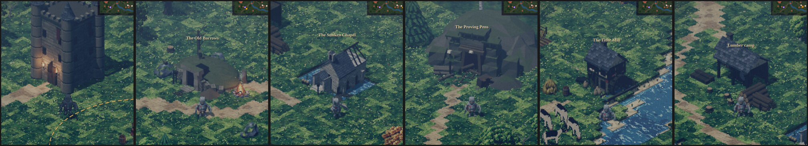
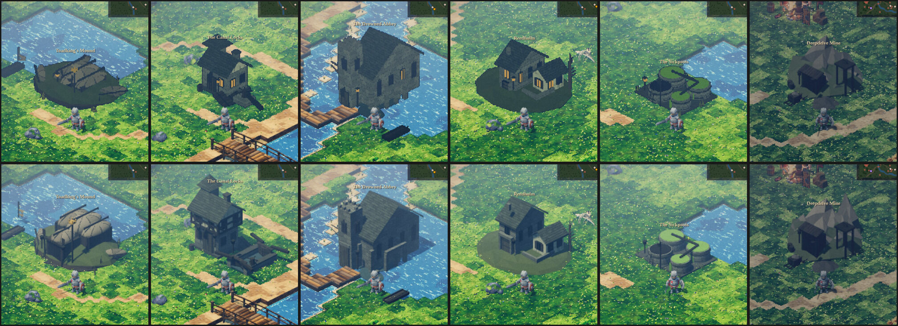
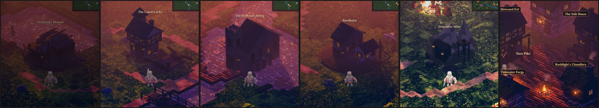

# The buildings: an art pass on size and look

**Status:** Implemented (2026-11-15).

The owner, 2026-11-15: *"Do an art pass on all the buildings, especially some of the dungeon buildings.. are they the
right size and look good enough?"*

The measure is the landmark standard ([vale-landmarks-proposal.md](./vale-landmarks-proposal.md) §3):

- **Built in 3D, never a card.**
- **At the people's scale.**
  - A figure stands 1.75 of Luminati's units, which is 0.35 of a kit unit (`buildkit.js`).
  - A door is 1.2–1.4× a figure, 0.42–0.49 kit.
  - A landmark reads as itself on a phone at the game's camera.
- **The door reads as a way in**, lit at dusk.
- **On the sim's footprint** (`envfoot.js`).

Every building in play was shot at the game's camera on a phone's frame, with the hero stood in front of it. The tool was `tools/capture/rig.mjs`, with the hero placed so the building sits mid-frame.

## 1. What was found

**The Fens were still cards.** Only the Vale's kit pieces stood in 3D (`world.js` placeEnv: `vale &&`).

- Every Fens dungeon door and Saltmere's stilt buildings were the baked flat pictures: lit by no sun, casting no shadow,
  and leaning as the camera turned.
- The Vale's were brought into 3D on 2026-11-10; the other regions waited for "the Vale is right".

**Several were smaller than a man.** Door heights, in figures:

| Building | Before | After | What else |
|---|---|---|---|
| **Toadking's Mound** (the Boat Hall) | 0.69× | **1.34×** | The hall's top went from 1.2 figures to 2.2, and the crown on its boat-hook to 3.1. The way in is a passage out of the mound's face, roofed with a fourth boat, oars either side, two lanterns |
| **The Canal Locks** | 1.03× | **1.37×** | The keepers' hall went from one storey to two (ashlar under timber), its stair-tower 1.04 kit to 1.48. It gained the lock itself: a stone chamber with water in it, mitre gates at each end, their balance beams, the capstan. Before, nothing said *locks* |
| **The Drowned Abbey** (west door) | 0.8× above the flood | **1.37×** | Lanterns either side of the door, a plain lintel |
| **Reedholm** (the undercroft door) | 0.57× | **1.2×** | The chapel's walls went from 0.5 to 0.66, so the low door under its sill is a man high. The door is still sunk, with steps down; the site is a secret |
| **Deepdelve Mine** (adit) | 1.03× | **1.37×** | Paler rock in bands, four more crags. It read as one dark lump; it still reads as a rough outcrop |
| Saltmere's stilt houses | 0.86× | **1.2×** | Walls 0.4 → 0.5 kit |
| **The Drowned Eel** | 1.09× | **1.31×** | Its pent porch roof hid whoever stood at the door from the camera (33 % in view, the one Saltmere miss: [fens-dungeons-audit.md](./fens-dungeons-audit.md) §1). Now an open frame, posts and a beam with the lanterns |
| The Stilt House (inn) | 0.97× | **1.14×** | Ground storey 0.4 → 0.48 |
| The Sickpools' vats | | | In 3D their slime had gone black (a part flagged to glow takes the world's window glass, dark by day). Now green |

**Kept as they are** (right size and approved; [vale-landmarks-proposal.md](./vale-landmarks-proposal.md) §7–8):

- Wickham Keep: door 1.26×, the keep five figures high with torches.
- The Old Barrows: 1.14×.
- The Sunken Chapel: sunk, its porch dry.
- The Proving Pens' adit: 1.77×.
- The Tithe Mill, the lumber camp and the milestone.

**The towns** are Luminati's own house builder: the houses, taverns, inns, smithies, shops and temples. Their doors are
about 1.2× a figure, and they read well at the camera in both towns. They were not changed.

## 2. What changed

- **Every region's kit pieces stand in 3D** (`world.js` placeEnv: the `vale &&` gone). The Fens' doors, Saltmere's
  stilts, the cistern, the punts and the eel traps take the world's sun, lamps and shadows. Their windows light at dusk
  with the town's.
  - `?landmarks=sprites` still shows the cards.
  - The cards are re-baked (`bake-env.cjs --keep-missing`), so they match the models.
- **The models** (`tools/actor-lab/buildkit.js`): the table above.
- **On the sim's footprint.** Each remodel stays inside its old footprint. Re-baked, three shrink and none grows:

  | Building | Before | After |
  |---|---|---|
  | Toadking's Mound, front edge | 7.48 | 7.15 |
  | The Canal Locks | −8.1…12.96 × −6…5.11 | −7.8…12.48 × −5.79…4.99 |
  | The Abbey, front edge | 8.39 | 8.0 |

  Every door's exit (`outdoor.js` DOOR_Y) stays clear of its building. Nothing else moved.
- A finding left alone: `doorOn`'s arch (buildkit.js) stands out of the wall by half the door's width instead of
  lying on it. On a wider door it pushed the Abbey's footprint over its exit, so the Abbey's door has a plain lintel.
  The other doors keep theirs: fixing the helper would move every building's footprint.

## 3. Measured

**Cost** (`tools/capture/figperf.mjs`, a phone's 390 × 844, draws and triangles a frame at the WebGL context, every
pass; the cloud box's software GL, so the numbers compare before with after, not with a phone):

| Where | Before (cards) | After (3D) | For scale: the Vale, already 3D |
|---|---|---|---|
| Saltmere's square | 324 draws, 608 k tris | 506 draws, 622 k tris | Thornwick's square: 429 draws, 725 k tris |
| The Fens overland, at Saltmere's edge | 154 draws, 943 k tris | 360 draws, 957 k tris | The Vale overland at Thornwick's gate: 493 draws, 1,151 k tris |

The draws go up by the pieces' materials (each piece is merged to one mesh a material) and their shadows. The Fens
now cost what the Vale has cost since 2026-11-10, and the triangles barely move (+2 %).

**Visibility** (`tools/capture/visibility.mjs`, no subject under half in view):

- Saltmere: 11 subjects, 0 under half. Before, the Drowned Eel's door was at 33 %.
- The Fens overland: 15 subjects, 0 under.
- The Vale overland: 17 subjects, 0 under.

## 4. Left for another pass

- **The Fens' palette.** Its grass is Luminati's own bright green; the Vale's dusky grade isn't applied there. This is
  the owner's standing order: "the other regions keep Luminati's palette until the Vale is right".
- **The temples read as houses.** Saltmere's Chapel of the Grey Sisters and Thornwick's Shrine of the Ember are
  Luminati's house builder in stone, with a sign but no bell-cote or other mark of a chapel.
- **To check on a real phone** (the owner's): walking up to Toadking's Mound and through Saltmere's square, the
  busiest Fens views.
