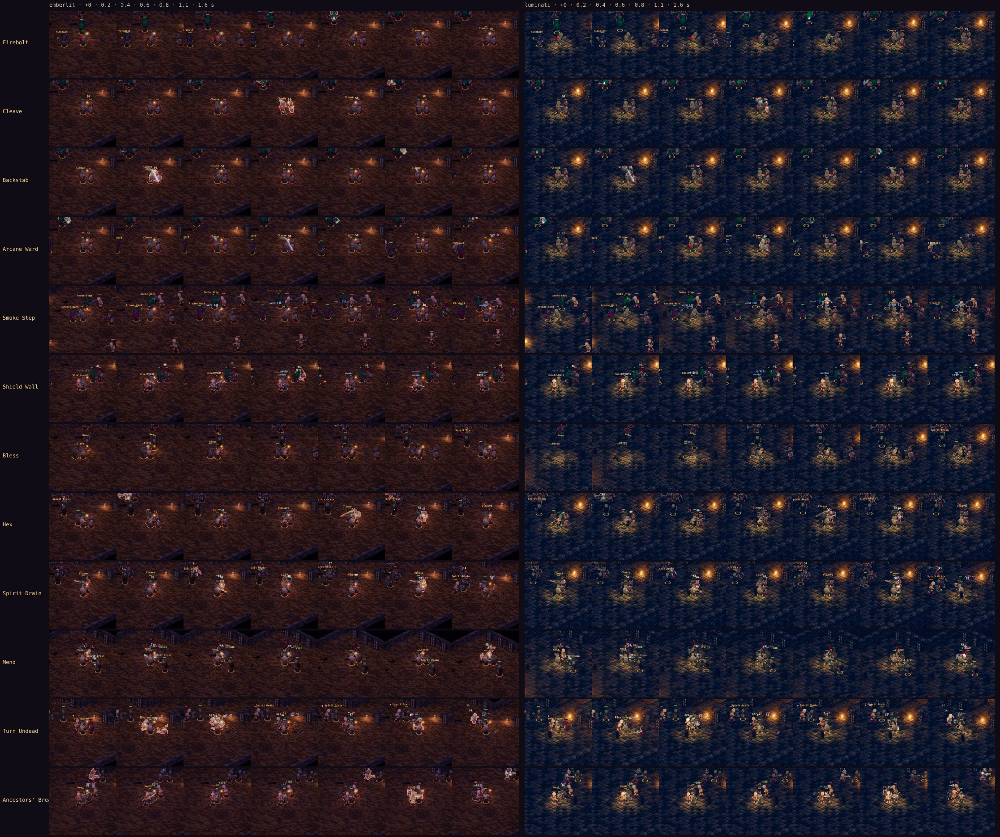
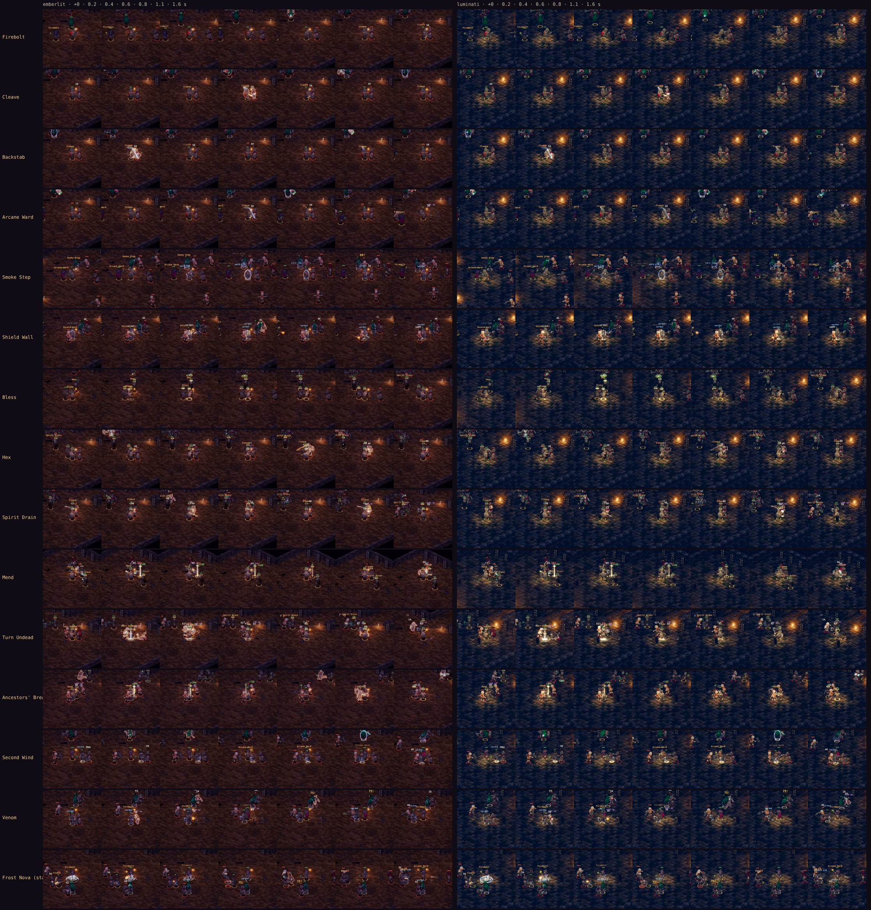
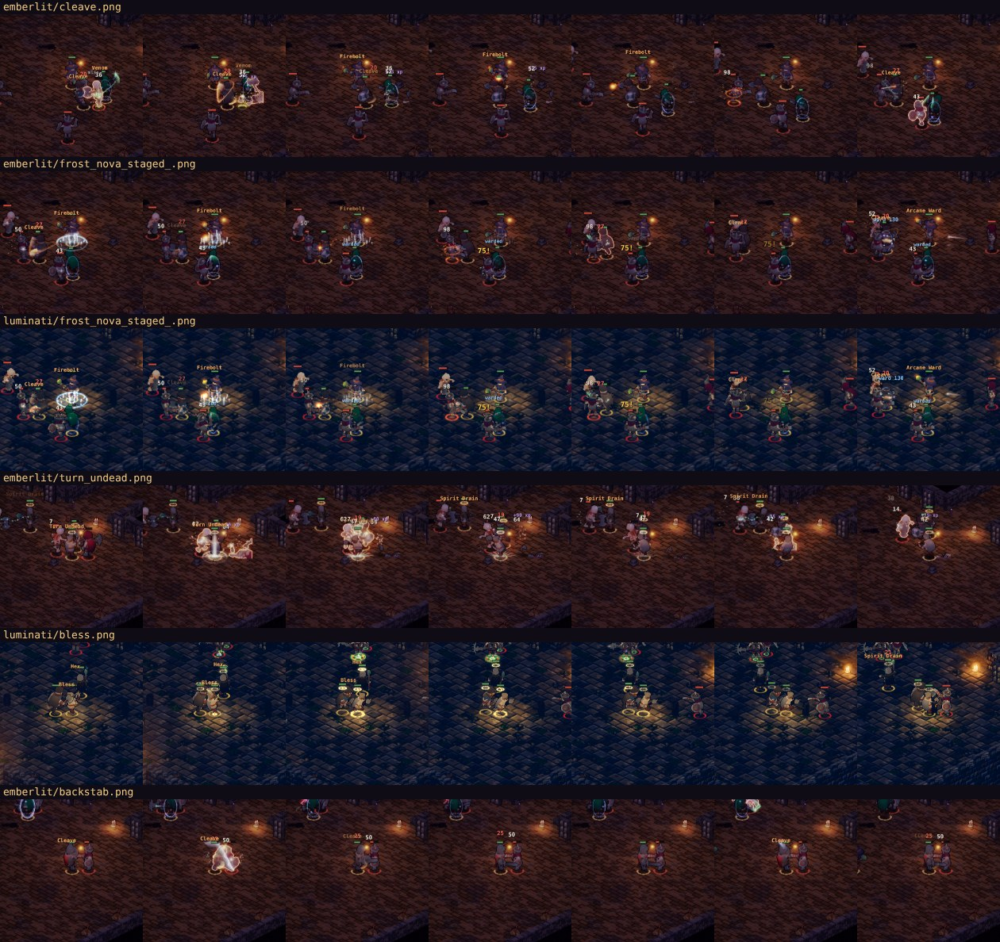
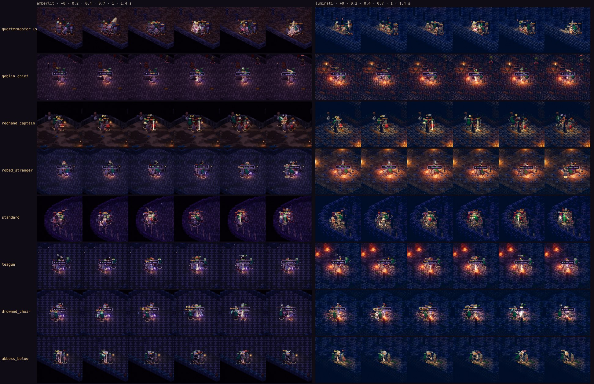
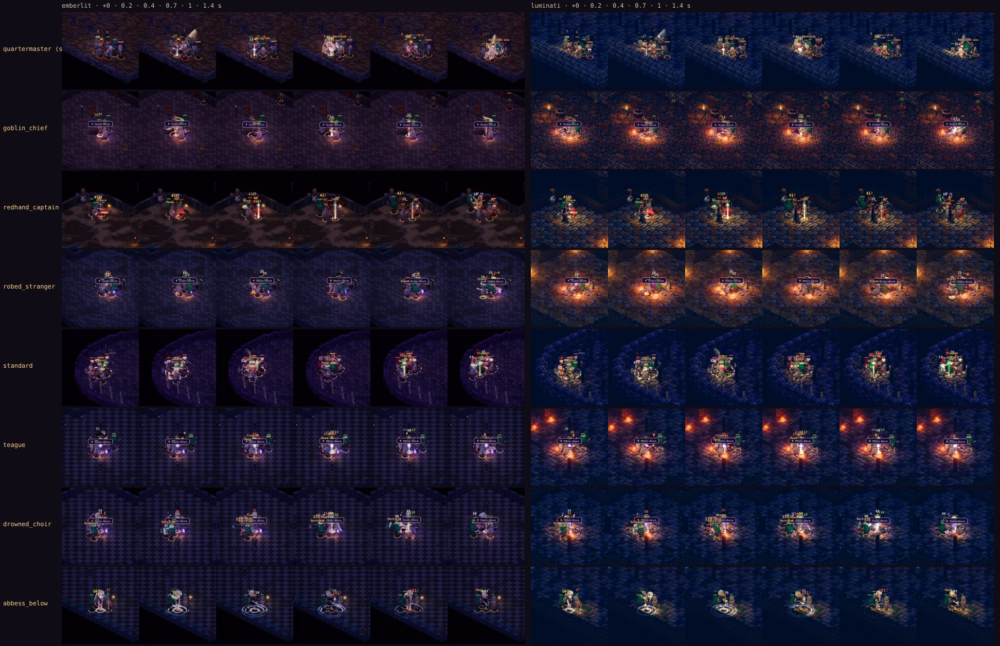
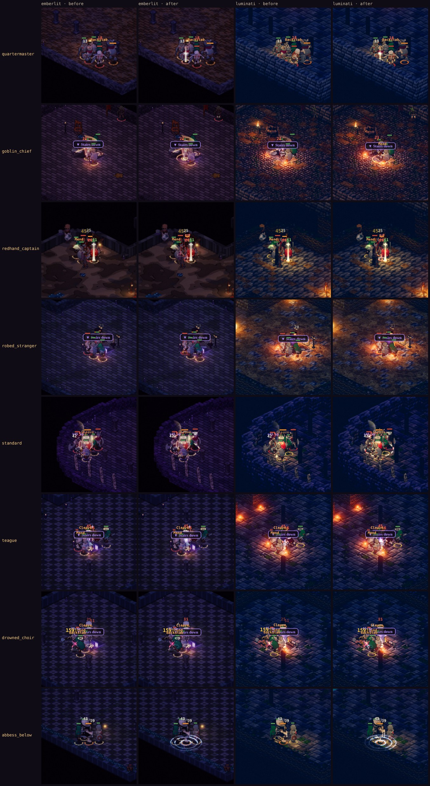
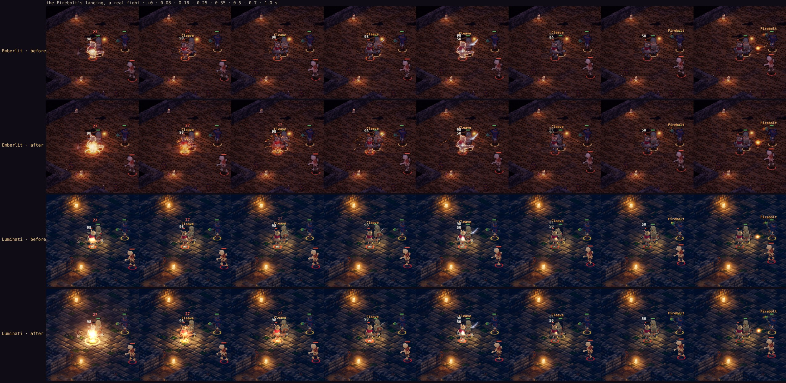
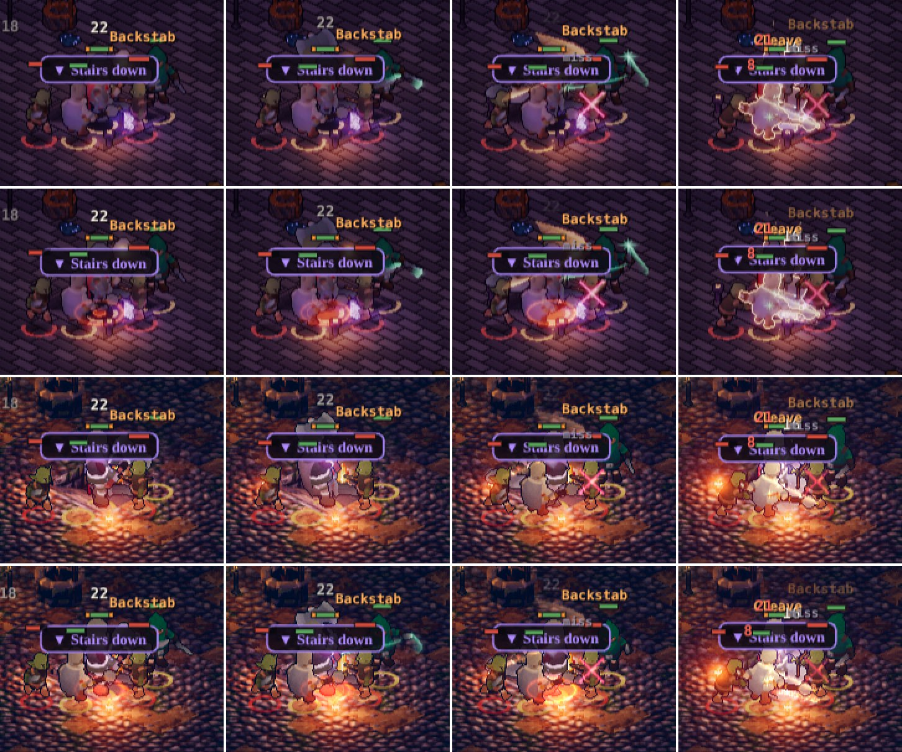
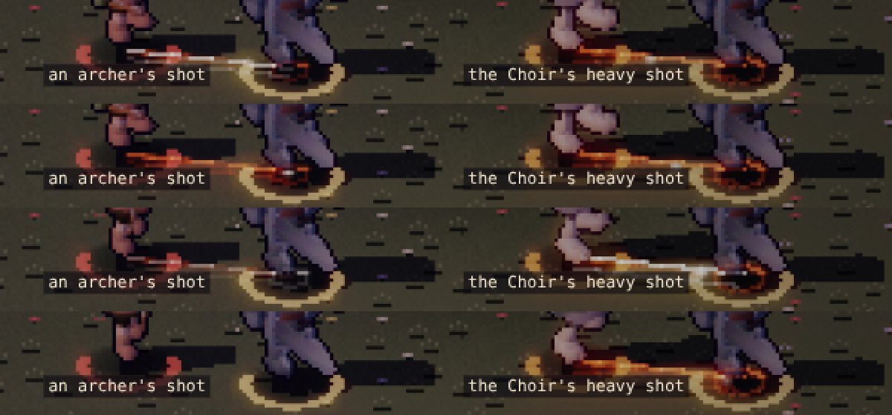

# Combat effects: every skill its own

**Implemented (2026-11-07), and the boss pass after it (below).** The code:
- the effects: `src/render/skillfx.js`;
- the events: `src/sim/battle.js` `skillEv`;
- faster primitives: `src/render/fx.js` (disc kernels);
- the art review cells: `src/dev/review.js`;
- the fight capture: `tools/capture/skills.mjs`.

The owner, 2026-11-07:

> "After this move onto the combat fx including critic review. Unique effects for each spell and skill. AAA quality"

## How it was looked at

- **A real fight on both renderers.** `tools/capture/skills.mjs` stages three parties of level 15 with every skill
  learned, in a level-15 room of the Old Barrows:
  - fighter, rogue, mage;
  - cleric, shaman, fighter;
  - the mage alone in front, the rogue's Backstab off and the fighter starting hurt, so that Frost Nova, Venom and
    Second Wind come up.

  It shoots each skill's first cast at +0, 0.2, 0.4, 0.6, 0.8, 1.1 and 1.6 s. The sim is deterministic, so the same
  skills fire at the same moments on every checkout, and a before and an after line up frame for frame.
- **The art review.** `?dev&scene=stage&show=fx&match=Skills`, and `tools/capture/stage.mjs --show fx --match Skills`
  for strips. Every skill's moment has its own cell, and so does every aura.

## The critique (before)

- **A skill was its name.** A cast drew its name floating up over the caster and the class's ordinary swing or cast
  flash, nothing else.
  - Bless, Hex, Arcane Ward, Shield Wall, Smoke Step, Mend and Ancestors' Breath drew nothing at all.
  - Frost Nova and Turn Undead were a screen shake.
  - The Firebolt was the mage's ordinary fire bolt.
- **What a skill leaves on someone couldn't be seen.** A Shield Wall's taunt, a Smoke Step's dodge, Bless, a Ward's
  shield, a Hex, Venom's poison, Spirit Drain's stacks and Frost Nova's slow were state the sim kept. On the screen,
  only a "ward 40" or a "hexed" floated up once.
- **One look for every class.** A cleric's Mend and a shaman's Breath read alike (a green number). A fighter's Cleave
  and a rogue's Backstab were the same heavy arc in different colours.

## The design (after)

Each class has its colour language. Each skill has its own shape and its own timing: an anticipation, an impact and a
decay.

| Class | Skill | The moment | What it leaves |
|---|---|---|---|
| Fighter: warm steel, amber | Cleave | a crescent swept round the blade toward the target and past it, a white-hot edge; a spark and a scuff ring on each foe beside the target | |
| | Shield Wall | the war cry: a red ring thrown out over the floor, the lines of the foes it turns; then a shield of light standing before him | a ring of plates at his feet, turning, a pulse going out |
| | Second Wind | three strands of wind whirling up round him, a ring at his feet | |
| Rogue: verdant, a crimson cut | Backstab | a shadow's streak from where the rogue stood, then two cuts crossing on the target; a crit a star | |
| | Smoke Step | smoke thrown out in a ring at the feet, billowing and rising | wisps of smoke turning about them |
| | Venom | a green splash, drops thrown out and falling, a ring at the feet | bubbles rising off the poisoned, a sick glow under them |
| Mage: arcane blue, fire, frost | Firebolt | in flight, a roaring head with embers shed behind it; where it lands, a white-orange flash, a ring of fire, embers flung up and falling, smoke-light rising, the floor scorched | |
| | Frost Nova | a cold streak from her staff to the thickest knot of foes, then a ring of frost running out 3.5 tiles over the floor there, ice spikes standing up behind it as it passes, a cold mist; each foe reached flashes white | rime at the chilled foe's feet, snow falling on them |
| | Arcane Ward | runes drawn in round the ally, then the dome closing over them | the dome, a light running round it, facets twinkling |
| Cleric: gold | Mend | a beam of gold from above onto the ally, a ring at their feet, a mark rising over their head, motes going up | |
| | Bless | a rune circle turning at the cleric's feet, a halo settling over each of the party | the halo |
| | Turn Undead | the sunburst: rays running out over the floor, a ring of light behind them, a column; each of the dead it reaches flares and smokes | |
| Shaman: spirit teal, hex green and violet | Spirit Drain | a tether, motes drawn along a wavering line from the foe to the shaman | a mote apiece circling the foe for each stack |
| | Ancestors' Breath | a breath going out over the floor, leaves of spirit-light spiralling up each of the party | leaves going up them |
| | Hex | a sigil drawn stroke by stroke on the floor under the knot (two rings and a five-pointed star), a violet line out to each foe it takes | a mark under each hexed foe, the life sinking out of them |

How it's built:
- **One effects plane.** Everything is drawn as light into the emissive plane with fx.js's primitives, as AGENTS.md
  asks: effects reuse the primitives, no new passes. So both renderers show it: Emberlit lights its window with it, and
  Luminati lays the plane over its world.
- **Moments come from the sim.** `battle.js` emits a `skill` event when a skill is cast and when it lands: who cast
  it, at whom, and those it reached. It's an event only, never state, so replays are exactly as they were (a test holds
  the fight's hash, heard or not).
- **Effects follow people.** A moment follows its caster and target by id while they move.
- **Auras come from state.** They are read off the sim's state every frame: `buff.wall`, `smoke`, `bless`, `breath`,
  `ward`, and a foe's `slow`, `poison`, `drain` and `hex`. They fade over their last 0.8 s (a foe's over its last 0.6 s).
- **Ground effects are on the ground.** Ground effects are true world circles: an ellipse of 11.3 × 5.7 px a tile,
  stroked a pixel at a time. They sit under the figures; the rest stands over them.

## Measured

**The frame's cost.** A node benchmark with the real primitives, a 260 × 300 native buffer, on the cloud box:

| | Before the kernels | After |
|---|---|---|
| Every aura on 3 allies and 6 foes (the worst case) | 1.53 ms | 0.52 ms |
| Seven big moments at once, and every aura | 4.10 ms | 0.96 ms |
| Nothing under way | 0.005 ms | 0.003 ms |

fx.js's `disc()` now takes its weights from a kernel kept per radius and falloff, to a tenth of a pixel. These are the
same marks without a `hypot` and a `pow` a pixel, and every older effect is faster for it too.

**Tests.** `test/skillfx.test.mjs` checks three things:
- every class skill has a moment of its own, and no two draw alike;
- the sim says when a skill is cast and lands, with who it reached;
- saying so changes nothing: the same fight's state hash, heard or not.

`npm run check` passes: 491 tests, SMOKE_OK, RENDER_SMOKE_OK.

**Burst frames.** Before and after, on both renderers: `tools/capture/skills.mjs`.
- Each row is a skill's first cast, at +0, 0.2, 0.4, 0.6, 0.8, 1.1 and 1.6 s. Emberlit is on the left, Luminati on the
  right.
- The before has 12 rows: Venom, Frost Nova and Second Wind never came up in its two fights.
- The after adds the third fight. Frost Nova is staged there (marked so): the sim's own event, sent with the foes
  nearest the mage, because no fight here brings two foes within its 2.8 tiles.

*Closer, at play scale. Rows: Cleave's crescent, Frost Nova (both renderers), Turn Undead's sunburst, Bless's halos
(Luminati), Backstab's crossed cuts.*

## Tuned after the first real-fight frames

- **Arcane Ward.** On two or three of the party at once, the dome read as a wall of ovals. It is held at about half the
  light now.
- **The Firebolt.** In flight it passed for the mage's plain bolt. Its head is now an 11 px halo with a 4 px core, and
  it sheds 10 embers, not 7.
- **Every stroke.** At fx.js's own gain the first pass read as dotted outlines. Rings are now stroked a pixel at a time
  along their length, and the module's light is ×1.7.

## Left, and the critic's notes for the next pass

- **The foes' own abilities.** The bosses' calls, the hexer's curse and the acolytes' fire still use the shared cast
  and bolt. They are next, in the same way: an event each, and a moment each.
- **Timing against the clip.** Each moment starts on the sim's cast and landing (a skill lands 0.38 s into its 0.55 s clip). The swing and
  the effect line up because both follow the sim; a skill-specific clip would sell them more.
- **A ward breaking.** When a ward is spent, the dome goes out without a shatter. A 'warded' pulse and a break are
  worth adding.
- **Frost Nova's own conditions: fixed (2026-11-07, GDD v1.53; the owner: "Yes fix frost nova range").** It had two
  faults:
  - It was cast round the mage, who keeps her distance.
  - Its 2.8 tiles could never take in two foes, because they stand 2.8 apart (their melee reach round whoever they
    fight).

  It is now thrown onto the thickest knot of foes within the mage's reach (her bolt's 14 tiles), 3.5 tiles across as
  Hex is. A cold streak runs from her staff to the knot, and the ring bursts there at its real radius. Measured, in 3 ×
  3 minutes of fighting:

  | | Before | After |
  |---|---|---|
  | Frost Nova cast, L6 mage, fighter, cleric | 0 | 4 |
  | L9 fighter, rogue, mage | 0 | 13 |
  | L15 fighter, rogue, mage | 2 | 16 |
  | The contract's no-healer party at L6 (fighter, rogue, mage), worn down | at 189 s, 264 s | at 269 s, 292 s (the gate: within 300) |
  | roomlv, a mage hero with a fighter and a rogue, L9 (two seeds) | down at 235 s, 260 s | held 300 s, 16 waves each |
  | … at L15 | down at 217 s, 284 s | held 300 s, 16 and 15 waves |

  Every contract gate still passes. The mage is clearly stronger now that her level-6 skill works. The no-healer gate
  is back near its margin before the dungeon dressing (283 s, 292 s). If it's too close, Frost Nova's power (0.8×) is
  the knob. `test/skillfx.test.mjs` holds the fix: with it, it goes off in a minute's fight and lands on a knot;
  without it, it never fires.

## The boss pass: the gaps, and every boss's mechanic (2026-11-07)

The owner, on the catalog's recommendation ([combat-catalog.md](combat-catalog.md) §C): "Yes go ahead with steps 1 and 2":
1. fill the effect gaps;
2. draw the boss mechanics.

**How it was looked at.** `tools/capture/bosses.mjs` fights each boss in his own hall, on his own floor:
- the party: the contract's fighter, rogue and cleric, at the hall's level, with every skill;
- both renderers;
- the frames: the first time his mechanic fires, at +0, 0.2, 0.4, 0.7, 1.0 and 1.4 s, cropped round where it happens;
- the bosses whose mechanic holds through the fight (the Standard's line, Teague's cage, the Choir's singing): a moment 4 s
  into the fight.

The sim is deterministic: the before and the after fire on the same frames (the Quartermaster at 6.7 s, Skarn at 11.8 s,
Garrow at 17.9 s, the Stranger at 13.8 s, the Abbess at 13.7 s).

**The critique (before).**
- **A boss's mechanic was a banner.** The art review shows what fx.js drew for each: nothing at all for
  - the Quartermaster making a man whole;
  - Garrow's call;
  - the Stranger's kindle;
  - Skarn's drum;
  - the Choir raising a singer;
  - the Abbess's bells.
- **What holds through a fight couldn't be seen.** Nothing showed:
  - which of the dead the Standard's line protects (they take half);
  - that Teague's cage mends him;
  - that Garrow's men shield him (only the boss bar's ⛨);
  - that the Choir's singers mend the hall.
- **A ward went out with nothing**, and a level gained was a banner and a sound.
- **On Luminati:**
  - Teague's cage wasn't drawn (it has no atlas);
  - the bolts and arrows in flight were only their light;
  - the Abbess's water wasn't drawn at all.
- **Weapons with nothing drawn:** the ten Mere Tower wardens, Brannoc and Wren swung with no trail, default sparks and the
  default soul colour. Wren never got her bow: there was no atlas for it.
- **Every skill made the same sound,** a war cry.

### The design (after)

| Boss | The moment | What holds |
|---|---|---|
| The Quartermaster | a brass streak from him to the most broken of his ranks; three blades of light closing on the man; a rack-light over him and a ring at his feet: he stands up whole | |
| Captain Garrow | the call thrown out in red rings; a line to each man; each standing in a red flash at his post | while his men stand: a red thread from each to him, and a shield over his head (he takes half) |
| The Robed Stranger | a streak of fire to where the last of them fell; a ring of fire on the floor there; flames standing up; cinders going up as the minion kindles | |
| Old Skarn | three drum beats thrown out over the floor, a star on each; dust going up where the goblins come out of the tunnels | |
| The Standard | | a ring of its reach (4 tiles), dashed and turning on the floor round it; a small shield of its light over each of the dead it covers, a thread back to it |
| Brother Teague | | the lantern burning; while he's hurt, its light drawn along a thread into him |
| The Drowned Choir | a pale column where a sister stands up out of the stalls; a ring; a thread of song from the Choir to her | notes going up off each singer; the hall's dead mending in their light |
| The Abbess Below | a bell's shape swinging over her; its toll in three pale rings going out over the floor | (the water, drawn on both renderers now) |
| The Toadking | a ring off his foot; one welling up under each of the party where the mud comes | (the mud, as before) |

And besides the bosses:
- **A ward breaking** (a new sim event, `combat 'wardBreak'`): the dome flashes and shatters, its shards thrown out and
  falling, a ring at the feet.
- **A level gained:** a column of gold going up, two rings out over the floor, motes spiralling up and a star over the
  head.
- **Luminati:**
  - Teague's cage, and the bolts and arrows in flight, stood where Emberlit draws them (`hybrid.js` bits; `world.js`, a
    sheet a canvas). A bolt is lit by its own light.
  - The Abbess's water: a square a flooded tile, the tide line lighter, in one instanced draw, rebuilt only as the water
    comes in. Its glints are drawn as the effects' light.
- **Weapons:**
  - each warden in the colours of their bake, for example the Doorward's verdigris great sword, the Lensman's lamp-glass
    crossbow and the Bellringer's bell-bronze kindling;
  - Brannoc's sword in old iron;
  - Wren's twin knives in Saltmere's sea-teal.
  - Wren's ranged looks: four new atlases, `hero_wren_bow`, `_longbow`, `_xbow` and `_hxbow` (`tools/actor-lab` variants
    CP2B, CP2L, CP2X, CP2H), worn as the rogue's are.
- **Sound** (`audio/cues.js`): each skill its own, from the bank's one-shots pitched and layered (no new samples). For
  example, Frost Nova is a cold ring with the floor cracking under it, and Turn Undead a deep bell. Each boss's mechanic
  and a ward breaking are heard where they happen too. The cast is silent now, where every skill was the same war cry.

How it's built, as the skills' moments are:
- **The sim's boss events name who and whom.** `bossIssue`, `bossCall`, `bossKindle`, `bossSwarm`, `bossVespers`,
  `bossMud` and `bossFlood` carry `by` (the boss's id) and `tid` or `reached` (those he raised, called or issued to). A
  moment follows them by id while they move.
- **Events only, never state.** A test holds the fight's hash, heard or not.
- **The holds come from the sim's state each frame:** `halved` (LINE_R), the cage's `owner`, `guards` and `singer`.
- **Tests:** `test/skillfx.test.mjs` checks:
  - every one of these moments draws, and no two draw alike;
  - each hold draws only with its state;
  - a spent ward reports it broke;
  - the Choir names herself and the singer she raised;
  - the fight's hash is the same, heard or not.

  `test/audio.test.mjs` checks every class skill sounds its own and no two sound alike.

**Burst frames.** Before and after, on both renderers: `tools/capture/bosses.mjs`.

*Closer: one moment of each, before and after, Emberlit then Luminati.*

**Tuned after the first real-fight frames.** The holds and the bosses' moments were drawn at the skills' strength. They
read in the art review but were lost in a melee: counted against the sim's state they drew 179 marks for the Standard's
line, 12 for the singing and 3 for the cage. Each boss's light is now ×1.6; the line's ring, its shields and Garrow's are
stronger; the cage's halo is larger, with its light always running into Teague (faster and brighter while he mends, a
ring breathing round him); and each singer's song goes out over the floor in a ring.

**Left.** In the thick of a fight, the Stranger's kindle and Garrow's call land where the party stands, and the figures
over them hide part of it (the frames above). The Luminati side shows the bell and the issue strongly, and the rest more
quietly than Emberlit: its own torchlight is brighter round them.

### Found on the way: the Quartermaster never issued (fixed, GDD v1.54)

In his hall, against the contract's party, both of his escorts are down by 9.1 s, and his first issue is due at 10 s.
There's nothing left to issue to: in 3 × 90 s of fighting at levels 1, 2 and 3 it never fired once.

The world doc's line is that "the most broken of his ranks stands up whole, re-armed from his racks". The prototype's
version (`tools/lumina/ember/issue.js`) stands a fallen one up first; ours only makes a living one whole. Making it work
is a rules change and a balance run, so it's left for the owner. The capture stages the sim's own event for him (marked
"staged") so the effect can be seen.

**Fixed (2026-11-08; the owner: "Yes fix the Quartermaster to raise a fallen rank").** Every 10 s the last of his ranks to
fall stands up whole where it fell; with none down, the most hurt living one is made whole as before. One he stood up pays
nothing when it falls again (no XP, coin, souls or count), so his hall is no farm. Measured with `tools/balance/boss.mjs
barrows 3 1,2,3,4,5,6 --floor 2`, with `--src` for before:

| | Before | After |
|---|---|---|
| issues in his hall, at his level | 0 | one every 10 s (11.7, 21.7, 31.7 … s) |
| he falls in, at his level (L3) | 50–54 s | 60–67 s |
| the party's lowest HP, at L3 | 76–82 %, nobody down | 73–83 %, nobody down |
| a party a level under (L2) | 62–64 s, 73–79 %, nobody down | 73–92 s, 21–78 %, downed in two of three |

`test/bosses.test.mjs` holds it: in his own hall he issues, stands a fallen rank up, and it pays nothing when it falls
again. It fails without the fix (he never issues). The capture tool doesn't stage him any more.

## The Firebolt's explosion (2026-11-08)

The owner: "The mage fireball needs more explosion fx on hit".

**Before.** Where the Firebolt landed: a flash, one ring of fire, 18 embers and a scorch, gone in 0.9 s. A mage's ordinary
fire bolt landed in a small flash and 12 embers. Neither threw any light on the room. And the first Firebolt of a fight
often lands where nobody sees it: the mage reaches 14 tiles, which is past the edge of a phone's view.

**After.**
- **The Firebolt lands as a blast** (`skillfx.js` firebolt, 1.3 s):
  - a white core flash;
  - a fireball billowing out from nine lobes round a growing middle, cooling white → orange → red as it grows;
  - a fast shock ring over the floor and a slower, wider one;
  - ten flame tongues licking up round the edge;
  - 26 burning pieces flung out on arcs, trailing and bouncing once where they meet the floor;
  - smoke-light going up;
  - the floor left glowing and cooling.
- **The light it throws:**
  - **On Emberlit**, a moment of firelight on the room: the lighting pass's third slot while it lasts (`renderer.js`
    blasts, 0.55 s; the nearer lamp keeps the second).
  - **On Luminati**, one of its own spell lights (`world.js`, as the carry light is).
- **A harder jolt** than a heavy blow's.
- **A mage's ordinary fire bolt** (and a foe's) lands as a small explosion (`fx.js` burst):
  - a longer, bigger flash;
  - a ring over the floor as well as in the air;
  - 18 embers;
  - its own short flash of light.

**Burst frames.** `node tools/capture/skills.mjs --party 1 --land`, a new mode that shoots each skill's first landing on
the screen, cropped round where it lands. It fires at 20.1 s on both trees, Emberlit then Luminati, before over after:

## Attack warnings: the telegraph grammar (2026-11-08)

The catalog's best single thing to adopt from Luminati ([combat-catalog.md](combat-catalog.md) §B, §F.3): a foe's heavy
blows and shots marked on the ground before they land, on both renderers. Presentation only: the sim's timing, damage
and balance are as they were (the state hash is the same with the warnings heard or not: `test/skillfx.test.mjs`).

**Before.** A foe's attack showed nothing until it landed: the swing clip, then the hit. A boss's heavy blow and an
archer's shot read the same as any other.

**After.**
- **The sim says what's coming** (`battle.js` attack): a `windup` event `{ by, tid, heavy, bolt, boss, x, y, tx, ty,
  wind, fly }` when a foe starts a heavy blow (an elite's or a boss's) or any shot. `wind` is the time to the blow or
  the release (WINDUP_HEAVY 0.38 s, WINDUP 0.18 s), `fly` the time the shot takes to land. A light melee blow says
  nothing (Luminati marks nothing that small).
- **A heavy blow:** a red-orange ring on the floor under the one it's meant for, 1.4 tiles across (1.7 for a boss's),
  its fill running out to the rim as the blow comes. The rim goes white as it lands, then it's gone in 0.16 s.
- **A shot:** a lane on the floor from the shooter to its mark, filling toward the mark until the shot lands, with a
  white front and a ring at the mark that goes white at the landing. It follows both ends until the release; then its
  start holds (its edges flash: locked) while the end stays on the mark, as the bolt does. A light shot's lane is
  thinner and fainter, so a room of archers doesn't paint the floor.
- **Emberlit:** drawn as light (`skillfx.js` warn), as every moment is, so it also shows over Luminati.
- **Luminati:** Luminati's own enemy marker as well, laid on its ground (`world.js`: a filling disc and rim, the lane as a
  stretched strip, in GroundMarkers' style-0 red-orange). A dark ink edge sits under each: on a firelit floor the red
  alone was lost (the boss halls' braziers).

**How often.** In 30 s of Skarn's hall at level 5, 18 heavy blows (his) and 13 arrows. In the Choir's hall at level 17,
14 heavy shots (hers) and 28 cantors' shots.

**Measured.** `node tools/capture/bosses.mjs --warn`, a new mode that finds a foe's first heavy blow, shot and heavy
shot in three halls by its attack starting (the sim's `atkN`/`atkKind`, there before the warnings too). The moments fire
at the same time on both trees (Skarn's blow 2.7 s, an archer 3.1 s, Garrow's blow 4.5 s, the Choir's shot 2.8 s).
Skarn's blow at +0, 0.1, 0.2 and 0.4 s; rows: Emberlit before, after; Luminati before, after:

The lanes, in the art review's own cells (`?dev&scene=stage&show=fx&match=warnings`), an archer's light shot and the
Choir's heavy one, at four moments of their flight:

**Tuned.** The first ring was 0.95 tiles: in a melee the figures stood on it and hid it. It's 1.4 now, with a stronger
fill and rim.

**Left.**
- The grammar asks for every wind-up to be at least 18 frames (0.3 s). Our heavy blows are 0.38 s and a shot from 4
  tiles away about 0.33 s, but a light shot from 2 tiles is about 0.26 s. Lengthening it would change the sim's timing,
  so it's a balance question, not a drawing one.
- Bosses' area mechanics (the Toadking's stamp, the Abbess's bell) still mark where they land only as it happens; a
  warning ring before them would need the sim to say so ahead of time.
