# New creatures: giant rats and giant spiders (a proposal)

**Status: Implemented (2026-11-10)** (GDD v1.58–v1.59, world doc v1.36–v1.37; the bestiary below; the toads, 2026-11-13, GDD v1.83). The owner: *"Design the best way to model and create
new NPC types - giant spiders and giant rats."* Then: *"Go with your recommendations, spiders in Wickham Keep's cellars..
rats should be 20% bigger."*

## The bestiary (2026-11-10)

The owner: *Create new creatures, red fire beetle, goblin, and a graveyard wraith (1.5x size of humanoid), stone golem (2x size of a humanoid)… Also a rat king and spider queen as boss archetypes. We can worry about where they go location wise and lore later."* And: *"Run art and fx critic rounds in these and the new rat and spiders. AAA quality fitting with the aesthetic we have now."*

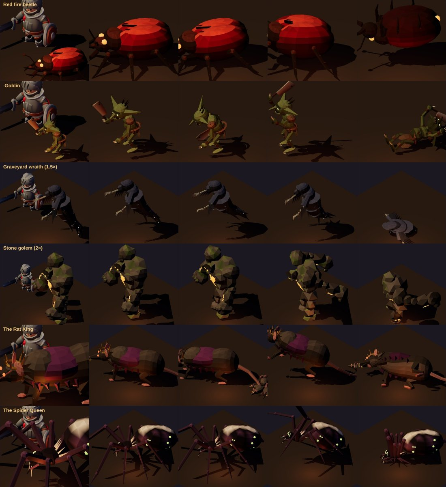

*The model sheet (`node tools/actor-lab/creatures-sheet.cjs`), each at its height in the game beside the knight: the red
fire beetle, the goblin, the graveyard wraith (1.5×), the stone golem (2×), the Rat King and the Spider Queen.*

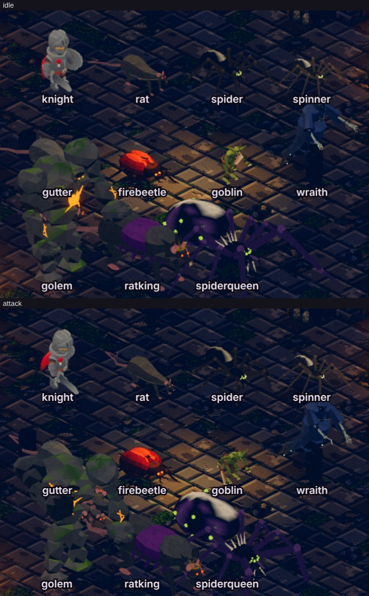

*In the game (`stage.mjs --show cast`): the knight for scale, the vermin, the four new foes and the two bosses.*

- **Built in code** (`tools/actor-lab/creatures.js`), in the kit's style (vertex-coloured, shaded smooth with creased
  edges at the KayKit cast's density since round S1 below, the cast's proportions and light), four new body plans and
  two bosses:

  | | Body plan | Triangles · bones | Its look |
  |---|---|---|---|
  | Red fire beetle | the hexapod (tripod gait) | 5,880 · 28 | a lacquered crimson dome going black at the tips, fire-glands over the eyes and at the tail; the cases fly wide on a glowing belly to spit; dies flipped, legs kicking |
  | Goblin | the small biped | 10,884 · 18 | after the owner's reference (below): a big bald head a third of its height, bat ears ringed in brass, a scowl, red eyes sunk deep, a wide grin of teeth; a red scarf on a leather mantle, a belt of pouches, a red loincloth, leather wraps; big clawed hands, no weapon |
  | Graveyard wraith | the floating shroud | 9,844 · 35 | 1.5 men; after the owner's reference (below): a skull under a hood crowned with three horns, long gaunt arms in bell sleeves (a man's, moving as one's: below), clawed hands, a shroud twisting down to a point and six tendrils curling up off it like flames; dies into a heap of rags |
  | Stone golem | the heavy biped | 10,672 · 16 | 2 men; chiselled blocks of blue-grey stone, a carved chest disc, a horned block head, manacles and trailing chains, lichen veins and tufts (after the owner's reference, below); falls apart when it dies |
  | The Rat King | the rat, crowned | 13,114 · 22 | a crown of bent nails, a ruff, a purple cape over the back, long incisors, and the knot: six rats grown together by their tails, riding the tail's last bones |
  | The Spider Queen | the spider, a brood-mother | 6,716 · 31 | an egg-sac abdomen ringed in bone with a bone hourglass, green eggs glowing under its skin, a crown of spines, long raised forelegs, sickle fangs |

- **The kit grew for them:** scale tracks (the wraith fading, the heap); `hull()`, one lathed body skinned across
  bones with blended weights (the rat's body, critic round 4); `rock()` (hashed icosahedra: the golem); glow strength a
  creature (over ~1.6 it burned out white); `lab.js` `?tall=` for a cell taller than a man's (bake.json `tall`: the
  golem 2.1, the wraith 1.6), so the atlas holds them.

### Art critic rounds

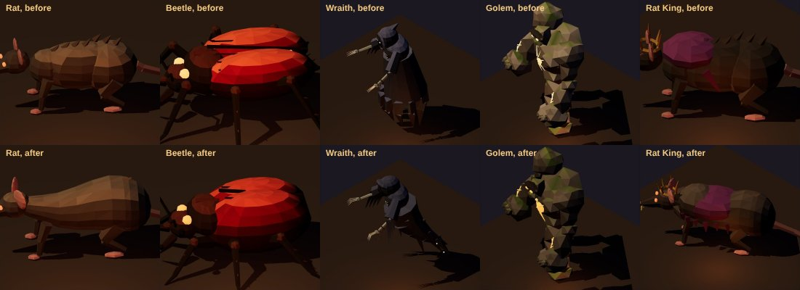

| Round | Seen | Done |
|---|---|---|
| 1 (sheet) | The beetle two flat pancakes on stilts. The goblin's cleaver a block, its green lime. The wraith a straight cone, its hem fangs, its arms rakes, its death a toppled log. The golem's core and cracks white scribbles, its head lost. The Rat King a banded grub in a beret. Every glow burnt out white | One high dome, short legs close in, a duskier red. An extruded blade, olive-grey skin, hair. Darker highlights. A bigger orange core, four thick cracks, the head low and forward. Glow per creature (1.15–1.6) |
| 2 (sheet) | The wraith a barrel; its hood read as cat's ears. The Rat King's cape strips a comb of red spikes. The Queen's eggs still white | The shroud a smoke-trail in four bones; a deep cowl. A draped blanket with a ragged hem. A sick green, and a bone hourglass on the sac |
| 3–4 (sheet) | The wraith's hood a pale mushroom. The rat a long banded loaf with a dinosaur's ridge; then a bottle with a flat rump | Darker hood. One lathed hull, pear-shaped, its rump round, skinned across four bones; a raked ridge; bigger pink ears |
| 5 (in the game) | The golem near-white under the game's figure light. Old Gutter white. The spiders' legs lost on the dark floor | The golem's stone darker (twice). Gutter grey, not pale. The spiders' legs a shade lighter than their bodies |

### Effects critic rounds

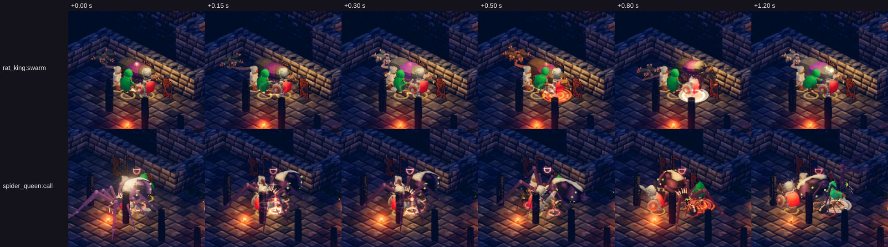

- **Round 1** (`stage.mjs --show fx --foes …`): the party's own skills (the cleric's columns) buried the creatures'
  effects. The Stage now fights them with a **quiet** party (its skills off), cropped on the striker. Each creature's
  blows spark in its own colour (`fx.js` styles: the beetle's fire, the wraith's cold green, the golem's grit), its
  heavy blows and shots warned on the ground as every foe's are.
- **Round 2:** the golem's heavy blow had no weight for a giant of stone, and the beetle's spit landed as a plain
  spark. Now the golem's heavy blow shakes the room (a big shock ring and the Toadking's stamp jolt: style `quake`),
  and the beetle's spit bursts into fire-light where it lands (`blast`: style `burn`). The bosses' mechanics read: the
  Rat King's swarm (the knot behind him), the Spider Queen's brood called in.
- **Left for a later pass:** the goblin's and the wraith's crops in the capture (the camera holds the party; a creature
  on the room's edge falls out of a 300 px crop). Their sparks and swings are the game's grammar.

### Against the owner's references: the rat and the wraith

The owner, with two pictures of miniatures (not kept here: they're another's work): *"Use these as reference models for
the rat and wraith… keep on iterating until the 3d models look like this but in our low poly style like the other NPCs."*

- **The rat's reference:** heavy, hunched, shaggy grave rats, their heads big and snarling on long incisors, big
  clawed hands, thick ringed tails, grey.
- **The wraith's:** a skull under a hood crowned with three horns, its jaw open and its sockets lit; arms flung wide,
  gaunt, the fingers long and clawed; a shroud hanging in tatters; below the waist, flames of it twisting up round a
  point; dark, with green light on its edges.

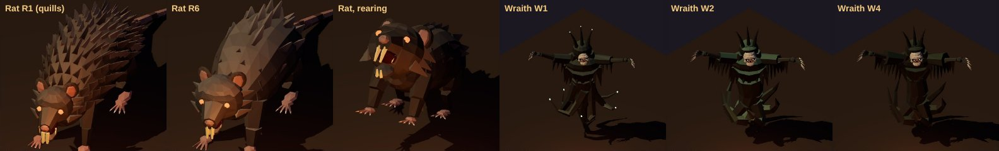

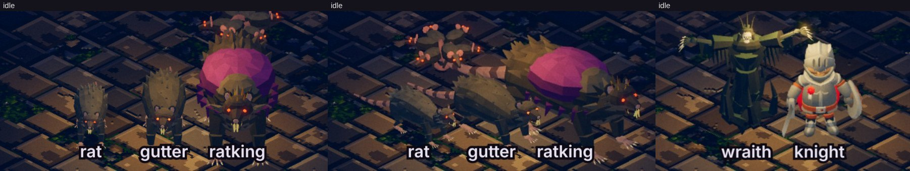

| Round | Seen | Done |
|---|---|---|
| R1 | A porcupine: the coat stood out in quills; brown; the head small; stick legs | The coat laid back; a cool grey; the head bigger; the forelegs thicker |
| R2 | A pine cone: an even grid of shingles | In the kit's chunky style: a few big ragged clumps where the shag is heaviest (a crest, a ruff, the flanks, the haunches), the hull smooth between |
| R3–R4 | The head still small; a long loaf from the side | The head bigger again; the forelegs thick and furred, the hands big; the body a tenth shorter |
| R5 (in the game) | A hedgehog from the camera's height: the hump and ruff hid a head hung low | The head raised over the shoulders, a thick neck; the hump and the front of the crest lower |
| R6 (in the game) | The face small under the back; the grey lifted to tan by the game's light | The head a quarter bigger again; a darker grey (and Old Gutter's); the Rat King's cape widened over the new hull, darker (it glowed magenta) |
| W1 | Rebuilt to the reference: the skull, the horned crown, the arms flung wide, the tendrils. But the skull small in the hood, scarecrow sleeves, the tendrils sticks with lit dots (spider legs) | A bigger skull forward under a brim; wide ragged sleeve drapes; big hands, long fingers; the tendrils broad tongues of flame rising off the base; the dots gone |
| W2 | Too green (a cactus); a barrel ringed in spikes | Green on the top edges only; a waist, the shroud hanging from the shoulders in a V and long down the back |
| W3 | Pipe sleeves | Bell sleeves |
| W4 (in the game) | The green lifted to lime by the game's light | A darker, greyer green: the reference's rim, not a colour |

### Against the owner's reference: the stone golem

The owner, with a picture of a painted miniature (not kept here): *"Use this as the reference model for the stone golem.
Continue in critic passes until our new 3d models look just as good for the game."* The reference: a golem of
chiselled, bevelled blocks of pale blue-grey stone; a carved disc on the chest, a ring cut round a hole at its heart; a
small block head between the shoulders with two stub horns, round eye holes, a dark mouth; long segmented arms, boxy
fists to the knees, rusted manacles on the forearms and broken chains trailing on the floor; a narrow waist-block over
stacked block legs; yellow-green lichen in veins down the stone and in fuzzy tufts on its tops.

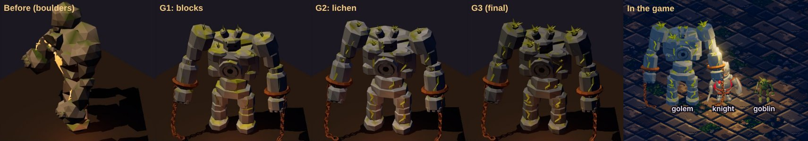

| Round | Seen | Done |
|---|---|---|
| G1 | The old golem round boulders, not the reference's cut blocks | Rebuilt: `block()`, a chiselled block (an octagonal prism with its edges and rims cut, its corners nudged by a hash, so it looks worked by hand); the chest disc with its ring, hole and a faint ember far back in it; the horned block head with eye holes and a mouth slot; the manacles and their chains (links off the cuff, down and along the floor); stacked block legs; lichen veins and tufts |
| G2 | Lichen painted every top face yellow; tufts thin sticks; veins lost; the stone beige under the torches; the head too high | Lichen only in patches on the tops, in thick zigzag veins and in tufts; tufts fuzzy balls (a core and a burst of short blades); the stone blue-grey; the head lower between the shoulders; cheaper chain links |
| G3 (in the game) | The tufts little stars at the game's size; the stone near-white under the game's figure light | Tufts nearly twice the size and more of them (the shoulders, the chest, the forearms, the fists, the knees); the stone a quarter darker than the reference's, so it lands on its pale blue-grey in the game |

7,692 triangles in two draws when it was built (the chains a third of it; 10,672 since round S1 below): for a figure
twice a man's height that comes one at a time.

### Smooth, at the cast's density, and the goblin after the owner's reference

The owner, with a picture of a goblin miniature (not kept here): *"Here is a reference image for the goblin model. Make
sure your poly counts are high enough for all these new creatures to match the similar detail and smoothness like the
kaykit models. Keep going on critic passes on all of these as if you were a 3d character designer and professional
artist."*

**The kit (round S1).** The KayKit adventurers are about 6,400–7,000 triangles each, shaded smooth; ours were 1,900–3,200
(the golem 7,700), every facet flat and given its own random shade, which read as a crumpled paper model beside them.
Now:

- **Creased normals** per part (`toCreasedNormals`): smooth across faces that meet under 50°, hard past it (a blade's
  rim, a cylinder's cap). The golem's rig creases at 28°, so its chiselled blocks keep their cut edges.
- **No per-facet shade.** A gentle mottle by position instead (±10 %, a vertex's shade the same on every face that
  shares it), and the material shaded smooth (`flatShading` off).
- **Denser:** every sphere and limb a part names drawn at 1.6× its segments, floored at what reads round shaded smooth;
  the rat's hull lathe 16 → 28.
- **`tube()`:** one swept tapering tube through points, skinned along its bones and blended across the joints. The
  wraith's tendrils use it: a string of capped limbs read as stacked logs once it was shaded smooth.

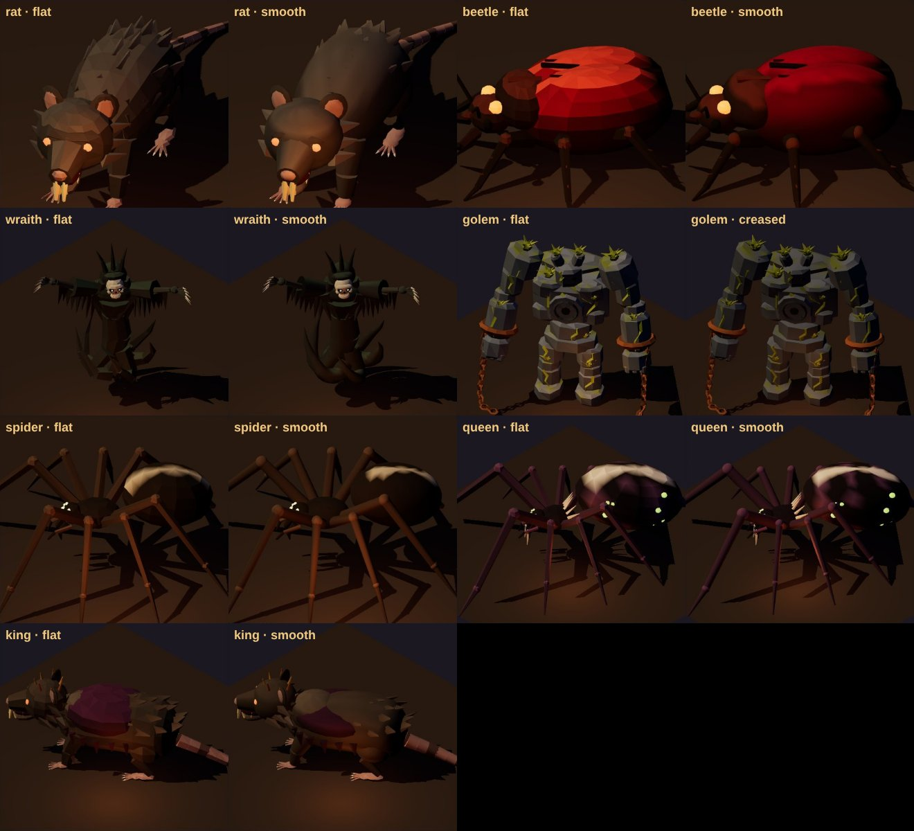

| Creature | Triangles before → after |
|---|---|
| Giant rat, Old Gutter | 3,180 → 6,758 |
| Giant spider, spinner | 1,876 → 4,982 |
| Red fire beetle | 2,428 → 5,880 |
| Goblin (rebuilt) | 2,184 → 10,884 |
| Graveyard wraith | 2,624 → 7,800 |
| Stone golem | 7,692 → 10,672 |
| The Rat King | 6,024 → 13,114 |
| The Spider Queen | 2,552 → 6,716 |

Still two draws each. A room of six goblins is about 65,000 skinned triangles, which a phone holds; the heaviest two
come alone.

**The goblin's reference:** two-thirds of a man, hunched; a big bald head, a third of its height; huge bat ears out wide
and up, frayed, brass rings through them; a heavy brow over deep-set red eyes, a big nose, a wide grin of sharp teeth;
skinny with a little pot belly, long arms, big long-fingered hands, big bare feet; a ragged red scarf over a dark leather
mantle (a V down the back), a belt of round pouches and a buckle, a ragged red loincloth, leather wound round the wrists
and shins; bright green. No weapon: it fights with its claws, so Attack is a raking swipe, Attack2 a jab, Heavy a leap
with both claws, and Cast a cackle with both claws up.

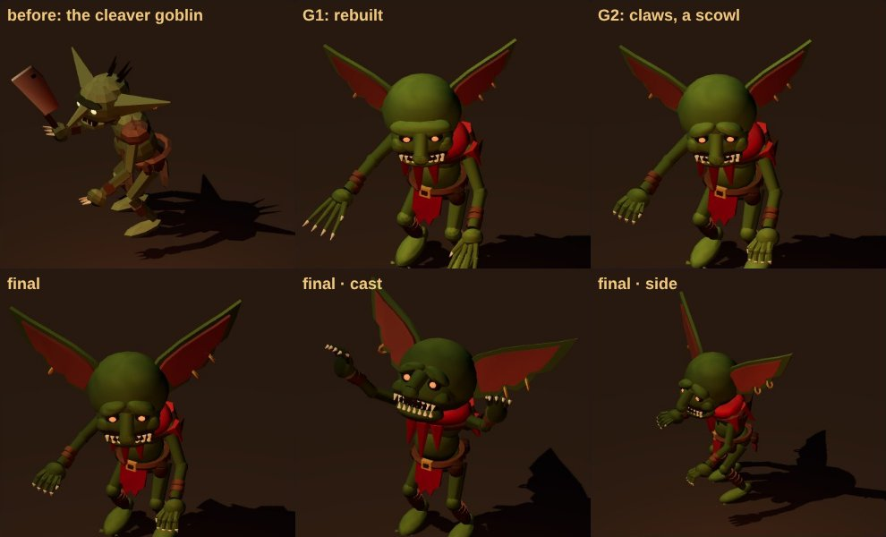

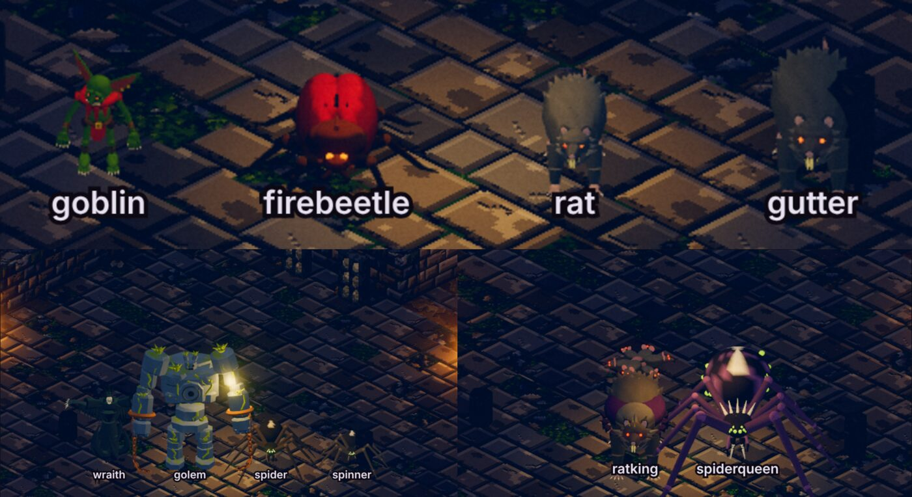

| Round | Seen | Done |
|---|---|---|
| G1 (sheet) | Rebuilt to the reference. The fingers long straight rakes; the brow one band round the skull (a cap's visor); 21,000 triangles | Fingers shorter and thicker, curled down at the tips like claws, a thumb; the brow two ridges low at the nose (a scowl); small parts at small segment counts (→ 11,000) |
| S2 (in the game) | The goblin lime and its head small from the camera. The beetle an orange blob. The golem pale with neon veins. The Queen's hourglass a white blotch. The Rat King's cape a purple shell. The rats' crest quills | The goblin's green darker, its head a tenth bigger. The beetle a deeper crimson. The golem's stone and lichen darker. The hourglass narrower. The cape flatter and darker. The rats' fur blades pressed flat to the body and laid lower |
| S3 (in the game) | The goblin's ears small beside the reference's | A quarter bigger, the rings with them |
| S4 (sheet) | Shaded smooth, the wraith's tendrils stacked logs and its bell sleeves capped pipes. The rat's face a teddy bear's | The tendrils one swept tube each (`tube()`); the sleeves' mouths dark inside; the rat's brow two ridges, a scowl |

### The wraith's arms, a man's (2026-11-10)

The owner: *"wraith arms are always stuck out wide, they should move, and be more like human arm movements"*. The bind
pose was the reference's spread, and every clip was a few degrees off it.

- **At rest, a man's arms:** they hang from slack shoulders a little out from the body, so from the game's camera they
  don't vanish against the robe. The elbows are bent, and long gaunt forearms bring big clawed hands forward to the
  hips. Your reference's spread is now the peak of the Heavy, and of the Cast's lift.
- **Joints:** the sleeve's top is shared with the chest and the forearm's root with the sleeve, so a raised arm stays
  joined. A `claw` bone at each hand's knuckles curls the fingers and splays them. The sleeve is a bell from shoulder to
  elbow, its mouth dark, its hem in rags.
- **Clips:** the shoulder leads, the elbow follows a beat later and the claws last, and the two arms are never mirrored.

  | Clip | Motion |
  |---|---|
  | Idle | breathing in the shoulders; the right hand rises and curls, the left a beat behind |
  | Walk | the arms trailing back, swinging a little against each other |
  | Attack | a rake: cocked over the head, then down across the body, the elbow snapping straight, the claws shutting after |
  | Attack2 | a two-handed lunge and grab |
  | Heavy | the spread and the shriek, then the dive |
  | Hit | the arms snapping in, elbows up |
  | Death | a last reach upward, then slack |
  | Cast | both clawed hands lifted out at the sides, trembling |

- **Round A2** (`creatures-sheet.cjs --only wraithf,wraith --clips … --frames 6`, new for reading a motion): the arms
  were short and the hands small, so the forearms are longer and the hands bigger. The Cast crossed the hands before its
  face, so it now lifts them out to the sides.
- **Cost:** 9,844 triangles, 35 bones, still two draws.

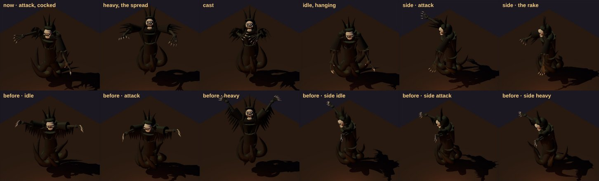

### The humanoids on KayKit's rig (2026-11-10)

The owner: *"goblin and other humanoids NPCs should use the same rigging, movement and idle like player and NPC
characters. Idle should fit with the type."*

- **The rig:** the goblin, the wraith and the golem now stand on the cast's skeleton (KayKit's Rig_Medium, loaded from
  `Skeleton_Warrior.glb`, the pack with the most clips). Each keeps its own body, built in code as before. KayKit's
  joints are moved onto the creature's own, so its proportions stay: the goblin's short legs and big head, the golem's
  long arms. The body is bound where it stands in KayKit's idle, and KayKit's clips drive it (`creatures.js onKayKit`,
  the variant's `creature.rig`).
- **Their own bones:** the bones KayKit hasn't ride on their KayKit parent and keep the motion the kit keyed for them,
  retimed to each clip. That is the jaw, the wraith's claws, its shroud and its six tendrils.
- **Fitting each pose:** each sampled pose is put back on the creature's joints (`applyFit`), since KayKit keys every
  bone's translation. The hips' sway is scaled to the creature's height, and the wraith's by a further 0.35, so it
  floats rather than steps.

| | Idle | Walk | Attack · Attack2 | Heavy | Hit | Death | Cast |
|---|---|---|---|---|---|---|---|
| Goblin | Unarmed_Idle (a crouched brawler) | Running_B (the goblin skirmishers') | Unarmed punches A and B (the claws) | Dualwield chop (both claws down) | Hit_A | Death_A | Taunt (the jeer) |
| Wraith | Idle_B (the skeletons' looming idle) | Walking_D_Skeletons (the undead's reaching walk) | 1H slice (the rake) · Dualwield stab (the lunge) | Spellcast_Summon, to half (the spread) | Hit_B | Death_C_Skeletons (it sinks) | Spellcasting (the drain) |
| Golem | 2H_Melee_Idle (a heavy stance) | Walking_C (the slow one) | Unarmed punches A and B | 2H chop (both fists down) | Hit_B | Death_B (it topples) | Taunt_Longer (the roar) |

- **Timing:** the heavy blows land on frame 5 of 10, as the cast's KayKit swings do (bake.json), and the summon is
  trimmed to its first half, as the skeleton mage's is.
- **Cost:** the same triangles and draws. Bones: the goblin 42 (KayKit's 41 and its jaw), the wraith 65, the golem 41.
  `Skeleton_Warrior.glb` keeps 22 of its 95 clips, up from 9 (785 KB → 1.47 MB).
- **A fix on the way:** in the world, a creature figure didn't carry its `creature` flag, so the heroes' heroic pass
  shrank its head to 0.62 and stretched its spine (`world.js` figureFor). The atlases always had it as built, and the
  world now does too.

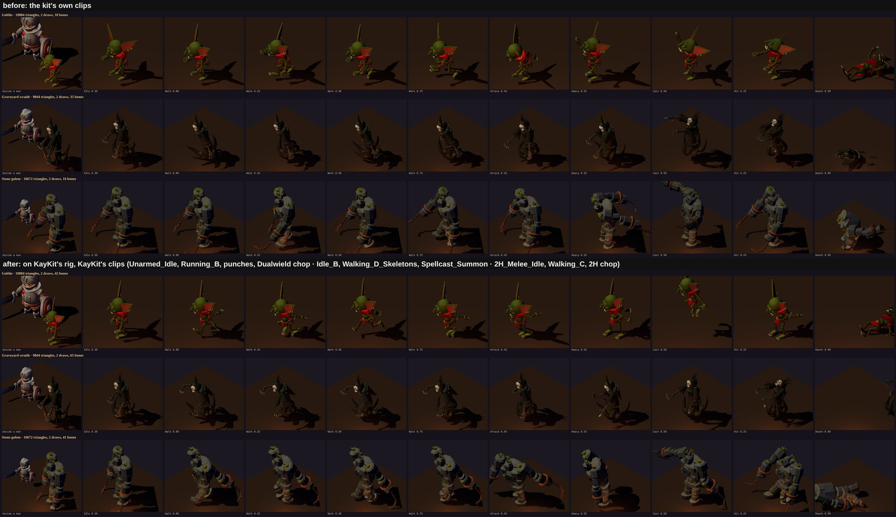

### The beasts' idles (2026-11-10)

The owner: *"Other non humanoid NPCs should also have some idle movements."* Before, the beasts' idles were small
sways: a few hundredths of a radian, 2.0–2.4 s long. They were played over the bake's 8 frames at 7 fps, so in the game
they ran 1.75–2.1× fast and read as a jitter. Now each is a loop of a beast's own business, at its own length:

| | Loop | In it |
|---|---|---|
| Rat, Old Gutter | 4 s | breathing; a sniff, the head up and the nose working; a look round, the chest turning with it; up on its haunches to wipe a paw over its face; the tail sweeping and once flicking |
| Rat King | 5 s | the same, heavier, with no grooming; a longer look and a snarl, the knot dragged on the tail |
| Spider, spinner | 4 s | the abdomen breathing (swelling as it turns); the palps never still; the fangs flexing in a bout; one leg at a time lifted and set down, the forelegs feeling ahead; the body turning a little on its legs |
| Spider Queen | 5 s | the same, her forelegs held raised and weaving, her egg-sac swelling more |
| Fire beetle | 4 s | the feelers sweeping, stopping while it looks; the mandibles clacking twice; one leg after another shifted; once a loop the wing-cases lifted and fluttered, the smoulder under them showing |

The bake holds each idle at its length: 12 frames at 3 fps for 4 s, 15 for 5 s (bake.json), so in the game it plays at
true speed. The model plays smoothly between the frames, and each foe starts its loop at its own point. The atlases
grow by 4 frames (7 for the bosses) a direction, the widest 6,954 px. No change to triangles, draws or bones.

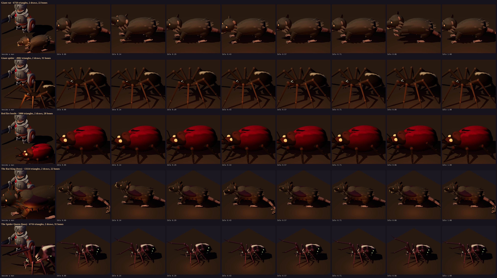

### The Proving Pens: a trial dungeon to fight them in (GDD v1.60)

The owner: *"Add a test dungeon to thornvale, one room with each of the new creatures.. level 4"*. **The Proving Pens**
(`sites.js` `proving_pens`, `plans.js`) are on the Hollow Vale behind the Scrag Warren's old adit under the north range,
its boards off again, at the end of the warren's track. Its name is over the door, and it is on the World map. They
are a trial, not canon (world doc v1.38), and will go or get a story when the creatures are placed.

- **Flat at 4**, like a secret dungeon or the Mere Tower, so it is no band and Wickham Keep keeps 4–6 as its own. It
  pays as any level-4 room does.
- **Two authored floors of five,** laid out on the Barrows' first floor and the Keep's second, so the plan rules hold.
  Each pen names its own family (`battle.js`):

  | Floor | Space | Who |
  |---|---|---|
  | 1 | The Adit Mouth | the way in (safe) |
  | 1 | The Beetle Pen | red fire beetles alone (`beetles`) |
  | 1 | The Goblin Pen | goblins alone (`gobs`) |
  | 1 | The Wraith Pen (offshoot) | graveyard wraiths alone (`wraiths`: undead, so Turn Undead reaches them) |
  | 1 | The Rat King's Hall | **the Rat King** and his swarm, the vermin's waves (`vermin`); the way down |
  | 2 | The Pens' Stair | the way in (safe) |
  | 2 | The Mixed Pen | all four new together: goblins and golems up front, beetles behind, a wraith the elite (`bestiary`) |
  | 2 | The Vermin Pen (offshoot) | rats, spiders and spinners, Old Gutter leading (`vermin`) |
  | 2 | The Golem Pen | stone golems alone (`golems`) |
  | 2 | The Spider Queen's Hall | **the Spider Queen** and her brood, the cellars' waves (`cellar`) |

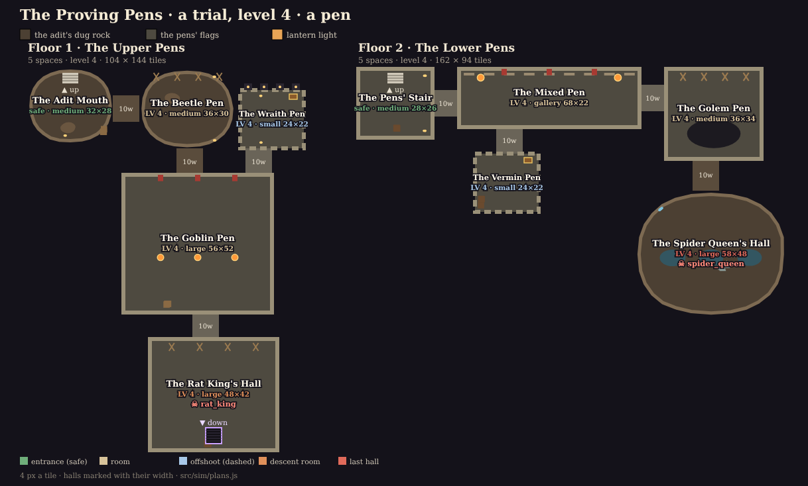

**Balance** (`roomlv.mjs 300 4 4 1,3 --site proving_pens --floor F --part P`: fighter, rogue and cleric at 4 in gear,
five minutes; `boss.mjs proving_pens 4 --floor F`, three seeds):

| Room | Waves held | Lowest | Downs |
|---|---|---|---|
| Wickham Keep's first floor (for comparison) | 21 | 75 % | 0 |
| The Beetle Pen | 23 | 72 % | 0 |
| The Goblin Pen | 22 | 75 % | 0 |
| The Wraith Pen | 20 | 52 % | 0 |
| The Mixed Pen | 19 | 76 % | 0 |
| The Vermin Pen | 22 | 70 % | 0 |
| The Golem Pen | 17 | 70 % | 0 |
| The Rat King (his hall) | down in 74–87 s | 74–76 % | 0 |
| The Spider Queen (her hall) | down in 56–61 s | 64–81 % | 0 |

The wraiths cut deepest (52 %) and the golems last longest (17 waves). Every pen holds well past the contract's ten
waves at the level, as the Keep's rooms do.

`test/pens.test.mjs` checks the following:
- the site and its plan;
- each pen fills with its own kind and nothing else, at 4;
- the two bosses open their halls;
- the way in from the Vale and out to it.

### In the sim (unplaced but for the Pens)

- `battle.js`: `firebeetle` (rogue: a `firespit` bolt, 8 tiles), `gob` (minion), `wraith` (warrior), `golem` (warrior,
  DEF 9, speed 2.3); `rat_king` (`swarm`, escort rats) and `spider_queen` (`call`, a spider and a spinner), at their
  mirrors' HP, ATK and DEF. No family of the game's own lands names them yet: only the Proving Pens' (above).
- Names (`content/foes.json`), actors (`renderer.js` `ENEMY_ACTOR`), bolt look, banners, voices (`audio/cues.js`).
- **The Stage fights them:** `?dev&scene=stage&show=fx&foes=firebeetle,golem` (a family of those alone for the room),
  `&boss=rat_king` (that boss in the floor's hall), `&quiet=0` to let the party's skills run.
- **Balance:** `tools/balance/boss.mjs wickham_keep 5 --floor 1 --boss rat_king` and `… 6 --floor 2 --boss spider_queen`
  (GDD v1.59's numbers). `test/bestiary.test.mjs`: the mirrors, the bosses' stats against their mirrors', every actor
  cast as a creature.

## The toads (2026-11-13)

The owner: *"Like before we created new nPCs, take a strong pass at creating toad NPCs for the toad king dungeon"*, with
two references: a big warted brown toad sat up on its forelegs, and a horned monster toad with a mouth of fangs and a
barbed tongue thrown out of it. GDD v1.83, world doc v1.43 (the Boat Hall's *"something living in each"* hull is a toad;
the Toadking got his name from them).

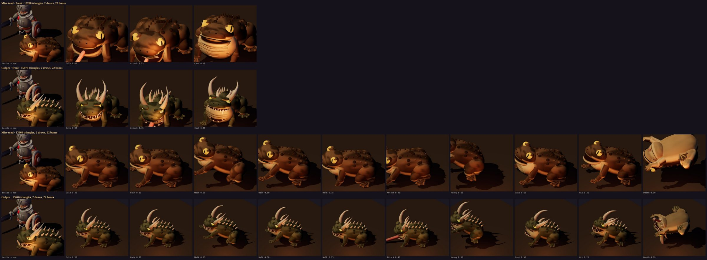

**One body plan, two creatures** (`creatures.js` `toad`, `gulper`), the kit's fifth plan after the quadruped, the
arachnid, the hexapod and the bipeds:
- one lathed hull, wider than tall and pitched up toward the head, the rump low;
- a broad flat head over a jaw and a throat sac on their own bones (the jaw opens, the sac swells: the croak);
- forelegs straight and splayed, hind legs folded along the flanks on long webbed feet;
- warts and a ridge of spines laid on the hull's surface, the back blotched by a coarse hash of where a vertex is;
- gold eyes in bulging sockets under a lid, the pupil a slit;
- **the tongue**: a chain of four bones out of the jaw, built laid out straight, kept in the mouth by scaling its root to
  nothing in every clip but a lash.

The mire toad, hip-high to a man (0.55), is brown and warted with a cream belly, and has a short pink tongue. The gulper,
chest-high (0.9), is grey-green, with two great horns, a lesser pair, bone spikes down its back, fangs, and a tongue as
long as itself with a bone spear-head and barbs. Clips: an idle of five seconds (breathing, a look round, a forefoot
shifted, the tongue flicked once); a hop for a walk; the lunge and bite (the gulper's the lash: back, mouth wide,
thrown, held, hauled in); a bite and a slap; the leap and belly-flop for the heavy; a flinch; rolled belly-up for death;
the croak.

**Critic rounds** (`creatures-sheet.cjs --only toadf,gulperf,toad,gulper`):
- **T1:**
  - The mouth's seam lay out in front of the face like a strap: it now sits on the head's widest edge, thinner.
  - The lids stood up as knobs: smaller, down on the eye.
  - At the rat's glow the gold eyes burned out white: 0.6.
  - The browns read orange in the warm light: muted.
  - The gulper's bright gums read as a red rubber ring: dark.
  - Its fangs were too small to read: twice the size, a long pair at the corners.
  - Its spines were too many: six a row, the crown of little spikes gone.
- **T2:**
  - Seen side on, the far eye's socket stood over the head: lower, further out.
  - The hop didn't read from the camera: half again higher, the legs thrown further.
  - At the lash the barb was a dark speck: a bone spear-head with six raked barbs.
  - The tongue's red read as paint: muted.
- **In the game** (`stage.mjs --show cast` in the Mound's second floor; `--show fx --foes gulper`): beside a reed-cutter
  and the knight they read at their sizes; the gulper's horns and fangs and the toad's gold eyes carry; both fall
  belly-up. The gulper's heavy comes down on the party with the mound's mud and the room shakes (fx.js `quake`).

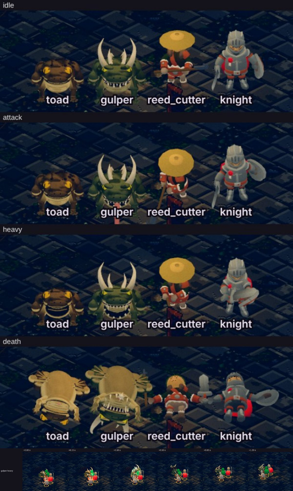

**A kit fix on the way:**
- **What happened:** `clip()` keys only the bones a frame names. The tongue's turn was named only while it was out, so
  its track had holes, and three's mixer hung on the first pose.
- **The fix:** every frame keys the tongue now. A bone a frame doesn't name rests there (the arrays are filled, not
  sparse).
- **The test:** `test/toads.test.mjs` checks every creature's tracks are whole. It runs where the lab is installed.

**Triangles:** 13,260 and 15,466, two draws each (the Rat King's 13,114). The first build was 15,840 and 17,870: forty
warts and toe-knobs at the kit's sphere density were half the toad, and are now low-count bumps.

**In the sim** (`battle.js`):
- `mudtoad`: a minion's strength, HP 40, ATK 7.6, dodge 2.
- `gulper`: a warrior's strength, HP 58, ATK 9.8, reach 4.6.
- The families: `toadmen` (the Mound's first floor: toads and reed-cutters, the reeve its elite) and `boathall` (the
  second and third: a gulper the elite).
- The Toadking's escort: `gulper` and `fowler`.
- Names, actors, sparks (`fx.js`: the tongue a thrust, the gulper's heavy a `quake`), voices (croaks pitched low).
- Measured (GDD v1.83): the right party holds the Mound's rooms as before (2 of 9 defeats either way), and the Toadking
  falls in 49–51 s against 49–53 s.

## As built

The answers to §6: the kit in code (1); the spiders in Wickham Keep's Old Cellars (2); the web damage only, no new rule
(3); Old Gutter in now, the Cutting's elite (4); the look as on the sheet (5), the rats a fifth bigger.

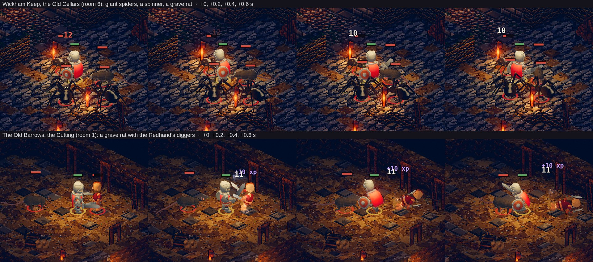

*In the game on the manual clock: the hero kept standing in each room until its vermin were up, four frames 0.2 s apart.*

- **The sim** (`src/sim/battle.js`):

  | Kind | Mirrors | HP / ATK / DEF | Its difference |
  |---|---|---|---|
  | `rat` (grave rat) | minion | 31 / 7.2 / 3 | dodge 12, speed 4.0, reach 2.4; 1 gold |
  | `spider` (giant spider) | warrior | 55 / 9.5 / 6 | chitin, speed 3.0; the cellars' elite |
  | `spinner` | rogue | 34 / 8.4 / 3 | a `web` bolt at range 12 (damage only) |
  | `gutter` (Old Gutter) | warrior | 56 / 9.6 / 5 | the Cutting's elite, every fifth wave as any elite |

  - **Two families, not one `vermin`,** because each room mixes the vermin with what's already there:
    - `cellar` = `{ melee: ['rat', 'spider'], ranged: ['spinner', 'spinner'], elite: 'spider' }`: Wickham Keep's Old
      Cellars (`plans.js` `old_cellars`, floor 2);
    - `cutting` = `{ melee: ['cutthroat', 'rat'], ranged: ['crossbow', 'rogue'], elite: 'gutter' }`: the Old Barrows'
      Cutting (`the_cutting`, floor 1). The rat takes the risen minion's place beside the diggers.
  - None undead (Turn Undead does nothing to them). The board's bounty counts Old Gutter as the Barrows' elite he is.
  - Names for the defeat screen: `content/foes.json`.
- **The art:**
  - `variants.json`: VR1 the rat (height 0.47, a fifth over the spike's), VR2 the spider (0.54), VR3 the spinner (the
    spider smaller and paler, 0.41), VR4 Old Gutter (the rat greyer, 0.61). `bake.json`: `vermin_rat`, `vermin_spider`,
    `vermin_spinner`, `vermin_gutter`, their clips mapped to the kit's.
  - Baked: `assets/actors/vermin_*` (atlases) and `cast.json` (no GLB: the game builds them from the kit). `lab.js` bakes
    a creature's vertex colours and its own glowing eyes.
  - `renderer.js` `ENEMY_ACTOR` maps the kinds; the web's orb is a pale silk (`fx.js` `BOLT_RGB.web`).
  - Voices: the rats a goblin's squeal pitched up, the spiders a cultist's hiss pitched down (`audio/cues.js`).
- **Balance** (`tools/balance/roomlv.mjs --part`, 3 seeds, 300 s; before = the same rooms with the diggers and the cult):

  | Room | Party | Before | After |
  |---|---|---|---|
  | the Cutting at 3 | the right party at 3 | 28 waves | 28 waves |
  | the Cutting at 5 (two up) | the right party at 3 | 18.3 | 18.3 |
  | the Cutting at 1 | hero 1 and a hire | 16.0 | 19.7 |
  | the Old Cellars at 6 | the right party at 6 | 19.7 (held 3 of 3) | 17.3 (held 2 of 3, nobody Fallen) |
  | the Old Cellars at 8 (two up) | the right party at 6 | 7.7 | 9.0 |
  | the Old Cellars at 6 | the hero alone | 5.7 | 5.3 |

  The contract's room (the Breach) is untouched; `smoke-test.mjs` passes with its replay.
- **Checks:**
  - `test/vermin.test.mjs`: every kind named, none undead; each within 15 % of its role's HP and ATK; each room fills with
    its own and nothing else;
  - `test/redhand.test.mjs`, `test/models.test.mjs` (a creature names no model, its clips the kit's);
  - the browser suite: a grave rat in the Cutting stands as its model (`world.js` `stats.modelNames`).

*The proposal as it was put follows.*

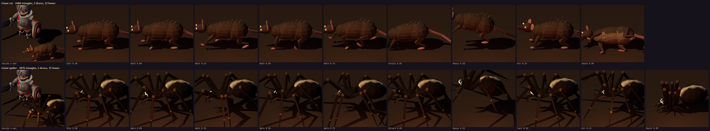

*The spike's model sheet (`node tools/actor-lab/creatures-sheet.cjs`):*
- *each creature beside the KayKit knight at the size the cast would give it, then through its clips;*
- *the game's camera angle (45° round, 35° down) in a torch-lit room;*
- *every frame posed through `figure.js` `pose`, as the bake and the game pose a figure.*

## 1. What we have

- **Every foe is a man.** All 76 actors in `tools/actor-lab/bake.json` are KayKit's humanoids (knight, barbarian,
  rogue, mage, the four skeletons), recoloured, re-dressed and re-proportioned (`variants.json`, `figure.js`). One
  builder, `figure.js` `build`, makes each:
  - the bake (`lab.js`) draws it into its atlas: the sprites, `?figures=sprites`, the Frontier;
  - the game stands it in Luminati's world as a skinned model (`tools/render3d/world.js`, from `assets/models` and
    `cast.json`);
  - the animator (`render/anim.js`) picks a clip (`idle`, `walk`, `attack`, `heavy`, `hit`, `death`…) and a frame;
    the model plays the KayKit clip `cast.json` maps it to.
- **KayKit has no beasts.** A man can't be bent into a spider, or a rat without looking like a man on all fours. The fen
  ghoul is as far as bending goes.
- **Canon:**
  - **Grave rats are canon:** the world doc's Beasts family (§8), and the GDD's bounty *"Old Gutter, a grave rat the size
    of a dog, is eating the dead in the Barrows."* The world doc already plans the beasts "on one shared quadruped"
    (war-hounds, wolves, boars, snow-wolves) and "at most two new silhouettes a region".
  - **Spiders are not.** They go into the world doc first, where and whose (§6, question 2).

## 2. The ways to get a beast, weighed

| Way | For | Against |
|---|---|---|
| **A free animated pack** (e.g. Quaternius' CC0 animals and monsters) | Real animation; quick if it has the beast | Its own rig and clip names per pack; another hand's style beside KayKit's; can't be fetched here (itch.io and OpenGameArt are blocked to this environment); a dependency row; what the pack lacks (a giant spider with our clips) we'd still have to make |
| **Bend a KayKit man** (as the fen ghoul) | No new pipeline | No spider; a rat on a man's skeleton walks like a man |
| **Luminati's own pixel monsters** (its procedural sprites) | They exist | Flat cards, against the art standard the landmarks set (built in 3D, lit, shadowed) |
| **Our own creature kit, in code (recommended)** | Our style; nothing downloaded; one rig per *body plan*, its species by parameters; clips made to our clip names; deterministic; flows through the bake, the cast and the 3D figures unchanged | The animation is ours to tune (the spike's is a first pass) |

## 3. The recommendation: a creature kit in code

`tools/actor-lab/creatures.js`, in the same spirit as the env kit (`buildkit.js`): the catalogue is code.

- **A rig per body plan, not per species.** Each body plan is built bone by bone at its bind pose. Its parts (blobs and
  tapered limbs, faceted, vertex-coloured) are rigid on their bones in **one skinned mesh**, plus one for its glowing eyes.
  - **The quadruped:** the rat now; then the world doc's hounds, wolves, boars and snow-wolves on its proportions.
  - **The arachnid:** the spider and its kin.
- **Clips keyed in code**, named as the cast wants: `Idle`, `Walk`, `Attack`, `Attack2`, `Heavy`, `Hit`, `Death`,
  `Cast`. They're sampled at 24 fps from small functions:
  - the rat scurries on its diagonal pairs;
  - the spider walks the alternating tetrapod gait, four legs down while four swing;
  - each rears, lunges and dies its own way: the rat rolls onto its side, the spider curls its legs in under it.
- **One seam:** a variant names `creature: { kind: 'rat', … }` in place of `model`.
  - `figure.js` `build` returns the creature in the shape it returns a KayKit model in (`{ root, mixer, clips, frame }`).
  - `pose` leaves a creature's proportions alone (the heroic pass is a man's).
  - Nothing else changes: the bake bakes its atlas, `models.mjs` writes its cast entry (no GLB to prune), world.js stands
    it in the world, and the animator drives it.
  - Its size is the variant's existing `height` (a man is 1).

**Measured (the spike):**

| | Triangles | Draws | Bones | Height |
|---|---|---|---|---|
| Giant rat | 1,680 | 2 | 22 | knee-high, a third of a man; nose to tail-tip 1.4 men |
| Giant spider | 1,876 | 2 | 31 | waist-high; its legs span 1.5 men |

- A room of six: about 11,000 triangles and 12 draws, under a figure's budget.
- `luminati.js` 135 → 139 KB gzipped with the kit in it.

## 4. The two creatures

- **The giant rat:**
  - **Look:** a grave rat the size of a dog: hunched, the haunches broadest, a mangy ridge down its back, a bare ringed
    tail curling to the ground, round bare ears, yellow teeth, eyes like coals.
  - **Clips:** it scurries, lunges to bite (`Attack`), rears and claws (`Attack2`), leaps (`Heavy`), squeals (`Cast`, if
    a rat should ever call) and rolls over dead.
- **The giant spider:**
  - **Look:** a cellar spider grown wrong: low and wide, eight banded legs, a swollen dark abdomen with a pale mark down
    it, eight eyes catching the light, the fangs working.
  - **Clips:** it walks, rears and strikes (`Attack`), bites (`Attack2`), pounces (`Heavy`), spits a web (`Cast`) and
    dies with its legs curled.
- **Variants by parameters:** the fur, belly, body, banding and eye colours and the seed are parameters. A *spinner*,
  smaller and paler, is the same spider at a smaller `height`. **Old Gutter** is the rat at a bigger one, greyer.

## 5. In the sim (the balance contract holds whoever fills a wave)

Each new kind mirrors a role's strength, as every family has (`battle.js`, GDD §7.1). The waves get harder in kind, not
in sum.

| Kind | Mirrors | Its difference |
|---|---|---|
| `rat` (giant rat) | the minion | quicker and lighter (HP about 30, dodge 12, speed 4.0), a short reach; vermin carry little gold |
| `spider` (giant spider) | the warrior; the family's elite | chitin (DEF 6), slower; its heavy blow a pounce |
| `spinner` (a smaller spider) | the rogue (ranged) | spits a `web` bolt |

- **The family:** `vermin` = `{ melee: ['rat', 'spider'], ranged: ['spinner', 'spinner'], elite: 'spider' }`, none of
  them undead (Turn Undead does nothing to them).
- **Mixed into what's there:** grave rats in the Old Barrows' rooms with the diggers (they eat the dead, and the dig
  turned them up).
- **Old Gutter** as the bounty's named elite (GDD §16's board), at the elite's stats.
- **Checks:** the room-level harness and the boss harness on a `vermin` room before and after, and the smoke test's
  contract.

## 6. Questions for the owner

1. **The approach:** our own creature kit in code (recommended), rather than a downloaded pack?
2. **Where the spiders live** (canon; the world doc first). Candidates:
   - Wickham Keep's second floor, "a castle then a cave": its cellars gone to the spiders, and the Redhand won't go down;
   - the Sunken Chapel's flooded undercroft;
   - a Fens site (webs over the meres).
3. **The spinner's web:** damage only, as every other bolt (no balance change), or a short root on the one it hits (the
   heroes' Binding Roots' status turned on them: a rule, so a balance run)?
4. **Old Gutter:** in now, as the Barrows' bounty elite?
5. **The look:** the rat and the spider as on the sheet, or more grotesque (bigger fangs, a skull-mark, sores), or less?

## 7. The work, if approved

1. **The world doc:** the spiders' place and lore; the grave rats' look (§8).
2. **The sim:** the three kinds, the family, where they fill waves; Old Gutter; the balance runs. Tests: the kinds'
   stats mirror their roles (as the Fens' test does).
3. **The art:**
   - `bake.json` and `variants.json` entries naming `creature`, re-baked (atlases, `cast.json`);
   - a `web` bolt's look (`skillfx.js`);
   - a squeal and a hiss (`tools/audio/synth.mjs`, no download);
   - the animation tuned on the manual clock (burst frames of each clip in a real fight: `tools/capture/skills.mjs`'s way).
4. **Checks:** the browser suite (a creature stands as a model and plays its clips); a capture sheet in a room at dusk.

## The spike, in the code

- `tools/actor-lab/creatures.js`: the kit, `buildCreature({ kind, … })`: the rig, the parts, the clips.
- `tools/actor-lab/figure.js`: `build` returns a creature for a variant naming one; `pose` keeps a creature's proportions.
  Inert until a variant names a creature.
- `tools/render3d/build.mjs` stages `creatures.js` with `figure.js`.
- `tools/actor-lab/creatures.html`, `creatureslab.js`, `creatures-sheet.cjs`: the model sheet above.
- No node test: `three` resolves only under `tools/actor-lab`, which CI doesn't install. The sheet is the spike's check.
