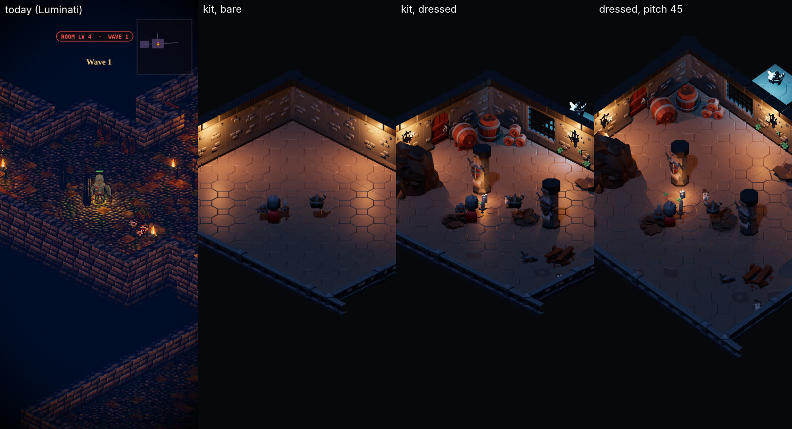
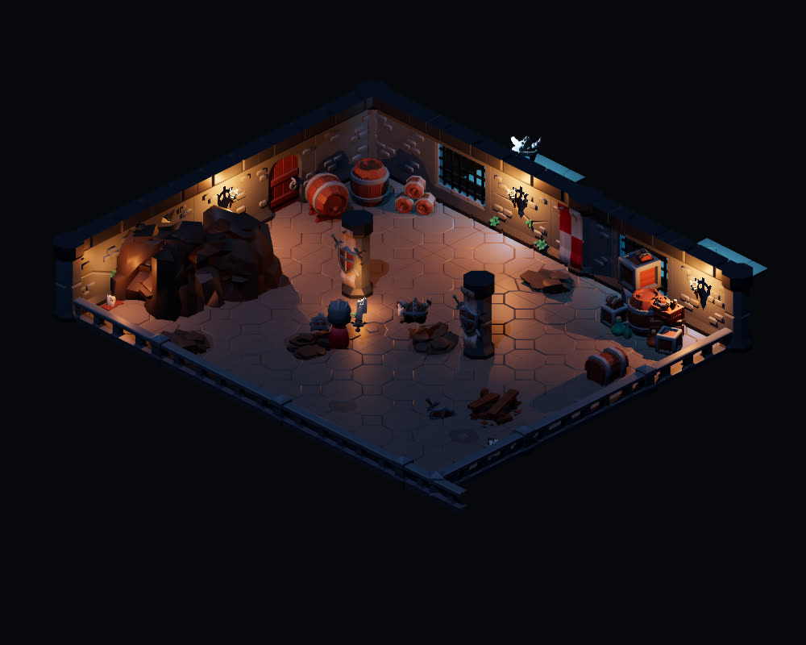
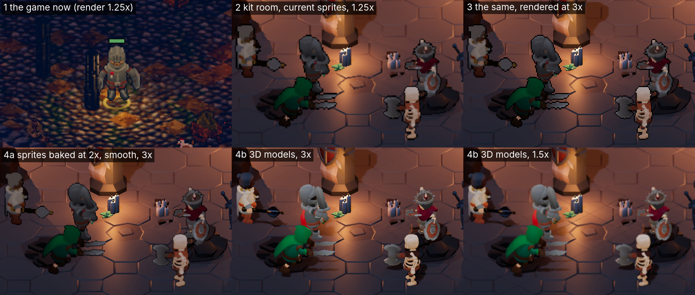
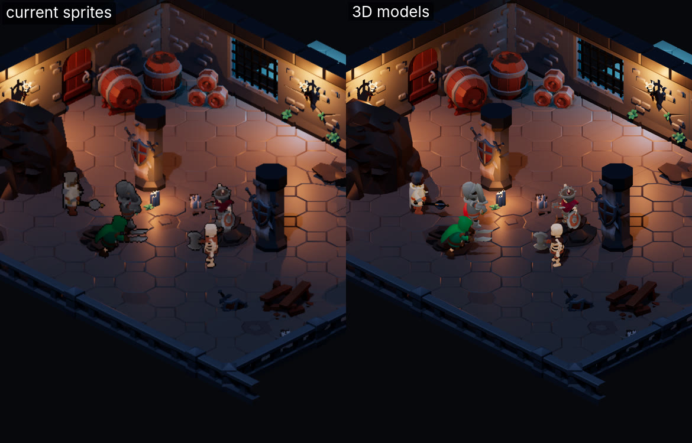
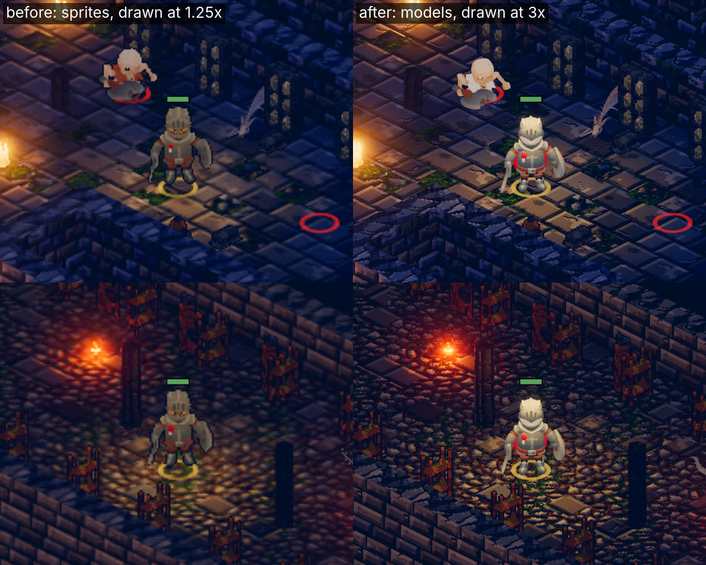
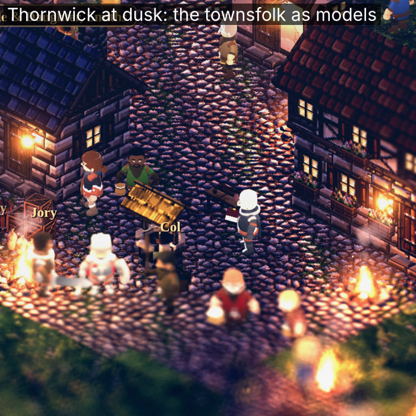

# The dungeon and world kit: toward the owner's reference (a proposal, 2026-11-09)

**Status: the walls and floors declined; §9's figures built** (2026-11-09). The owner: "dont change the dungeon walls and floors with KayKit - let's keep what we have": the dungeons keep Luminati's walls, floors and our dressing as they are, and §1–8's kit is not built (the spike in `tools/kit/` stands only as a record). The people as models at 3× (§9.6) are built and stay. The owner (2026-11-09), with a reference frame: "Use this as an art reference that we should
improve our existing dungeon assets to… look how smooth and addition dressing… propose an approach to design and build
improved world and dungeon tile assets."

The reference is a frame from a commercial game, so it stays out of the repo and is described here in words (as in
[art-critic-pass-11.md](./art-critic-pass-11.md)). The captures are ours. The spike's page and its shot script are
`tools/kit/spike-room.html` and `tools/kit/spike.mjs`.

**In short:** build dungeons (and later the towns' and overlands' ground) from a **modular 3D kit of real meshes** in
the Luminati renderer, instead of Luminati's textured cubes. Start from **KayKit Dungeon Remastered** (CC0, by the
author of our cast). Fill its gaps with pieces of our own and Quaternius' nature pack. The **sim's cells stay the
authority**, and a converter fits kit pieces to them. A spike room shows it on our camera (§4): the play area is 1.7×
brighter while the frame stays as dark beyond the walls; the walls have shape, gates, a balustrade toward the camera,
and clutter along their feet. The surface richness of the reference needs a material pass on top (§5.4).

---

## 1. The reference, read

A courtyard dungeon at dusk, seen from about 45° above (steeper than our 30°), closer than our camera. What makes it
look "smooth" and dressed:

| | What it does |
|---|---|
| **Form** | Walls are sculpted modules with depth: a plinth, pilasters, a cornice, and a parapet with a balustrade on top. Bays are recessed, with iron-barred gates. Heights change: a raised terrace behind, low balustrades toward the camera. No wall is a flat slab. |
| **Surface** | Big irregular flagstones with cracks and worn edges. The blocks are chamfered, and each stone varies a little in colour. Dark contact shading sits wherever a wall or prop meets the floor. |
| **Dressing** | Clusters, not scatter. Bones, skulls and ribcages lie along the wall feet, with urns in groups. Ivy hangs from the parapet, and ferns and flowers grow on the ledge. Lights are props: torches on tripods and a brazier. The middle of the floor is open for the fight. |
| **Light** | Two temperatures. A warm key comes from the torches and the low sun, and a cool cyan light comes from the cells behind the gates. Shadows are soft and the figures are rim-lit. The floor reads everywhere the fight is. |
| **Scale** | The figures are about 2.5× ours on screen, and the walls about two figure heights. |

Measured on the frame, scaled to a phone's width: **4.9 % of it is near-black** (luma under 20/255). The play area
averages **0.32** luma, and its 90th percentile is 0.53.

## 2. What we draw today

The Vale's three dungeons, two floors each, at dusk on both renderers (`node tools/capture/rig.mjs vale-dungeons
--renderer both`). Wickham Keep's first floor is the leftmost panel below.

- **Walls (Luminati):** the tile engine's cubes, two of our tiles a side. A brick texture repeats on every face. Every
  wall is the same height, its face flat, its top a flat cap. There are no openings, plinths or trims; a doorway is a
  gap. Walls toward the camera stand at full height and hide the room's near half.
- **Floor:** one cobble texture repeated every tile, so the grid shows.
- **Dressing:** our baked props stood as sprites. They are few, and small against the walls.
- **Light:** three or four lamps in frame. Most of the frame is black, including the room the fight is in.

| Frame (390 × 844) | Near-black | Play-area mean | Play-area p90 |
|---|---|---|---|
| Reference (scaled) | 4.9 % | 0.32 | 0.53 |
| Today, Luminati, Wickham Keep f0 | 68.1 % | 0.11 | 0.21 |
| Today, Emberlit, the same | 73.9 % | 0.08 | 0.16 |
| Spike, bare kit | 62.2 % | 0.20 | 0.40 |
| Spike, dressed | 66.5 % | 0.19 | 0.39 |

(The play area is the box x 40–350, y 250–600, where the camera keeps the hero.)

## 3. Why the gap is structural

No amount of retexturing a cube gives a plinth, a recessed gate or a balustrade. Luminati's terrain is a heightfield of
tiles with a top and a side texture each (`convert.js` `LEGEND`, `B: { top: 'crag', side: 'stone_brick' }`). That suits
the outdoors, but a dungeon's walls are architecture. The reference's look comes from **modular meshes**: wall pieces
that snap on a grid, with their own trims, corners, openings and variants, plus props placed against them.

## 4. The spike

One room, 24 × 20 kit units (about 34 × 28 of our tiles), built from 37 pieces of KayKit Dungeon Remastered. It is
lit as our dusk: a cool fill, three warm wall torches, and a cyan light in two cells behind the gates. The camera is
the game's (yaw 45°, pitch 30°, orthographic, the game's zoom on a phone). The KayKit Knight and Skeleton Warrior,
the models our atlases are baked from, stand in for scale.

- **It shows** that architecture beats texture. The walls have mass and a silhouette. The gates give the far wall
  depth and a second light colour, and the balustrade lets the camera see the whole room. Clutter along the wall feet
  and two pillars break up the floor while the middle stays open. The play area is 1.7× brighter (0.11 → 0.19) with
  the frame as dark beyond the walls (68 % → 67 % near-black): the dusk kept, the fight readable.
- **It doesn't show** the reference's surface. KayKit is flat colour from one gradient atlas (1024²), clean and
  toy-like; it matches our cast but not the reference's painted stone. Its floors are hexagon-patterned slabs, not
  irregular flagstones. There is no ivy, no bones and no urns. Nothing is optimised: 106 draw calls and 40 k triangles
  in the phone frame, one call per piece.
- **The camera at 45°** (the fourth panel) is closer to the reference and shows more floor, but it is a separate
  decision (§8): the HUD, the taps and the minimap all assume 30°.

Reproduce: `sh tools/kit/fetch.sh` (and the cast: `tools/actor-lab/fetch-assets.sh`, `npm i` in `tools/actor-lab`),
then `node tools/kit/spike.mjs` → `tools/capture/out/kit/`.

## 5. The approach

### 5.1 Where: the Luminati renderer

The game is committed to Luminati ([luminati-port-plan.md](./luminati-port-plan.md) §13), so the kit is meshes in it.
Emberlit's dungeons stay as they are, as the fallback. `bake-env.cjs` could later bake the same kit to sprites for it,
if parity is wanted.

### 5.2 The sources

| Source | Licence | What it gives |
|---|---|---|
| **KayKit Dungeon Remastered** (Kay Lousberg, 200+ pieces) | CC0 | Walls: straight, cracked, broken, gated, arched, doorway, window, corner, T, crossing, endcap, half, sloped. Pillars, and barriers (a balustrade 1.1 units high). Floors: large, small, broken, weeds, dirt, grates; foundations; stairs. Torches, candles, banners, barrels, crates, kegs, shelves, tables, chests, rubble, coins and keys. One gradient atlas. |
| **Quaternius Stylized Nature MegaKit** (already used for the undergrowth) | CC0 | Ferns, bushes, flowers, ivy-like plants, rocks: the greenery from the ledges down, and the caverns' rock. |
| **Ours, built in code** (as `buildkit.js` builds the towns' common things) | ours | What neither has: bone piles, skulls, ribcages, urns, a tripod torch, a brazier, iron cages, sarcophagi, cobwebs, ivy strips, and each site's set pieces (the Breach's columns, the font, the vats). The dressing passes' voxel props (critic pass 18, [vale-dungeon-dressing.md](./vale-dungeon-dressing.md)) are rebuilt as meshes in the kit's style. |

Candidates for the towns and overlands, to check in phase 0 before relying on them: KayKit's and Quaternius' other
CC0 medieval and ruins packs.

### 5.3 Fitting the kit to the sim

The sim's dungeon cells stay the only authority for walls, obstacles, doors and the fight. The kit is presentation
(AGENTS.md rule 2), so **no balance, replay or save number can move**. In `src/render3d/convert.js`, a new **kit plan**
does the following:

1. **Scale.** The kit keeps its own proportions against our figures: a KayKit wall is 1.6 figure heights, so it is
   scaled by 1.75 / 2.47 = 0.71 into Luminati units. A 4-unit module is 2.8 Luminati units, about **5.7 of our tiles**:
   one module is about a hall's width (6).
2. **Runs.** Each room's boundary, between floor cells and wall cells, is traced into straight runs. A run is split into
   full and half modules, stretched by at most 12 %. Corners, T-joins and ends come from the neighbour mask.
3. **Which way they face.** Runs on the far sides (facing the camera) are tall walls. Runs on the near sides become
   **barriers**: a balustrade the camera looks over, in place of today's full-height near walls. This is the same rule
   as Emberlit's walls cut to stubs, said in architecture.
4. **Variants** by a hash of the run's position and the floor's kit (a crypt cracked, a keep with pillars, a chapel
   arched). Gates and doorways go where the sim has openings or the plan names cells.
5. **Floors** are slabs on their own grid, independent of the walls, with a few small-tile patches. The water stays
   Luminati's.
6. **Black beyond the walls**, as today.

It is pure and deterministic (a function of the sim's level and the seed). It gets unit tests: every boundary cell
covered, no tall piece over a walkable cell, the same plan twice from the same seed.

### 5.4 Dressing, in layers on the existing grammar

The grammar stays as [vale-dungeon-dressing.md](./vale-dungeon-dressing.md) set it: tall things at the back walls, low
things near, a lit set piece on the axis, the middle open, the doorways lit by their place. The kit adds layers:

| Layer | What | Rule |
|---|---|---|
| L1 Set pieces | The authored ones (already in the sim's plans) | As placed today |
| L2 Wall feet | Clusters of barrels, urns, bones, rubble along the back walls | A seeded Poisson scatter in a 1.5-tile band; clusters of 3–7 |
| L3 Greenery | Ivy from wall tops, ferns at the feet, moss | By kit: the chapel and the Fens heavy, the crypt light, the keep none |
| L4 Floor detail | Decals: cracks, moss, grime, puddles, scorch | Seeded, a few per room, never on a fight marker |
| L5 Lights | Wall torches, tripods, braziers, cold cell lights | Two temperatures; Luminati's 12-lamp budget, pooled |

**Collision rule:** anything that blocks must be an obstacle in the sim (as today's props are). Purely cosmetic
pieces stay below knee height wherever the floor is walkable, so a figure never seems to stand inside a barrel.

### 5.5 Surface: a material pass over the kit

This closes the gap the spike leaves:

- **Per-kit palettes.** KayKit's single atlas is recoloured per kit: crypt limestone, keep brick, chapel sandstone
  under moss, the dig's earth, the Fens' green-black. This is cheap and done at build time.
- **A detail layer.** A world-space (triplanar) stone, crack and grime texture multiplied over the flat colour, in
  three.js's material hook (`onBeforeCompile`): two 512² textures, CC0 or made in code.
- **Ambient occlusion baked per piece** into vertex colours at build time, plus contact-shadow decals at the wall feet.
- **Floors:** a flagstone slab set of our own (irregular stones, chamfered, seeded colour variation) to replace
  KayKit's hexagons where the kit wants the reference's look.

### 5.6 Light

Use the reference's recipe within our dusk: a warm key from the props, a cool counter-light (the cells, a shaft from a
grate, the water), and soft shadows from one shadow-casting light (plus at most two torch shadows on a phone). The
target is the **play area at 0.20–0.26 mean luma, with the frame still over 60 % black beyond the walls**. The owner
has kept the game dusky and gloomy; the reference's 0.32 is brighter than that (§8).

### 5.7 The world, after the dungeons

The same method applies to the towns and overlands:

- the ground blended across tiles (a splat map, not one texture per tile, so the grid disappears);
- cliff and bank meshes in place of the cubes' sides;
- paths as decals;
- walls, fences and steps from the kit.

### 5.8 The figures (a follow-up decision)

The kit will make our 56 px baked sprites look lo-fi beside it. Two ways out:

- re-bake the atlases at 2× (`BAKE_PX`);
- draw the KayKit glTF characters themselves in Luminati, since our atlases are baked from those very models.

The second is closer to the reference, but it is its own proposal: animation, weapons, the eight facings, and the
memory budget.

## 6. Building it

- **`tools/kit/`:**
  - `fetch.sh` (the CC0 packs into `tools/kit/models/`, gitignored);
  - `build.mjs` (pieces → one `.glb` per kit with its palette, the baked AO and the merged atlas, plus `kit.json`:
    each piece's footprint, height, sockets and whether it blocks) → `assets/kit/` (committed, never hand-edited:
    AGENTS.md's bake rule);
  - `spike.mjs` and `spike-room.html` (this proposal's).
- **Luminati:** `tools/render3d/world.js` gets a **kit layer**. It instances each piece once per kind
  (`InstancedMesh`: one draw call per kind, not per piece) from the kit plan the converter hands over, and
  `build.mjs` rebuilds the vendor bundle.
- **A dependency** for glTF optimisation (`@gltf-transform/core`, build-time only) needs an architecture decision row
  first. Without it, the build uses three's own loader and exporter in Node.
- **Review:**
  - the kit in the art review (`?dev&scene=stage&show=kit`: every piece in each kit's palette);
  - `rig.mjs` before and after for every site and floor;
  - a critic pass scored on a rubric against the reference, as pass 11 did (reference, us, target).

## 7. Phases and gates

| Phase | What | Done when |
|---|---|---|
| 0 | **In the game:** Wickham Keep's first floor built from the kit by the converter (straight runs, corners, barriers, floors, the torches). The phone measured. | The owner has seen it. The gates below are measured on the iPhone. |
| 1 | The kit plan for every built site (the keep, the chapel, the barrows' crypt), with variants per kit and the caverns' rock from the nature pack | Every Vale floor on the rig, before and after |
| 2 | Dressing layers L2–L5 and our missing pieces (bones, urns, tripods, braziers, cages, ivy) | The critic pass's rubric at its target |
| 3 | The material pass (palettes, detail layer, AO, flagstones) and the light recipe | Play area 0.20–0.26, over 60 % black beyond |
| 4 | The Fens' dungeons, then the towns' and overlands' ground (§5.7) | Every map on the rig |
| 5 | The figures (§5.8), as its own proposal | The owner's decision |

**Gates for every phase** (the port plan's §8, plus the kit's own):

- 60 fps in a dressed dungeon room at dusk on an iPhone 12-class phone;
- at most 150 draw calls and 300 k triangles in frame;
- the kit at or under 3 MB gzipped, loaded per region;
- a level built in under 400 ms;
- `npm run check` and the browser suite unchanged.

The sim is untouched, so the balance contract and the replay hashes cannot move. That is checked anyway.

## 8. Questions for the owner

1. **The base:** KayKit's clean, low-poly style (it matches our cast; the spike), with the material pass on top? Or a
   painted kit closer to the reference, which means commissioning an artist or a paid pack? The CC0 kit checked so far, KayKit, is flat colour; phase 0
   would survey the other CC0 packs for painted stone first.
2. **How bright:** keep the dusk and lift only the play area (0.20–0.26), or go toward the reference (0.32)?
3. **The camera:** stay at 30°, or try 40–45° (the spike's fourth panel; the HUD, taps and minimap would follow)?
4. **The figures:** stay sprites (re-baked at 2×), or move to the 3D models (§5.8)? Both are shown with our cast in §9.
5. **Emberlit:** retire its dungeons once Luminati's are built, or keep it at parity with a bake of the kit?

---

## 9. Resolution, smoothness and the figures (2026-11-09)

The owner: "What can we do to increase resolution and some smoothness to our existing assets, and show me what 4
would look like with our characters."

### 9.1 Where the softness comes from

- **Luminati draws at 1.25× pixel density** (its `Game.js`: `maxPixelRatio: 1.25`). On a phone at 3× density, the
  canvas is 487 × 1055 pixels for a 1170 × 2532 screen, and the browser stretches it 2.4×. That softens the whole
  world, the figures included (panels 1 and 2 below).
- **The figures are 56 px pixel art** (`bake.json` `px: 56`), sampled nearest, so each texel covers about three
  screen pixels. At non-integer scales the blocks come out uneven, and they shimmer as a figure moves.
- **The ground is Luminati's own pixel-art tiles** (16 px): the cobbles in panel 1.
- Emberlit draws at a third of the screen's resolution and scales up 3×, by design.

### 9.2 What we can do, cheapest first

| # | Lever | Cost | Gain |
|---|---|---|---|
| 1 | **Render at the phone's density:** `maxPixelRatio` 1.25 → 2, with Luminati's `renderScale` lowered whenever a frame runs over budget (dynamic resolution). A Graphics setting: Sharp, Balanced, Battery. | 2.6× the pixels at 2, 5.8× at 3. Measured on the iPhone before it ships. | The biggest single step: everything is sharp (panel 2 → 3). A small change. |
| 2 | **Sharp-bilinear sampling** for the pixel art: smooth the step between texels at non-integer scales without blurring them | A few lines in the sprite shader | No uneven blocks, no shimmer as figures move |
| 3 | **Anti-aliasing** at the new density (MSAA, or FXAA in the post pass) | Small at 2× | Smooth mesh edges |
| 4 | **Re-bake the atlases bigger** (`BAKE_PX`) and sample them smooth (panel 4a) | At 2×, four times the pixels (below). 1.5× (84 px) is a middle step. Compression (KTX2/Basis) would cut GPU memory 4–8×, with its own decision row. | Finer detail; still a flat card |
| 5 | **The env sprites** (`bake-env.cjs`: houses, trees, rocks) re-baked the same way, or replaced by kit meshes | As 4 | As 4 |
| 6 | **The figures as 3D models** (panel 4b) | The renderer work in §9.4 | Smooth at any size, lit and shadowed by the room, any facing, every frame |

### 9.3 Option 4 with our cast

The kit room (§4) with our party (Knight F1, Cleric C1, Rogue R2) against two skeletons (E1, E2), each at the same
frame of the same clip, drawn three ways. It is shot on a phone at 3× density (`node tools/kit/spike.mjs --cast
<bakeDir>`, `tools/actor-lab/kit-cast.html`).

- **The cards** are lit as Luminati lights the game's figures: their normals lean 0.6 toward the sky, and
  `figureGlow`'s self-light is 1.0 underground.
- **The models** are built by `lab.js` itself (`labActor`): the heroic proportions, faces, gear and recolours the
  bake uses. The room lights them, with 0.4 of the cards' self-light, and they cast shadows.
- **The 2× re-bake** used `BAKE_PX=112` into a scratch folder: five actors in 3 min 55 s.

- **4a, re-baked sprites:** smoother edges and finer detail (faces, buckles, the shield's rim), and the ink outline
  thins. But it is still a card: it has no shadow of its own, light never catches its edges, it turns in 45° steps
  (eight facings), and it animates at the baked 7–16 frames a second.
- **4b, the models:** the same people, gear and colours, standing in the room. The torches light them, they cast
  shadows on the floor, they are smooth at any zoom, and they could turn and animate continuously. At 1.5× (the last
  panel) they still hold up, which leaves room in the frame budget.

| | Today's sprites | Re-baked at 2× | 3D models |
|---|---|---|---|
| Download, one actor | 1.2–1.8 MB (atlas PNG) | 3.6–5.8 MB | Mesh about 330 KB; texture 13–16 KB. The animations (1.3–2.0 MB raw for 76–95 clips, of which we use about 11) are shared by every figure. |
| GPU memory, one actor | About 24 MB (7,392 × 816 RGBA) | About 96 MB (14,700 × 1,640: wider than the 8,192 most phones take, so it would be split) | Under 1 MB |
| All 76 actors' atlases | 80 MB of PNG | About 4× | n/a |
| Draw calls, the five figures | 5 | 5 | 138 unmerged (about 27 a figure, one per part); 2–4 a figure merged |
| Triangles, a figure | 2 | 2 | 6–7 k |
| Facings and frames | 8, at 7–16 fps | 8, at 7–16 fps | Any facing, every frame |

The port plan's budget is 64 MB of actor textures on a phone (§8). Re-baking at 2× breaks it four times over unless
the atlases are compressed. The models fit it many times over.

### 9.4 What 4b takes

- **The renderer** draws each figure from its variant, as `lab.js` builds it (model, gear, face, recolour,
  code-built props), instead of an atlas frame: the same code, run in the game rather than in the bake.
- **The animator** hands over a clip, a time and a facing angle instead of a clip frame and an octant. The heroic
  pass (bones lengthened after each pose is sampled) runs each frame, as the bake does: a few dozen bones a figure.
- **What the atlases carry now moves:**
  - the weapon anchors the effects use → the hand bones;
  - the grim pass (desaturation, the ink outline) → a material grade, and an outline pass if wanted;
  - the townsfolk's heights;
  - the glowing eyes.
- **Loading:** the shared animation set once, then a mesh per variant. Each figure's parts are merged to keep the
  draw calls down.
- **What stays baked:** the portraits, the character-window figures, and Emberlit's atlases (from the same
  variants).
- **The sim is untouched:** no balance, replay or save number can move.

### 9.5 Recommendation

1. **Now:** render at the phone's density (cap 2, dynamic) with sharp-bilinear sampling (levers 1–3). It is a small
   change that sharpens everything, the existing art included. Measure the frame rate on the iPhone first.
2. **The figures:** go to 3D (4b), alongside the kit, since it is the same renderer work. It is smoother, lit by the
   room, and a quarter of a megabyte a figure where a 2× re-bake costs four times today's memory.
3. Keep re-baking (4a) as a fallback for Emberlit, or for a phone that can't afford the models.

### 9.6 Built: the figures as models at 3× (2026-11-09)

The owner: "Lets do just the character and npc model change to 4b at 3x." On the Luminati renderer every person is now
their variant's KayKit model: the party, companions, foes, bosses, townsfolk, the crowd, the road's pickets. The world
is drawn at the phone's own pixel density, up to 3×. The dungeon kit itself (§1–8) is not part of this.

**How it's built:**

- **One builder.** `tools/actor-lab/figure.js` is the variant builder lifted out of the bake: loadout, face, gear,
  repaints, eyes, heroic proportions, plumb props. `lab.js` bakes with it (a re-bake of the cleric and the skeleton
  warrior was byte-identical before and after the move). The game's renderer builds with it too, bundled into
  `src/vendor/` by `tools/render3d/build.mjs`.
- **The assets.** `tools/actor-lab/models.mjs` writes `assets/models/`. Each of the nine KayKit models keeps its
  meshes, skin and textures as they are, and only the clips our actors play (7–23 of 76–95): the glTF pruned, nothing
  re-encoded, 35.6 MB of packs → 8.7 MB (3.2 MB gzipped). The skeletons' five weapons are copied. `cast.json` holds
  all 76 actors' variants, heights and clips, and the 51 face presets they wear. A scene loads only the models its
  people use: Thornwick's square, five.
- **The animator stays the authority.** Emberlit's animator picks the clip, frame and octant as before
  (`src/render/anim.js`). `tools/render3d/world.js` (`placeFigure`) poses the model at that frame as the bake samples
  it (`from`/`to`, once or looped) and plays on smoothly to the next frame, never past it. The impact frame still
  lands on the sim's blow, and the walk still steps by distance. It turns smoothly to the octant's angle
  (135° − 45° a step, on the camera's yaw) instead of snapping.
- **A figure keeps its model** from frame to frame through a key (`hybrid.js` `keyOf`: the unit, the NPC's presence,
  the crowd walker or the picket; `renderer.js` gives the draws that had none a `who`).
- **Compacted.** `figure.js` `compact`, once per actor:
  - the skinned body parts that share a texture become one skinned mesh;
  - each bone's rigid parts become one mesh per kind (a face's parts by vertex colour).

  The hero went from 30 meshes to 7; Thornwick's seventeen figures from 579 to 103.
- **Lit as 4b.** The models are matte, as the baked atlases are, and get 0.4 of the sprites' self-light
  (`figureGlow`), multiplied by the vertex colours on a compacted face. A hit's flash and a wind-up's glow land on the
  material.
- **The carry light.** It hangs at 3.6 over a model (it was 2.4, a hand over the helmet that turned the head white)
  and is 1.75× stronger, so the floor around the hero is lit as before.
- **3× density.** The build's tag on Luminati's `Game.js` now takes `maxPixelRatio` from the game (`world.js`
  `PIXEL_RATIO = 3`). It was 1.25.
- **The fallback.** `?figures=sprites` draws the atlases as before. A figure whose model is still loading is drawn as
  its sprite.
- **Unchanged:** the sim, the saves, the replay and Emberlit (the draws only gained a `who`).

**Measured** (headless Chromium renders on the CPU here, so these are counts; frame rate needs the iPhone):

| Scene | Figures | Meshes in view | Triangles | Shadow casters |
|---|---|---|---|---|
| Wickham Keep, the hero | 1 | 156 → 160 | 159 k → 166 k | 8 → 14 |
| Thornwick at dusk | 17 | 333 sprites' scene → 456 | 541 k → 644 k | 29 → 154 |

- **The bundle:** its entry is 103 KB gzipped (it was 71: the glTF loader and the builder).
- **Draws:** about 6 a figure, and as many shadow draws. Without compaction it would have been 30 and 30.
- **Density:** 3× is 5.8× the pixels of 1.25×. Luminati lowers its render scale by itself when frames run long
  (the CPU renderer here settled at 2.5×).

**The gate still open:** 60 fps in Thornwick's square at dusk on an iPhone 12-class phone (the port plan's §8). If it
misses, the levers are:
- the pixel-ratio cap (2× is 2.6× the pixels of today, not 5.8×);
- shadows from the hero and the fighters only;
- the figures' far-off level of detail.
