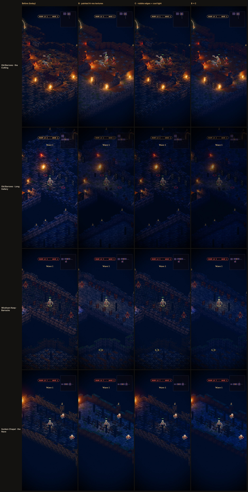
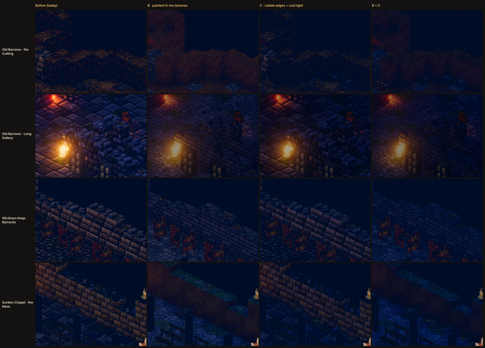

# The dungeons' look: a spike of B, C and B + C

**Status:** Declined (the owner, 2026-11-27: "Dont use the high res proposal from Nov 15, continue to build on our own assets"). The spike's code (`?dlook`, `tools/render3d/hires.js`) is retired; the dungeons' looks are taken further with our own kits (GDD v1.158).

The owner, 2026-11-15, of a reference (a stylised dungeon from another game): *"Why are these tile assets so smooth and
hi res, what can we do to improve the quality of our assets"*, then *"The overland we currently have i just want to
evaluate options for dungeon assets.. show me before and after for our dungeon with, b, c and b+c.. lets me review
before committing"*.

- **B, painted high-res textures**: the floors and walls at 128 texels a unit, not Luminati's 16, drawn smooth
  (mipmapped, filtered) with a normal map from each texture's own height. The textures are painted at load from a seed
  (`tools/render3d/hires.js`: flagstones, earth, moss over stone, coursed blocks, raw rock), chosen by the surface's
  name, and swapped onto the TileMap's materials once a dungeon floor is built (`world.js` load).
- **C, rubble edges and a cooler, darker light**: a stone or a heap of rubble at the foot of about one wall tile in
  three (corridors and doorways kept clear; at most 420 a floor), and the underground fill turned blue-grey and about
  25 % dimmer, so the braziers' orange reads against it (`convert.js` edgeRubble, coolAmbient).

## The captures

The rig (`tools/capture/rig.mjs`, dusk, 390 × 844 at 2×): the Old Barrows' Cutting and Long Gallery, Wickham Keep's
Barracks, the Sunken Chapel's Nave. Each column is one look; the second sheet is a 2.2× crop of the same spot.

## What they show

| | Reads better | Reads worse |
|---|---|---|
| **B** | The floors: the flagstones and cobbles are smooth, irregular stones with dark grout, the reference's kind of floor (the Barracks, the Gallery) | The walls: the earth and rock sides (the Cutting) and the Chapel's sandstone lose their courses and read as flat smears; the procedural painter is fine for a floor and too plain for a wall |
| **C** | The torches and braziers stand out more against the cooler stone | The rubble is barely seen at play's zoom; the rooms read darker, and B + C is the darkest of the four |

## What B costs

Measured in Chromium (software GL), the first floor of each site:

| Site | Surfaces painted | GPU memory (map + normal, mips) |
|---|---|---|
| The Old Barrows | 8 | 10.3 MB |
| Wickham Keep | 7 | 10.1 MB |
| The Sunken Chapel | 8 (the riverbed kept) | 10.3 MB |

Painting takes 0.1–0.4 s a surface on this machine (Node: 256² in 90–180 ms, a 512² rock in 405 ms), so a floor's
first load gains about 1–2 s here and perhaps 3–6 s on a phone; later floors reuse the cache. A version to ship would
bake the textures to files (or use authored ones) rather than paint them at load.

## If the owner picks one

- **B for floors only** is the safe step: the floors gained, the walls lost. Walls would want authored textures (a
  hand-painted or CC0 set), not this painter.
- **C** wants its rubble larger and lighter, or none, and the fill no darker than today's (the owner asked for brighter
  dungeons on 2026-11-02).
