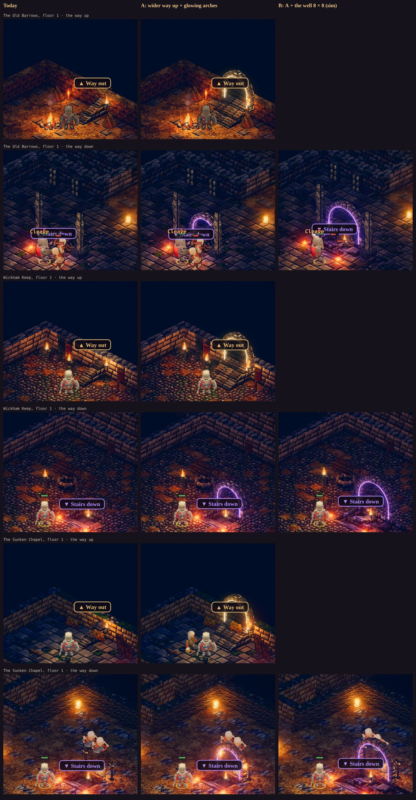

# The dungeon stairs: wider, under a softly glowing arch (a proposal)

**Status: Proposed (2026-11-10), with a spike** (`?stairs=arch`; the game is unchanged without it). The owner: *"the up
and down stairs are too narrow - make them wider and add an arch that slightly glows so its more obvious. Propose a new
design."*

*Today, option A and option B, at dusk, captured in the game on the manual clock:*
- *`tools/capture/rig.mjs … --query stairs=arch`, with `at: "stairsup"` and `at: "stairsdown"`;*
- *B from a scratch checkout with the sim's well made 8 × 8, served beside the game (`--base`).*

## 1. What's wrong now

Every floor has a way up and, except the last, a way down (GDD §3.1; `src/sim/world.js` `placeStairsUp` and
`placeStairsDown`; drawn by `src/render3d/convert.js` `stairs()`).

- **The way up is one person wide.** The sim's stair is 3 of our tiles across. Luminati's tiles are 2 of ours, so the
  flight draws 1 or 2 tiles wide: a narrow step-ladder into the wall, with nothing round its head. It reads as a
  cupboard, not a way out. Beside it the sim already blocks 5.2 tiles across (`envfoot.js` `stairsup_0`), so the room
  for a wider flight is there.
- **The way down is hard to see.** The stairwell is 6 × 6 of ours (3 × 3 of Luminati's), sunk two steps. From the
  game's camera, its near rim, the people standing at it and the sign over it hide the steps. What shows is a violet
  light and the sign.
- **Neither has a frame.** Nothing stands up out of the floor to say "a way through here". The signs (*▲ Way out*,
  *▼ Stairs down*) do all the work.

## 2. The design

### A: the presentation alone (no sim change)

- **The way up three tiles wide:** two abreast, over the 5.2 tiles the sim already blocks for it, and only where the room's
  floor is (never over a wall).
- **An arch over each way,** in the floor's own wall stone (the kit's: stone brick in the halls, brick in the dig):
  - two piers on plinths with imposts, nine voussoirs and a proud keystone;
  - **its inner edge a thin band of light, a little over white, so the world's bloom gives it a soft halo:**
    - gold-white over the way up (daylight on a first floor, *Way out*; a warm lamp deeper);
    - violet over the way down (the GDD's colours for up and down).
- **Where each arch stands:**
  - **The way up:** at the head of the flight, against the wall, a dark doorway in the wall behind it, so the flight
    climbs into the arch.
  - **The way down:** over the well's far edge, above its landing. From the room you look through the arch down into
    the well.

### B: A, and the well 8 × 8 (a sim change)

The well can't be drawn wider than the sim's opening: its rim is floor the sim walks on, and drawn steps there would sink
the people standing at it. So B widens it in the sim: `world.js` `WELL` 6 → 8 (4 × 4 of Luminati's tiles), with a wider
arch over it. Measured in a scratch checkout:

- **Every floor keeps its well:**
  - every site in every region, 40 seeds each: 400 wells at 6 × 6 and 400 at 8 × 8, no floor falling back to one step;
  - the Vale's three first floors fit an 8 × 8 well centred where the 6 × 6 is now.
- **The balance contract and the replays hold:** `smoke-test.mjs` passes with the same replay hash
  (`bf42d2f00d2ce22c`). Fights are in rooms the well doesn't change.
- **To change with it:**
  - the GDD (§3.1: "a stone stairwell 6 tiles by 6");
  - the tests pinned to 6 × 6 (`test/floors.test.mjs`, and the converter's level sizes and well checks in
    `test/render3d.test.mjs`).
  - No save change: the well is rebuilt from the seed.

### The cost

- The two arches on a floor: at most 1,352 triangles and 10 draws in all (Luminati's builder, merged).
- Their glow is a band of unlit mesh, not a light. The ways keep the lights they have, so no lamp is added (Luminati's
  12-lamp rule).

## 3. The spike, in the code

- `src/render3d/convert.js`:
  - `stairs(…, arch)`: the wider flight;
  - an `arch` entry in `sprites` for each way, with its place, span, level, light colour and the floor's wall stone.
- `tools/render3d/world.js` `buildArch`: the arch in Luminati's builder and the glow band (`ARCH_GLOW` 1.7 over the way's colour).
- `src/render3d/hybrid.js`:
  - passes `?stairs=` to the converter;
  - a fix along the way: when a chest or shrine changed, it re-placed the props alone, which would have taken the kit's
    models and the arches away. It now re-places them with the rest.
- `tools/capture/rig.mjs`: `at: "stairsup" | "stairsdown"`.

## 4. Questions for the owner

1. **A or B?** A widens the way up and frames both. B also widens the well, a sim change (the numbers above). Recommended:
   **B**, because the way down is the one that's hard to see, and its arch is bigger over the wider well.
2. **The glow:** as strong as the spike (a soft halo), or fainter, or stronger?
3. **The way down's arch:** over the well's far edge (the spike, framing the descent from the room), or over its near
   edge, where you step down (closer to the camera, but the braziers stand there now)?
