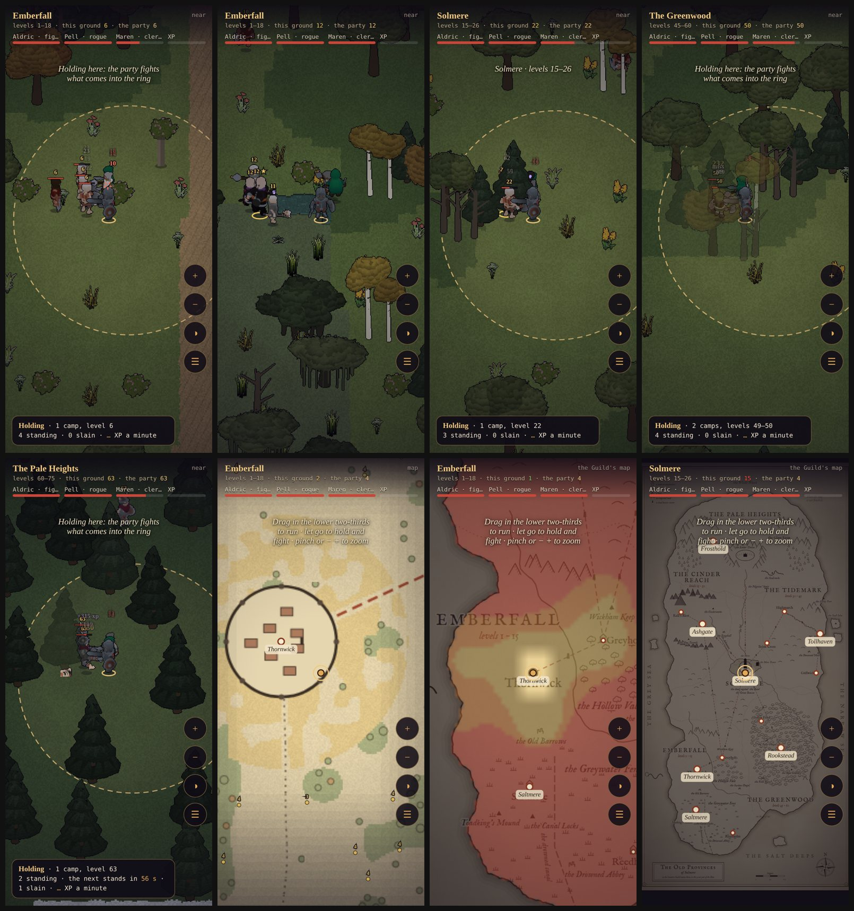

# The Frontier: the Old Provinces as one overland (proof of concept)

**Status: Proposal, with a playable proof of concept** (2026-10-20). The owner: *"a proof of concept for an overland
map that is 100x the current size suitable for an mmo style exploration. Let me zoom in and out. When moving with the
thumb stick the players explore and move. Lifting then the map area is locked and the characters autobattle in the
area selected. Pay special attention to the map features, terrain and NPC difficulty and respawn."*

- **Play it:** `/frontier.html` (on the deployed site too). It's a sandbox with its own sim. It reads no save,
  writes none, and nothing earned in it reaches a game slot.
- **Code:**
  - `src/sim/frontier/`: headless and deterministic, under the sim's lint rules.
  - `src/frontier/`: the view.
  - Tests: `test/frontier.test.mjs`.

Nothing here changes the shipped game, the GDD or canon yet. §8 lists what would have to change if the owner takes it on.

## 1. The size

The Frontier is **the whole of the Old Provinces as one walkable land**: the Lantern Guild's wall map
(`tools/worldmap/draw.mjs`, `src/ui/wallmap.js`) laid out at **2.1 tiles to the map's unit**.

| | The Vale today | The Frontier |
|---|---|---|
| Size (tiles) | 260 × 260 | 2520 × 5040 |
| Land (tiles) | 67,600 | about 6.75 million (the coast's polygon: 1.53 M map units² × 2.1²), **100×** |
| Towns | Thornwick | Thornwick, Saltmere, Greyholt, Reedholm, Ashgate, Kell's Rest, Solmere, Brine Cross, Highmarch, Tollhaven, Gullwick, Hollin Ford, Rookstead, Frosthold (15, the wall map's) |
| Level bands | 1–9 | 1–75: all six regions (GDD §17) |
| On foot, at the hero's 8.8 tiles/s | edge to edge in 30 s | Thornwick to Solmere by road about 2½ min; coast to the crater about 9 min |

Because the coast, the ranges, the rivers, the roads and the towns come from the wall map, the far zoom *is* the
Guild's map, and the land under it lines up with it.

**Chunks.** The land is cut into 64 × 64-tile chunks, 40 × 79 of them. Two things make a chunk cheap and the land the
same whoever walks it, in whatever order:

- A chunk is generated only when something needs it: a fight, a draw, a query.
- Each chunk is generated from the seed and its own coordinates alone.

Underneath sits one raster of the macro layers (land, region, woods, marsh, the Mere) at a cell per map unit, built
once in 0.17 s. It costs 5.8 MB. A chunk is made in about 4 ms. The engine would need the same chunked shape (§8).

## 2. The land: features and terrain

Every tile has a ground, a speed and a passability. Features stand on top.

| Terrain | Where | Walk | Notes |
|---|---|---|---|
| Sea, the Mere | past the coast; the Mere at Solmere | no | an inked shore; shallows a few tiles wide walkable |
| River | the Vale's river, the Ashwater, the Sol, the Long Water, the Highmarch water, the Fens' canal (the wall map's) | no | meandering 5–9 tiles wide; **a bridge wherever a road crosses**, and fords at a few shallows |
| Mountain | the ranges (the Vale's north range, the Reach's black hills, the Highmarch fells, the Heights) and the crater's rim | no | a ridge about 16 tiles thick with a hill skirt around it; **passes where the roads go through**; the Pilgrims' Stair is the rim's one gap |
| Hills, downs | the skirts of the ranges, the downs | 0.85× | rocks, scree |
| Forest | the Greenwood, the Vale's woods, the pines under the Heights | 0.9× | dense trees (each one solid), clearings in it |
| Marsh | the Greywater Fens, the Tidemark's salt marsh | 0.7× | meres (no walk), reeds, dead trees |
| Ash | the Cinder Reach | 1× | slag heaps (solid), tailings (no walk, rust-red) |
| Snow | the Heights | 0.85× | snow-dusted pines and rock |
| Meadow, fields | everywhere else; fields round the towns | 1× | groves, lone trees, undergrowth |
| Road | the imperial roads, ruled straight from Solmere (the wall map's eight); tracks from each town to its sites | **1.25×** | a dead beacon-tower each 300 tiles of imperial road |

**Landmarks** (each a feature on the map, and found by walking near):

- the towns, each with its walls and buildings and a safe ring;
- the dungeons' mouths, the wall map's sites by name (closed in the proof of concept);
- the beacon-towers;
- ruins;
- the crater and the Throne.

Underneath the macro layers, value noise gives the land its grain:

- clearings in a forest, groves in a meadow;
- outcrops on the hills;
- meres in the marsh;
- the rivers' meanders.

## 3. Difficulty: who stands where, and how hard

**The level map.** The difficulty is designed, not rolled. Each region has its band (GDD §17):

| Region | Band |
|---|---|
| Emberfall | 1–18 (the Vale 1–9, the Fens 10–18) |
| The Reach | 19–30 |
| Solmere's country | 15–26 |
| The Tidemark | 30–45 |
| The Greenwood | 45–60 |
| The Heights | 60–75 |

Each region also has a handful of **control points**, each a level at a place: low at the town and the road in from
the last region, high in the far wilds. A tile's level is the region's control points blended by inverse distance and
held to its band. So the land gets harder as you walk away from the towns and toward the next region, and a border
meets the next region's bottom level. On top of that blend:

- **Roads are safer:** −2 within 14 tiles of an imperial road, −1 by a track.
- **The deep wild is harder:** +1 in deep forest, high ground and marsh more than 40 tiles from any road.
- **Hotspots:** +2 within 30 tiles of a ruin or a dungeon's mouth, where the elites camp.

**Con colours.** Every foe shows its level, coloured against the party's average level:

| Colour | Foe's level against the party | What it means |
|---|---|---|
| grey | 6 or more under | no aggro, **no XP** |
| green | 3–5 under | |
| gold | 2 under to 1 over | "your level" |
| orange | 2 over | |
| red | 3 or more over | the GDD's contract: a room three up defeats even the right party |

The same colours tint the level overlay on the map, so a player can read where they belong before walking there.

**Aggro.** A foe notices the party within a radius of its own:
- the radius is 5 tiles + ½ tile per level it has over the party, from 3 to 9;
- grey foes never start a fight;
- a camp pulls together: one hit, all wake;
- **linked camps:** a camp within 7 tiles of one that's fighting joins in. Pulling one camp next to another is the
  overland's real danger.

**The con's edge.** A camp is two or three foes where a dungeon wave is five, at up to twice the strength (battle.js
`TIDES`), and the party mends between pulls. So two things carry the danger:
- **Field strength.** Every overland foe has × 1.5 HP and × 1.35 ATK.
- **The edge.** From two levels over, each level past the first is a step: +45 % ATK, +6 dodge, +20 % HP. Orange is
  one step, red two or more.

Both were tuned on the measures in §6.

**Leash.** A foe chases up to 26 tiles from its camp. Past that it **evades**: it walks home at 1.5× its speed, mending
to full and taking no damage. A foe whose camp drops out of the active area (below) resets at once.

## 4. Camps and respawn

**Placement.** The land is sampled on a jittered 20-tile grid, each cell seeded by its coordinates. A cell holds a
camp with a chance that depends on the ground and the spot:

| Ground or spot | Chance a cell holds a camp |
|---|---|
| Forest | 0.8 |
| Marsh, hills, ash | 0.7 |
| Snow | 0.6 |
| Meadow | 0.55 |
| Fields | 0.25 |
| Within 14 tiles of a road | × 0.4 |
| Inside a town's safe ring (its walls + 40 tiles) | none |

That's about **9,900 camps and 23,800 foes** over the land (counted over a ninth of the chunks: 45 % packs, 29 %
wanderers, 22 % camps, 4 % elites, and the lairs).

| Camp | Size | Respawn (each foe, after it falls) | Share |
|---|---|---|---|
| Wanderer | 1 | 40 s | 30 % |
| Pack | 2–3 | 50 s | 45 % |
| Camp | 3–5, an elite among them from level 5 (one in three) | 75 s; the elite 3 min | 22 % |
| Elite (rare) | 1 elite and 2 guards, at a hotspot | 8 min for the elite; the guards 75 s | 3 % |
| Lair | the dungeon mouth's warden (an elite of the site's band top) and 3 | 15 min | one at each site |

Each foe's respawn varies ±15 %, from its own hash, so a cleared camp comes back a body at a time, not all at once.
A foe stands back up at its camp and fades in over a second.

- **Kinds.** Each region's foes come from its family (battle.js `FAMILIES`):
  - Emberfall: the Ashbound by ruins, the Redhand on the roads and in the woods, the hill goblins under the north range;
  - the Fens: the reed-men, the harvest and the drowned.
  - The regions north have no foes of their own yet. **The proof of concept borrows** families for them (the Reach
    the goblins and the Redhand, Solmere the Cult, the Tidemark the Redhand and the drowned, the Greenwood the
    ghouls and goblins, the Heights the Ashbound legion), each at its band's levels.
- **Stats.** Each foe has its kind's level-1 stats scaled exactly as in a dungeon (battle.js `foe()`):
  - HP and DEF × (1 + 0.14 (L − 1)), ATK × (1 + 0.12 (L − 1));
  - an elite × 2.5 HP and × 1.3 ATK.
  - A blow is resolved by battle.js's formula (dodge, then `def / (def + 25 + 5L)` off the ATK, crits × 1.75).
- **XP.** A kill pays what a dungeon kill pays (`xp × level`, shared 1 / 0.65 / 0.5 among the living), elites × 3;
  grey foes pay nothing.

**Only near the party lives.** Camps within 64 tiles of the hero are awake: none in a town, up to about 20 in the
wild (55 foes), 3 at the median over a run out of six towns. Their foes stand, wander, aggro and fight.
Beyond that, a camp is a row of numbers (when each of its foes fell). When it wakes, every foe whose time has come is
standing. Respawn is counted in the sim's own ticks from when each foe fell, so the land is the same:
- whether you watched or not;
- after any route;
- on a server replaying the session.

This is MMO interest management in miniature. A shared world would keep the same bubble per player.

## 5. Controls

- **The stick explores.** Touch and drag anywhere in the lower two-thirds: the floating stick, as in the game.
  - While it's held the party runs where you point, the companions behind, at the ground's pace.
  - The party fights back at anything in reach without stopping: you can run through a camp and take its blows. Foes
    that notice you chase you to their leash.
- **Lift to hold.** Let go and the spot where the hero stands is **locked**: a ring of 12 tiles drawn on the ground.
  - Inside it the party autobattles on its own: it takes on any foe inside the ring and any that comes at it, and
    pulls the camps whose home is in the ring.
  - It never steps out (it reaches 4 tiles past the edge, only for a foe that's attacking it). When there's nothing
    to fight it goes back to the ring's middle and mends.
  - The party's fight is the dungeon's numbers with a simpler party: basic attacks, and the cleric's Mend (22 % of the
    most hurt ally's max HP, +20 % for a cleric, for 12 MP). There are no abilities or stances yet.
  - The ring's card says what it holds: its camps, their levels, the next respawn, kills and XP a minute.
  - Drag again and the lock lifts.
- **Wipe.** If the party falls, it wakes in the nearest town's square at 30 % HP and the lock is gone, as a wipe does
  in a dungeon.
- **Zoom.** Pinch, the mouse wheel, or the − / + buttons (44 px, on the right, in thumb's reach). Three tiers that
  cross-fade:

  | Tier | Scale | What it shows |
  |---|---|---|
  | **Near** | 12–40 px a tile | The land: the game's own baked sprites (trees, rocks, mountains, ruins, the party and the foes, animated) on painted ground, at the game's scale (16 px a tile is the game's view) |
  | **Mid** | 1.5–12 px a tile | The land drawn as a map, in the wall map's hand (the region tab's), a chunk at a time: roads, rivers, woods, every camp a dot in its con colour |
  | **Far** | under 1.5 px a tile | The Guild's wall map itself, the party on it, the towns named |

  - The level overlay (the ◑ button) tints the mid and far tiers by con colour.
  - A tap on the map shows that spot's region, level and the nearest camp.
- **Fast travel (proof of concept only).** The ☰ list jumps to any town, and the level stepper sets the party's
  level. Both are there so every band can be tried in a minute.

*Top row, Near: a party holding a ring in the Vale (level 6), the Fens (12), Solmere's country (22) and the
Greenwood (50). Bottom row: the Heights (63); the map tier round Thornwick, its camps dotted by con colour; the level
overlay for a level-4 party (gold at home, red beyond); the whole of the Old Provinces on the Guild's wall map.*

## 6. Measured

Every run is headless. The party is a fighter, a rogue and a cleric at the level named, in the Common kit of their
level; seed 20260807.

| What | Number |
|---|---|
| Macro raster (land, regions, woods, marsh, the Mere) | built in 0.17 s |
| A chunk (ground, features, camps) | about 4 ms |
| Land | 6.75 M tiles (100× the Vale's 67,600) |
| Camps, foes | about 9,900 and 23,800 |
| A sim tick with the bubble awake | 15–35 µs |

**Difficulty**, from `node tools/balance/frontier.mjs <party> <ground> 5 8`. Each case locks the party at up to eight
camps of that level spread over the land, five minutes each. "Downed" counts a spot's Downs; "lowest" is the party's
lowest HP; XP is the hero's.

| Party on ground | Wiped | Downed a spot | Lowest | Kills a minute | XP a minute |
|---|---|---|---|---|---|
| 3 on 3 | 0 of 4 | 0 | 62 % | 3.3 | 60 |
| 3 on 5 (orange) | 1 of 8 | 0.4 | 31 % | 3.5 | 125 |
| 3 on 6 (red) | 4 of 8 | 2.0 | 10 % | 1.7 | 148 |
| 6 on 6 | 0 of 8 | 0 | 61 % | 3.7 | 125 |
| 6 on 8 (orange) | 5 of 8 | 1.9 | 21 % | 1.8 | 215 |
| 6 on 9 (red) | 4 of 8 | 1.5 | 21 % | 1.6 | 145 |
| 9 on 9 | 2 of 8 | 0.8 | 53 % | 2.6 | 447 |
| 9 on 12 (red) | 1 of 4 | 1.0 | 25 % | 1.9 | 355 |
| 12 on 12 | 0 of 4 | 0 | 56 % | 3.4 | 290 |
| 12 on 15 (red) | 1 of 8 | 0.6 | 24 % | 3.0 | 432 |
| 15 on 15 | 0 of 8 | 0 | 63 % | 3.9 | 366 |
| 15 on 18 (red) | 1 of 8 | 0.5 | 35 % | 2.9 | 455 |
| 30 on 30 | 0 of 2 | 0 | 65 % | 2.7 | 550 |
| 30 on 33 (red) | 1 of 4 | 1.0 | 3 % | 3.3 | 840 |
| 45 on 45 | 0 of 3 | 0 | 65 % | 2.3 | 661 |
| 45 on 48 (red) | 2 of 4 | 2.0 | 24 % | 2.2 | 881 |
| 60 on 60 | 0 of 3 | 0 | 64 % | 3.8 | 1,336 |
| 60 on 63 (red) | 1 of 5 | 0.6 | 43 % | 2.2 | 912 |

**What the table says.**
- **Your own level is safe:** nobody falls, and the party's lowest is 55–65 %. The one exception is level 9, where two
  of eight spots stood among the Sunken Chapel's elites.
- **Red is a real risk:** a wipe at one spot in eight up to half of them, with Downs at most.
- **Orange costs most at the low levels.** A level is a larger share of the stats there; above 30 the GDD's stat
  rescale (§17, M9) isn't in yet, so the high bands are softer than they'll be.
- **The overland earns about a third of a dungeon room.** A same-level ring pays 125 XP a minute at level 6, against
  387 in a room (the smoke test's figure). The respawn timers and the camp grid are the knobs (§7).
  - That seems right to me: the dungeons keep the faster XP, the loot and the bosses; the overland is for exploring,
    for a fight on the way, and for a ring you can leave running. It's the owner's call (§9).
- A ring at your level fights 3–4 kills a minute, and the party waits between respawns. The card says how long.

## 7. Knobs (where the design can move)

| Knob | Now | Pushes toward |
|---|---|---|
| Respawn (wanderer / pack / camp / elite / lair) | 40 / 50 / 75 s / 8 / 15 min | faster: a ring earns more (halved: about two-thirds of a room) |
| Camp grid, density | 20 tiles, 0.25–0.8 | denser: more fights a minute walked |
| Lock radius | 12 tiles | wider: more camps a lock |
| Field strength, the con's edge | × 1.5 HP, × 1.35 ATK; +45 % ATK a step | the danger of every camp, and of red ground |
| Linked camps | 7 tiles | wider: more pulls go wrong |
| Road safety | −2 / −1 | more: roads as the safe way through a hard land |
| Aggro radius | 5 + ½ a level over, 3–9 | larger: a red land you can't walk through |
| Leash | 26 tiles | shorter: easier to run away |
| Grey XP | 0 | |
| Bubble | 64 tiles | larger: more of the world alive at a cost |

## 8. If it goes in: what the engine needs

- **The sim's world, chunked.** `makeWorld` holds `blocked`, `occ` and `tmat` for the whole world: 23 MB at this size,
  and `finalizeGround` runs 7.7 M `groundAt` calls up front. These become a chunk store, as here. `findPath` stops at
  60,000 nodes, so long walks need a windowed search, or roads as a graph above the tiles.
- **The renderer already bakes only the view** (the G-buffers are screen-sized). It needs:
  - the contact-shade field (`aoField`, 124 MB at this size) cut into chunks;
  - `structList`'s walk over every structure behind a spatial index;
  - the minimap reading chunks.
  - The Near tier would be Emberlit itself; the Mid and Far tiers would be this map, as the World map is today.
- **Battle.** `battle.js` fights in rooms with waves. The overland's fights are camps in a ring: a third mode beside the
  room and the tower, sharing `resolve`, `foe` and the party's AI (here simplified: basic attacks and the cleric's
  mending only, no abilities).
- **Saves.** The camps' timers: about 8 bytes a fallen foe, sparse. The bubble keeps them few.
- **Canon and design.** The world doc would need the regions as one land. GDD §10 (travel) and §3 (the room battle)
  would gain the overland camp. The coach, the World map and the dungeons stay as they are; the dungeons' mouths
  stand on the land.
- **MMO, later.** The bubble is interest management. Other players would need camp tagging (who a kill pays), and a
  respawn that quickens when a camp is contested.

## 9. Open questions for the owner

1. Is 100× of the Vale's area the scale, or the 15× the wall map gives at the Vale's own scale?
2. Should the overland earn about what a dungeon room does at the same level, or less, with the dungeons for loot and
   bosses?
3. Should a lock be free anywhere, or only at camps you've found?
4. Should the regions open as today (each at the last one's finale), or should the land be open and only its levels warn you?
