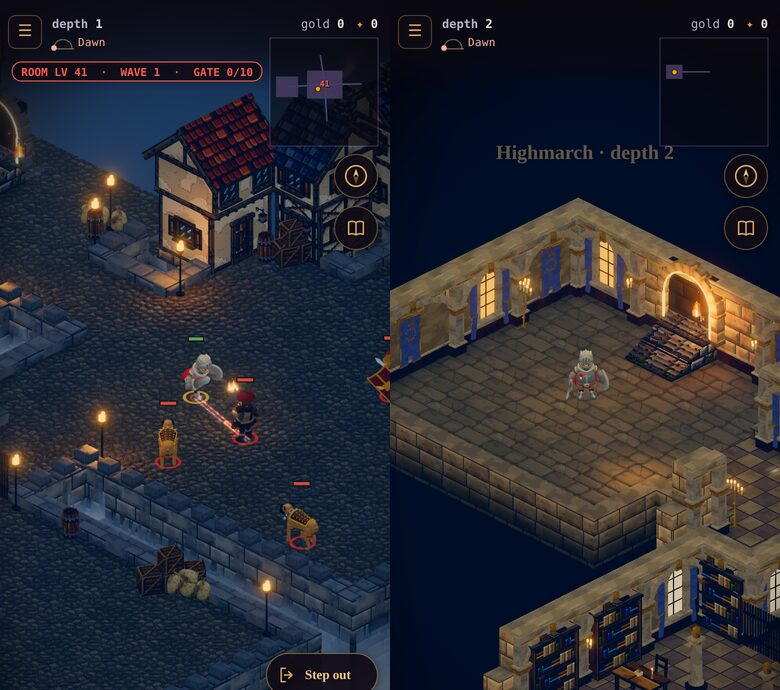
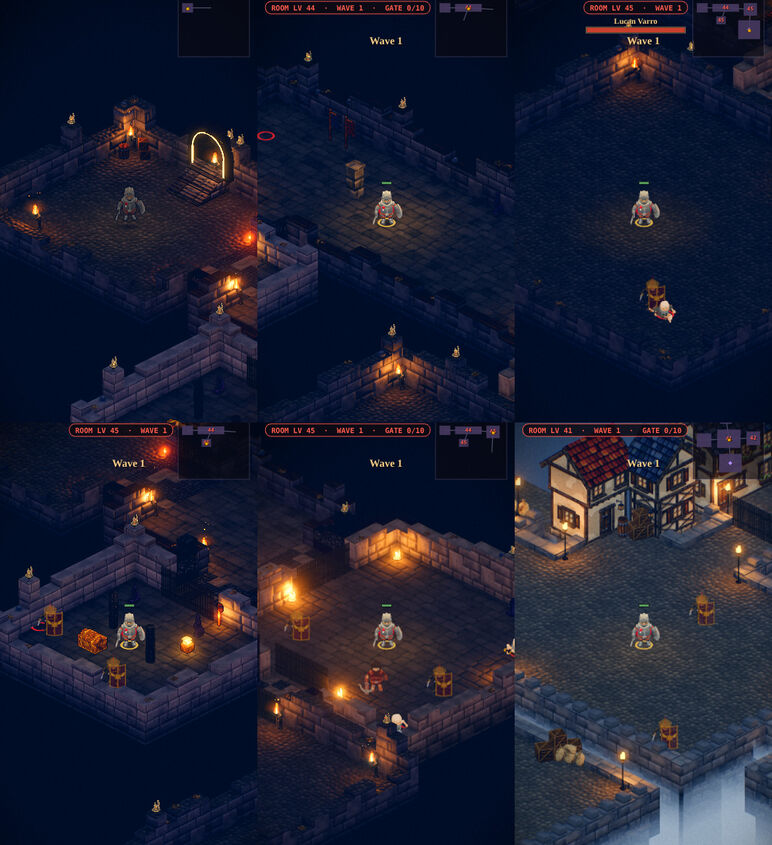

# Highmarch's second floor: a proposal

*2026-11-28 · **Implemented** (option A). The owner: "Go with your recommendations, call it the seventh tower, just a stand, the glass keep is the right place, leave floor 1 as is." Built: plans.js `highmarch` floor 2 *The Seventh Tower* (yard `ramparts`, muster hall `barracks` drawn grey as convert.js `towerhall`, steward's room `quota`, tower chapel `crypt`, roof `ramparts` with `signal_stand`); the palace floor parked as `glass_keep`; world doc v1.81, GDD v1.166. Not yet built: the drowned fleet's lanterns below the roof and the sea under it (§6). Earlier: The owner: "The seventh voice quest is in a dungeon but the second floor looks like a
palace.. the setting doesnt feel right for tollhaven area and what is in the first floor.. propose something different.
We could use the palace level later near the end of the game".*

Nothing is built yet. Anything canon doesn't fix is marked **(proposal)**. Once agreed, canon goes to the world doc first.

## 1. What's wrong

Floor 1 is the Walls, on the `ramparts` kit:

- grey stone at night, the wall walk in the open;
- the march-town's half-timbered roofs at its back and the mist off the marsh in front;
- torches, cargo, the legion shield to shield.

It reads as the Tidemark: a cold coast and a soldiers' war.

Floor 2 is the Seventh's Palace, on the `palace` kit:

- warm honey sandstone, gilt sconces and candelabra;
- royal-blue banners, a chequered marble floor;
- bookcases, lit windows, a throne room.

It's a different game's interior. Between the two floors:

| | Floor 1 (the Walls) | Floor 2 (the Palace) |
|---|---|---|
| Stone | grey, wet, dark | warm sandstone, clean |
| Light | torches against the night | a lit interior, gold |
| Sky | open, mist, the drop off the wall | none: a roof over every room |
| Colour | slate, rust, the legion's red | royal blue and gold |
| Feels like | a march fort on a cold coast | an inland court |

The stair down from the great bastion goes from the first column to the second with nothing between them.

The setting is also at odds with what canon already says about Highmarch:

- **It's a march**, the empire's old eastern border fort, walled and military (world doc §3.7 and its factions table). A march-lord
  keeps a hall, not a court.
- **Its tower looks at the sea.** Livia's third letter: *"So you are to be married in Highmarch, to a man whose tower
  looks at the sea."*
- **A Voice sings from a high place.** Lucan's first order was sung *"from the lamp-stand at the end of the outer
  mole"* (letter 2), and the six Voices sang the empire's orders at the Beacon. Lucan sang the drowned fleet up off the Mole from a lamp-stand.
- **The drowned are his,** and they walk up out of the salt marsh (the camp by the pans, 35). On the overland, the marsh and the pans
  run along the north shore from Highmarch's walls to the harbour bay.

## 2. Three options

### A. The Sea Tower (recommended)

The march-lords' tower, at the end of the wall on the cliff over the salt marsh. Livia's husband's tower, the one
that looks at the sea.

- **The route:** down the bastion stair and along the foot of the wall, in at the tower's door, then up through its
  storeys to the roof.
- **The end:** Lucan sings from the old signal stand on the roof. The drowned fleet lies below him in the marsh at
  low water, its stern-lanterns lit. That calls back letter 6: *"[the bound] keep their stations as long as the
  stern-lantern is lit."*

**Floor 2, the Sea Tower (44–45)** (proposal). The same five roles, levels, foes and bosses as now; only the place
changes.

| Space | Role | Lv | Kit (reused) | What it is |
|---|---|---|---|---|
| the Tower Yard | entrance | 44 | `ramparts` | Between the wall and the tower at the bastion stair's foot, in the open: wet flags, the wall above, the drowned's wet footprints going in at the door. The stair back up. |
| the Muster Hall | room | 44 | `keep` (new look, built from the crypt's stone and the tavern's timber) | The tower's ground floor: grey stone, a black timber roof, rushes. The drowned crews stand in ranks by ship. Down both walls, the standards Lucan collected, salt-stained: *"every one the empire raised, and some it never did."* (Was the Hall of Banners.) |
| the Steward's Room | offshoot | 45 | `keep` | Varro's counting room, three hundred years on: tally boards, the plate chest, the household's ledgers. *"He counts the spoons. Someone must."* (letter 3). The Kindler's letters are on the table under the paperweight, unopened. (Was the Study.) |
| the Tower Chapel | room | 45 | `crypt` | Small and cold, candles, one stand. Livia's box's empty stand, its lid on the floor. The Box letter (11) at the shrine. (Was the Chapel.) |
| the Roof | end | 45 | `ramparts` (the Lamp Fort's walk, its sea below) | The tower's top, open to the night and the wind, the battlements round it. On the signal stand is a gilt chair Lucan had carried up. Below: the marsh, the bay, the drowned fleet's lanterns. **Lucan** sings the Canticle from the chair, and at a tenth of his life sits down on the stand's steps. (Was the Throne Room.) |

**Why A:**

- **It follows from floor 1.** Same stone, same night, same sky. The last room is back in the open, high up, as the
  walls were.
- **It's the Tidemark.** The sea, the marsh and the drowned fleet are in the last room's frame.
- **Canon already holds it:** the tower that looks at the sea, a Voice singing from a high stand, the drowned in the
  marsh, Varro counting spoons. Nothing new has to be invented.
- **Lucan in the open is the better scene.** He sings over his fleet. When he's beaten, the lanterns below go out
  one by one, the drowned lying down as at Brine Cross (a renderer beat; no sim change).
- **The story keeps its beats:** the chapel and the empty stand, the letters on the table, the steps he sits on,
  "the Seventh's Palace".

**The name stays (proposal).** Lucan calls his tower *the Seventh's Palace*; the march calls it the Sea Tower. That's
the wry note the world doc's tone asks for, and every line that says "the Seventh's Palace" stays true: Josse's names
quest, Hester's lines, the Box fragment, the chapter. Only the lines that say **throne room** change, to the roof
(§5).

**The risk:** the Lamp Fort (38) also ends on a tower top over the sea. Three things keep them apart:

- **What's on top.** The Lamp Fort has a working light. Highmarch has a Voice's stand with a gilt chair on it.
- **What's below.** The fort looks at open sea. The tower looks at the marsh with a fleet grounded in it.
- **What it feels like.** One is a lighthouse keeper's room; the other a would-be emperor's stage, with banners
  carried up.

### B. The Sea Gate and the Fleet Basin

Down through the wall's water gate into the tidal basin where Lucan berthed the raised fleet.

- **The rooms:** the casemates, the basin quays, a chapel in the sea wall, and Lucan on the poop of a grounded
  imperial galley.
- **For it:** the most coastal option, with the fleet in your face.
- **Against it:** the docks and hulk kits are already the Drowned Mole (31–35) and the Gull Isles (36–40). This would
  be the third wharf-and-hull dungeon in a row.
- **The story strains:** a study and a chapel on a galley need explaining.

### C. The March Keep

The march-lords' old keep inside the walls: grey stone, black timber, rushes, a high seat instead of a throne.

- **For it:** the simplest option, and right for a march.
- **Against it:** it's all interior, so there's no sea and no sky.
- **It's close to Wickham Keep** (the Vale) in another tint.
- **It loses the high stand a Voice sings from.**

## 3. The palace later: the Glass Keep (recommended)

The `palace` kit is a good kit in the wrong place. Near the end of the game there's a palace that wants it:

- **The Glass Keep (71–72)**, the Praetory's second floor in the Heights ([new-dungeons-plan.md](./new-dungeons-plan.md)
  §4.2).
- It's the Empress's own house, where Aurelle's last letter is found.
- The plan has it as a new `glasskeep` kit (size M): *"the crypt kit's vault and piers in black glass, a frozen court,
  Aurelle's writing table"*.

Its rooms already line up one to one with the palace's:

| The palace now (Highmarch 2) | The Glass Keep (plan §4.2) |
|---|---|
| the Courtyard | the Frozen Court |
| the Hall of Banners | the Hall of Plaques (the empire's honours in the walls) |
| the Study (desks, bookcases) | the Empress's Study (her writing table, the Chronicle's last fragments) |
| the Chapel (the reliquary stand) | the Long Gallery of Glass (the glass-touched fused where they stood) |
| the Throne Room | the Legate's Hall (**the Glass Legate**, before the letter) |

**What changes on the way (proposal):**

- **The palace frozen.** The gold dulled under rime, snow drifted in at the windows, the blue banners stiff and
  white at the edges.
- **Glass grown out of the stone.** The Soulcracks' glass along the walls and over the floor's chequer.
- **A colder light.** The candelabra out; daylight through ice; the glass lit from inside.

The `glasskeep` kit then becomes a retint plus one dressing family (glass growths), not a new kit. That's an S
instead of an M on the Heights' build list.

**The other end-game place** that could take it is the approach to the Ember Throne (73–75). That's planned as its
own `runeplate` kit, so the Glass Keep is the better fit: the Empress's house should look like a palace.

## 4. Option A: what it takes

| Part | What changes | Size |
|---|---|---|
| Canon (world doc first) | §3.7 Highmarch: floor 2 the Sea Tower, *"which Lucan calls the Seventh's Palace"*; its rooms; the Roof for the throne room | S |
| `plans.js` `highmarch` floor 2 | the five spaces renamed, re-kitted (`ramparts`, `keep`, `crypt`), re-dressed; ids kept where the story reads them (`the_chapel`, `the_study`, `the_throne_room`: ids are API, AGENTS.md) or migrated | S |
| `sites.js` | `dress: ['ramparts', 'keep']`; the `palace` family kept (legionary, drowned, crossbow, cantor: the same foes) | S |
| `world.js` dressing | `keep_lamps` (iron rings of candles, torches), `standards` (salt-stained), `tally` (the steward's boards and plate chest), `signal_stand` (the gilt chair on the stand), `battlements` | S |
| Luminati look (`convert.js`) | a `keep` interior: the crypt's grey vault and piers with the tavern's black beams, no gold; the Roof on the Lamp Fort's walk with the marsh below; the drowned fleet's hulls and stern-lanterns as set pieces off the edge, the lanterns going out as Lucan sits down | M |
| Text | the "throne room" lines: about 6 (the quest, Hester, the site card, Lucan's NPC card, the story line); "the Seventh's Palace" stays | S |
| The palace kit | parked as it is (`?site=highmarch&floor=2` until swapped, then a `glasskeep` prototype on the Stage) | — |
| Checks | the contract at 42 / 45 (same foes and levels: expected unchanged), `boss.mjs highmarch 45 --floor 2`, visibility and dressing audits, before/after captures | S |

**The sim barely moves:** the same rooms, levels, foes, bosses and waves. Replays and balance should hold. Most of the
work is the look.

## 5. Questions for the owner

1. **Which option:** A (the Sea Tower, recommended), B (the Fleet Basin) or C (the March Keep)?
2. **The name:** keep *the Seventh's Palace* as Lucan's name for his tower (recommended: almost no text changes), or
   rename the floor *the Sea Tower* everywhere?
3. **Lucan's seat:** a gilt chair carried up to the roof (recommended: the scene keeps "his own steps"), or no chair,
   just the stand?
4. **The palace later:** the Glass Keep (recommended), the Ember Throne's approach, or somewhere else?
5. **Floor 1:** keep it as it is? It already reads as the Tidemark. Its houses' red roofs could go to slate to match
   the Tower (S).

## 6. As built (2026-11-28)

- **The name and the stand:** *the Seventh Tower*. No chair: Lucan sings from the old signal stand (a cold fire basket on
  its stand, `signal_stand`) and sits down on its steps. Every player line moved with it ("throne room" → the roof,
  "the Seventh's Palace" → the Seventh Tower).
- **The rooms' looks reuse what was built:**
  - the yard and the roof are the walls' own ramparts;
  - the hall is Wickham Keep's great hall in the walls' grey stone;
  - the steward's room is the counting house, with its ledger shelves and the clerks' desks;
  - the chapel is the crypt.
- **The sim:** the same rooms, levels, foes and bosses, so balance stands. The rooms' ids are new (`the_tower_yard`,
  `the_muster_hall`, `the_stewards_room`, `the_tower_chapel`, `the_roof`); nothing saved held the old ones.
- **Left for an art pass:**
  - **The roof reads as a walled terrace at night,** not yet over the sea. The marsh and the sea below it are still to come.
  - **The drowned fleet's stern-lanterns going out** as Lucan sits down are not built yet.
  - **The ramparts' houses and misty drop** don't come through on this floor: the rooms stand too close for the street
    behind them.
