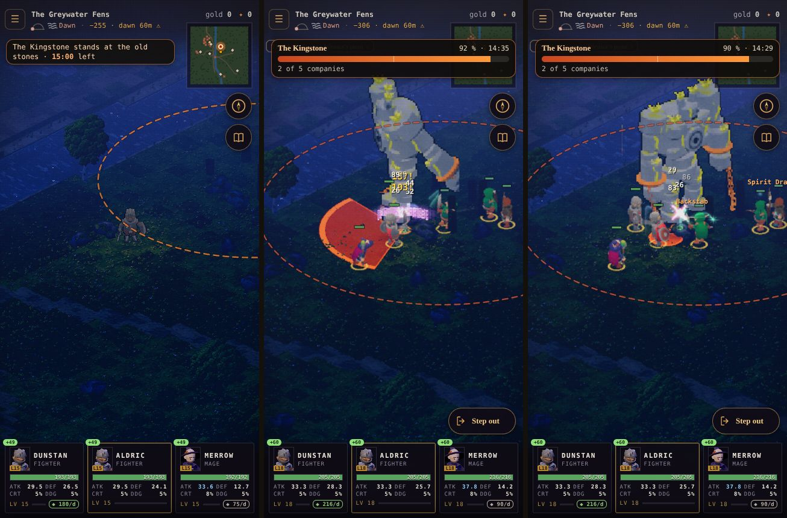
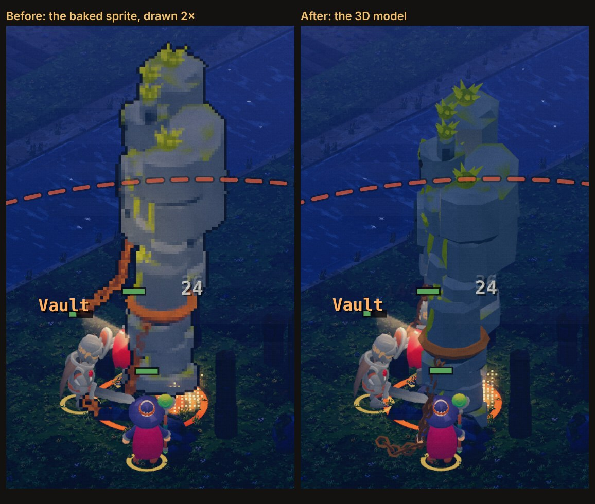

# The Kingstone: a game-plan, animation and movement critic pass

**Status:** Implemented (2026-11-15), GDD §19 v1.106.

The owner, 2026-11-15:

> *"Hits from the region boss should take my level 15 char down to about 30% health, the second if im not healed enough
> should knock me out. Run a game plan and animation, movement critic pass on the region boss.. he moved janky and stayed
> in 1 spot. Can we spawn the region boss directly in the map?"*

Measured headless on the manual clock (`tools/balance/regionboss.mjs` and a trace: two minutes of a level-15 right party
against the Kingstone with one AI company, seed 20261115), before and after; and in the game at 430 px (`?dev&ring=on`).

## 1. What was wrong

### Game plan

| | Finding | Why |
|---|---|---|
| G1 | **Its hits were small.** The biggest blow on the hero in two minutes was 24 % of max HP; its tells were 45–70 %, and its plain blows a warrior's | Its plain melee was the golem's, at its level; the tells were set before the owner's figure |
| G2 | **Its plain blow wasn't a tell.** 28 small punches a minute, from range 5.5, nothing on the ground | It fought as any foe: `melee()` |
| G3 | **The guards thinned its hits.** A second hit before a heal came in at a third: Hold the Line (a fighter near) and Ancestral Guard (the low) cut it, so "the second knocks me out" couldn't hold | Its tells were blows like any other, through every guard share |
| G4 | **It was elsewhere.** An *Enter the Ring* button took the company to a Ring of its own, a pocket trip: not the Fens' map the owner wanted it in | v1.105 built it as the Bowl's Sand is |

### Movement

| | Finding | Measured (before) |
|---|---|---|
| M1 | **It stayed in one spot.** Its blows reached 5.5 tiles past its 2.4-tile body, so everyone was always in reach and it never had to step | walked 35 tiles in 2 min, moving 27 % of the time, all of it shuffling round its middle |
| M2 | **It turned janky.** It re-faced the nearest fighter every tick, and every tell snapped its facing to its target | 64 facing changes over 45° in a tick, a minute; 153° a second on average |
| M3 | **Its feet slid.** The golem's walk drawn twice its size kept the golem's stride | (at 4×, a step covered half the ground the feet showed) |

### Animation

| | Finding |
|---|---|
| A1 | **Its swings didn't match its hits.** A tell set a 2-second wind-up and no swing; the punches it did throw were its plain melee's, out of time with what landed |
| A2 | **No weight.** A 4× giant throwing 28 light punches a minute reads as a toy |

## 2. What changed (v1.106)

| | Fix | Where |
|---|---|---|
| G1, G2 | **Every hit is a tell, and each takes 70 % of max HP.** Its plain blow is a fourth tell, the **slam**: a circle of 2.4 under whoever's nearest within 6 past its body, 1.3 s, every 4 s (3 once cracked). The stamp, the sweep and the stones land at 70 % too | `ring.js` RING.slam, .hurt; `battle.js` ringTells |
| G3 | **Its hits are a share of max HP as it stands** (`raw`): the guards' shares (Hold the Line, Ancestral Guard, the Spirit Totem) don't thin them. An Arcane Ward still soaks one; a cleric's Lifeline, once a fight, still catches the blow that would Down | `battle.js` applyHit |
| G4 | **It stands in the Fens' map.** In a window it stands at the old stones' middle in place of their golems, their reach ringed in ember; walking into it starts its fight there, on the stones' arena, as any spawn point's does. No button, no pocket trip; out of the stones mid-fight is walking out on it | `core.js` ringOpen, ringHeld, ringReach, ringIn; `battle.js` idleCamps, startRing (camp), the aggro check; `ui/ring.js`; `renderer.js` drawCampRings |
| M1 | **It walks.** Every 6 s it picks a mark: the thick of whoever it *can't* reach (the healers and bows hanging back), else the thick of those at its feet; it walks there at 1.5 tiles a second once it faces it, keeping 3 tiles off the stones' edge. It plants its feet only for a stamp or a sweep; a slam it throws on the move | `battle.js` kingTurn; RING.king |
| M2 | **It turns slowly**: at most 86° a second, toward its mark, or toward the tell it winds; its facing is its own (the path's steps no longer turn it) | kingTurn |
| M3 | **Its stride is twice the golem's**, as it's drawn twice the golem's size | `renderer.js` (BIG) |
| A1, A2 | **Its heavy swing lands with each tell** (0.45 s before, the clip's wind to its impact frame): the heavy chop for a slam and a stamp, the backhand for the sweep, and it stamps as the stones are called. About 26 swings a minute, every one a hit that can take 70 % | `battle.js` ringTells (swing) |

## 3. Measured, after

The same two minutes:

| | Before | After |
|---|---|---|
| Walked | 35 tiles, round its middle | 49 tiles, across the stones after its mark |
| Moving | 27 % of the time | 26 % (the rest winding or in reach: it walks *between* its tells now) |
| Facing changes over 45° a tick | 64 a minute | **0** |
| Turning, on average | 153° a second | 44° a second (capped at 86°) |
| Swings | 28 a minute, light, unmatched | 26.5 a minute, each with a tell |
| A hit on the hero | at most 24 % of max HP | **70 %** each (a hero left at 30 %; a second unhealed Downs them: `test/ring.test.mjs`) |

The fight, in the map with 70 % hits (GDD §19.9):

| Companies | You step out | Autobattle | Nobody steps out |
|---|---|---|---|
| 2 | 5.8 min, 0.7 downs a run | 5.8 min, 0 | 9.2 min, 58 downs a run |
| 3 | 6.3 min, 0.7 | 6.1 min, 0.5 | |
| 4 | 6.2 min, 0.7 | 6.1 min, 0.5 | |
| 5 | 5.8 min, 0 | 5.7 min, 0.5 | 6.9 min, 10.5 |

All won. The 5–7 minutes hold. A company that dodges is down about once in a fight, its cleric healing between hits;
one that stands in the red is down again and again, and with two companies the fight runs to nine minutes, but it's
never a wipe. A level-15 party synced to 18 wins in 5.8–6.3 minutes.

## 3.1 Its model in play (2026-11-15)

The owner, from the phone: *"Region boss model looks low res or like we just zoomed in. Do we need a separate model for this
size of boss so it looks good?"* No: it was never drawn as its model. The golem's figure (`tools/actor-lab/creatures.js`,
on KayKit's skeleton rig) asked its model for every clip its rig names, the Cast (`Taunt_Longer`) among them; the game's
models carry only the clips that are played (`models.mjs` prunes them), so the build threw (`Skeleton_Warrior: no clip
Taunt_Longer`) and the figure fell back to its baked 56-px sprite, drawn twice its size. The goblin (`Taunt`) and the
graveyard wraith (`Spellcasting`) fell back the same way, everywhere they stood. The figure now takes the rig's clips its
model carries; the three stand as their models (the bake's full models have every clip, so the atlases are unchanged).
The browser suite's Stage check now lines them up and fails without the fix (`creature_goblin: Skeleton_Warrior: no clip
Taunt`).

## 4. Left for later

- **Its own clips.** It plays the golem's clips at twice the size. A giant's slower walk cycle and a long two-handed
  overhead for the stamp would sell the weight better than the golem's chop. That's a bake (`tools/actor-lab`
  creatures.js), not a sim change.
- **A camera shake on its landings**, as a boss's heavy blow has (`renderer.js` jolt), scaled for a 70 % hit.
