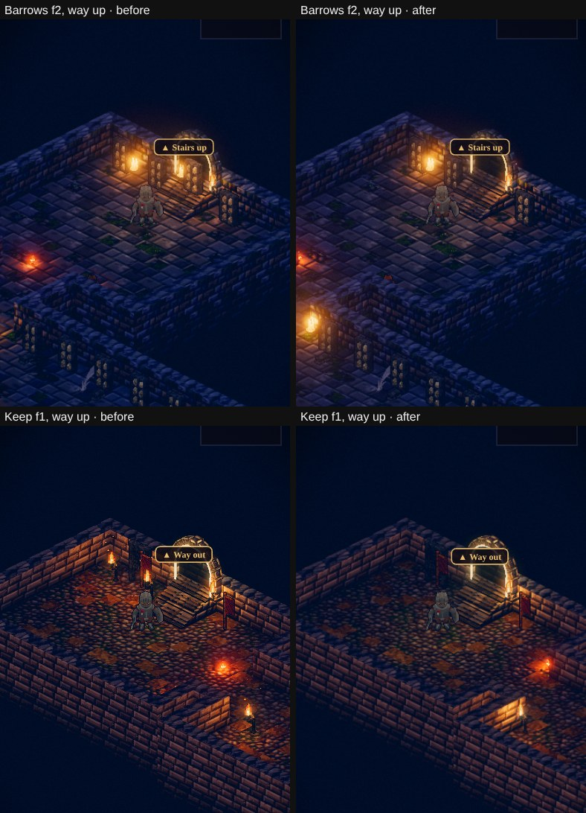

# Level design rules: towns, the overworld, dungeons

**Status: Plan of record (2026-11-10), GDD v1.62.** The owner asked: *"what guidelines are we using for town building
placement, overworld asset placement (rivers, roads, trees, rocks, ground assets, dungeon placements) and dungeon layout
and dressing? We want to make sure the placements make sense from a level design and playability perspective."* Then:
*"write the rules doc and the visibility test - where there is a discrepancy use the current code or test vs the
document. For foliage placement - it should be different based on the type of biome the map is based on. For dungeon
dressing, needs more detail and interior design layout - e.g. dont repeat with 6+ torches unless the room is large, or
dont repeat with 12 banners unless it makes design sense."*

This doc gathers the rules that were spread over a dozen proposals and the code into one place. Where an older doc
and the code disagreed, the code or its test wins (§6 lists each case). A new map, room or piece follows these rules,
and a change to a rule lands here first.

**How to read a rule.** **Must** rules are hard; **should** rules are judgement, with a reason. Each rule names what
enforces it:
- *test* — a `node:test` file, or the browser suite;
- *tool* — a command that reports on it;
- *code* — the placement code holds it, untested;
- *prose* — written down only.

The last column of a table, or the end of a line, says which.

## 1. The camera and the player (every map)

- **The camera looks from the south-east** (+x+y), down at the diorama.
  - Only a thing's south and east faces are seen, so doors, signs and the ways in face +x or +y (*test*: town, overland).
  - What is up-screen (north-west) of something tall is hidden by it.
  - Every rule about tall-at-the-back and low-at-the-front follows from this.
- **The default view is 25 tiles across** a phone held upright (`renderer.js` `VIEW_TILES`). A man is about 54 pt tall.
  The player may zoom from 67 % to 150 % of that (GDD v1.61), so a map must read at both ends: nothing important may
  depend on being far out or close in.
- **One thumb.** The world is tapped and walked with one thumb. A door, a person or a chest must be reachable by
  walking to it and tappable where it stands. The HUD's rules are the UI's (AGENTS.md), not this doc's.

### 1.1 Seen: the hero, the people and the ways in (new)

A person, a door or a way the player needs **must** be at least **half in view** from the game's camera, at the default
zoom, wherever the player meets it. "In view" means not behind a house, a wall, a tree, a rock, a kit piece or one of
the world's cards. The subjects:

| Map | What must be seen |
|---|---|
| A town | the hero where they wake; every townsperson where they stand; the step before each service's door; the gate |
| An overland | the hero where they arrive; the step before every way in (a dungeon's door, the gate, a road to another land); every arrival |
| A dungeon floor | the way in; the middle of every room; the stairs, both ways |

Enforced by `tools/capture/visibility.mjs` (*tool*), with a small set in the browser suite (*test*). They work the same
way: the hero is walked to each subject, and six points up a man's height (feet, waist and head, either side) are each
tested with a ray to the camera (`hybrid.js` `sees`, `world.js` `occluded`). A card's clear corners don't count as
cover. A subject passes at 50 % or more. The first survey of every map is in §5.

## 2. Towns

Every region's town is the same hub (docs/town-layout-proposal.md, GDD §10): the home screen, framed the same way
everywhere, so the menu never moves.

| Rule | Enforced by |
|---|---|
| **The square is the same in every town.** The well at (66, 71), the five services on the same tiles, their names from the region (`outdoor.js` `REGIONS`) | *test* town.test.mjs |
| **Every service door faces the well within 45°**, on its +x or +y face | *test* town.test.mjs |
| **Services stand 8+ tiles apart**, every door inside the square's frame (\|Δ(x−y)\| < 22, Δ(x+y) −93…50 of the focus) | *test* town.test.mjs |
| **The plaques hang at set heights** (temple 23.5, tavern 15.1, shop 13.4, smith 11.1, inn 18.7 tiles), not at the roofs, within ±17 of the centre; the drawn plaques match within 1 px and clear the buttons | *test* town.test.mjs, browser §15d2 |
| **The walls are closed, the gate the only way out.** The curtain leaves ±7 tiles at the gate, the gate itself ±3 walkable; walls in 20-tile runs | *test* town.test.mjs |
| **The square stays open 10 tiles round the well**: no house or tree (its table, its bucket and its people may stand there; a waystation's deck square, with no well, is exempt) | *test*: layout.test.mjs |
| **Tall at the back, low at the front.** Houses fill the north and west quarters; nothing taller than one storey stands between the square and the camera; a home never stands south of what it opens onto | *prose*; the visibility check catches the result (§1.1) |
| **Every door can be walked to** from where you wake (a flood fill); the town set stays off the roads (no footprint within a road's half-width) and 2+ tiles off the straight walk from each arrival to each door | *test* town.test.mjs (seed 1: more seeds, §7) |
| **Doorstep props** (a bench, a barrel, a cart) go only on the +x/+y faces and never inside the hub; the back quarters' trees stand up-screen of the square | *code* outdoor.js |
| **The approach.** Coming in the gate, the camera leads halfway to the square (k 0.5); you wake within hub.r − 6 of the square | *test* town.test.mjs |
| **The streets beyond the square** (docs/town-streets-proposal.md, not built yet): one-storey buildings only in front of the square, a grid for a large town, lanes for a small one, one way in | *prose* |

## 3. The overworld

### 3.1 Roads

- **Widths:** a main road 6 tiles, then 5 and 4, a track 3.
  - Corners are filleted: radius max(8, 2 × width). No turn sharper than 25° survives.
  - Joins within 6 tiles get an apron. *test*: overland.test.mjs.
- **Nothing stands on a road** except at its own end (a gate, a camp, the barrow's door). A tree crown never hangs
  over one. *test*: town.test.mjs (Vale and Fens, 3 seeds), reach-heights.test.mjs, overland.test.mjs.
- **A road goes somewhere.** Every road ends at a town gate, a site's door, a landmark, another road, or the map's edge
  toward another land (a shut road says why). *prose*.
- **The easy places are near town, the hard ones far out.** *test*: overland.test.mjs.

### 3.2 Rivers and bridges

- **Bridges are square to the grid**, and a road crosses one on a straight run along x. *code*.
- **A river meanders.** It swings ±4 tiles on a 52-tile wavelength and eases to straight within 12–36 tiles of a bridge
  or a mill. Its width breathes from 6.5 to 12.5. *test*: overland.test.mjs (width varies by more than 4).
- **The tests also hold:**
  - water under every bridge;
  - the bridge's ramps (±9.2 tiles) on land;
  - no road in the river except at a bridge;
  - the mill's wheel within a tile of the water.
- **Must, new: a bridge's ends stay clear.** Past either end of its deck, 3 tiles across and 2 deep stay walkable
  (*test*: layout.test.mjs, every bridge on all four lands). (Written first as "nothing solid within 4 tiles of the
  ramp's foot": the test holds what a walk needs, the code's.)
- **Should, new: the banks are planted for the biome** (§3.6). Reeds and willows at the Fens' water's edge (*test*:
  biomes.test.mjs); in the
  Vale, the undergrowth thickens along the banks (it does: 0.55 density within 2.5 tiles of water). Trees stand 2+
  tiles back from open water except the biome's water trees.

### 3.3 Sites, doors and arrivals

- **A way in opens toward the camera** (+y), with a lit marker. Its arrival, where you come out, stands 7.5–27 tiles
  in front of it on open ground. *test*: overland.test.mjs, reach-heights.test.mjs, sites.test.mjs, pens.test.mjs.
- **Every arrival can be walked to from the gate.** *test*: overland.test.mjs.
- **Every way in has its site's name over it.** *test*: sites.test.mjs.
- **One dungeon a level** (GDD v1.48). Trial and secret sites are flat and sit outside the bands: the Proving Pens at
  4, the Ninth Milestone at 9, the Undercroft at 18, the Mere Tower at 12. *test*: sites.test.mjs.
- **A landmark door is 1.2–1.4 times a man's height** (1.75 units) and sits on the sim's footprint. As a 3D kit piece
  it is under 1,500 triangles and 12 draws. *test*: browser suite (the doors' triangles and draws).

### 3.4 Sight lines

Nothing tall stands in a wedge in front of a landmark, toward the camera, so the landmark is seen from the road
(`outdoor.js` `inFrontOf`). The wedge's depth and half-width, in tiles:

| Land | Trees | Groves | Rocks | Half-width |
|---|---|---|---|---|
| The Vale | 62 | 80 | 30 | 32 |
| The Vale, the warren's adit | 40 | 40 | 40 | 26 |
| The Fens | 26 | 26 | 26 | 14 |
| The Reach and the Heights | 40 | 40 | 40 | 22 |
| The Reach and the Heights, hills and peaks | 72 | 72 | 72 | 28 |

*code*. The visibility check (§1.1) tests the result at each way in: the step before the door must be half in view.

### 3.5 Clearings

- **The town keeps a clearing of 40 tiles, a site 24, the camp and the warren 16, the crossroads 18.** No tree inside
  it. *code*.
- **Undergrowth keeps out** of the square (beyond its radius + 4), and away from the sites: 14 tiles in the Vale, 12
  elsewhere, 8 from a Fens door. It stays 6 or more tiles from every way in. *test*: town.test.mjs.

### 3.6 Foliage by biome (new)

The owner: *"it should be different based on the type of biome the map is based on."* Each land is one biome, with its
own species, its own way of growing and its own densities. A species may only stand on the ground its biome grows it
on. What the code does today is set against each profile below; the "to change" items are the next foliage pass (§7).

**The Hollow Vale: temperate meadow and mixed woodland, under a range, a river through it.**
- **Species:** oak, birch, autumn trees, pine on the slopes, dead trees on the foothills; groves of mixed crowns.
  Ground: flowers, grasses, fern, clover, mushrooms at a tree's foot. Rocks: mossy boulders, the barrow's grey stone.
- **How it grows:**
  - Woods are masses where a wood belongs: the north-west, the slopes under the range, round the lumber camp, the
    barrows' far side. Their crowns close over each other and thin to singles at the edge.
  - The meadow has clumps of 2–4 trees.
  - The canal road has a verge of oaks every 6 tiles.
  - The foothills are pines, scree and the range's rocks.
  - Undergrowth is thick at the woods' edges and along the banks, in patches in the meadow.
- **Densities:** tree cover 15–25 % of the map within 8 tiles of a tree, with 30 or more groves (*test*; GDD v1.71, the owner: the Vale's trees a quarter fewer; it was 25–35 % and 40+). Rocks about
  1 % of the meadow (*test*: ≤30 on the map).
- **Never:** marsh trees (alder carr, willow); bare desert rock on the meadow.
- **Today:** as above. Every tree and undergrowth piece stands on grass (survey, seed 20260807: 290 trees, 214
  undergrowth, all on grass).

**The Greywater Fens: marsh and fen, more water than land.**
- **Species:** alder, alder carr thickets, willow, the drowned dead standing at the water's edge; reeds.
  Undergrowth: grasses and low plants.
- **How it grows:**
  - Thickets on the raised ground between the meres, in patches (a noise mask), never in open water.
  - Willows and the dead at the edges of the water.
  - Reeds in ribbons along every water edge.
  - The map's edge is a ring of carr.
  - Open water and marsh stay open: the Fens read as wide and wet, not wooded.
- **Densities:** cover (the share of the map within 8 tiles of a tree, as the Vale's) 15–25 %, less than the Vale's
  (*test*: biomes.test.mjs); reeds on most of the water's edge.
- **Never:** birch, autumn trees, mixed groves (the fens critic pass 2: they read round and cheerful here).
- **Today** (the foliage pass, 2026-11-11): alders and carr on the raised ground and the marsh; willows and the dead only
  at the water's edge, never out on the open marsh (`outdoor.js` `waterEdge`: round every mere and along the canal, the
  trunk 1.5–3 tiles from the water, on the bank, the grass or the marsh's lip within 3 tiles; a crown may lean over the
  water, never a road); cover 20.6 % (the Vale 26.4 %). On Luminati the carr is drawn living (`convert.js` `TREES`: it
  was `deadwood`, so bare trees stood out on the marsh) and the willow as birch, the one light crown it has. The reeds along the edges are Luminati's own: it
  grows them on every land tile beside water (*test*: biomes.test.mjs).

**The Cinder Reach: cinder badlands.**
- **Species:** red rock outcrops and their rubble, slag heaps round the works, dead trees, a few pines on the hills'
  feet. Ground: dry grass only, bare stone.
- **How it grows:**
  - Outcrops in clusters on the ridges (a noise mask).
  - The works' heaps in their own yard.
  - Dead trees single and far apart.
  - The map's edge is a ring of rock and dead trees.
  - Most of the ground is bare.
- **Densities:** trees under 3 % cover, rocks 5–10 %, dry grass in a few patches.
- **Never:** flowers, ferns, clover, mushrooms, leafy trees.
- **Today** (2026-11-11): no pine on scree (its red rock stands there instead; the old build had none in the playable
  area, so this changes the margin only); dead trees and rock; cover 9.5 %
  (*test*: biomes.test.mjs: no pine on scree, no leafy growth, cover 12 % at most).

**The Pale Heights: alpine.**
- **Species:** pines in stands, dead pines at the treeline, scree fans, boulders. Ground: grasses and fern below the
  treeline only.
- **How it grows:**
  - Pine stands on the lower slopes (the south-west and the south-east).
  - Above the treeline (the snow), only rock and the odd dead pine.
  - Scree fans at the cliffs' feet.
  - The map's edge is pines.
- **Densities:** pines 15–25 % cover below the treeline, none above; no undergrowth on snow or scree.
- **Never:** green undergrowth on snow; marsh plants; leafy trees.
- **Today** (2026-11-11): living pines only below the snow line; where a stand would have run onto snow or scree, a
  dead pine one in five, a rock one in three, the rest bare (one for one, a stand became a ring of rocks); no undergrowth
  on snow, scree or marsh; cover 17.0 % (*test*: biomes.test.mjs). A rock on snow is drawn small, in basalt (`convert.js`):
  the land's snow stone, white on white, hid them (the foliage critic, rounds 2 and 3).

**Lands to come** (Solmere, the Tidemark, the Greenwood): a profile each, written here before the map is built. The
Greenwood is deep forest, its open ground the exception: glades and paths cut through closed canopy, so §1.1 matters
most there. The Tidemark is a coast: dune grass, wind-bent pines and rock, no trees on the sand or the strand.

**Every biome, the same rules:**
1. Species from the biome's list only, each on its own ground.
2. Trees never on roads, plazas or water, and never in a sight-line wedge (§3.4) or a clearing (§3.5).
3. Tall things (groves, big trees, rock outcrops) mass at the back and the edges; the front of a site stays low.
4. Cover thins toward the paths the player walks. A road is lined, never walled in: tall trees no closer than 2 tiles
   of verge.
5. The undergrowth is placed last, on its own random stream, so nothing it adds moves a tree, a rock or a house
   (*test*).
6. The edge of the map is a ring the player can't walk through, in the biome's own trees or rock (`forestRing`).

### 3.6b Spawn points (new, GDD §10.3 v1.68)

A land's fights away from its dungeons (`src/sim/camps.js`). The owner: *"each region or overworld map should also have
3 or 4 NPC spawn locations … with appropriate site dressing and appropriate NPC difficulty just like the 3 or so dungeons
per map … wider aggro/chase radius (show as a dotted line when encountered)"*.

| Rule | Why | Enforced |
|---|---|---|
| Three or four a land, at least one at each of its dungeons' bands | a fight on the land for every stage of it | *test*: camps.test.mjs |
| The first band's may stand by a road; a higher band's stands more than its reach from every road | a walk to a lower band's dungeon never meets a fight it can't win (the first try put a level-5 picket by the keep road, and a level-1 walk to the Keep died to it) | *test* |
| None reaches a way in or out, or where anyone arrives | you never come out of a door into a fight | *test* |
| Open ground under it: its middle, its posts and its hole walkable, its dressing on its own tiles, no other's arena overlapping | the band stands and fights where it's drawn | *test* |
| Away from the map's edge by 25 tiles or more | the border's forest stands between the camera (south-east) and anything at the edge | *prose* (the old picket was moved for it) |
| Dressed as what it is (a camp's fire, tent and banner; a nest's burrow; the stones' pillars; the graves' saint and urns) | read from afar before it sees you | *prose* |
| Its band idles at its posts or its hole while it's full | seen before it sees you (a nest too, v1.67) | *test* |
| Its reach shows as a dashed amber ring on the ground as you come up on it, its arena a red one in its fight | where it'll see you, and where you can run past (renderer.js `drawCampRings`) | *code* |

### 3.7 Rocks, fields and beasts

- **Rocks:** see each biome (§3.6). A rock never blocks a road, a door, an arrival or a bridge's end.
- **Fields** are walled on their back (north and west) edges in 12-tile runs, never across a road or water
  (*test*). Wheat stands in rows along the furrows; the undergrowth grows round it.
- **Mountains** never stand on the walked map (*test*). Beacon towers stand every 46 tiles from tile 30, 8 tiles
  off the verge (*code*).
- **Beasts** graze in herds of 2–6 inside or beside the fields, never on a road (*code*: `herd`).

## 4. Dungeons

### 4.1 Layout

| Rule | Enforced by |
|---|---|
| **Room sizes:** small 18–26 tiles, medium 28–38, large 40–62; a gallery (a large corridor) 60–80 long and 18–28 across | *test* layout, plans |
| **A floor's last hall (the descent room, its boss's hall) is always large; an entrance is never small** | *test* layout, plans |
| **Authored floors** (the Vale's, plans.js `checkPlan`): at most 2 floors and 5 spaces a floor; halls 10 wide, 8–14 long; one entrance, one last hall; one offshoot, a dead end off one room; every space reached; nothing overlapping; levels within the floor's +0…+1 | *test* plans.test.mjs (built floors too) |
| **Generated floors:** 6–8 rooms; corridors and halls 6 wide; halls 8–12 long, 14 at most, joined only across 10+ tiles of facing wall | *test* layout.test.mjs |
| **The walls facing the camera are cut low.** A wall with floor up-screen of it within 8 tiles is a knee-high stub; the north and west walls stand | *test* layout.test.mjs |
| **The stairs.** The way up stands against the entrance's north or west wall. The way down is a 6×6 well nothing walks over, under its arch; coming back up you stand in the corridor outside the descent room | *test* floors.test.mjs |
| **A small room holds 4 foes at once at most**; a large room the full wave of 5 | *test* layout.test.mjs |
| **Every floor tile of a room walks**; the ways in and out are opened 3 wide | *test* ways.test.mjs |
| **The halls and corridors are safe ground**: a fight never starts in one | *test* (battle) |

### 4.2 Interior design: how a room is furnished (new detail)

A room is dressed as **what it was for**: a stable, a barracks, a crypt, a nave, a store, a dig, a cave. Then it is
composed for the camera and for the fight. Order of work: the room's purpose, its zones, its set piece, its groups,
its light, then a check of the lanes.

**Zones** (from the camera's corner, the room's axes `u` along its length, `v` across it):
- **The back walls** (north and west: the walls the camera sees). The tall pieces stand here and hang here: racks,
  shelves, urn niches, banners, standards, torches, a stall, a scaffold. *code* world.js.
- **The near walls** (south and east: cut to stubs). Low pieces only: crates, benches, rubble, a trough, straw. Nothing
  taller than the stub, or it stands between the camera and the fight. *code*; *prose*, to test (§7).
- **The corners:** heaps and clusters (barrels with crates, spoil, casks), because a corner is where things are put.
- **The middle third:** the fight's floor. At most 1–2 obstacles, by place (`PLAN_OB`), each within 45 % of the
  half-size but more than 4 tiles from the centre, with 3×3 clear round it and 5 tiles from other solid pieces. None in
  the entrance or the last hall. Flat pieces (a rug, a circle, scorch, cracks, a puddle) may lie anywhere. *test*
  ways.test.mjs.
- **The axis:** one set piece on the room's axis, facing the way in (an altar, a font, a well, a map table, the binding
  circle), with a light of its own. *test* dressing.test.mjs.
- **The doorways:** each doorway's mouth kept clear, 6.5 tiles in an authored room and 8 in a generated one. *code*.

**Groups, not sprinkles.** Pieces go in one of three ways:
1. **A single,** placed for a reason: the set piece, a shrine, a chest, a well.
2. **A cluster of 2–3** of a kind or of a family: two barrels and a crate; a heap of spoil and a lantern; a tent, its
   bedroll and its cookfire. A cluster stands against a wall or in a corner, never alone mid-floor.
3. **A row**, only where the place is a row: pews in a nave (two blocks, an aisle 4+ tiles wide on the axis), bunks in
   a barracks along the long walls, urn niches along a gallery, strongboxes along a vault, the bound in ranks. A row
   runs parallel to a wall, one piece every 3–4 tiles. It is as long as the room's wall, so its count is capped by
   the room's size (§4.3).

Never the same piece evenly spaced over the floor, and never more than three of a kind side by side unless they're a
row. A group mixes kinds where the place would (a store's barrels with its crates and sacks).

**Symmetry by place.** A built, formal room (a nave, the muster hall, the binding crypt, a vault) is symmetric about its
axis: pairs either side, a centred set piece. A lived-in or dug room (a camp, a dig, a stable, a cave) is asymmetric,
with clusters where people left things.

**Light, as a lighting designer would:**
- **One light at each doorway** of a fighting room, on alternate sides. A sanctuary (a floor's way in) keeps a pair
  at its way in. *code*; *test* for the Horse Lines.
- **The set piece's own light.**
- **Where the place has its own:** a camp's cookfires, a crypt's niche candles. Nothing more.
- **The kind is the place's** (`DOOR_LIGHT`): the dig's lanterns on poles, the crypt's candles, the keep's and the
  barracks' torches, the cellars' lanterns, the chapel's candelabra, the cut's candles. Braziers belong to a
  sanctuary, a hall's dais and the generated floors.
- **Every light in a room together is capped by its size** (§4.3): a small room is lit by two or three lights, a large
  hall by half a dozen.
- **The darkest part of a fighting room must still show its floor and its foes.**

**Lanes.** From each doorway to the middle, and between the doorways, a lane 4 tiles wide stays free of solid pieces,
so the party walks in and a fight can move. *code* (doorway mouths, the open middle); to test (§7).

**What it says.**
- Each authored room has a note in plans.js (what it was, who's there) and a `dress` list of what stands where. The
  pieces are chosen from that note, not from a kit's general list.
- A generated room draws a layout from its floor's kit (`DRESS` rooms: storehouse, camp, colonnade, crypt, nave,
  lockhall, vats, mound…) and is dressed by it.
- A kit's list names its place's pieces only: a gibbet in a stable, or a monolith in a legion's vault, says nothing.

### 4.3 How many of a piece: by the room's size (new, enforced)

`src/sim/dresscaps.js`: a room holds at most this many of a piece, by size. `world.js` asks before it sets each piece
down, on every floor, authored and generated. A piece past its cap isn't placed, and its tile stays floor. Every light
together is capped too.

| Piece | Small | Medium | Large | Gallery |
|---|---|---|---|---|
| **All lights together** | 3 | 5 | 7 | 8 |
| Brazier | 2 | 2 | 4 | 4 |
| Torch | 2 | 3 | 4 | 4 |
| Lantern | 2 | 4 | 4 | 4 |
| Candelabra | 1 | 3 | 3 | 3 |
| Candles (a cluster) | 3 | 4 | 4 | 4 |
| Barrels, crates, bones, urns | 2 | 3 | 4 | 4 |
| Sacks | 2 | 2 | 3 | 3 |
| Spoil | 2 | 5 | 6 | 6 |
| Cracks | 2 | 6 | 6 | 6 |
| Scorch | 2 | 3 | 3 | 3 |
| Puddle, straw | 2 | 3 | 4 | 4 |
| Reeds | 3 | 5 | 6 | 6 |
| Hay | 1 | 2 | 3 | 3 |
| Windlass | 1 | 2 | 3 | 3 |
| Vat, boat | 1 | 3 | 4 | 4 |
| Sarcophagus | 2 | 4 | 6 | 6 |
| Monolith | 1 | 2 | 2 | 2 |
| Gibbet, spire, totem | 1 | 1 | 2 | 2 |
| Stalagmite | 3 | 6 | 8 | 8 |
| Pillar | 2 | 4 | 10 | 10 |
| Broken pillar | 1 | 2 | 3 | 3 |
| Banner | 1 | 2 | 3 | 4 |
| Standard | 1 | 1 | 2 | 2 |
| Rack | 2 | 4 | 4 | 7 |
| Stall, trough, cart | 1 | 1–2 | 2–3 | 2–3 |
| **Rows** (only where the place is a row): pews | 4 | 8 | 16 | 24 |
| Bunks | 4 | 8 | 12 | 16 |
| Urn niches | 3 | 4 | 6 | 9 |
| Strongboxes, bars | 2 | 4 | 8 | 8 |
| The bound | 3 | 8 | 8 | 8 |

The authored Vale rooms (45 of them) all sit within these caps as they were dressed (`node tools/dungeon/dress-audit.mjs`:
0 over). The generated floors (the Fens, the Tower, the Undercroft) did not. Before → after, the most of any one piece in
any one room, two seeds, every floor:

| Piece | Small room | Medium room | Large room |
|---|---|---|---|
| Brazier | 8 → 2 | 6 → 2 | 8 → 4 (+ the stairwell's own pair) |
| Windlass | 4 → 1 | 3 → 2 | 7 → 3 |
| Pew | 9 → 4 | — | 2 |
| Bones | 6 → 2 | 6 → 3 | 3 |
| Stalagmite | 6 → 3 | 6 | 6 |
| Vat | 5 → 1 | 3 | 7 → 4 |
| Barrels | 4 → 2 | 5 → 3 | 6 → 4 |
| Sarcophagus | 3 → 2 | 6 → 4 | 10 → 6 |
| Boat | 4 → 1 | 3 | 5 → 4 |

The balance harness's rooms were unchanged by it (`roomlv.mjs` at Canal Locks 13 and Toadking's Mound 10, before and
after: 13 and 12 waves, the same to the gold). Two skill tests that fight in a Canal Locks room were given longer, to
wait for the foes to stand where their rules want them.

### 4.4 What stays clear: the stairs, the doorways, the lights (new, enforced)

The owner, 2026-11-10, with a screenshot of a floor's way up (two heaps of barrels against the stair, a light on it, a
brazier in the doorway to the next room): *"need rules to prevent things like barrels blocking the stairway, or a torch in
the middle of a hallway or entrance to another room."* Three rules, `src/sim/keepclear.js`, kept by `world.js` on every
floor, authored or generated:

| Rule | What it keeps clear | How |
|---|---|---|
| **The stairs** | nothing on a stair or within 2 tiles of it: the way up's flight, its foot and the run out to where you arrive; the way down's well and rim, and three rows in front | the dressing is laid before the stairs are placed, so once they are, the dressing on their ground is taken up (`clearStairs`). The stairs' own pieces stay: the stairwell's two lights, its set piece (the Barrow Door's guardians, the Chancel's altar and candelabras), a chest, a shrine. |
| **The doorways** | nothing within 1.5 tiles of a doorway (a room's floor where a corridor comes in) | `place()` refuses it. Corridors were already kept clear. |
| **The lights** | a brazier, torch, lantern, candelabra or candles stands by a wall: at its foot or a step out (a wall within 2 tiles), never in a room's open middle, a hallway's middle or a doorway | `place()` refuses it. A doorway's light now stands against the wall the corridor comes through, just past the opening's edge; it stood two steps inside and out in the floor. |

Measured (`node tools/dungeon/dress-audit.mjs --clear --seeds 3`: every site's floors, 60 floors): before, 843 pieces
where the rules say no (795 lights in the open, 406 of them a doorway's, 38 on the stairs, 11 in doorways); after, 0. The
floors hold 4 % fewer pieces and 9 % fewer lights (901 → 819: the ones that stood in the open). Doorway lights placed:
646 of 887 before, 635 of 904 after. `test/keepclear.test.mjs` holds every floor to it.

**A chest is seen whole** (the owner, 2026-11-11: *"Chests should always be visible to the player not tucked against a
southern wall so you can barely see the top"*). The camera looks from the south-east, so a wall on a chest's near side
(+x, +y, within two tiles) showed its lid at most. That's the rule the shrines have kept since 2026-10-01.
- **How:** every chest (a room's plan, the dressing, a floor's one at least) is moved, if it must be, to the nearest free
  tile of its room that's clear there and reachable (`world.js` `seeChests`, `nearClear`). A vault's key goes with it.
  No draw, so nothing else on the floor moves.
- **Measured** (every site's floors, four seeds): 86 of 195 chests had a wall on their near side before; 0 after.
- **Test:** `test/chestview.test.mjs`.

### 4.5 The kits: each place's brief

| Kit | The place | Its pieces (back walls · clusters · set piece · obstacles) | Its light |
|---|---|---|---|
| dig | the Redhand's dig at the Barrow Mouth | shoring, ladders · spoil, crates, sacks · a camp's cookfire · spoil, broken pillars | lanterns on poles |
| gallery | a crypt's long galleries | urn niches, sarcophagi in rows · urns, bones · a sarcophagus · pillars | candles in the niches |
| muster | the legion's muster hall | racks, standards · crates · the legion's standards · colonnades | torches |
| bailey | the Keep's bailey | stalls, banners · crates, barrels, straw · the well, the cart · pillars | torches |
| barracks | bunks and the armoury | bunks in rows, racks · crates · the armoury's racks · pillars | torches |
| cellar | cellars dug into a cave | cask racks, scaffolds · barrels, spoil · the broken floor · stalagmites, boulders; still pools | lanterns |
| nave | the drowned nave | pews in two blocks, saints · urns · the altar, the font · pillars; bog pools | candelabra |
| cultcut | the cult's dig | chains, gibbets · sacks · the windlass · broken pillars | candles |
| binding | the binding crypt | the bound in ranks, chains · bones · the binding circle · a ring of pillars | candles |
| mound, locks, vats, abbey | the Fens' (generated) | reeds and boats; windlasses and chains; vats; candles and saints — by `DRESS` | braziers (capped, §4.3) |

## 5. The checks, and the first survey

- **`node tools/capture/visibility.mjs [maps | all]`** reports §1.1 map by map: each subject's share in view and what
  hid it. It exits 1 when a subject is under half (`--warn` reports only).
- **The browser suite** runs it on Thornwick and the Old Barrows' first floor.
- **`node tools/dungeon/dress-audit.mjs [site…] [--over]`** lists every authored room's pieces against §4.3.
- **The node tests** named in each table above.

**The first survey** (2026-11-11, every map in §1.1, default zoom, day): **143 subjects on 17 maps, 5 under half in
view**. Twelve maps clear: Thornwick, the Hollow Vale, the Greywater Fens, the Cinder Reach, both floors of the Old
Barrows, Wickham Keep and the Sunken Chapel, the Pens' second floor, the Drowned Abbey.

| Map | Subject | In view | Hidden by | Verdict |
|---|---|---|---|---|
| Saltmere | the Drowned Eel's door step | 33 % | the Eel's own card | **Open.** The card draws its stilt deck in front of its footprint, so the step falls under the deck. Fix: build the tavern in 3D, or grow its footprint to the deck. |
| Pale Heights | the road down the Sol (closed, to Solmere) | 0 % | Luminati's border pines | **Open.** The border scatter (Luminati's `scatterForest`) avoids hand-placed trees, not roads. It wants a gap where a road leaves the map. |
| Proving Pens, floor 1 | the Wraith Pen's middle | 33 % | the near wall (basalt) | **Open, minor.** The legs are hidden by the near wall's top; the hero reads. §7: "the near walls' low pieces only". |
| Canal Locks, floor 1 | room 4's middle | 17 % | the near wall (basalt) | **Open, minor.** The same. |
| Toadking's Mound, floor 1 | room 5's middle | 0 % | — (never drawn) | **Open, a bug.** The cavern runs past 256 of ours, so the level is cropped round its two stairs (convert.js), and room 5 (x ≈ 294) falls outside: a reachable room drawn black. Fix: hold a generated cavern to 252 a side. |

Fixed in the same pass: the Frozen Hospice's arrival stood behind its well-house (17 %). It moved six tiles south onto
the road, in front (100 %).

**What the survey taught the check** (tools/capture/visibility.mjs, world.js `occluded`):
- **Standing in a way out travels.** A gate, a road off the map, a site's door, or a floor's stair up (within 1.6
  of its top step) moved the hero to the next map, and every later subject was measured there. The first run's 17
  "failures" were mostly that. The hero now stands clear of every way, and a map that's left mid-survey is an error.
- **A way is seen at its middle or its step.** The step is the arrival beside it, else its approach 3 tiles out. A
  gate's middle is under its arch; a site's door is inside its building's card.
- **A card hides only where it's drawn.** A ray through a sprite card reads the card's own pixel, as the card is drawn
  (alpha 0.5), instead of a fixed margin. It names the piece (`ember:town-fens:…`), not `Sprite3D.mesh`.

## 6. Where the docs and the code disagreed (the code wins)

| Rule | The doc said | The code or test, now the rule |
|---|---|---|
| A service door's angle to the well | within 55° (town-layout-proposal.md) | within 45° (town.test.mjs) |
| An authored hall's width | 8 or more (vale-dungeons-plan.md) | 10 (plans.js `PLAN_RULES`, the owner: "halls 10") |
| A hall's width, generated floors | — | 6 (halls.js); authored 10 |
| A landmark's draw calls | about 10 (vale-landmarks-proposal.md) | 12 at most (the browser suite) |
| The Vale plans' status | "a proposal, not yet built" (plans.js header) | implemented (2026-11-02) |
| A room's caps | `DRESS_CAP` by kind, any size | `DRESS_CAP` and, by size, `dresscaps.js` (§4.3) |

## 7. Not yet enforced, and the next work

**To fix (from the first survey, §5):**
- The Toadking's Mound's room 5, outside the drawn level.
- Saltmere's Drowned Eel door step.
- A gap in the border where a road leaves the map.

**To test:**
- The near walls' low pieces only.
- The lanes from each doorway.
- The town checks on more seeds.
- The doorway light by kit, in every room.
- A shrine against a far wall.

**Built** (2026-11-11): the foliage pass to the biome profiles (§3.6), and its test per biome (`test/biomes.test.mjs`).

**To write:** a profile for each land to come, before it's built.

## Sources

- **Towns:** GDD §10; town-layout-proposal.md; town-streets-proposal.md; region-towns-proposal.md;
  art-critic-pass-14.md; `src/sim/outdoor.js` (`buildTown`, `REGIONS`).
- **The overworld:** `outdoor.js` (`buildOverland`, `buildFens`, `buildReach`, `buildHeights`, `scatter`,
  `undergrowth`, `forestRing`, `inFrontOf`); docs/reach-heights-overlands.md; vale-landmarks-proposal.md;
  the art critic passes 10–14.
- **Dungeons:** GDD §3; dungeon-halls-proposal.md; vale-dungeons-plan.md; vale-dungeon-dressing.md; `src/sim/level.js`,
  `halls.js`, `plans.js`, `world.js` (`DRESS`, `DRESS_CAP`, `dressPlanned`), `dresscaps.js`.
- **The checks:** test/town, overland, reach-heights, sites, plans, layout, floors, ways, dressing, dress and pens
  `.test.mjs`; test/browser/run.mjs; tools/capture/visibility.mjs; tools/dungeon/dress-audit.mjs.
