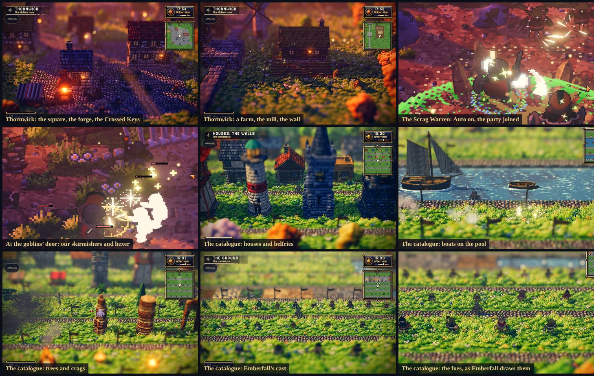
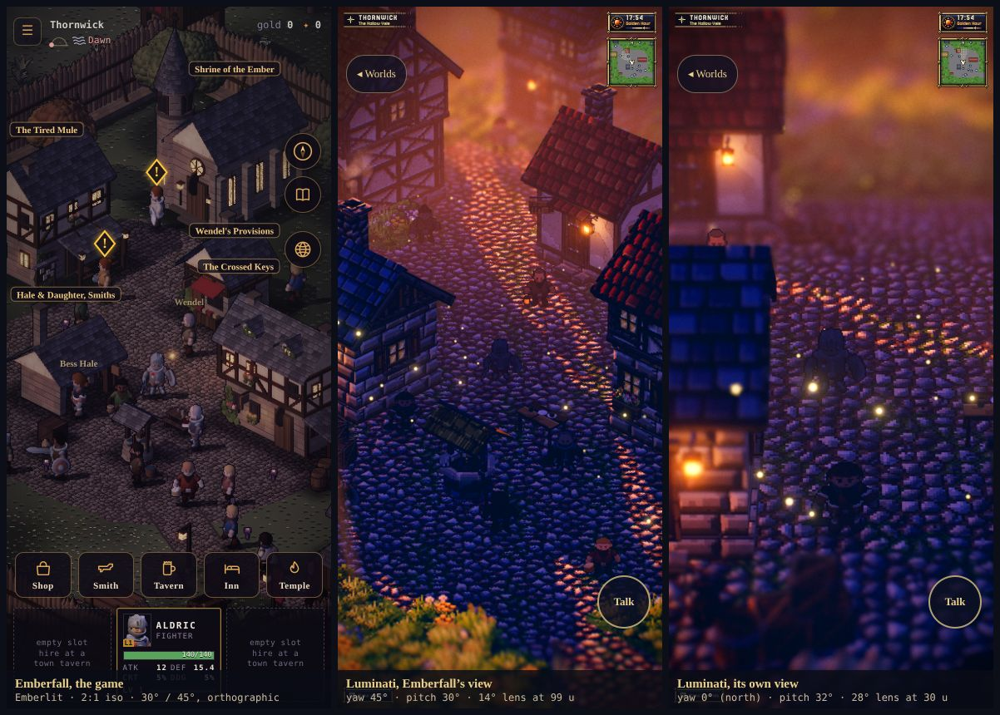
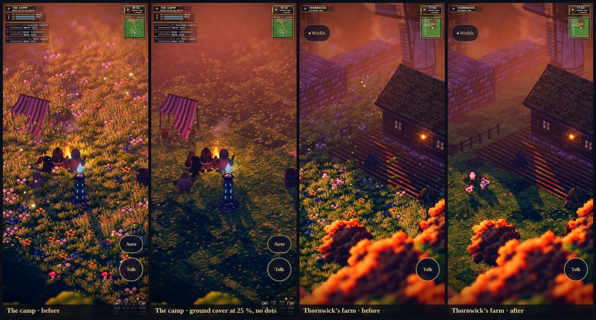
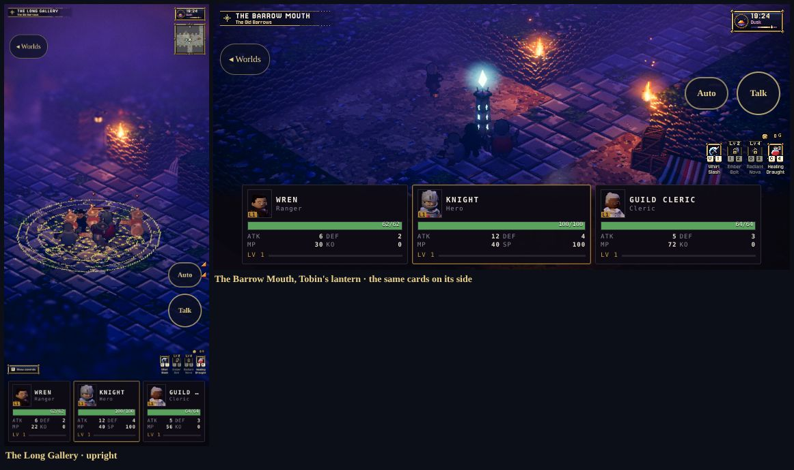
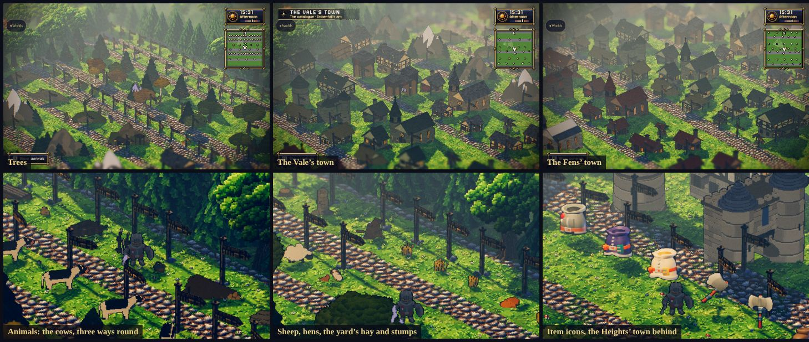

# Another world: Luminati's dioramas, Emberfall's people (prototype)

**Status: Prototype** (2026-10-31). The owner: *"Let's create an alternative game world using this repo for the world and
environment. Let's keep our player and NPC character assets AS IS. https://gitlab.com/stubborn-hug/lumina. Create a
prototype."*

**Play it:**
- from the game's menu (☰), **Compare worlds**, which saves the slot first. The owner: *"Keep these map options
  available from the menu so i can compare gameplay and world art."* It lists:
  - this game drawn by Emberlit or by Luminati (the port's trial build, [luminati-port-plan.md](./luminati-port-plan.md)
    §12; the same choice as Graphics);
  - our five maps, each opened straight into play with your hero's look: Thornwick, the Scrag Warren and the Old
    Barrows (Auto on), the Catalogue and its second wing. Their ◂ button reads **◂ Game** and goes back to your game
    (`?from=game`, `ember/touch.js`);
  - all of Luminati's worlds (this front page) and the Frontier;
- or open `/lumina/` directly.

Pick a hero, then a world. It's a sandbox: no save is read or written, and nothing reaches a game slot.

*Emberfall's Knight in Luminati's Emberfall village at golden hour; the Mage in Starfall Vale; the Cleric on Gildhaven's
road; the Rogue at Brightwater Crossing; Wren on Willowmere's green; the Barbarian at Cinderwatch Pass's Waystone Camp.
Every villager in them is drawn from Emberfall's cast too.*

## 1. What it is

[Luminati](https://gitlab.com/stubborn-hug/lumina) is an MIT-licensed HD-2D engine on three.js r186. Pixel-art sprites
stand in a lit, shadowed 3D diorama, with tilt-shift depth of field, an hour of the day with weather, water and god
rays. Its worlds are generated at runtime from level JSON, and there are no image files.

**Luminati's (pinned at `80e1aa6`):**
- the worlds: the terrain, buildings, props, water, foliage;
- the light, weather, camera and UI;
- the dialogue's lines and its foes.

**Emberfall's, as they are:**
- the player;
- the party;
- every villager, and anyone a story brings on.

These are drawn from our baked actor atlases, read from the game's own `assets/actors/` at runtime. Nothing is copied,
re-baked or edited. In dialogue each speaker's portrait is their own `<actor>.face.png`.

**The worlds shipped:**

| World | Size | Character |
|---|---|---|
| Emberfall | 48 × 40 | Luminati's demo village, by chance the same name as ours |
| Willowmere | 28 × 22 | a hamlet by a pond |
| Brightwater Crossing | 36 × 28 | a river hamlet |
| Gildhaven | 128 × 128 | a walled river town with 68 villagers |
| Starfall Vale | 128 × 128 | a festival vale |
| Cinderwatch Pass | 96 × 120 | a fight, with a party to recruit; its goblins drawn as ours, its other foes Luminati's |

And Emberfall's own (§3), written by `tools/lumina/levels.mjs` when it builds:

| Level | Size | What it is |
|---|---|---|
| Thornwick | 90 × 72 | our town converted from the game's own sim, its nine townsfolk with their own words |
| The Scrag Warren | 56 × 60 | an autobattle encounter: Wren and a Guild cleric with you against the hill goblins |
| The Old Barrows | 48 × 72 | a dungeon: the Ashbound in the Long Gallery, the Quartermaster who stands them up again, Tobin's lantern to wake at (§8) |
| The Catalogue | 112 × 119 | every world asset the engine builds, one of each and named, and Emberfall's whole cast |
| The Catalogue: Emberfall's art | 126 × 93 | the second wing: all 290 pieces of the game's own world art and item icons (§10) |

## 2. How our people get into their world

Luminati paints every character with one function, `createCharacterSheet(spec)` in `engine/pixel/CharacterSprites.js`:
32 × 32 frames in four directions. The prototype's build (`tools/lumina/vite.config.mjs`) changes what the import of that
module means, and doesn't touch Luminati's files:

- **Imports of `CharacterSprites.js` go to `tools/lumina/ember/sheets.js`.** It passes everything through except
  `createCharacterSheet`, which returns a sheet cut from one of our atlases.
  - The monsters (`MonsterSprites.js`) come too. Its humanoids (goblin, archer, shaman) are painted with the same
    function, so they're our goblins; its other kinds are painted another way and keep Luminati's look.
  - Imports of `FestivalPoses.js` go to `festival.js` the same way: a cheer, a dance, a bow are our attack, walk and
    idle frames.
- **Three call sites are tagged at build time**, so a sheet knows whose it is: the player (`Player.js`), a party member
  (`PartyMember.js`) and a villager (`Npc.js`, with its id). The build stops if Luminati's code at those lines has moved.
- **Who's who:**

  | Who | Drawn as |
  |---|---|
  | The player | the hero picked on the front page (`?hero=`, the Knight by default) |
  | A party member | by class: swordsman → the Barbarian, cleric → the Cleric, scholar → the Mage, hunter → the Rogue with a bow, bard → the Shaman |
  | A villager | by preset, picked by the villager's own seed and id among Emberfall's people (below); a level can name the look (`spec.emberActor`, any baked actor) |
  | Luminati's goblin, archer and shaman | our goblin skirmisher, goblin archer and goblin hexer, in every level (its slimes, bats, boars and golem stay Luminati's) |

  | Villager preset | Emberfall's people |
  |---|---|
  | innkeeper | Maudry, Dace, Nell |
  | merchant | Wendel, Pim, Hedda |
  | cleric | Ilse, Orla, Agnes |
  | guard | Jory, Osric |
  | farmer | Ned, Hedda, Tobin |
  | elder | Osric, Agnes, Hester |
  | villager | the four villagers, Hester, Tobin, Bess and Ned |

- **The sheet.**
  - **All eight octant rows** of our atlases. Luminati's animations name its four directions; the row drawn is the
    octant of the sprite's heading within that direction's quarter (`ember/view.js`, §6).
  - **Only what the figure can show** (2026-10-31: the first catalogue crashed iOS Safari's tab). With every clip in
    eight rows, its 72-actor cast held ≈ 900 MB of canvas. A sheet is now cut to one of three sets:
    - *full* (idle, walk, attack, hit, death; eight rows) for anyone who fights or dances;
    - *plain* (idle and walk; eight rows) for a villager, or the player on a peaceful level;
    - *still* (idle, the one row facing the camera) for a `still` villager, who never turns.

    A clip a sheet doesn't hold shows its idle, and the atlas image is let go once cut.

    | Level | Canvas memory (measured) |
    |---|---|
    | The catalogue | 28 MB (72 still, 1 plain) |
    | Thornwick | 49 MB |
    | Gildhaven, 68 villagers | 64 MB |
    | The encounter | 71 MB |

    The browser suite holds the catalogue under 64 MB.
  - **The columns** are our idle, walk, attack, hit and death clips. Luminati's poses by name (`slash`, `hurt`,
    `cheer0`, `kneel` …) point into them.
  - **Scale:** 32 native pixels to a world unit. Our 56-px figure stands 1.75 units, about a Luminati villager's height
    on the screen.
  - **Loading:** only the atlases' JSON is fetched at boot. An atlas's image is fetched when its sheet is first asked
    for. Sprite3D clones a sheet's texture per sprite, so the sheet keeps its clones and re-uploads each when the pixels
    arrive.
- **Light.** Our albedo takes Luminati's sprite lighting (its wrap-lit material, sun-facing shadow cards, its warm fill).
  Our normal maps aren't used.

**On a phone** (`ember/touch.js`; Luminati has no touch input):
- **Walk:** drag on the world for a floating stick that feeds Luminati's move vector. Drag to the edge to run.
- **Talk:** speak and turn a page (Luminati's `confirm`).
- **Zoom:** pinch, which drives the camera's wheel.
- **Worlds:** back to the front page.
- Luminati's keyboard chart is put away on a phone.
- The game's own windows, buttons and dialogue still take their taps: only touches on the world drive the stick.

## 3. Emberfall's own: Thornwick, the catalogue, a fight

The owner: *"Can we create an existing map into the new engine? Do we have a catalogue of all the game world assets
built in the new engine? Can we also create an npc autobattle encounter."*

`tools/lumina/levels.mjs` writes three levels into the build: nothing generated is committed except `lumina/`. They
head the front page, under *Emberfall's own, in Luminati's light*.

*Thornwick at dusk: the square with Hale & Daughter's forge, the Crossed Keys and the well; a farm, the mill and the
wall. The Scrag Warren with Auto lit, the party in the HUD, our skirmishers and hexer at the door. The catalogue:
houses and belfries, the boats, trees and crags, Emberfall's cast and its foes. (Captured on software WebGL.)*

### 3.1 Thornwick, converted from the game

The converter builds the town with the game's own code: `createSim(seed, …, { scene: 'town', region: 'vale' })`, the
same world the game plays. It reads:
- every tile's ground (`world.tmat`);
- every placed piece and its footprint (`world.structs`, `sim/envfoot.js`);
- the services and their names, the townsfolk's posts, the square, the roads.

**Scale.** Our tile is half a Luminati unit. A 56-px figure stands 3.5 of our tiles and 1.75 of their units (at
`EMBER_PPU` 32), so the town keeps its proportions. The crop is the walled town and the farms east of it, out to the
Vale road: our tiles −12…168 by −16…128, 90 × 72 of theirs.

| Ours | In Luminati |
|---|---|
| Ground: grass, dirt, cobble, field | `g` (some `G` and `f`), `.`, `c`, `F`. Each of their tiles is four of ours; the most of them wins, and a road or a field wins a tie with grass. The undergrowth's flowers become `f` tiles |
| The curtain wall, its eight towers, the east gatehouse | raised stone terrain (`k`): the wall 2 units over the ground, the towers 3. A cliff nobody climbs. The Vale road is kept open through the gate, which is a gap in the wall (Luminati has no gatehouse) |
| The 17 buildings | `house`. The five services carry their names. Walls and roofs follow the piece: stone and slate for the Shrine and the forge; stone and timber for the Crossed Keys; timber and thatch for the Tired Mule; plaster for Wendel's; timber, plaster, log and planks under thatch for the homes, workshops and farms |
| The forge out front | two `smithy` pieces, the forge and the anvil |
| Trees, rocks, fences | `tree` (oak, autumn, birch, pine; dead as `deadwood`), `rock`, `fence` lines: 17, 11 and 5 |
| Props | the two wells, two lampposts, the windmill, the food stand (`marketStall`), the carts, handcart and wheelbarrow (`debris` cart), the lumber and woodpile (timbers), barrels, crates, sacks, the table, the bench, three haystacks, the hens (`critters`) |
| The nine townsfolk | `npc` at their posts, each in their own look (`spec.emberActor`). Their lines are read from their compiled Ink (`inkjs` at build time): a first meeting, then a later one. A line that names the hero is left out, because Luminati has no hero name |
| Places | regions: *Thornwick* (the Hollow Vale), *The Square*, and each service by name |

**Left out:**
- the sheep: Luminati's critters are chickens, cats, birds and dogs;
- the pumpkins and the wheat: the fields are farmland tiles;
- the grove ring round the town, which falls outside the crop. Luminati's forest border stands in.
- No hiring board, shop or quest: Luminati has none of our rules (§5).

### 3.2 The catalogue

There was no catalogue. Luminati's level editor has an object palette, but nothing shows the assets standing in the
world. The level *The Catalogue* now does. It's generated from Luminati's own `ObjectCatalog.js`, so a type or a kind
added at a new pin shows up in its row.
- Every exhibit has a signpost in front naming it as the level format writes it (`house · wall stone_brick · roof
  roof_red`, `tree · kind juniper`), so a level can be written by hand from what you see.
- Each row is a region, and its plate names the row as you walk in.

| Row | Exhibits |
|---|---|
| Houses: the walls | 11, one for each wall texture (the roofs in turn) |
| Houses: the roofs and the forms | 10: each of the 6 roofs; two storeys, the gable to the front, a flat roof, a ruin |
| Buildings | 11: the windmill, 2 wells, 2 market stalls, 6 belfries |
| Trees | 13 kinds |
| Stone | 13: 6 rocks, 6 crags, the haystack |
| Light and fire | 15: 2 lampposts, the wall torch, the campfire, a point light, 4 fires, 6 monuments |
| Props | 15: bench, barrel (standing, lying), crate, crate stack, flower box, signpost, sacks, 7 kinds of debris |
| Indoors | 15: bed, tables, chair and stool, shelves, hearth, counters, rug, staircase, wardrobe and drawers, window |
| The smithy | 6 |
| Fences, bridges and boats | the fence, a bridge over a channel, 3 garlands, 3 ships on a pool, a waterfall off a stone step |
| Life in the air and underfoot | 4 critters, 10 emitters |
| The ground | every tile type in the legend, water and stairs included |
| Emberfall's cast | all 72 baked actors as Luminati draws them: 33 heroes and townsfolk, 19 foes, 20 bosses. Talk to one for its id |

The combat pieces (enemies, chests, waystones, the sky dragon) are left out, because an enemy turns a level into a
fight. They're in the encounter and in Cinderwatch.

### 3.3 The encounter, and the autobattle

**The Scrag Warren** (world doc §3): the hill goblins' door at the foot of the range, an old adit with a horse skull on
its cap, in the Reach since v1.32.
- **The party** is GDD §7.1's right one, fighter, rogue and cleric, at the game's size, you and two (so our three
  player cards hold it, §9):
  - your hero, the fighter;
  - Wren (Luminati's ranger, *hunter*);
  - a Lantern Guild cleric (cleric, *support*).
  - Brannoc (greatshield) was a fourth until the cards came: four cards across a phone cut every name short.
- **How they join:** as the level opens (an `arrive` event: `party join …`). They fight by Luminati's party AI.
- **Their lines:** Wren's come from her Ink, as once joined. The cleric's is the Lamp rank's line in
  `content/companions.json`.
- **The goblins:** 13 in four bands. 4 skirmishers (level 4) on the spoil heap, 3 archers (5) on the shelf, and 4
  skirmishers (5) and 2 hexers (6) at the door, all drawn as ours.

**The autobattle** (`ember/autobattle.js`) is the hero's side. It drives the player through Luminati's own combat hooks
(`window.__game.combat`: `move`, `aim`, `press`, `path`), so it keeps to the same paths, cooldowns and guards a thumb
would:
- the target is the nearest foe, one already fighting first, kept while it lives;
- out of reach, it walks there, along the walk grid when a cliff is in the way;
- in reach, it swings, with a skill in turn every 2.6 s;
- it drinks a draught under 40 % HP, and dodges away from a burst of damage.

The **Auto** button turns it on and off. The front page's link starts it on (`&auto=1`). Touching the world takes the
hero back. It works in any fight, Cinderwatch's too.

**Measured** with the Knight, on the manual clock: the engine stopped and stepped at 1/60 s without rendering, the
autobattle ticked every 6 frames.

| Run | Cleared | Lowest HP (sampled every 5 s) | Draughts | Hero level |
|---|---|---|---|---|
| Auto on, levels 4–6 (13, shipped), the party of three | all, in 45 s | the hero 39/112, Wren 60/75, the cleric 65/78 | 0 | 1 → 4 |
| *Before, with Brannoc (a party of four):* | | | | |
| Auto on, goblins at levels 2–3 (9 goblins) | all, in 35 s | the hero 96/112, Brannoc 99/120 | 0 | 1 → 3 |
| Auto on, levels 3–4 (13) | all, in 45 s | the hero 98/124, Brannoc 101/120 | 0 | 1 → 3 |
| Auto on, levels 4–6 (13) | all, in 45 s | the hero 91/100, Brannoc 91/120 | 0 | 1 → 4 |
| Auto off, the hero idle at camp | nothing: the party keeps to its leader, out of the goblins' reach | full | 0 | 1 |

It's an easy fight with four. With three it bites: the hero went down to 39 of 112 at the door. Luminati's party heals
and levels up fast, and a level-up refills HP; the difficulty is Luminati's numbers, not ours. Raise the levels in
`levels.mjs` for a harder one.

When the hero falls with Auto on, the autobattle rises at the waystone by itself (a key to Luminati's death screen once
it's armed, as a tap would) and fights on.

## 4. Build and deploy

- **Build:** `node tools/lumina/build.mjs`.
  - It checks out Luminati at its pin into `tools/lumina/.work/` (ignored by git) and runs `npm ci` there.
  - It stages `tools/lumina/ember/` (our files, the six levels, Luminati's licence), writes our three levels
    (`levels.mjs`) and the list of baked actors (`actors.js`), runs Vite, and writes `lumina/`.
  - `node tools/lumina/levels.mjs [id]` prints what each of our levels holds, without building.
  - It also builds a third page, `lumina/world.html` (`ember/world.js`): not a level of the prototype but the frame the
    game itself puts its world in when the menu's Graphics is set to Luminati, the port plan's trial build
    ([luminati-port-plan.md](./luminati-port-plan.md) §12).
- **Size:** 4.0 MB in all. The Japanese and Chinese font slices, 15 MB of Luminati's own build, are left out: they're
  fallbacks behind Google Fonts for pages in those languages, and the prototype is in English.
- **Deploy:** `lumina/` is committed: the site has no build step (`netlify.toml` publishes the repo as it is). Never edit
  it; rebuild. `lumina/BUILD.txt` names the pin.
- **Dependencies:** three.js, Luminati and Vite live only inside that build (architecture A16). The game's own pages
  don't load three.js, and A2 (Emberlit) stands for the game; with the trial renderer chosen, the game frames
  `lumina/world.html` and three.js loads there (A17, proposed).

## 5. What's rough, and what would come next

- **The facing is ours, the turning is Luminati's.** Our eight octants are drawn (§6), but the four-way facing that
  bounds them is still Luminati's choice, with its own hysteresis. Our animator also steps a turn through the octants in
  between (`render/anim.js`, 55 ms a step); here a turn cuts straight to the new row.
- **Emberfall's view on Luminati's worlds.** Their levels were laid out for a camera looking north: the forest border's
  open south edge, the facades facing +Z, the roofs the north camera sees past (their level checks). Seen from the
  south-east, a border's east side can stand between the camera and the play. Our own levels are laid out for it.
- **Pixel scale.** Our figures are baked at 56 px against Luminati's 28-px people and painted props. Up close they're
  finer-grained than the world round them. Two fixes: re-bake our actors at Luminati's density for this look, or draw
  the world at twice Luminati's.
- **Our normal maps** could feed Luminati's sprite lighting for the same rim light and shading as in Emberlit.
- **Our rules aren't in it.** No waves, quests or saves of ours. The fights (Cinderwatch, the Scrag Warren) are
  Luminati's combat system and party AI with our faces. Its numbers aren't ours either: the encounter is easy (§3.3). A real port would put Luminati's renderer under Emberfall's sim, and that is the larger decision (the
  game's renderer is Emberlit, A2).
- **Speed.** This sandbox has no GPU (software WebGL), so it measured nothing useful: about 1.5 frames a second at
  390 × 844 × 2. Luminati's own resolution governor scales its render. Try it on a phone before deciding anything.

## 6. The main game's view

The owner: *"What about matching the camera and isometric rotation in the main game?"*

Emberfall is 2:1 isometric (`src/render/iso.js`). Its diamonds and its actors are baked by an orthographic camera at
30° pitch and 45° yaw (`tools/actor-lab/lab.js`): seen from the south-east, one world axis runs down-right and the
other down-left. Luminati's camera looks north (yaw 0, from +Z) through a 28° lens. The prototype now opens every world
in **Emberfall's view**. The front page's *Seen as* switches to Luminati's (`?view=luminati`).

*The square from the hub, on a phone. Left, the game (Emberlit). Middle, Luminati in Emberfall's view: the same
corner, the well and the table below the hero, Wendel's and the Crossed Keys to the right, the smithy to the left.
Right, Luminati's own view, looking north.*

| | The game | Emberfall's view | Luminati's view |
|---|---|---|---|
| Yaw | 45° | 45° | 0° (north) |
| Pitch | 30° | 30° | 32° |
| Lens | orthographic | 14° (near-orthographic) | 28° |
| Distance | — | 99 u | 30 u |
| A figure, of a phone's height | 1/16 (52 of 844 CSS px) | 1/17 | 1/10.5 |
| Depth of field | none | the band 62 % of the screen, 16 u deep | the band 30 %, 6 u deep |

**The camera** (`ember/view.js`; the build tags Luminati's `Game.js` and `DebugControls.js` to take it):
- **Yaw 45°.** Screen right is then world +X −Z and screen down +X +Z, exactly as `iso.js` projects our x and y.
  Thornwick is laid out on X = our x, Z = our y (`levels.mjs`), so the town sits on the screen as it does in the game.
- **Pitch 30°**, the bake's.
- **A 14° lens**, near-orthographic like the bake. The distance frames a figure as the game does on a phone: 1.75 units
  seen a cos 30° shorter, a sixteenth of the height, so 99 units for Luminati's default 30. A level's own distance keeps
  its ratio, so the encounter (24) stays closer.
- **The depth of field** is opened out to match: our game has none, and the near-orthographic view spans two to three
  times the depth on the screen that Luminati's does. The square is sharp; the far roofs and the near hedges soften a
  little.
- **Unchanged:** the stick and the keys walk screen-true at any yaw (Luminati's move basis follows the camera), Q / E
  still turn it within Luminati's ±60° arc, and the wheel and pinch zoom.

**The eight facings.** Our atlases have a row for each screen octant (0 E, 1 SE, 2 S … 7 NE); Luminati's sheets have
four (down, left, right, up), chosen by every system it has: walking, talking, combat, the party.
- The four stay Luminati's state.
- When one of our sheets shows a frame, the row drawn is the octant of the sprite's heading on the ground since its last
  frame. It's measured as our animator measures it (`render/anim.js`: screen right and screen down at the camera's yaw,
  a hysteresis of 0.62 of an octant).
- The octant is kept within the quarter of Luminati's own facing, so a turn to talk or to swing wins. A sprite standing
  keeps its octant.
- It works in both views. Luminati's own monsters keep their four.

**Measured** on the manual clock (the engine stopped, stepped 1/60 s unrendered): from the square, each of the stick's
eight directions for 0.75 s draws that screen octant's row, 8 of 8, in both views. The browser suite checks the camera
and the eight rows.
- With the hero teleported between directions on the real clock in this sandbox (about 1 frame a second), only one or
  two frames were drawn after each jump, too few to see a turn. That is why the check steps the clock instead.
- The encounter in Emberfall's view: all 13 goblins cleared in 40 game seconds, nobody down.

## 7. The ground cover, and no floating dots

The owner: *"The grasses and ground cover hide the characters too much, what if those were at 25% of current size?
Other larger assets like trees, houses, are fine at current size. Also drop the floating luminous dots."*

*Before and after, at the same spots. Left pair: the party round the camp's fire, now standing full-length in the grass,
the crates under the tent showing. Right pair: a farm in Thornwick, the hens in plain view.*

`ember/ground.js`, in every world and both views (the build tags Luminati's `GroundDetail.js` and `World.js`):
- **The ground cover at 25 %.** That's every grass tuft, tall grass, flower, bush, fern, mushroom, pebble and reed of
  Luminati's ground detail, through its one `Foliage` call. Trees, houses, rocks, crags and the forest border are other
  builders, so they're unchanged.
- **No floating luminous dots.**
  - The camera's dust motes are off: 120 glowing specks that follow the camera, on in every level.
  - A level's dust, firefly and sparkle areas are left out.
  - The embers rising off a fire stay, and so do the smoke, mist, leaves and petals.
  - The catalogue keeps its labelled exhibits of the three (`emberExhibit` in `levels.mjs`), since that's what they
    show.
  - Thornwick's own firefly area over the farms is gone from `levels.mjs`.

**Measured:**

| Level | Ground cover at 25 % | Particle areas built |
|---|---|---|
| Thornwick | 19,350 instances in 10 fields | none (was fireflies) |
| Willowmere | | petals (was fireflies, petals) |
| Cinderwatch Pass | | petals, leaves ×2, smoke, mist ×2, embers (was 14: 5 fireflies, a sparkle and a dust too) |

Every level builds with no camera dust and no page errors. The browser suite checks Thornwick's ground cover size and
that no dust, firefly or sparkle area is built.

## 8. A dungeon: the Old Barrows

The owner: *"Create an example dungeon level with an encounter and respawn."*

**The Old Barrows** (world doc §3.1, v1.32–33) is the Vale's crypt. The level (`levels.mjs` `barrows`, 48 × 72) has one
floor of each of its three, from the door down:
- **The Barrow Mouth.**
  - The Redhand's dig at the door: their spoil, their tent and cart, their campfire.
  - **Tobin Hask**, Thornwick's sexton, on his coffin-lid with his lantern and his book. His six lines come from his Ink:
    his first meeting, then the floors and the Muster Hall.
  - **His lantern is the waystone.**
  - The party joins here, as at the Scrag Warren: you, Wren and a Guild cleric.
- **The Long Gallery.** Burial niches with a skull in each and the families' candles still burning, and the Ashbound in
  rows: 3 minions, 4 warriors, 2 rogues.
- **The Muster Hall.** The Third Legion's stores (racks, crates, sacks, barrels), four braziers, a chest, 3 warriors,
  2 mages and **the Quartermaster**.

**The encounter.** Luminati's goblin, archer and shaman are drawn as our Ashbound and the Quartermaster as himself:
- each enemy object names its look (`emberActor`: `skeleton_minion`, `skeleton_warrior`, `skeleton_rogue`,
  `skeleton_mage`, `boss_quartermaster`);
- the build tags `CombatSystem._spawnGroup` to ask `sheets.js` `enemySheetFor` first. It builds the sheet as Luminati's
  `humanoidSheet` does, with the kind's pose aliases;
- they're named as `content/foes.json` names them (*Ashbound warrior* …).

**The respawn.** Two kinds, one Emberfall's and one Luminati's:
- **The Quartermaster still issues** (`ember/issue.js`). Canon says "every little while the most broken of his ranks
  stands up whole, re-armed from his racks", and our sim's rule is `issue`, every `ISSUE_S` = 10 s.
  - While he stands and a fight is on, every 10 s of combat time the most broken of his 14 ranks stands up whole.
  - A fallen one goes first: back at its post, as Luminati's rest brings a foe back, and into the fight (the `wake`
    hook). If none has fallen, the most hurt one is made whole where it stands.
  - Put him down and the ones you put down stay down.
  - Autobattle goes for him first, sooner than his ranks.
- **Falling** (Luminati's death and respawn, COMBAT.md §6.11).
  - You wake at the last waystone you walked by, Tobin's lantern, lighter in the purse. The foes you've killed stay
    dead.
  - A rest at the lantern heals the party and brings every foe back.
  - With Auto on, the hero rises by itself.

**The light.** The crypt has no sky, so it holds a fixed hour as Luminati's own rooms do. It's a warm dusk (19.4) for
the gloom, lit by 12 wall torches, the braziers, the candles and the Redhand's fire. A level this deep shares Luminati's
12 lamps by distance.

**Measured** with the Knight and Auto on, on the manual clock (stepped 1/60 s, unrendered):

| | |
|---|---|
| Party | you, Wren, the Guild cleric |
| The gallery cleared | by 40 s; the Quartermaster had stood 2 back up meanwhile, at 15 s and 25 s (8 standing became 9) |
| The Quartermaster | at 18/138 at 60 s, down by 65 s; nothing issued after |
| All 15 cleared | in 70 s, 17 kills (two of them twice), nobody down, the hero level 1 → 4 |
| Lowest HP (every 5 s) | the hero 93/112, Wren 58/69 |
| A fall (struck down at the end) | Auto rose; the party woke at (22.5, 63.7), beside Tobin's lantern (then at 22.5, 62.5; now 23, 62.6, within the 2-unit attunement of where the party arrives), full HP |

An earlier run, before an issued foe was woken, left one minion asleep at its post after the Quartermaster fell.
Autobattle now also goes to sleeping foes once none are awake, so a dungeon is cleared rather than left.

**Fixed on the way:** `touch.js` took any touch on a `<canvas>` for a touch on the world, but Luminati paints its UI's
art on canvases too. A tap on the death screen's art never reached it. Canvases inside Luminati's UI root are now the
UI's.

## 9. Our player cards

The owner: *"Keep the old player tiles HUD in the same locations both portrait and landscape."* That means the game's
own party cards, in place of Luminati's frames, in the Luminati prototype.

`ember/cards.js` draws the game's cards (`src/ui/party.js`'s look) along the bottom on a combat level: you in the
middle, a companion either side.
- **What each card shows:**
  - a portrait: the face of whoever the sprite is drawn as;
  - the level, name and class;
  - the HP bar;
  - four numbers: ATK, DEF, MP and SP for you; ATK, DEF, MP and kills for a companion;
  - the level bar: your XP.
  The numbers are Luminati's (its combat state and `MemberCombat.info`).
- **The same place either way up.** One row, as wide as the screen up to 760 px, centred, at the bottom, upright and on
  its side. The game's landscape column is not carried over.
- **What moves out of the way:**
  - Luminati's vitals (top left) and party frames give way to the cards.
  - Its skill bar, loot feed and the folded controls' tab step up by the cards' height (`--ember-cards-h`).
  - So do Talk and Auto. On a short screen Auto sits beside Talk, clear of the clock.
- **A card is rebuilt only when what it shows changes**, so nothing re-renders under a finger.
- **Peaceful levels** show no cards, as Luminati shows no vitals there.

**Turning the phone keeps the hero's size.** A three.js lens is vertical, so in Emberfall's view the hero stood 24 px
tall on a phone held sideways against 52 upright. The game keeps things the phone's size either way up, so the view now
frames a figure at 52 CSS px whatever the window's height (`view.js`: about 99 u upright, 46 u on its side). It's
re-framed when the phone turns, with the fog's start kept 7 u short of it as Luminati sets it.

The browser suite boots the Old Barrows and checks:
- the party of three, each group's look and the Quartermaster's;
- the issuer and his 14 ranks;
- the cards replacing Luminati's vitals, in the same row upright and sideways;
- a fall waking the party at Tobin's lantern.

## 10. The catalogue's second wing: Emberfall's art

The owner asked which of the original game's assets would suit the catalogue, then: *"Put them all into the
catalog."*

**All of it, in a wing of its own.** *The Catalogue: Emberfall's art* (`levels.mjs` `catalogueArt`, 126 × 93) holds
290 pieces: every sprite of the game's baked world art and every item icon, each with a signpost naming it as the game
names it (`env · sheep_1`, `town-vale · vale_tavern_1`, `item · sword_1h`). It's a level of its own because Luminati's
levels are 128 a side at most, the first wing is 112 × 119, and the town sets alone take a dozen rows of house-sized
cells.

| Row | Pieces | Fit (as judged before) | How it reads in Emberfall's view |
|---|---|---|---|
| Props and the yard (`env`) | 31 | good | right: barrels, carts, the weapon rack, hay, stumps beside our people |
| Animals | 15 | good, and fills a gap | right: cows from three sides, sheep, hens. Luminati's animals are chickens, cats, birds and dogs |
| Trees | 31 | fair | better than expected: standing pines and oaks, flat only if the camera's turned |
| Rocks and ground cover | 17 | rocks not judged; ground cover: skip | small; the ground cover is the kind that was shrunk (§7) |
| Landmarks, bridges, walls and stairs | 16 | poor | the landmarks stand; the bridges, walls and stairs are cut-outs |
| Mountains | 8 | poor | stand as scenery cut-outs |
| The Vale's, the Fens', the Reach's and the Heights' towns | 28, 43, 28, 28 | poor | **better than expected**: drawn from the same angle as this view, a town reads as solid houses in Luminati's light and shadow. Walk round one and it's a flat card |
| Item icons (`assets/items`) | 45 | not world art | two units tall, along the last lane |

**How they stand** (`ember/props.js`):
- **No object type in Luminati holds a picture**, so the level carries a sidecar, `levels/catalogue-art.ember.json`.
  For each piece it gives where it stands (x, z), its rectangle in its atlas, and its foot (the atlas's own `ax ay`),
  or an item by name.
- **Standing them up.** `props.js` cuts each piece from its atlas once the image is in. It stands it as a Sprite3D, as
  our characters stand: turned to the camera, at our scale (32 baked px to a unit), its foot on the ground.
- **Light.** Luminati's sprite lighting, with a little of its warm fill. Our art was baked to be relit by its normal
  maps, which aren't used, and reads dark without it.
- **What they don't do:** nothing collides with them, and no lamp is added (Luminati's lamp count is fixed).

**Signposts.** The camera looks from the south-east, so a small piece's sign stands behind it, north-west of it. A
signpost in front hid every sheep. A tall piece's sign stands in front, where the piece doesn't hide it.

**Rough:**
- **One view.** The art is drawn from the game's camera only, so it lines up in Emberfall's view and not in Luminati's
  (`?view=luminati` shows it turned wrong).
- **No collision.** The buildings and walls are pictures: you walk through them.
- **The same pieces could furnish our own levels:** the sheep in Thornwick's pasture, the weapon racks in the Muster
  Hall.

The browser suite opens the wing and checks that all 290 stand, a sheep, a cow's side view, a house from each of three
towns and a sword among them.
