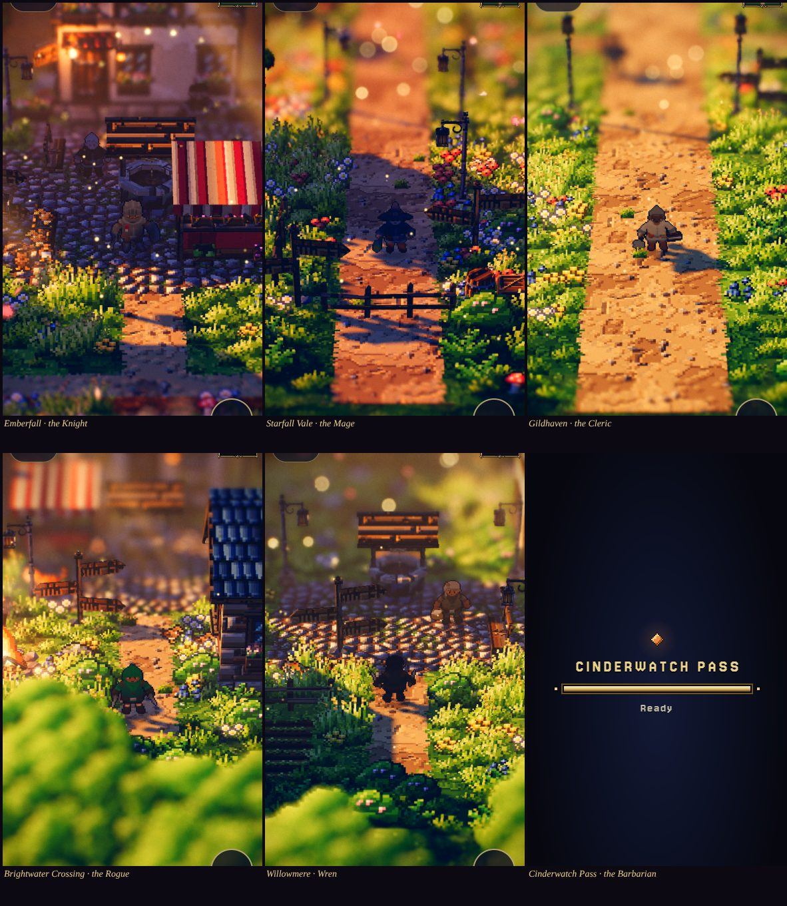

# Another world: Luminati's dioramas, Emberfall's people (prototype)

**Status: Prototype** (2026-10-31). The owner: *"Let's create an alternative game world using this repo for the world and
environment. Let's keep our player and NPC character assets AS IS. https://gitlab.com/stubborn-hug/lumina. Create a
prototype."*

**Play it:**
- from the game's menu (☰), *Another world*, which saves the slot first;
- or open `/lumina/` directly.

Pick a hero, then a world. It's a sandbox: no save is read or written, and nothing reaches a game slot.

*Emberfall's Knight in Luminati's Emberfall village at golden hour; the Mage in Starfall Vale; the Cleric on Gildhaven's
road; the Rogue at Brightwater Crossing; Wren on Willowmere's green; the Barbarian at Cinderwatch Pass's Waystone Camp.
Every villager in them is drawn from Emberfall's cast too.*

## 1. What it is

[Luminati](https://gitlab.com/stubborn-hug/lumina) is an MIT-licensed HD-2D engine on three.js r186. Pixel-art sprites
stand in a lit, shadowed 3D diorama, with tilt-shift depth of field, an hour of the day with weather, water and god
rays. Its worlds are generated at runtime from level JSON, and there are no image files.

**Luminati's (pinned at `80e1aa6`):**
- the worlds: the terrain, buildings, props, water, foliage;
- the light, weather, camera and UI;
- the dialogue's lines and its foes.

**Emberfall's, as they are:**
- the player;
- the party;
- every villager, and anyone a story brings on.

These are drawn from our baked actor atlases, read from the game's own `assets/actors/` at runtime. Nothing is copied,
re-baked or edited. In dialogue each speaker's portrait is their own `<actor>.face.png`.

**The worlds shipped:**

| World | Size | Character |
|---|---|---|
| Emberfall | 48 × 40 | Luminati's demo village, by chance the same name as ours |
| Willowmere | 28 × 22 | a hamlet by a pond |
| Brightwater Crossing | 36 × 28 | a river hamlet |
| Gildhaven | 128 × 128 | a walled river town with 68 villagers |
| Starfall Vale | 128 × 128 | a festival vale |
| Cinderwatch Pass | 96 × 120 | a fight, with a party to recruit; its foes stay Luminati's monsters |

## 2. How our people get into their world

Luminati paints every character with one function, `createCharacterSheet(spec)` in `engine/pixel/CharacterSprites.js`:
32 × 32 frames in four directions. The prototype's build (`tools/lumina/vite.config.mjs`) changes what the import of that
module means, and doesn't touch Luminati's files:

- **Imports of `CharacterSprites.js` go to `tools/lumina/ember/sheets.js`.** It passes everything through except
  `createCharacterSheet`, which returns a sheet cut from one of our atlases.
  - The monsters (`MonsterSprites.js`) keep Luminati's painter.
  - Imports of `FestivalPoses.js` go to `festival.js` the same way: a cheer, a dance, a bow are our attack, walk and
    idle frames.
- **Three call sites are tagged at build time**, so a sheet knows whose it is: the player (`Player.js`), a party member
  (`PartyMember.js`) and a villager (`Npc.js`, with its id). The build stops if Luminati's code at those lines has moved.
- **Who's who:**

  | Who | Drawn as |
  |---|---|
  | The player | the hero picked on the front page (`?hero=`, the Knight by default) |
  | A party member | by class: swordsman → the Barbarian, cleric → the Cleric, scholar → the Mage, hunter → the Rogue with a bow, bard → the Shaman |
  | A villager | by preset, picked by the villager's own seed and id among Emberfall's people (below) |

  | Villager preset | Emberfall's people |
  |---|---|
  | innkeeper | Maudry, Dace, Nell |
  | merchant | Wendel, Pim, Hedda |
  | cleric | Ilse, Orla, Agnes |
  | guard | Jory, Osric |
  | farmer | Ned, Hedda, Tobin |
  | elder | Osric, Agnes, Hester |
  | villager | the four villagers, Hester, Tobin, Bess and Ned |

- **The sheet.**
  - **Four rows**, Luminati's directions from our octants: down is our S, left W, right E, up N. The diagonals are
    left out (§4).
  - **The columns** are our idle, walk, attack, hit and death clips. Luminati's poses by name (`slash`, `hurt`,
    `cheer0`, `kneel` …) point into them.
  - **Scale:** 32 native pixels to a world unit. Our 56-px figure stands 1.75 units, about a Luminati villager's height
    on the screen.
  - **Loading:** only the atlases' JSON is fetched at boot. An atlas's image is fetched when its sheet is first asked
    for. Sprite3D clones a sheet's texture per sprite, so the sheet keeps its clones and re-uploads each when the pixels
    arrive.
- **Light.** Our albedo takes Luminati's sprite lighting (its wrap-lit material, sun-facing shadow cards, its warm fill).
  Our normal maps aren't used.

**On a phone** (`ember/touch.js`; Luminati has no touch input):
- **Walk:** drag on the world for a floating stick that feeds Luminati's move vector. Drag to the edge to run.
- **Talk:** speak and turn a page (Luminati's `confirm`).
- **Zoom:** pinch, which drives the camera's wheel.
- **Worlds:** back to the front page.
- Luminati's keyboard chart is put away on a phone.
- The game's own windows, buttons and dialogue still take their taps: only touches on the world drive the stick.

## 3. Build and deploy

- **Build:** `node tools/lumina/build.mjs`.
  - It checks out Luminati at its pin into `tools/lumina/.work/` (ignored by git) and runs `npm ci` there.
  - It stages `tools/lumina/ember/` (our files, the six levels, Luminati's licence), runs Vite, and writes `lumina/`.
- **Size:** 4.0 MB in all. The Japanese and Chinese font slices, 15 MB of Luminati's own build, are left out: they're
  fallbacks behind Google Fonts for pages in those languages, and the prototype is in English.
- **Deploy:** `lumina/` is committed: the site has no build step (`netlify.toml` publishes the repo as it is). Never edit
  it; rebuild. `lumina/BUILD.txt` names the pin.
- **Dependencies:** three.js, Luminati and Vite live only inside that build (architecture A16). The game's own pages
  don't load three.js, and A2 (Emberlit) stands for the game.

## 4. What's rough, and what would come next

- **Four directions.** Luminati's Sprite3D faces down, left, right or up. Our atlases have eight. Teaching Sprite3D the
  diagonals (its `DIRECTIONS`, `directionFromVector`) would let our figures turn as they do in Emberfall.
- **Pixel scale.** Our figures are baked at 56 px against Luminati's 28-px people and painted props. Up close they're
  finer-grained than the world round them. Two fixes: re-bake our actors at Luminati's density for this look, or draw
  the world at twice Luminati's.
- **Our normal maps** could feed Luminati's sprite lighting for the same rim light and shading as in Emberlit.
- **Our rules aren't in it.** No party AI, waves, quests or saves, and Cinderwatch's fight is Luminati's combat system
  with our faces. A real port would put Luminati's renderer under Emberfall's sim, and that is the larger decision (the
  game's renderer is Emberlit, A2).
- **Speed.** This sandbox has no GPU (software WebGL), so it measured nothing useful: about 1.5 frames a second at
  390 × 844 × 2. Luminati's own resolution governor scales its render. Try it on a phone before deciding anything.
