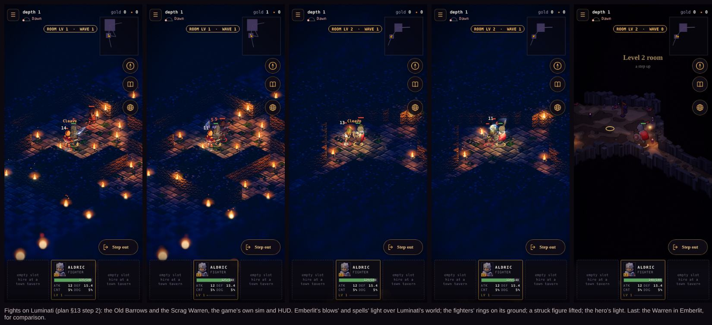
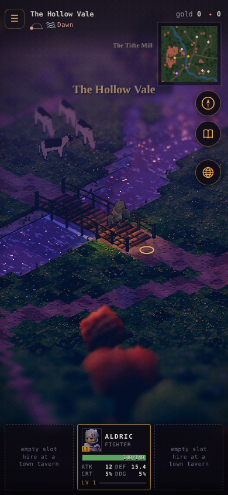
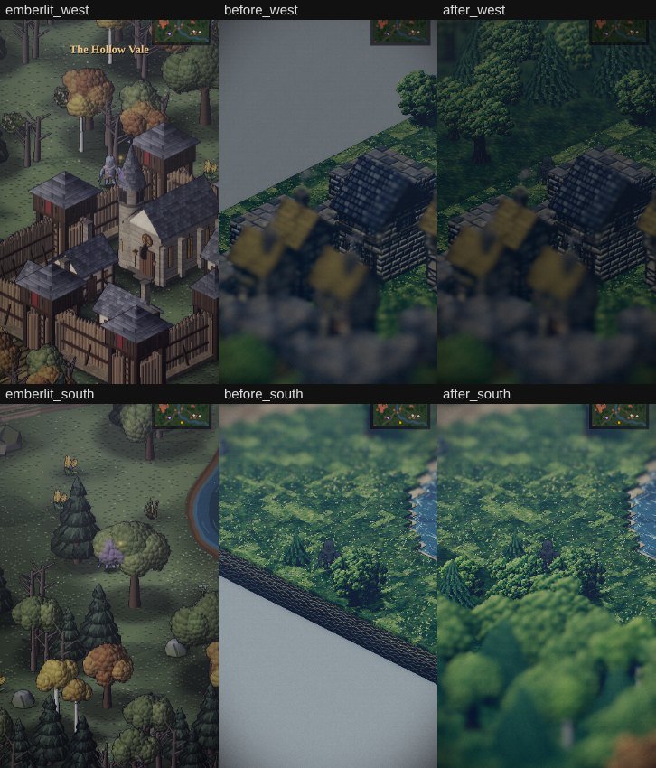
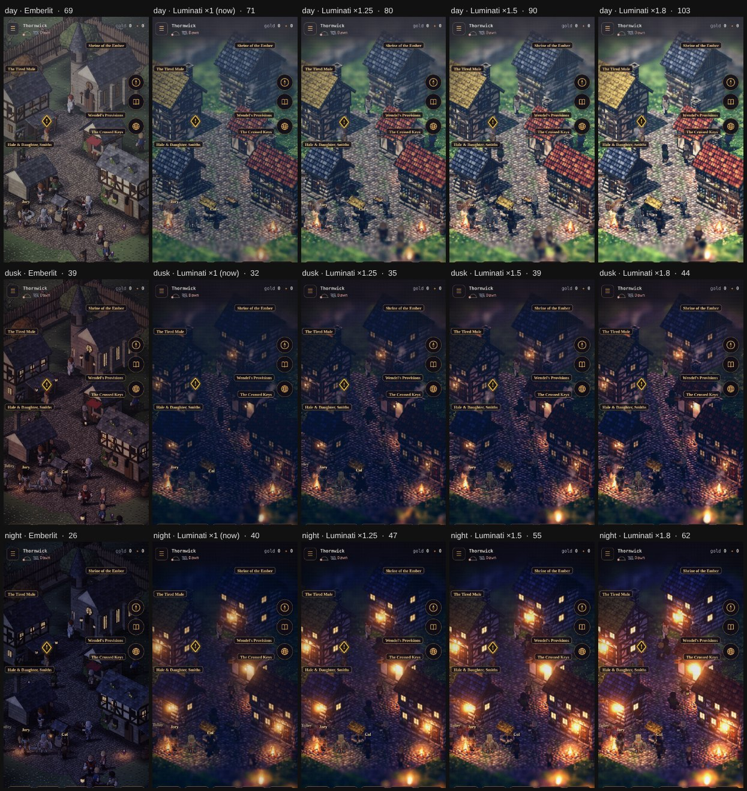
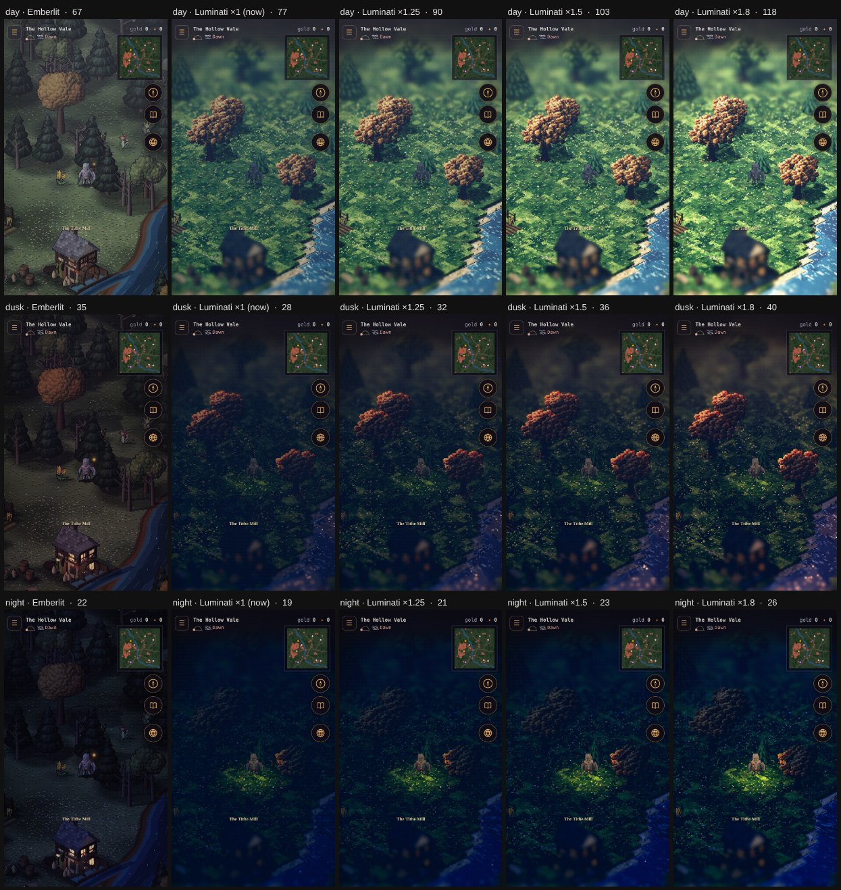
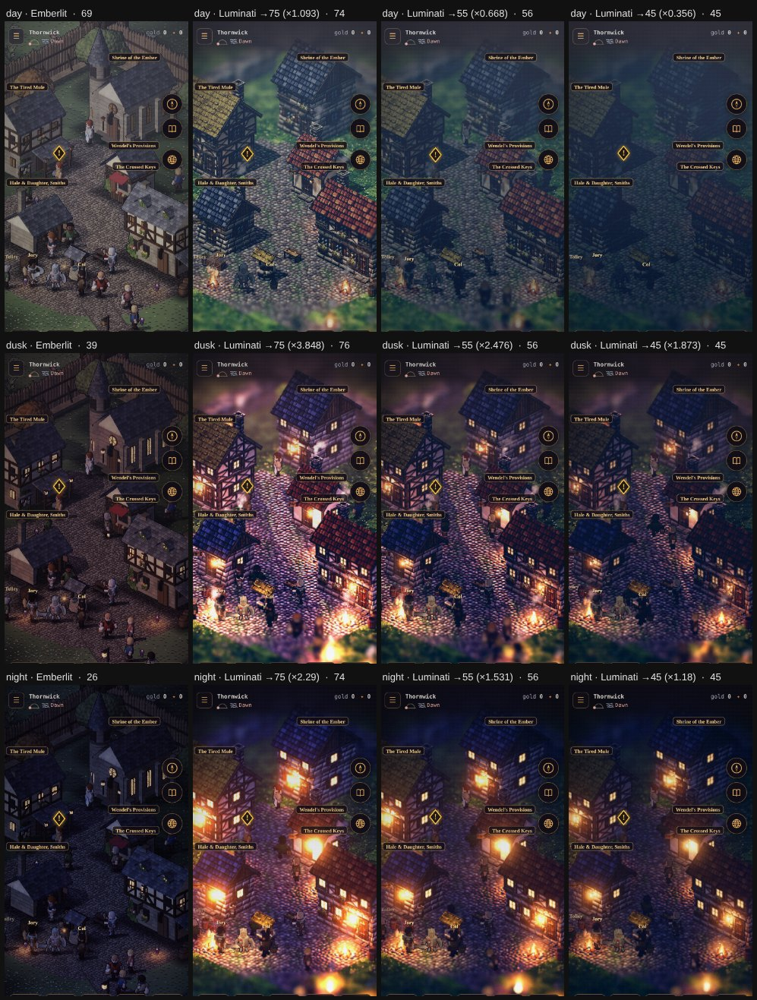
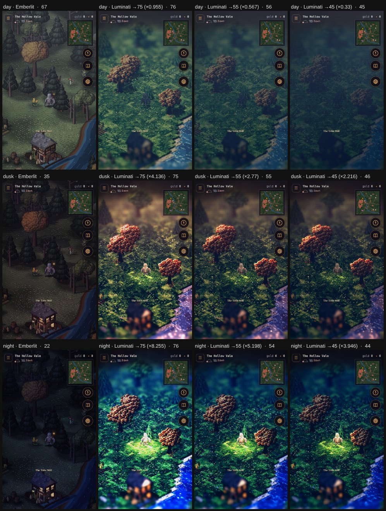
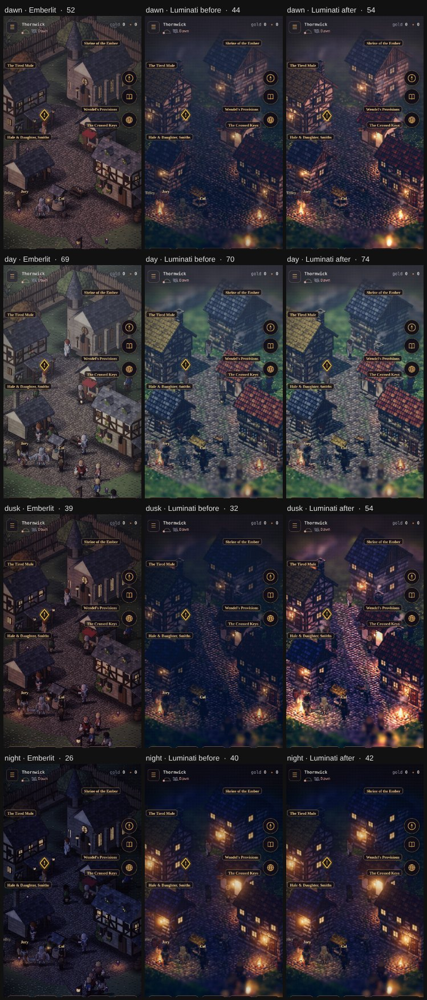
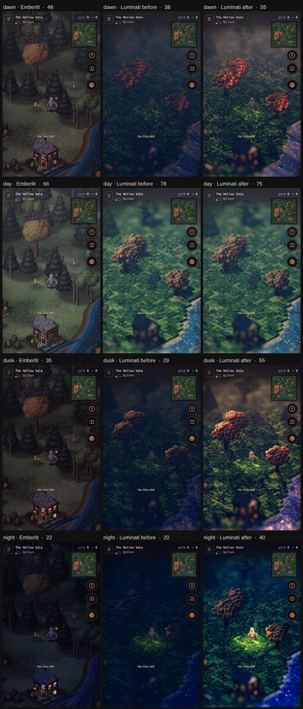
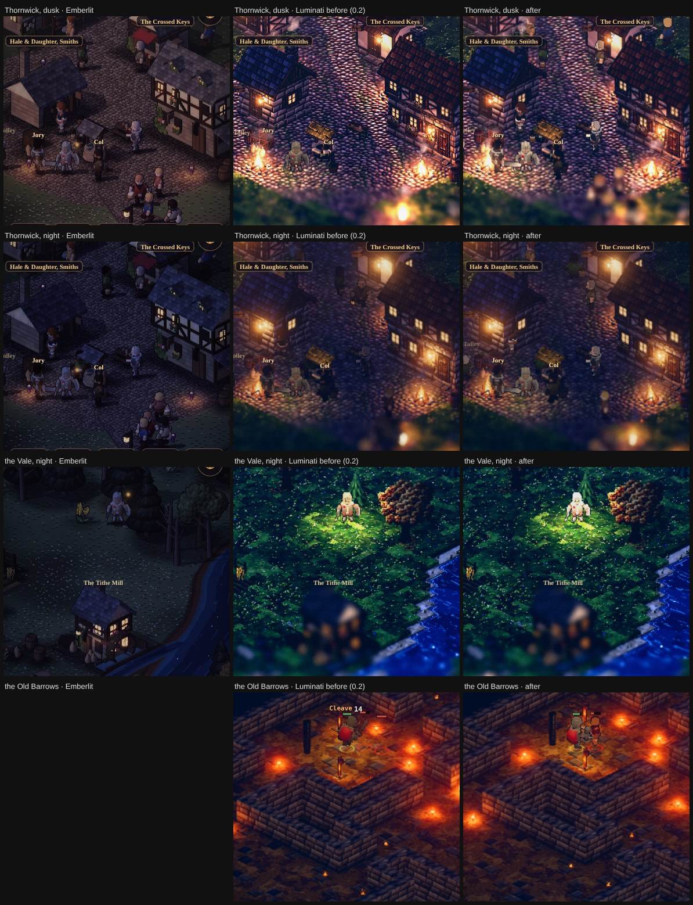

# Luminati as Emberfall's renderer: a plan

**Status: Plan of record, phase 0 built** (2026-10-31): the owner is staying with Luminati (§13). The owner's choices are in §11. Phase 0, the trial build, is
in the game behind the menu's Graphics setting (§12); the owner played it, and §13 orders what comes next. The prototype it builds on is
[lumina-prototype.md](./lumina-prototype.md) (`/lumina/`, architecture A16). Its decision row, A17, is proposed in
[architecture.md §11](./architecture.md#11-decision-log).

The owner asked to replace the current game with the Luminati engine, seen through Emberfall's iso camera, and:

- keep the UI: the navigation, the quest log, the day and night cycle, and the rest;
- keep both Luminati's assets and Emberfall's in reserve, so the original Emberfall art can come back later;
- recreate every Emberfall map in Luminati.

This plan says how. In short:

> **Luminati replaces Emberlit, and nothing else.** The game keeps its own sim, UI, story, sound and saves. Luminati
> becomes the thing that draws the world (light, shadow, water, weather, the hour), seen from our camera, and it never
> decides anything. Every map is built at runtime from the sim's own world, so what you see is what the sim walks.

---

## 1. The principle: swap the renderer, not the game

The prototype ran Luminati's whole game: its `Game.js`, combat, party AI, waystones, HUD and dialogue, with our people
painted in. The port does not.

Our game already owns those things, and they are what make it Emberfall:

- the deterministic sim with replayed, verified progression (A11);
- the balance contract (AGENTS.md rule 6);
- Fallen, the temple and the wipe;
- the sellswords, the board, the coach, quests from Ink, and the save shape.

A second combat or quest system would fork the rules from what the server replays.

The port therefore takes only Luminati's **engine and world-building layers**: the WebGL pipeline, the post chain,
lighting and climate, the terrain, water, the object builders and the set-piece kits. It drives them from our sim, the
way `src/render/renderer.js` drives Emberlit today.

What follows from that:

| Layer | Change |
|---|---|
| `src/sim/` | **None.** Replays, hashes, the smoke test's tamper cases and every balance gate stay as they are. This is the plan's biggest safety margin: the port can't move a number |
| `src/ui/` | Kept. The overlays, cards, journal, compass, world map, minimap, sky dial and menus stay DOM. Three imports move (§4) |
| `src/story/`, `src/audio/`, `src/persist/` | None. Audio's `onFrame` hook is honoured by the new renderer too |
| `src/render/` (Emberlit) | **Kept whole, in reserve** behind `?renderer=emberlit`, and the default until the cutover (phase 9) |
| `src/render3d/` (new) | The Luminati adapter: the same `createRenderer(canvas, sim, input)` contract (§3) |
| `src/vendor/luminati-80e1aa6/` (new) | Luminati's engine and world layers plus three.js r186, built once by a tool and committed (§2) |

Luminati's `Game.js`, `combat/`, `party/`, `story/`, `campaign/`, `siege/` and HUD are not loaded. Nor is its own
dialogue: ours stays.

---

## 2. Build and loading

The game has no build step (A1), and that holds. Luminati is source we pin, so:

- **A tool builds a vendored bundle.** `tools/render3d/build.mjs` checks Luminati out at its pin (as
  `tools/lumina/build.mjs` does now) and Vite-builds a **library**, not a page:
  - the engine and world modules the adapter imports;
  - three.js r186;
  - the build-time tags the prototype already proved (`vite.config.mjs`).

  The output is ES modules in `src/vendor/luminati-80e1aa6/`, mapped in the import map as `luminati`. It is committed
  and never edited, like `lumina/`. CI checks it is fresh, as it does compiled Ink.
- **A17** (proposed): Luminati MIT at `80e1aa6`, three.js r186, vendored as a prebuilt bundle; Vite a devDependency of
  the tool only. It supersedes A2's Emberlit-only rendering once the cutover lands.
- **First load.** The budget is under 2.5 MB before the title (architecture §9). The engine chunks Luminati's game
  would need measured, gzipped, in today's `lumina/` build:

  | Chunk | Gzipped |
  |---|---|
  | engine | 90 KB |
  | three.core | 51 KB |
  | Palette | 85 KB |
  | Props | 34 KB |
  | SetPieceKitParts | 33 KB |
  | SeasonKitParts | 38 KB |

  That's about 330 KB. The 193 KB CombatSystem chunk, the 96 KB Evermere and the 38 KB StoryRunner are not needed.

  The renderer loads behind the title screen (the title is DOM and the intro is its own canvas), so it costs no time
  to the first paint. Target: **≤ 450 KB gzipped for the renderer**, measured each phase.

---

## 3. The renderer contract

`main.js` and the dev pages call these. The adapter implements each one, or the UI stays as it is:

| Call | Today (Emberlit) | In Luminati |
|---|---|---|
| `render(alpha, now)` | stamp the G-buffer, light, composite | interpolate actors (`p.px → p.x` by alpha), update sprites and FX, `engine.step` with our clock (the prototype's manual stepping), render |
| `resize()` | canvas, zoom check | renderer size; the camera distance from the window's height (`view.js` `distanceFor`), so a figure stays 52 CSS px either way up |
| `holdSky(tod)` | hold the light at an hour (title at dusk, `?dev&tod`) | the same hour fed to Luminati's lighting instead of the sim's clock |
| `transiting` | a scene baking | a level building (§5): input held, as now |
| `refresh()` / `ready` | rebuild after a load; first bake done | rebuild the level from the sim's world; first level built and shaders compiled |
| `setCast(cast)` | actor atlases for the party | the same atlases cut into Sprite3D sheets (§6) |
| `enemyAt`, `npcAt`, `propAt`, `serviceAt`, `doorAt` | screen hit-boxes from the last frame | the same idea: each sprite's projected screen rectangle from the last frame, with a 44 px minimum target. Buildings and doors by a ray against the converter's footprint boxes |
| `screenToTile(sx, sy, z)` | `iso.js` `unproject` | a ray from the camera against the terrain's heightfield, then world `(X, Z) × 2` back to sim `(x, y)` |
| `minimapRect`, `plaques` | rectangles and labels for the DOM overlays | the same, from `Vector3.project` |
| `onFrame` (audio) | per frame | per frame |

**`iso.js` keeps working for directions.** Our view keeps the 45° yaw. At a 30° pitch the ground's vertical squash
is sin 30° = 0.5, which is exactly the 2:1 of `iso.js`. So `screenDirToWorld`, which main.js uses for the stick, gives
the same answer in both renderers. Only the position calls (`project`, `unproject`) move to the camera. The dev pages
(`dev/stage.js`, `dev/review.js`) stay on Emberlit: they review Emberfall's own art (§7).

---

## 4. What the UI keeps, and the three imports that move

Everything in the owner's screenshots is DOM in `src/ui/`, reading sim state and the calls above:

- the top bar: the place, the sky dial ("Night · −36 · dawn 3m"), gold;
- the minimap, the compass and its list of destinations, the journal and world-map buttons;
- the quest tracker;
- the party cards: along the bottom upright, stacked on the left sideways;
- the town menu, dialogue, the character sheet, the shrine, the tower, the sellswords, defeat, the step-out, and the
  title and intro.

None of it changes. The checks that guard it (the sky dial overlaps nothing, the square's menu is the same in every
town, the tap targets, the landscape cards) run against both renderers.

Three imports reach into `src/render/` from outside it. They move to a neutral module both renderers use:

- `weatherNow` and `holdWeather` (`render/weatherfx.js`, used by `ui/hud.js`, `audio/listen.js`, `main.js`);
- `PART_NAMES` (`render/daylight.js`, used by `ui/hud.js`).

They go to `src/world/` (`weather.js`, `daylight.js`), which reads the sim's clock and the season. Emberlit re-exports
them, so nothing it does changes.

**The day and night cycle stays the sim's.** The sim's clock is the hour. The sky dial reads it as now. The new renderer
maps the same 0..1 to Luminati's time of day (sun, moon, sky, fog, the lamps' night switch), using `daylight.js`'s
parts as the keyframes so dawn begins when the dial says it does. Weather the same: `weatherNow` to Luminati's
`Climate`/`Weather` (rain, snow, fog, wind). Dungeons hold their fixed hour, as the Old Barrows does.

---

## 5. Recreating every map

Every map in the game is built by the sim (`createSim`: `outdoor.js`, `regions.js`, `sites.js`, `road.js`), and the
dungeons differ per save seed and per floor. So the maps can't be authored once in Luminati's editor. Instead,
**converters** build a Luminati level from the sim's world at runtime: pure functions in `src/render3d/levels/`, the
grown-up form of the prototype's `levels.mjs`. That also keeps the two in step: a wall the sim walks round is a wall you
see.

Scale: one sim tile is half a Luminati unit (X = x/2, Z = y/2), as the prototype set.

| Map | Sim size (tiles) | Luminati (units) | Notes |
|---|---|---|---|
| Thornwick (the Vale's town) | 140 × 120 | 70 × 60 | the prototype's conversion, extended to every struct |
| Saltmere (the Fens) | 130 × 116 | 65 × 58 | water and stilts: Luminati's water planes |
| Ashgate (the Reach) | 140 × 120 | 70 × 60 | |
| Frosthold (the Heights) | 140 × 120 | 70 × 60 | Luminati's snow cover |
| The waystations | town-shaped, smaller | | the same town converter |
| The Vale overland | 260 × 260 | 130 × 130 | over the 128 limit (below) |
| The Fens overland | 240 × 240 | 120 × 120 | |
| The Reach and Heights overlands | 260 × 260 | 130 × 130 | **today they build the Hollow Vale's** (same name and counts). The port draws what the sim builds; giving them their own land is a design change for the GDD first, not part of this plan |
| The 11 dungeon sites | 95 × 108 (the Reedholm undercroft) to 266 × 272 (the Toadking's Mound) | 48 × 54 to 133 × 136 | per seed and floor; the Mound and the Scrag Warren (253 × 190) over the limit |
| The Mere Tower | 123 × 64 | 62 × 32 | its landings, waves and the punt |

**The 128 limit.** Luminati clamps a level to 128 units a side (`LevelFormat.js` `MAX_SIZE`). The clamp exists for
its editor and its `Nav` grid (1–2 ms for 128²); we use neither, since the sim does our pathing. Two remedies, decided
in the spike:

1. Crop the unwalkable margin (`PAD`) the sim builds round every outdoor map. Most overlands then fit.
2. Tag the clamp up to 160 at build time and measure terrain, shadows and draw calls at that size.

If neither holds on a phone, the converter splits a big map into chunks and builds them round the hero. That part is
ours: Luminati's `SpatialSplit` only kd-splits one level's terrain and props for culling, which helps at any size.

**How a struct becomes a thing** (one table per region, data in `src/render3d/levels/<region>.json`):

| From the sim | Luminati form |
|---|---|
| ground (grass, road, cobble, mud, water, snow) | terrain colour and height; water planes; Luminati's ground detail at a **quarter of its size** (the prototype's `GROUND_COVER`), no floating dots |
| walls, cliffs, dungeon walls | raised terrain (`k` heights) or wall objects; dungeon cells to floor and wall |
| houses and service buildings | Luminati's house and set-piece builders, styled by region from the world doc (canon first if a style is new). The building's door and service footprint are kept for `serviceAt` and `doorAt` |
| trees, rocks, fences, lamps, wells, signs | the nearest catalog object by kind, from the catalogue already built |
| chests, shrines, stairs, the punt | catalog objects, picked by `propAt` |
| lights | lamps and torches, within Luminati's 12-lamp budget; big maps share them through `LightPool` |

**Each level is checked against the sim** by a `node:test` per map and a sample of seeds per site:

- every walkable tile has no solid object standing on it;
- every blocked tile looks blocked;
- every door, service and prop the sim knows has a pickable footprint.

The Frontier (`/frontier.html`) is its own sandbox with its own sim and renderer. It is **out of scope**; it can follow
once the game is across.

---

## 6. Actors, animation and effects

- **Actors** come from our atlases, as in the prototype (`sheets.js`): eight screen-octant rows, 32 px to a unit,
  their foot on the ground, lit by Luminati's sprite lighting.
  - `anim.js` keeps deciding the clip and frame from sim state. The adapter shows that frame instead of Luminati's
    animator. The facing is our octant directly, with no Luminati quarter to clamp to.
  - **Memory is a gate.** The prototype crashed iOS Safari at about 900 MB of cut canvases. The cut sets brought
    that down to 28 MB (full for combatants, plain for walkers, still for the standing).
  - The port goes further: one texture per atlas, with each frame a UV rectangle, so nothing is copied at all. Atlases
    load per region (architecture §9). The budget is under 64 MB of textures for actors on a phone, measured each
    phase (`__sheets` style counters).
- **Effects.** `fx.js`'s primitives (rings, arcs, bolts, bursts, hits, telegraphs, the Fallen glow) map to Luminati's
  FX quads and particles, depth-tested in the scene. Damage numbers and plaques stay DOM, placed by projection. Every
  `sim.bus` event that `fx.js` reacts to today is listed in phase 6, and each gets its Luminati effect. None is
  dropped silently.
- **Combat reads the same.** Telegraphs, hit flashes and the party's focus ring are presentation of sim events and
  are kept. Luminati's own combat UI is not loaded.

---

## 7. Both asset sets in reserve

Nothing is deleted, and either art can be used for any map:

- **Emberfall's art stays as it is.**
  - The art and its tools stay: `assets/actors`, `assets/env`, `assets/items`, the bakes, the faces and the icons.
  - Emberlit stays in `src/render/`, selectable with `?renderer=emberlit`.
  - The art review (`?dev&scene=stage&show=…`) and the character stage keep working on Emberlit.
- **Luminati's art stays whole.** The vendored bundle carries the full object catalog and the kits, not only what the
  first maps use, so a builder is one table row away.
- **The switch is data.** Each region's struct table (§5) can name either a Luminati object or an Emberfall sprite.
  The prototype's `props.js` already stands our baked art in Luminati's world; it moves into the adapter. Bringing
  the original art back for a building, a tree or a whole town is a table change, not code.
- **The catalogue stays as the shelf.** `/lumina/`'s two wings (Luminati's builders, and our 290 pieces of art and
  icons) remain the place to look before choosing.

---

## 8. Gates

Each phase ships behind the flag and must meet these before the next one starts. The numbers go in the commits
(AGENTS.md rule 7).

| Gate | Target |
|---|---|
| Frame rate | 60 fps in Thornwick's square at dusk on an iPhone 12-class phone, 30 fps on the battery saver; the slowest map measured on the phone too |
| Memory | under 64 MB of actor textures; no Safari reload in a 20-minute session across town, overland and two dungeon floors |
| Load | the renderer at or under 450 KB gzipped, loaded behind the title; a level built in under 400 ms on the phone |
| Context loss | a lost WebGL context rebuilds the level and carries on (the A2 rule) |
| Parity | `npm run check` unchanged; replay hashes unchanged (the sim is untouched); the browser checks pass on both renderers |
| Taps | every pick target 44 px or more; a tap on a foe, an NPC, a prop, a service and the ground lands on the same thing in both renderers (a scripted tap table per map) |

---

## 9. Phases

| # | Phase | Delivers | Exit |
|---|---|---|---|
| 0 | **Spike and decision** | The vendored bundle builds; a bare scene under our sim; the 128 limit tested (crop vs. raise); one atlas as UV frames; first-load size | A17 accepted or the plan re-scoped |
| 1 | **Thornwick, a vertical slice** | `?renderer=luminati` in the real game: the town converter, the camera (`view.js`), actors through `anim.js`, `screenToTile` and the pickers, the hour from the sim | walk, talk to Maudry, open a service, all UI in place, upright and sideways |
| 2 | **UI and input** | `weather` / `daylight` moved to `src/world/`; the minimap rect and plaques; the stick; the zoom check; `transiting` | the UI browser checks pass on both renderers |
| 3 | **All towns and waystations** | Saltmere, Ashgate, Frosthold and the waystations; region style tables | the sim-vs-level checks pass; the square menu check |
| 4 | **The overlands** | the converter with the size remedy; roads, the coach's stops, foes' camps | the Vale and Fens overlands at frame-rate gate; the Reach and Heights as the sim builds them (§5) |
| 5 | **Dungeons and the Mere Tower** | the site converter for all 11 sites, every floor, per seed; torches through `LightPool`; the tower's landings | a sample of seeds per site checked; boss halls readable |
| 6 | **Combat presentation** | every `fx.js` effect mapped; telegraphs, hits, Fallen, the temple's raise | the M3 create→Fallen→temple→wipe check passes on Luminati |
| 7 | **Performance and memory** | the gates in §8 on real phones; the battery saver; context loss | all gates met |
| 8 | **Tests and tools** | the browser checks parameterised by renderer; capture tools (`tools/capture`, `tools/dungeon/capture.mjs`) able to shoot either | CI runs both |
| 9 | **Cutover** | the default flips to Luminati; Emberlit stays behind `?renderer=emberlit` | the owner's play-test on the phone |

Phases 3–5 can run side by side once phase 2 is done; each is one converter and its checks.

---

## 10. Risks

| Risk | Mitigation |
|---|---|
| Phone performance: Luminati's diorama (shadows, depth of field, bloom) is heavier than a 2D G-buffer | Its own `ResolutionGovernor`; a phone profile (smaller shadow maps, DOF off or eased as `view.js` does); the frame-rate gate decides before the cutover |
| Memory on iOS Safari | UV frames instead of cut canvases; per-region atlases; the 64 MB gate; a 20-minute soak |
| Coupling to Luminati's internals | One pin, build-time tags only (never edits), the adapter the only importer. A Luminati update is a deliberate re-pin with the checks run |
| Maps over 128 units | Crop the margin, raise the clamp, or chunk (§5); decided in the spike |
| Our baked art is flat in a lit 3D world | Luminati builders for the world by default; our art per row where it reads (the second wing shows which) |
| Picking feels different from Emberlit's | Projected rectangles with a 44 px floor, and the scripted tap table compared across renderers |
| Visual and rule drift (a tree on a walkable tile) | Levels only from the sim's world, and the sim-vs-level checks per map |

---

## 11. The owner's choices (2026-10-31)

The owner: *"Depth of field Blur is a new menu setting, design reach and heights now, leave out the Frontier for now,
lets stop at the trial build so i can play test before continuing."*

1. **Depth of field** is a setting in the menu's new **Graphics** panel, per device: *Soft blur* (the prototype's eased
   blur, the default) or *Off*. It applies at once (`src/render3d/settings.js`, `src/ui/title.js`).
2. **The Reach and Heights overlands** are designed and built as their own lands, not the Vale's copied, as separate
   work from this plan: the world doc (v1.34) and the GDD first, then the sim
   ([reach-heights-overlands.md](./reach-heights-overlands.md)). They're previews (`?scene=overland&region=reach|heights`)
   until their acts are built. The converter draws them.
3. **The Frontier** stays out of the port, on its own renderer.
5. **The prototype's maps stay playable as they are** (the owner: *"keep what you had from that prev build - the map and
   assets so i can play them"*): Thornwick, the Scrag Warren, the Old Barrows and both catalogues, with Luminati's own
   play, from the menu (*Another world*, *Compare worlds*). The port never rebuilds them (`tools/lumina/build.mjs` keeps
   the committed levels; `--levels` only on purpose).
4. **Stop after phase 0**: the trial build (§12), for the owner to play on the phone. Phases 1–9 wait for that
   play-test, and the default stays Emberlit.

---

## 12. Phase 0: the trial build

**How to play it.** Menu → **Graphics** → *Luminati* (the game saves the slot and reloads), or add `?renderer=luminati`
to the address. *Emberlit* goes back. It's the same game: the same slot, sim, HUD, menus and taps.

**How it's built, and how it differs from §2–§3.** The fastest honest way to put Luminati under the real game, so the
owner can judge the look and the feel before the big work:

- **Emberlit stays the game's eye.** It keeps its camera, its animator's choice of clip, octant and frame for every
  figure, everything drawn over the world (the minimap, names, service plaques, bars and numbers, the banner, the
  stick), and every tap test (`npcAt`, `enemyAt`, `serviceAt`, `doorAt`, `propAt`, `screenToTile`).
  - With another painter set (`renderer.setExternal`, `src/render/renderer.js`), it skips its bake, its stamping and
    its two light passes.
  - It hands that painter each frame's figures and camera.
- **Luminati draws the world in a frame.** `lumina/world.html` (`tools/lumina/ember/world.js`, built with the
  prototype by `tools/lumina/build.mjs`) sits over Emberlit's world canvas and under its overlay.
  - It takes no pointer and never has focus, so taps and keys reach the game as before.
  - It boots Luminati's `Game` with none of Luminati's play: no title, no HUD, its player hidden, its loop stopped.
  - The game steps it once a frame (`src/render3d/hybrid.js`).
  - This stands in for §2's vendored module bundle. That bundle is phase 1, and the frame goes then.
- **The camera is Emberlit's, exactly.**
  - `hybrid.js` turns Emberlit's camera into the ground point at the middle of the screen, and the CSS px a unit.
    It uses `iso.js`: a tile is 16 × 8 px, so a unit is 16√2 native px.
  - `world.js` places a 45° / 30° camera on a 1° lens at the distance that gives that scale. That's near enough
    orthographic that Emberlit's overlay and taps land on Luminati's ground.
  - Measured with `hybrid.probe`, at five points round the hero: within **0.4 px** in the Old Barrows, **0.37 px** in
    the Vale and **1.4 px** in Thornwick's square (whose camera eases onto the square).
- **The figures are ours, drawn by Luminati.**
  - Each figure is a sprite facing the camera, cut from its atlas by UV (one texture an atlas, nothing copied).
  - Each stands at Emberlit's anchor, lit by Luminati's sun and lamps, with its shadow.
  - Faded when Emberlit fades it (the Fallen, the dying).
- **The hour and the weather are the sim's.**
  - The sim's four parts of the day map onto Luminati's clock: dawn at 5:00, day 7:30, dusk 17:30, night 20:30. So
    the dial's word and the sky agree.
  - The title's held dusk holds Luminati's too.
  - The sim's rain and snow are Luminati's. Its fog and wind aren't drawn yet.
- **Every map is converted at runtime** from the sim's world (`src/render3d/convert.js`), as §5 says:
  - towns and the waystation, with each region's walls and roofs;
  - the overlands, with mountains raised as rock and the walls raised as terrain;
  - every dungeon floor, per seed, its walls raised, its braziers lit and a torch to each room.
  - Pieces with no Luminati match (mills, ruins, the keep, the Fens' stilt houses, animals, carts) stand as our own
    baked art. This is §7's "both sets in reserve" working from day one.
  - Over 128 units the map is cropped round its middle (§5's first remedy).

**Measured** (headless Chromium on software WebGL, so times are a slow floor; a phone's GPU is what phase 7 measures):

| | Thornwick | The Hollow Vale | The Old Barrows |
|---|---|---|---|
| Level (Luminati units) | 88 × 68 | 128 × 128 (cropped from 130) | 68 × 80 |
| Luminati objects · our sprites | 72 · 137 | 133 · 99 | 75 · 0 |
| Converting it (Node) | 0.13–0.19 s | 0.53 s | 0.66 s |
| Built, first boot / a travel | 17–25 s / – | – / 11.5 s | 15 s / – |
| Shader programs | 53 | 83 (after the travel) | 42 |
| Off Emberlit's overlay | 1.4 px | 0.37 px | 0.4 px |

The other levels convert inside Luminati's limits too: Saltmere 81 × 66, Ashgate 88 × 68, the Fens 128 × 128, the
Toadking's Mound 128 × 128 (cropped), the Scrag Warren 128 × 97 (`test/render3d.test.mjs`).

**Checks.**
- `test/render3d.test.mjs` (node:test): every sample world converts to a valid level within the limit, the hero on a
  walkable tile, the same world to the same level, a town's services as named houses, and the hours.
- The browser suite's `render3d` check: the game with `?renderer=luminati` builds Thornwick, then the Vale after walking
  out of the gate, the ground within 2 px of Emberlit's overlay, the frame taking no pointer, and Graphics turning the
  depth of field off.
- The sim is untouched: `npm run check` (replays, smoke, balance gates) as before.

**What's rough** (for the play-test; each is a later phase's work):
- **Effects.** No weapon or spell effects, hit sparks, floor rings or telegraphs yet: they were Emberlit's G-buffer
  work (phase 6). The numbers, bars and names are there.
- **Light.** No carry light round the hero in a dungeon, and the dungeon's fog is blue (Luminati's evening light).
- **Day.** Luminati's day is brighter and greener than Emberlit's dusky one. The owner's direction (keep the gloom)
  wants a pass on its keyframes.
- **Placement.**
  - Buildings are Luminati's houses sized to our footprints, so a door may sit off our service's spot. The tap still
    goes by Emberlit's sprite.
  - Our own art stands as flat cut-outs.
- **Waits.** A first boot and each travel wait behind black while the level builds, longer on a slow phone.
- **Memory and speed on a phone are unmeasured** (the gates in §8; phase 7).
  - Each actor atlas is one texture of about 24 MB.
  - The frame runs a second WebGL context beside Emberlit's idle one.
- **The Reach and Heights overlands** are their own lands now ([reach-heights-overlands.md](./reach-heights-overlands.md)),
  and the converter draws them. In Luminati they still read green: its grass is green, its snow belongs to its season
  kit, and the Heights' snow stands as pale sand. They need a ground pass of their own in phase 3.

---

## 13. Committed to Luminati: what's next (2026-10-31)

The owner, after the trial: *"assuming we are going to stick with the Luminati engine (keep the compare and other maps in
the menu). Whats next on the main game to implement the Luminati engine."*

So the port goes ahead. **Compare worlds**, *Another world* and the prototype's maps stay in the menu, and the
prototype's maps are kept as they are (§11 point 5). The order below puts first what the owner sees most: the fights.
Each step lands on main behind the Graphics switch, so the game stays playable in Emberlit all the way to the cutover.

| # | Step | What it delivers | Done when |
|---|---|---|---|
| 1 | **The engine in the page** (§2's phase 1) | `tools/render3d/build.mjs` builds Luminati's engine and world layers and three.js as ES modules into `src/vendor/luminati-80e1aa6/` (import-mapped as `luminati`). `src/render3d/` imports it, and the frame goes. One WebGL context: Emberlit's world canvas isn't made when Luminati draws | the trial's checks pass without the frame; the renderer loads behind the title at ≤ 450 KB gzipped (§2); no second context |
| 2 | **Fights** (§6, phase 6, brought forward) | <ul><li>Every `fx.js` effect in Luminati's FX quads, particles and ground markers: weapon trails, spells, hit sparks, the Fallen.</li><li>The floor rings, the telegraphs and the party's focus ring.</li><li>Hit flashes on the sprites (`combatFx`).</li><li>The hero's carry light (a combat VFX light, not a lamp).</li></ul> | a Scrag Warren and an Old Barrows fight in the game read as well as the prototype's; the M3 create → Fallen → temple → wipe check passes on Luminati |
| 3 | **Dungeons dressed** | <ul><li>Each site's dressing kit (`world.js` DRESS: dig, gallery, muster, bailey, nave, mound, locks, vats, abbey) as Luminati props: racks, bones, braziers, banners, cages, as the prototype's Old Barrows has them.</li><li>Walls at their height in each site's stone.</li><li>Darker fog, and a fixed hour per kit.</li><li>The Mere Tower's landings.</li></ul> | a sample of seeds per site captured and judged against the prototype's Barrows |
| 4 | **Towns and the waystation** | <ul><li>Buildings placed on our services' doors, not only sized to our footprints.</li><li>Saltmere's stilts and punts in 3D (until then our art stands in).</li><li>Each region's walls and roofs checked against the world doc.</li><li>The service plaques over Luminati's houses.</li></ul> | the square-menu and x-ray checks pass on Luminati |
| 5 | **The light and the look** | <ul><li>Luminati's day keyframes moved toward Emberlit's dusky ones (the owner's standing direction: keep the gloom).</li><li>Fog and wind weather.</li><li>The biomes' light: the Reach's arid day, the Heights' winter (done in the converter, §14).</li><li>A depth-of-field pass at the phone's size.</li></ul> | a contact sheet at dawn, day, dusk and night in each region, before and after |
| 6 | **The phone** (phase 7) | the gates in §8 on the owner's iPhone: frame rate, memory (atlas textures cut to the frames used, as the prototype's sheets were), level build time, context loss | the gates met, the numbers in the commit |
| 7 | **Tests and tools** (phase 8) | the browser suite run on both renderers; capture tools able to shoot either | CI runs both |
| 8 | **The cutover** (phase 9) | the default flips to Luminati; Emberlit stays in the menu (Graphics, Compare worlds) | the owner's play-test |

**Step 1: done** (2026-10-31).
- **The bundle.** `tools/render3d/build.mjs` builds `tools/render3d/world.js`, with Luminati's engine and world layers
  and three.js, into `src/vendor/luminati-80e1aa6/`: 67 ES modules, most loaded only by a level that needs them.
  `src/render3d/hybrid.js` imports `luminati.js` and calls `createWorld({ container, uiRoot, assets })`. The frame and
  `lumina/world.html` are gone.
- **Living in the game's page.** The build tags three lines of Luminati's `Game.js`, so nothing of its own reaches the
  player: its UI goes under a hidden root of ours, its input listens to a target nothing sends to, and its sound never
  unlocks (and is muted). Our keys, taps and sound are the game's alone.
- **One WebGL context draws.** Emberlit is made `external` (`createRenderer(…, { external: true })`): its canvas is
  only the taps' surface, its light passes run on a 1 × 1 stub that never shows, and its bake's buffers are never
  allocated (tens of MB on a phone).
- **Converter fixes.**
  - A level's legend now names only the tiles it uses. Naming the desert's and the snow's tiles had loaded both kits on
    every level.
  - Braziers, shrines and stairs are Luminati's core lights (campfires, lampposts). Its monument was The Bells of
    Evermere's and loaded its season kit and the set-piece kit's flames.
- **Measured.** What a scene fetches of the bundle (gzipped):

  | Scene | Modules | Gzipped |
  |---|---|---|
  | Thornwick | 38 | 697 KB |
  | the Old Barrows | 36 | 651 KB |
  | the Reach | 39 | 699 KB |
  | the Heights | 42 | 795 KB (both kits) |

  - That's over §2's 450 KB target. The engine's core is 201 KB, the props 140 KB, three.js 56 KB, and the hidden
    player's painter and the muted audio 49 KB.
  - The trims (stubbing the player's painter, the audio and the UI's art; dead trees off the set-piece kit) belong to
    step 6.
  - The figures, the camera (within 0.85 px of Emberlit's overlay in Thornwick, 0.37 px in the Vale) and the look are
    as the trial's.
- **Checks.** The browser check now asserts no frame and Luminati's one canvas; `npm run check` passes (475 tests).

**Step 2, fights: first cut done** (2026-10-31). 
- **The blows' and spells' light.**
  - Emberlit's `fx.js` keeps drawing every effect: weapon arcs, stabs, casts and muzzle flashes from the atlases' weapon
    anchors, bolts' trails and halos, hit sparks, shockwaves, a foe's last light, the Fens' marsh-lights.
  - It draws them on black into its emissive plane at its native size: the only buffer an external Emberlit still
    keeps.
  - `hybrid.js` lays that over Luminati's world as light: a sharp layer and a blurred one for the bloom, blended
    `plus-lighter` (`screen` where that's missing), placed as Emberlit composites its window, so each effect lands on
    its figure exactly.
  - Every effect, its timing and its colour are the game's own (`FX_STYLES`), with no second effects system to keep in
    step.
- **On Luminati's ground, in 3D.**
  - A ring at each fighter's feet in its side's colour: the party's gold, foes' red, the elite's orange.
  - The fight's mud and sluice (the Toadking's, the Vatwarden's) as pools with their rims, welling up and sinking away.
  - Meshes made once and reused, so no new program appears mid-fight.
- **A struck figure flashes.** Its colour is lifted, still lit; Luminati's own combat sprites drew our sheets as pale
  cut-outs.
- **The hero's ember-wisp.** One of Luminati's four spell lights (never a lamp) at the shoulder: full underground and
  by night, less at dusk and dawn, none by day.
- **Fixed along the way:**
  - With Luminati drawing, the top bar, its ☰ and the vignette had sat under the world (none carry a z-index, the world
    had 1). Its layers now go straight after the game's canvas.
  - The dungeons' braziers are standing torches; a campfire each was a field of bonfires.
- **Checked.**
  - The browser suite fights in the Old Barrows on Luminati: blows' light drawn (`renderer.emiLit`), rings on the ground,
    the hero's light taken, no page errors. It also asserts the world's layers sit under the top bar.
  - Captures of the Old Barrows and the Scrag Warren, Emberlit's beside them, are in `docs/img/lumina/fights.jpg`.
- **Still to do in this step.**
  - Effects in true 3D (Luminati's FX quads, with depth, so a blade swung behind a figure tucks under it); the light
    layer is depth-blind.
  - The telegraphs and the flood.
  - Spell lights on bolts.
  - The dungeons' light (too blue and dark beside Emberlit's warm halls: step 3 and step 5).

**The top bar over Luminati** (2026-11-01). The owner, on the phone: *"At the top of the phone screen its a bit blurry
washing out the town name and gold and ember count."* Emberlit's halls and dusky squares were dark behind the bar, but
Luminati's day and its snow are bright. With Luminati drawing (`body.world3d`):
- the bar gets a dusk-coloured fade behind it, drawn as its own backdrop (`#hud::before`), so its size, which places
  the minimap, never changes;
- its words get a firmer shadow;
- its grey stats are a step lighter.

Emberlit's look is unchanged. Before and after: `docs/img/lumina/topbar.png`.

**From the owner's phone, 2026-11-01:** *"Try your fixes also it didnt help. Also the bridge doesnt look right and
characters dont walk over it they walk through it. The cows look bad too"* (and earlier, the top bar 2 px lower).
- **The top bar's words.**
  - They have a crisp one-pixel outline instead of the soft 6 px glow.
  - The fights' light is no longer two page layers blended over Luminati's canvas (`plus-lighter`, a CSS blur). Those
    are the likely reason Safari drew the words above them soft. It's drawn in Luminati's own render now, after its post
    pass: Emberlit's emissive plane as a texture, added over the picture with a few taps of bloom, placed as Emberlit
    composites its window.
  - The old layers also never cleared a pixel once its light was gone (a bug: a stray comment had swallowed the line).
- **Bridges.** A bridge is now Luminati's own, across our deck's line, the river left open under it.
  - Its deck is a walk surface, so the figures stand on it as they cross: the hero's height over the Vale's first bridge
    is 1.22, against the ground's 1.0.
  - Before, it was our art stood up as a flat cut-out, which the figures passed through.
- **The farm's beasts are alive.**
  - Cows and sheep were frozen cut-outs from the level. Now they're figures in the frame Emberlit's animator chooses
    (`render/beasts.js`: the tail swished, the head lifted to chew), at their foot, with their shadows.
  - Hens are Luminati's own, pecking about.

**From the owner's phone, 2026-11-01:** *"Combat effects especially the line cast by a projectile is leaving an ongoing
visual artifact"*. Their two screenshots, in the Old Barrows and on the Vale at night, show every effect's path left
behind in faint light:
- a bolt's head as a chain of beads;
- the impact sparks as fans;
- the rising motes of a fallen foe as streaks.

That was the old page layer's bug above. Those builds (a030930 to 5924677) never cleared a pixel once it was lit.
009d6bd removed the layers, and the light is now drawn in Luminati's render each frame, over a picture its post pass
draws whole. Measured in headless Chromium, a Barrows fight with a mage and a cleric left no trail at the phone's
3× scale. The browser check now guards it: a bright square of light is laid over the world and then moved on for five
frames. The point it left goes back to the bare picture, read straight off Luminati's drawing buffer (sum of RGB):
bare 171, lit 765, left 187, the difference being the torches' flicker. Netlify keeps `src/` for five minutes, so a
reload after that picks up the fix.

**From the owner, 2026-11-01:** *"Up and down stairs are missing from the dungeons"*. There were two causes:
- **The converter drew both ways as lampposts**: one at the foot of the way up, and one on each of the stairwell's 36
  tiles. Now each is Luminati's own stair tiles (`convert.js` `stairs()`; four new legend entries: `^ v > <`, a flight
  climbing toward north, south, east or west):
  - **The way up** is a flight of three. It climbs from the floor (level 2) toward the wall it stands against, over the
    `stairsup` structure's 3 × 7 of ours, to level 5 under the wall's 6.
  - **The way down** is the 6 × 6 stairwell sunk two levels: the top step at its open (+y) edge, then a step, then a
    landing at level 0.
  - The figures walk the steps' height, since Luminati places them by its ground.
  - Measured in the Old Barrows (Luminati's ground, units):

    | Where | Height |
    |---|---|
    | The floor in front of the well | 1.0 |
    | The well's top step | 0.81 |
    | The well's middle | 0.31 |
    | The well's bottom | 0 |
    | The way up's foot | 1.0 |
    | The way up's middle | 1.5 |
    | The way up's top | 2.19 |

  - Each has a torch of its own: one on the wall beside the way up's top step, and one on the well's far wall below
    the floor. Unlit, the sunk well read as more floor in the Barrows' dark.
  - `world.ground(x, z)` (for checks) reads Luminati's ground, and the browser suite asserts both: the well more than
    0.8 under the floor, the way up's top more than 1 above it.
- **A cavern too big for one level lost its stairwell.** Luminati holds 256 × 256 of ours, and the crop was centred
  on the hero's way in.
  - The Toadking's Mound runs 265 of ours wide, and its well at x 272 lay past the crop's edge at 188. The Scrag Warren
    lost its well the same way.
  - The crop now centres on the middle of the way up and the way down when both fit, and is kept inside the floor's
    bounds. A window past the bounds held nothing.
  - Both ways are now in every site's level (`test/render3d.test.mjs`: barrows, wickham_keep, toadking_mound,
    drowned_abbey).
  - The far corners of those two caverns are still outside it. Rebuilding the level round the hero as they walk is
    for step 3, dungeons dressed.

**The Vale first (the owner, 2026-11-01):** *"continue - run through all of these, validate - run art critics. The
only modification to this plan - focus only on the Hollow Vale Map - we will continue to iterate until we get
everything right - then expand to other areas."* So steps 2 to 7 are done for the Vale (Thornwick, the Hollow Vale,
and its dungeons: the Old Barrows, Wickham Keep, the Sunken Chapel, the Ninth Milestone). The other regions wait,
drawn as the converter has them now.

**Step 2, fights: done for the Vale** (2026-11-01).
- **Telegraphs.** Emberlit has none to port. A boss's ground (the mud, the sluice) was already drawn in step 2's
  first cut, and the wind-ups are a fraction of a second.
- **The foe the party is set on is marked.** Tapping a foe sets the party on it (`battle.js` focus), and nothing had
  shown it. Now four turning arcs, in pale gold, sit just outside its ring.
  - New in Luminati only.
  - The sim exposes `focusId`, read-only (`core.js`).
- **The effects respect walls.**
  - fx.js writes each lit pixel's owner depth key (a sim x + y) into the light plane's alpha, when another painter
    draws (`fx.target({ KEY })`).
  - Luminati's light pass rebuilds each pixel's world point from its own depth buffer. Where a surface stands above
    the floor and nearer the camera than the owner, the light is cut to Emberlit's 0.22.
  - The floor never hides it, so sparks still fall onto the ground in front.
  - Luminati's figures are billboards that write no depth, so a figure in front doesn't dim another's light.
    Emberlit dimmed it.
  - Measured over a wall's top (sum of RGB): bare 62, light whose owner stands in front 755, behind it 215.
- **The create → Fallen → temple → wipe → inn → reload flow** now runs on both renderers in the browser suite (25
  checks). On Luminati two of its fixed waits were too short for software GL (a few frames a second); they wait for
  the outcome now.

**Step 3, dungeons dressed: done for the Vale** (2026-11-01; [art critic pass 19](./art-critic-pass-19.md)).
- **The stone.**
  - Each kit's floor: the dig's earth, the bailey's cobbles, the cellar's bare rock, the nave's flags.
  - Its walls: dressed stone (crag tops, stone-brick faces), or rock for the cave and the Cult's cut.
  - Its pools: wet riverbed.
  - Only a ring of wall stands round the floor; the rest of the level is void, black as Emberlit draws it. Before,
    the whole level read as a lit sea of wall-tops.
- **The light underground is Emberlit's** (`convert.js` `ambientOf`).
  - Its dungeon ambient (`AMB_BASE`) through the kit's tint (`KIT_TINT`, moved to `palette.js` and shared), and no
    sun, laid over Luminati's hemisphere light each frame.
  - Luminati's lamps run at half, so a brazier is a small warm point, as in Emberlit, not a pool of orange.
  - Luminati's own hour had lit every wall a saturated violet.
- **The furniture**, as pass 18 dressed it:
  - **In Luminati's 3D, where it has the thing:** stone braziers with real fire and a light each, crate stacks,
    barrels, sacks, boulders, basalt stalagmites and pillars, bones, spoil and pews.
  - **Our voxel props for the kits' own pieces** (`gsprite.js`, built in the page by `hybrid.js` as Emberlit builds
    them, the same variant on the same tile): standards, banners, saints, the bound, the font, sarcophagi, urn shelves,
    tents, bunks, chests, shrines.
    - They stand facing the camera, as the figures do.
    - An opened chest, a used shrine or a broken cage is stood again as it is now.
    - The binding circle and bedrolls lie under the figures.
  - A light at each prop Emberlit lights.
- **Left:**
  - Our props are flat, lit as the figures are. Emberlit's are normal-mapped.
  - The two big caverns' far corners stay outside their level.

**From the owner's phone, 2026-11-02:** *"The dungeons are too dark"*.
- At Emberlit's own brightness, a room's floor away from the braziers was lost on a phone. The headless captures had
  matched Emberlit's mean (about 12–22 of 255); the phone showed darker still.
- Underground, the ambient fill is now 2.4× (`ambientOf`: sky 1.0, ground 0.5 of `AMB_BASE` × the kit's tint), and
  the lamps 0.85× (from 0.5). The braziers stay small warm points.
- Mean brightness of the room's band, Luminati before → after (`tools/capture/rig.mjs vale-dungeons`, the same seed
  and rooms):

  | Room | Before | After |
  |---|---|---|
  | The gallery | 17.3 | 28.1 |
  | The bailey | 22.0 | 37.4 |
  | The cellar | 17.0 | 26.4 |
  | The nave | 17.3 | 26.4 |
  | The binding | 17.8 | 28.0 |

**From the owner's phone, 2026-11-02:** *"The edge of the map falls off a cliff, and is blank. The old maps were
surrounded by trees, boulders or other impassable objects"*.
- The Vale's overland is 260 × 260 of ours. A level holds 256, so the crop kept the playable land and dropped the sim's
  forest ring, which stands in the margin past it.
- Luminati's own forest border and outer scenery had been kept to town-sized maps.
- Every outdoor map now has both, so the forest goes on past the edge. The god rays are still a town's only.
- Left to the phone: whether the outer forest round a 128-unit level costs frames.

**From the owner's phone, 2026-11-02:** *"Daytime seems too dark. Show me day, dusk, night so we can tune the
brightness"* (a screenshot of Thornwick's square at dusk, in rain: mean 29 of 255).
- A brightness knob on top of the Vale's grade: `world.js` `settings({ bright })`. It's a post-tone-map multiply on the
  exposure, so ×1.25 is about +12 % of mean in sRGB at dusk and +13 % by day.
- `tools/capture/rig.mjs` takes `"bright"` per shot.
- The default is still 1, until the owner picks from the sheets below.
- Mean of the world band (12–68 % of the screen; 390 × 844), Emberlit beside Luminati at ×1 / 1.25 / 1.5 / 1.8:

  | | Emberlit | ×1 (now) | ×1.25 | ×1.5 | ×1.8 |
  |---|---|---|---|---|---|
  | Thornwick, day | 69 | 71 | 80 | 90 | 103 |
  | Thornwick, dusk | 39 | 32 | 35 | 39 | 44 |
  | Thornwick, night | 26 | 40 | 47 | 55 | 62 |
  | The Vale, day | 67 | 77 | 90 | 103 | 118 |
  | The Vale, dusk | 35 | 28 | 32 | 36 | 40 |
  | The Vale, night | 22 | 19 | 21 | 23 | 26 |

- What the numbers show:
  - Luminati's day already matches Emberlit's.
  - Its dusk is the dark one, a fifth below Emberlit's. In the town, dusk is darker than night: the windows and lamps
    light only at night.
  - Its townsfolk are dark silhouettes at dusk and night, where Emberlit's are lit.

- The owner asked to compare Luminati at means of 75, 55 and 45. Each was fitted per scene and hour (a log-log secant
  over captures, three passes), and each landed within 1.5 of its target:

  | | 75 | 55 | 45 |
  |---|---|---|---|
  | Thornwick, day | ×1.09 | ×0.67 | ×0.36 |
  | Thornwick, dusk | ×3.85 | ×2.48 | ×1.87 |
  | Thornwick, night | ×2.29 | ×1.53 | ×1.18 |
  | The Vale, day | ×0.96 | ×0.57 | ×0.33 |
  | The Vale, dusk | ×4.14 | ×2.77 | ×2.22 |
  | The Vale, night | ×8.26 | ×5.20 | ×3.95 |

  The Vale's night needs a far larger multiply than the town's, which has its windows and lamps. Past about ×3 the
  overland's night turns a lit blue-green, not a darker one.

**The owner's pick, 2026-11-02:** *"Day 75, dusk 55 and night 40"*. Dawn takes dusk's 55.
- Set in `hybrid.js` `BRIGHT`, a multiply for each part of the day, passed in each frame (`world.js` `brightHour`).
  - Each part's middle gets its own value.
  - The value eases log-linearly to the next part's, so the ×2.5 dusk comes on over half a part.
  - Only the Vale outdoors. The dungeons and the other regions keep 1.
- Each value was fitted by captures to within 1 of its target:

  | | Dawn | Day | Dusk | Night |
  |---|---|---|---|---|
  | Thornwick | ×1.445 | ×1.093 | ×2.406 | ×1.06 |
  | The Vale | ×2.0 | ×0.941 | ×2.763 | ×3.391 |

- Mean of the world band, played with no tuning knob (`tools/capture/rig.mjs`). Emberlit | Luminati before → after:

  | | Dawn | Day | Dusk | Night |
  |---|---|---|---|---|
  | Thornwick | 52 \| 44 → 54 | 69 \| 70 → 74 | 39 \| 32 → 54 | 26 \| 40 → 42 |
  | The Vale | 48 \| 38 → 55 | 66 \| 78 → 75 | 35 \| 29 → 55 | 22 \| 20 → 40 |

- `test/render3d.test.mjs` checks each part's middle, that no second's step is over 0.3 %, and that dusk sits above day.

**The owner, 2026-11-02:** *"Fix the townsfolk silhouettes at dusk and night"*.
- Emberlit's figures read in their own colours at every hour (their steady glow in the emissive plane). Luminati's
  were lit only by the sky and the lamps, plus a fixed self-light of 0.2. At dusk and by night they went dark.
- The figures' own light now rises as the light they stand in falls (`world.js` `figureGlow`, each frame):
  - The light here is the luminance of the hemisphere × its intensity, plus half the sun's.
  - The glow is `FIG_LIT` (1.6) less that, between 0.2 and `FIG_MAX` (1).
  - It's set on the figures and the beasts, not on the scenery.
- The light and the glow at each part's middle (the rig's `--stats`):

  | | Day | Dawn | Dusk | Night | The Old Barrows |
  |---|---|---|---|---|---|
  | The light | 1.67 | 0.62 | 0.76 | 0.18 | 0.34 |
  | The glow | 0.2 | 0.98 | 0.84 | 1.0 | 1.0 |

- Four strengths were tried at dusk, by night and underground (`FIG_LIT` 0 / 1.3 / 1.6 / 2.0). At 2.0 the figures
  read flat, as cut-outs.
- The pixels the glow changed, mean luma before → after: Thornwick at dusk 54 → 77, by night 41 → 68; the Vale by
  night 53 → 77; the Old Barrows 29 → 52. These are approximate: figures that moved between the shots count too.
- The browser check holds the hour: the glow is 0.2 by day, 0.6 or more at dusk and 0.95 or more by night, as the
  light falls.
- `tools/capture/rig.mjs` takes `"set"` per shot (any `world.js` setting) and `--stats`.
- Col's own clothes are dark, so he stays a darker figure than the rest, as he is in Emberlit.

**Step 4, Thornwick: done for the Vale.**
- **A tap on a service's building opens it as Luminati draws it.** Each named house's box goes through Luminati's
  camera (`renderer.js` `serviceAt` asks the other painter first).
  - All five services hit in the browser check.
  - Before, a tap had to land on Emberlit's invisible sprite.
- **The plaques are Emberlit's**, over the world at each service's sign height. They sit near Luminati's roofs.
- **The houses are each region's walls and roofs** (`REGION_LOOK`), sized to our footprints. Thornwick's are the
  Vale's timber, plaster and thatch, with stone for the shrine and the forge.

**Step 5, the light and the look: done for the Vale** (contact sheets in art critic pass 19).
- **Luminati's 24 hours graded toward Emberlit's looks** (`daylight.js` `LOOKS`, the owner's standing direction):
  - colours greyer;
  - the sky darker, not whiter (greying the horizon also greyed the fog, and the Vale went milky);
  - the sun 0.72×, the fill softer, the nights darker.
- **The picture graded as Emberlit's.** Luminati's game grades at a saturated 1.3 under a light vignette. In the Vale,
  saturation runs from 0.74 by day to 0.92 by night, and exposure from 0.84 to 0.9, under a heavy vignette.
- **The sim's dusk is Luminati's golden hour and sunset** (`PART_HOURS` 17 to 19.6). Emberlit's dusk is a warm low
  sun. Held across Luminati's purple dusk it sat darker than night.
- **The Vale's turf is mostly Luminati's dark grass.**
- The other regions keep Luminati's palette and grade until the Vale is right.
- **The sim's fog thickens Luminati's air.** Emberlit's overlay still drifts the fog banks and the wind; Luminati has
  neither weather.

**Step 6, the phone: measured, the gates wait for the owner's iPhone.**
- Every Vale scene fetches about 700 KB of the bundle gzipped (Thornwick 698, the Vale 700, each Vale dungeon 698),
  against §2's 450 KB.
- The weight: the engine 195 KB, Luminati's small props 99, three.js 55, the props 38, the set-piece kit 37, the
  sprite painters 59, the muted audio 19.
- The trims left (stubbing the audio and the hidden UI's art) are a few per cent each, and touch modules Luminati's
  game still calls. They wait for the frame rate, memory and build-time numbers from the phone, which decide what's
  worth the risk.

**Step 7, tests and tools: done for the Vale.**
- The create → Fallen → temple → wipe → inn → reload flow runs on both renderers.
- `tools/dungeon/capture.mjs` shoots either renderer and any floor (`RENDERER`, `FLOOR`, `PLACES`, `TOD`).
- The Luminati block checks:
  - Thornwick's taps;
  - the Barrows fight (light, rings, the focus marker);
  - walls hiding light;
  - the stairs;
  - no trails.
- The Stage (the art review) stays on Emberlit.

**Step 8, the cutover, waits for the owner's play-test** (the plan's own gate). The Vale is ready for it; the other
regions are not yet.

After step 1, Emberlit is still the game's eye for the overlay and taps. Moving the overlay itself (the minimap, names,
plaques, bars) onto Luminati's camera is part of step 7. It's needed before Emberlit's code can ever be retired, and
that isn't planned: Emberlit stays in reserve.

---

## 14. The biomes: grassland, desert, snow and ice (2026-10-31)

The owner: *"Can we also create assets/tiles in the new engine to cover desert/grassland, and icy/snowy areas?"*

Luminati already paints all three, so nothing new is drawn by hand:

- **Grassland:** its default set (grass, dark grass, flowers, farmland, dirt paths, cobbles).
- **Desert:** its arid set, from its set-piece kit:
  - ground: dry earth, dry grass, cracked earth, red sand, scree, sandstone;
  - rock: red rock with its cliffs;
  - trees and crags: junipers, palms, cypresses, dead trees, red-rock and sandstone crags (mesas, hoodoos, spires);
  - houses: adobe walls, terracotta and flat roofs;
  - light: an arid day (`climate: arid`).
- **Snow and ice:** its winter set, from its season kit:
  - ground: snow, trodden snow paths, frosted cobbles;
  - ice: ice to walk on, frozen water;
  - trees and stone: snow pines, bare trees, snow and ice stones and crags;
  - season: `season: winter`.

Each kit loads only for a level that uses it.

What's built:
- **In the game** (`src/render3d/convert.js` `BIOMES`, `BIOME_OF`), each region draws in its biome:
  - **The Vale and the Fens** stay grassland.
  - **The Cinder Reach** is desert. Its grass becomes dry earth, scrub, cracked pans and red sand; its paths cracked
    earth; its cobbles sandstone; its mountains red rock; its trees junipers and the dead; its stones red rock. It takes
    the arid light.
  - **The Pale Heights** are snow and ice. Its open ground is snow with trodden patches and scree; its paths are snow
    paths; its cobbles frosted; its water frozen to ice; its mountains snow; its trees snow pines and bare; its stones
    snow. It takes the winter season.
  - The town walls stay stone.
- **In the prototype:** a seventh map, **The Biomes** (`levels.mjs` `biomes`).
  - Grassland, desert, and snow and ice stand side by side, west to east. Each has its ground tiles in bands with a
    signpost naming each tile, a pond (an oasis, a frozen tarn), its trees, stones, crags and a house, and a path.
  - One level holds one light, so the three share an afternoon.
  - It's in the menu's *Compare worlds* and on the prototype's front page.

Checks: `test/render3d.test.mjs` asserts:
- the Reach converts in the desert's tiles and trees with the arid light, and no grass;
- the Heights convert in snow, ice and frozen water with the winter season, and its trees are snow pines and bare;
- the Vale stays grassland;
- every tile is in the legend.

The browser suite checks the front page lists the Biomes.

Rough: the town walls take no snow or sand, and the Heights' scree reads warm (it's the arid set's).
