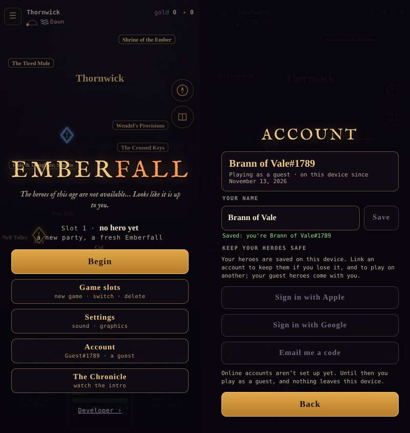

# Online services: setting up Supabase

**Status:** Current (2026-11-13). The owner's checklist for turning on accounts and cloud saves (development plan §2.2,
architecture A7). The game side so far is local: the guest profile (`src/net/profile.js`), the account
(`src/net/account.js`) and the Account screen (Menu → Account, `src/ui/title.js`). Until `online.json` exists the game is
offline, guest-only, and every sign-in button says online accounts aren't set up yet.

**What you'll end up with:** a Supabase project holding two tables, `profiles` and `saves`, each with Row Level
Security (RLS); anonymous sign-ins for guests; email codes, Google, and later Apple for linking; and one small public file,
`online.json`, that tells the game where the project is.

**Keys.** Supabase gives every project two keys.

| Key | Where it goes |
|---|---|
| **anon / publishable** | Public by design: it ships in the game, and RLS is what protects the data. It goes in `online.json`. |
| **service_role / secret** | Bypasses RLS. It never goes in the repo, the game, a chat or a screenshot. Only the save validator will use it, later (§2.13), as a server secret. |

---

## 1. Create the project (5 minutes)

1. Sign in at **supabase.com** and choose **New project**.
2. Fill in the project:
   - **Name:** `emberfall`.
   - **Database password:** generate one and keep it in your password manager. The game never needs it.
   - **Region:** the one nearest most players (for example `us-east-1` or `eu-west-2`). You can't change it later.
   - **Plan:** Free is enough for development. It pauses after a week with no traffic; Pro does not.
3. Wait for the project to finish provisioning, about two minutes.

## 2. Make the tables (2 minutes)

1. Open **SQL Editor → New query**.
2. Paste the whole of [`supabase/migrations/20261113000000_accounts.sql`](../supabase/migrations/20261113000000_accounts.sql)
   and choose **Run**. It should end with "Success. No rows returned".
3. Check the result in **Table Editor**:
   - both `profiles` and `saves` are listed;
   - neither shows a red **"RLS disabled"** or **"Unrestricted"** badge.
4. Check the policies in **Authentication → Policies**. There should be three on `profiles` and four on `saves`.

What the tables allow:
- a player reads and writes only their own rows;
- a client can never mark a save `verified`;
- `delete_my_account()` removes the player's user and, by cascade, every row of theirs (a store requirement).

Instead of the SQL Editor, you can use the Supabase CLI:

```bash
npx supabase link --project-ref <ref>
npx supabase db push
```

## 3. Turn on the sign-ins

Under **Authentication → Sign In / Providers**:

1. **Anonymous sign-ins:** on. This is what makes every guest a real (anonymous) user, so linking later keeps their
   heroes.
2. **Email:** on, and **Confirm email** on. Put `{{ .Token }}` in the body of two templates under
   **Authentication → Emails**, so players get a 6-digit code rather than a link:
   - **Change Email Address**, which a guest gets when linking an email;
   - **Magic Link**, which they get when signing in on a second device.

   Codes work in the app, and on a phone where a link would open another browser.
3. **Allow manual linking:** on (**Authentication → Settings**). Linking Google or Apple to a guest needs it.
4. **Google** (optional to start, needed before launch):
   1. In **Google Cloud Console → APIs & Services → Credentials**, create an **OAuth client ID** of type **Web
      application**.
   2. Under **Authorized redirect URIs**, add the callback URL Supabase shows on its Google provider page,
      `https://<ref>.supabase.co/auth/v1/callback`.
   3. Paste the Client ID and Client secret into Supabase's Google provider and save. The secret lives in Supabase,
      never in the game.
5. **Apple:** needed only once there's an iOS build. It requires an Apple Developer account ($99 a year), a Services ID
   and a key. Leave it for the Capacitor milestone. Its button stays hidden until `online.json` lists it.

## 4. Tell Supabase where the game lives

Under **Authentication → URL Configuration**:

- **Site URL:** the Netlify address, for example `https://<your-site>.netlify.app`.
- **Redirect URLs:** add each of these:
  - `https://<your-site>.netlify.app/**`;
  - `http://localhost:8080/**`, for local testing;
  - any custom domain later.

## 5. Tell the game where Supabase is

1. Open **Project Settings → API**, or **Connect** in newer dashboards, and copy two values:
   - the **Project URL**: `https://<ref>.supabase.co`;
   - the **anon public** key, which may be labelled publishable. Not service_role.
2. Copy [`online.example.json`](../online.example.json) to **`online.json`** at the repo root and fill them in:
   ```json
   {
     "supabaseUrl": "https://<ref>.supabase.co",
     "supabaseAnonKey": "<anon public key>",
     "providers": ["email", "google"]
   }
   ```
   List only the providers you turned on in step 3. The game shows a button for each.
3. Commit and push `online.json`. Both values are public by design: the game fetches the file at start-up, and Netlify
   serves it like any other file. If the file is missing or malformed, the game stays offline and guest-only.
   `account.js` `onlineOf` accepts only an `https://….supabase.co` URL.

You don't need to paste either value into a chat. Committing the file is enough; the next session reads it from the repo.

## 6. What comes next (game side)



Once `online.json` is in, these are the remaining steps:

1. **`src/net/supabase.js`:**
   - the client: supabase-js, vendored per A1, with its own decision row;
   - anonymous sign-in on first online launch;
   - `linkIdentity` for Google and Apple, and `updateUser({ email })` plus `verifyOtp` for email codes;
   - the profile row, with the device profile's name and tag (a new tag on a clash).
2. **The Account screen, signed in:**
   - who you are linked as;
   - the cloud save's last sync;
   - **Sign out**;
   - **Delete account**, which calls `delete_my_account()` and then clears the local profile.
3. **Cloud saves:**
   - each slot is pushed to `saves` on autosave;
   - each slot is pulled on a second device;
   - if both copies changed since the last sync, the player chooses, shown with level, region and playtime (§2.2).
4. **The validator** (§2.13):
   - a Supabase Edge Function holding the service_role key as a function secret;
   - it replays a session and marks the save `verified`.

   Leaderboards read only verified rows.

## Checking it

Once `net/supabase.js` lands, check each of these:

| Check | Expected |
|---|---|
| A fresh browser with no network | Plays as a guest, and the Account screen says offline. |
| The same browser, online | **Authentication → Users** shows one anonymous user. |
| Link by email code | The same user, now with an email; the heroes are still there. |
| A second browser, signed in by the same email | Pulls the saves. |
| Delete account | The user and their `profiles` and `saves` rows are gone. |
| As player A, `select * from saves where user_id = '<B>'` through the anon key | Returns nothing. |
