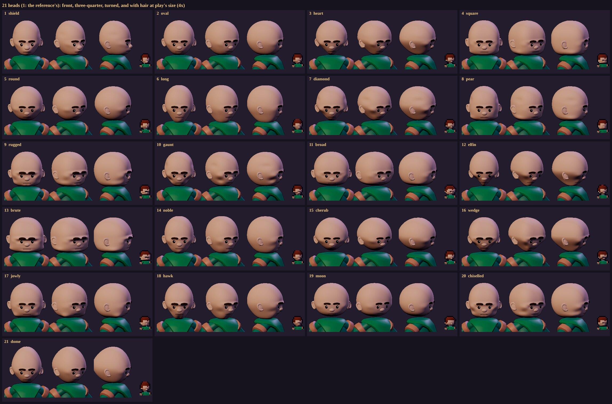
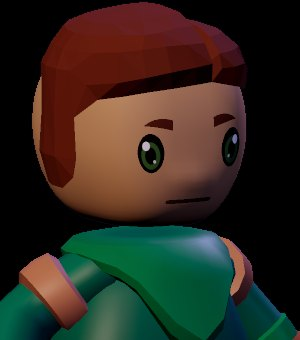
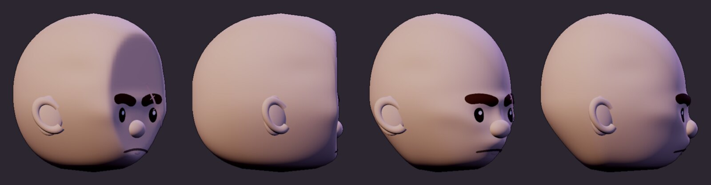
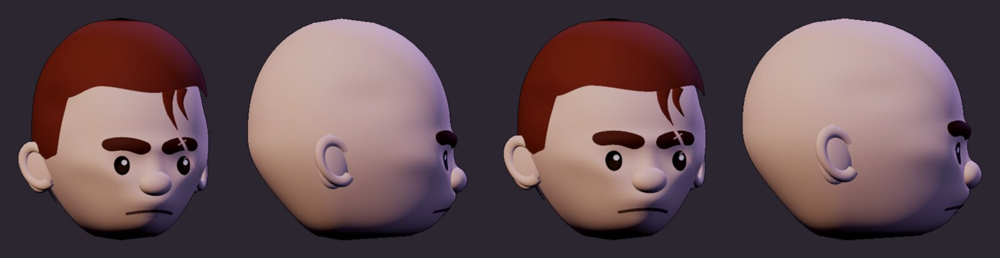
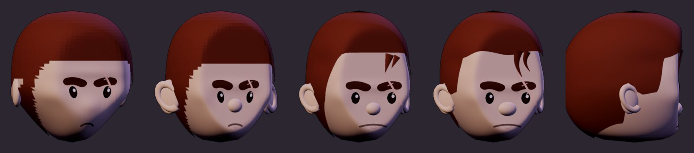
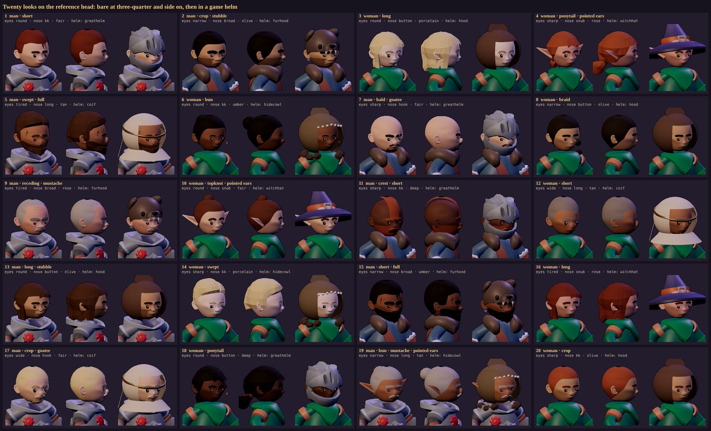
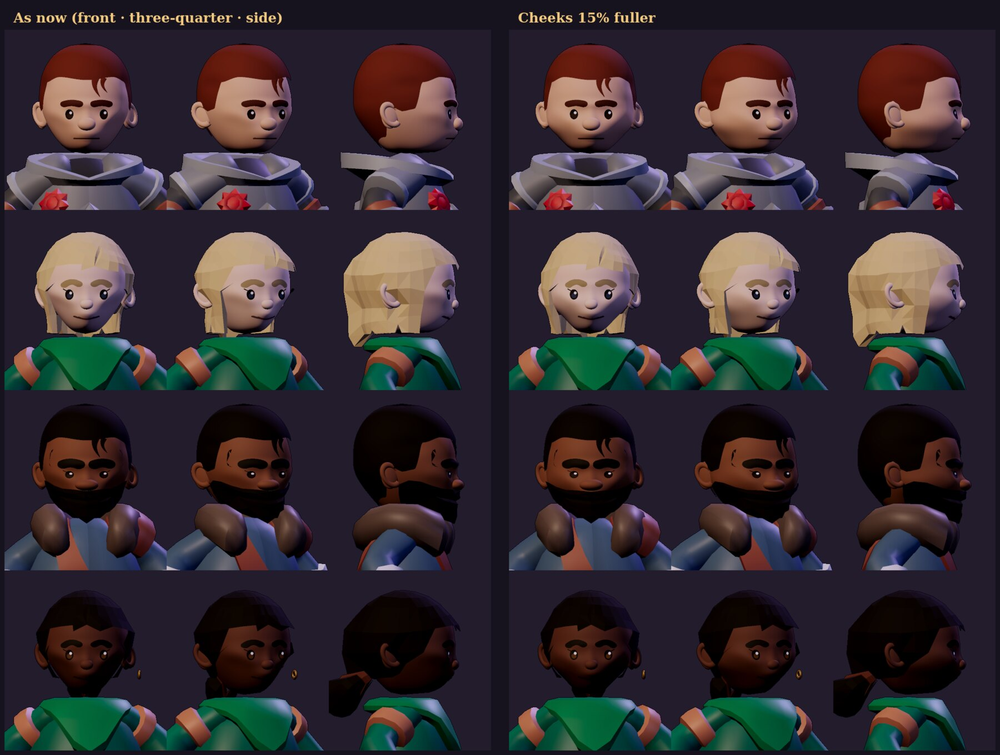
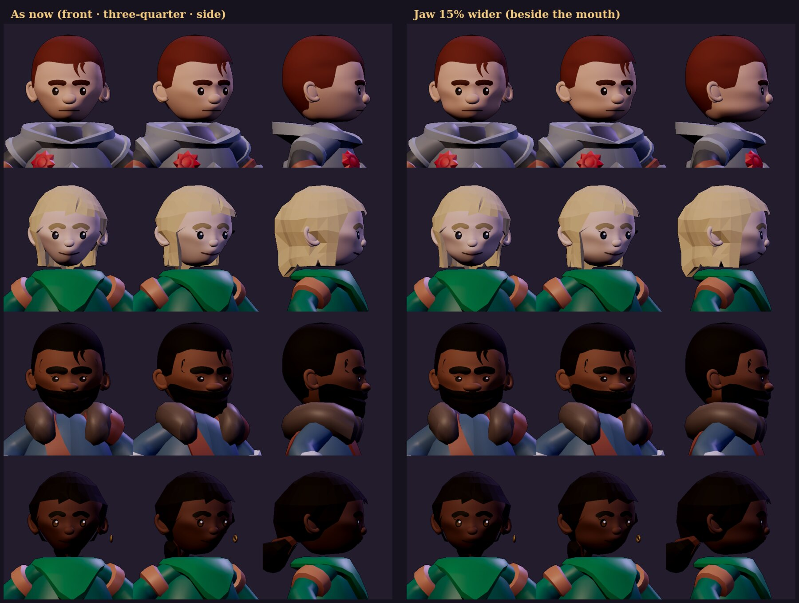
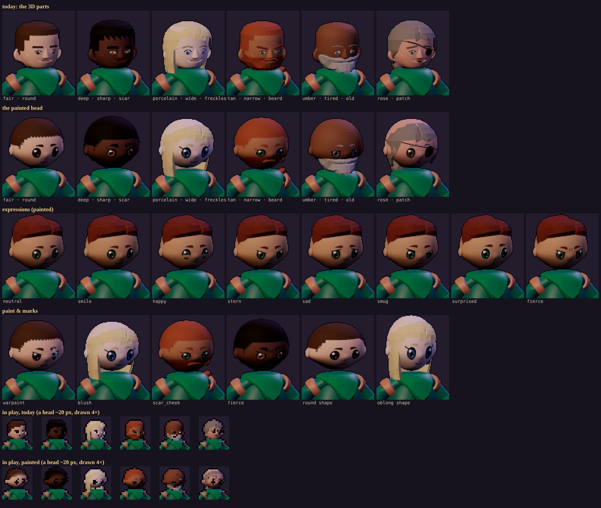
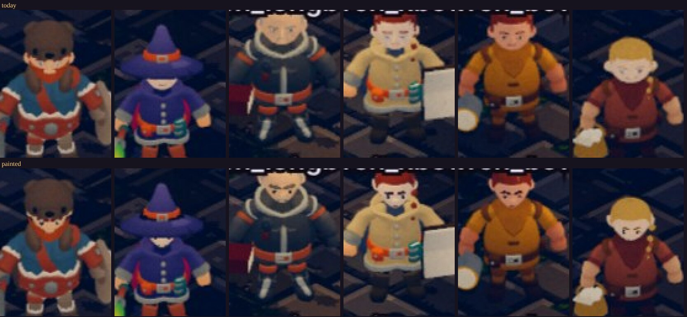

# The painted head — spike (2026-11-12)

**Status: spike, behind a switch.** The game draws as before unless the page has `?faces=painted`.

## Why

The owner (2026-11-12), after the Meshtint *Cute Series Faces Expansion Pack*: *"lets use this to improve the fidelity and
possible variability for faces … Pay close attention to the maps for the face and also the better head shapes"*, then
*"Go with the packs proportions, selectable by player expressions as a part of character creation. Start the spike"*.

What the pack does (studied from its product images; none of its art is in the repo, ours is built in code):

- a head in three parts: a swappable **hair** shell; a smooth, egg-shaped **skull** (a full crown, round cheeks, a soft
  chin, the nose a sculpted bump, small set-in ears); and a **face mask**, a small curved patch on the skull's front that
  carries the whole face as **one painted picture** (eyes, brows, mouth);
- one picture fits every head: the brows take the hair's colour, the irises their own; a lash flick on some;
- what reads small: big dark eyes with a glint, thick brows, a short mouth line; expressions and marks (scars, war paint,
  fangs, tears, creases) are the same picture redrawn.

## What the spike builds (`tools/actor-lab/faces.js`, *the painted head*)

- **The skull** (`eggSkull`, `eggAt`, `HEADS`): built from numbers, twenty heads to choose from (the owner, 2026-11-12,
  after the pack's rounded box: *"I dont like the shape of the head or the big eyes. Build 20 different head shapes with
  some depth or detail that i can choose from"*). Each is its sections' squareness, the crown's and chin's curves, its
  width and depth, the jaw drawn in toward the chin, a long jaw or a tall crown, then sculpted: the brow ridge, the eyes
  set in, the nose's bridge, cheekbones and the hollows under them, the lips, the chin's point and cleft, the jaw's
  corners, the temples, jowls, the back of the skull, a sloped forehead. The reference head (below), then oval, heart, square, round, long, diamond, pear,
  rugged, gaunt, broad, elfin, brute, noble, cherub, wedge, jowly, hawk, moon, chiselled, dome; the pack's box kept as
  `pack`. Each stays inside KayKit's head, so its helms and hoods and our hair shells still fit (KayKit's long cuts pushed
  out to clear it). A face's `head` picks one (the reference head, `shield`, without). Our six noses are six soft bumps (`BUMP`) low, just over
  the mouth; our six face shapes deform it as they did KayKit's (`SHAPES`); flat ears set back at the eyes' and nose's
  height, or our pointed ones. The board: `node tools/actor-lab/faces-spike.cjs --heads` → `out/faces_heads.png`, each
  bald from the front, three-quarter and turned, and with hair at play's size.
   (the pack's box, the board before: )
- **The reference head** (`HEADS.shield`, the default; the owner, 2026-11-12, with a picture of a stylised head: *"None of
  these match the shape of this ref image. Map this closely and critic pass until you get it right"*; the picture is the
  owner's and is not in the repo). Mapped in nine passes, each a render beside the reference at its turn (18°), bald and
  side on, and the silhouette measured (the head's width over its height at 21 heights, chin to crown, its RMS against
  the reference's):

  | pass | what changed | RMS |
  |---|---|---|
  | — | the oval / the pack's box, as they were | 0.060 / 0.112 |
  | 1 | a flat face plane (`flat`, a soft min on the front; gone again at pass 10), the reference's eyes (small dark ovals with a glint), thick round-ended brows, a wide thin mouth | 0.089 |
  | 2 | narrower (0.41), a rounder crown, a broader jaw; a ball nose; big ears | 0.030 |
  | 3 | a squarer crown; the ears lower, with a rim (a C open toward the face); the eyes and brows lowered to the reference's heights, the sockets and brow ridge with them | 0.037 |
  | 4 | the ears turned to flare forward and stand clear of the hair; the nose a mesh of its own (the skull's grid is too coarse for a round one) | 0.059 |
  | 5 | the ears in and lower; the crown rounder; the hair cut along its line (`clipTris`: no more steps at the hairline), smooth normals | 0.037 |
  | 6 | the temples in; the painted head's own short cut (a thick cap, sideburns, a forelock) | 0.036 |
  | 7 | the picture laid by where a point is, not its angle (a narrow head kept its features squeezed: the mouth half the reference's) | 0.036 |
  | 8 | a hairline by the angle round the head (`lineRound`: the KayKit blend never reached this flatter front); the forelock two tapered ribbons on the brow; a bigger nose | 0.038 |
  | 9 | the nape; the nose an oval | 0.037 |

  Then the owner (2026-11-12): *"The front face is flat, it needs to push out just like a real face and nose. In the side
  profile the back of the head pushes too far back, it should curve in a little like the sides just at the bottom"*. The
  passes now add a bald three-quarter (50°) and a bald side profile (90°), the side measured too (its depth over its
  height):

  | pass | what changed | RMS (front) | side depth at mid height |
  |---|---|---|---|
  | 9 | as committed: a flat face plate, the back deep | 0.037 | 0.92 |
  | 10 | the flat plane gone; the face pushed out (`muzzle`: the mouth's and jaw's front; `cheekF`: the cheeks under the eyes), the chin and brow fuller, a nose bridge from the brow widening to the tip; the back shallower (1.0) and curving in toward the neck (`nape`, as the jaw does at the sides); the skull's grid packed toward the face (twice as fine there, 72 × 52) and the mask finer (56 × 48) to carry it | 0.046 | 0.96 |
  | 11 | the face's front squarer at its bottom than the back (`lowF`: the chin forward under the mouth, not sloping back from it); the width and jaw back (0.43, 0.76) | 0.042 | 0.96 |
  | 12 | the back shallower again (0.86), its curve in kept to the bottom | 0.043 | 0.92 (with the nose; the crown 0.75 at 0.8 up, the nape 0.65 at 0.1) |
  | 13 | the ears closer in (the cheeks' fullness had widened the face at the ears' height) | 0.038 | 0.92 |

   (pass 9, then pass 13)

  Then the owner: *"The shape is much better but the face sits a little low and the forehead is huge maybe the part above
  the head is too tall by 15%"*. Pass 14: the cranium above the brow line (y 0.47) kept to 85 % of its height (`cap`: the
  crown at 0.96, was 1.05), everything up there brought down with it (the hairline read on the full crown it was drawn for,
  the forelock, KayKit's cuts); the face now sits higher in the head (the eye line from 0.36 of the height to about 0.39).
  The reference's height is its thick hair's, so the short cut's crown is thicker (0.165 at the top, was 0.115). The front
  silhouette's RMS against the reference 0.056 (0.070 before the thicker crown): the head now reads wider for its height
  than the reference, the owner's call over the picture's. 

  What's left is the hair's top (the reference's is chunkier, its peak to the front) and the light (the reference is lit
  from the front; our portraits keep the game's dusky key from the side). The eyes, brows, nose, ears and mouth apply to
  every head, so the twenty were redrawn with them. 
- **Twenty looks** (the owner, 2026-11-12: *"Using this latest show me 20 variations — hair, eyes, nose, ears, male and
  female, beard and no beard. With game helms and without. Make sure diff hair styles hug the head and dont float"*;
  `node tools/actor-lab/faces-spike.cjs --looks` → `out/faces_looks.png`): each bare at three-quarter and side on, then in
  a game helm (great helm, bear hood, hood, witch hat, coif, hide cowl). Men on the Knight's and Barbarian's bodies, women
  on the Rogue's (as Maudry), with lashes, coloured lips (`lips`) and the reference head's softer sister (`shieldF`: a
  narrower jaw and chin, a lighter brow). What it took:
  - **Hair that hugs:** KayKit's own cuts (long, ponytail, swept) and the Barbarian's full beard are carried from KayKit's
    skull onto ours (`conform`, `radialMap`): each point kept at its height over the surface under it, read from the
    two skulls' distances from the head's middle in every direction, and never closer than 0.02 to ours (before, they
    were pushed out by hand and floated on the narrower head). Our own cuts are shells grown off the skull, cut cleanly.
  - **Helms that fit:** a helm made for KayKit's head is brought to this one's (`head.userData.fit`, `gear.js`): down to
    the lower crown and in to the narrower head; a cloth hood, kept off the head by design, only comes down (brought in,
    its window crowded the face). The hood's look (a round shell with a window) is its own, as on today's faces.
  - **Noses:** six shapes as meshes (`BUMP`: the ball, a button, long, a hook tipped down, broad, a snub tipped up).
  - **Pointed ears** where this head's ears sit.

  
- **Fuller cheeks** (`cheekFat`, a head's or a face's own; the owner, 2026-11-12: *"Show me a comparison of this vs
  fatter cheeks by 15%"*): the skull widened between the mouth and the eyes, a little forward too, at most 15 % at its
  fullest (s 0.25, between the mouth and the nose), easing out above and below and toward the back. Measured bald from the
  front: the outline up to 8 % wider where it shows below the ears (0.644 → 0.694 of the head's height at 0.2 up); the
  ears cover its fullest. Off by default, awaiting the owner's choice. 
- **A wider jaw** (`jawWide`, as `cheekFat`; the owner, 2026-11-12: *"Don't change.. but show me 15% wider jaw, the
  parts on the side of the mouth"*): the face beside the mouth and down along the jaw widened, at most 15 % at the mouth's
  height (s 0.13), easing out above and below, the back of the head left. Measured bald from the front: the outline
  13–14 % wider at and just below the mouth (0.574 → 0.653 of the head's height at 0.15 up, 0.487 → 0.548 at 0.1), the
  same from the ears up. Off by default. 
- **The mask** (`faceMask`): the skull's front from 66° left to 66° right and from just above the chin to the brow line,
  a hair (0.006) proud of it, its picture's u and v across it. The eye line sits at y 0.46, the mouth at 0.18.
- **The picture** (`facePicture`, 512 px, one per distinct face, cached): drawn on a canvas in the head's own units — the
  eyes made smaller after the owner's *"I dont like … the big eyes"*: a modest almond with its white, the iris in its colour, a pupil, a glint, the upper lid's dark line and a crease over it,
  thick tapered brows in the hair's colour, a short mouth line, a hint of the lower lip. Transparent between the features
  (the skull's skin shows; a painted skin showed as a patch of another tone in the game's light) and drawn as a cutout
  (`alphaTest`: the game's figure fade sets `transparent` from the figure's opacity). No mipmaps: at a 20 px head the
  eyes stay dark pixels.
- **Our parts on it:** eyes (round, wide, narrow, tired, sharp), brows (six), mouths (seven), iris colours, lashes; marks
  painted (scar through the brow, cheek scar, freckles, blush, forehead lines, eyepatch, and a new war-paint stripe); the
  earring, beards and hair are the kit's own, grown off the new skull (KayKit's long cuts pushed out to clear it).
- **Expressions** (`EXPRESSIONS`, `PEXPR`): neutral, smile, happy, stern, sad, smug, surprised, fierce: the brows turned
  and raised, lids lowered, a mouth (and fangs, tears, a scowl's creases) — the picture redrawn.

## Measured

- **The face board** (`node tools/actor-lab/faces-spike.cjs` → `tools/actor-lab/out/faces_spike.png`): six looks as
  today's 3D parts and as the painted head, the eight expressions, marks and shapes, and both at a 20 px head drawn 4×.
  
- **In play** (the Stage, `node tools/capture/stage.mjs --show cast --cast party,town --clips idle --query faces=painted`):
  the same figures cropped and drawn 3×, today's above. Today's faces are two specks at play's size; the painted ones
  read as eyes, in their colour, under brows. 

## Found, for the full pass

- **Dark skin** (deep, umber): dark eyes and black brows on it lose their edge; the pack lightens its brows there and
  keeps the glint. To do: a lighter brow and an eye rim on dark skin.
- **The pixel look at play's size** is crisp but a little ragged (no mipmaps); a hand-drawn far picture (the eyes as two
  clean blocks) may read better.
- **KayKit's long cuts** (long, ponytail, swept) were made for its wider head and sit wide on the narrower reference head;
  they want painted-head cuts of their own, as the short cut has.
- **Hats and hoods** cover the eye line on some (the mage's brim: brought down to the lower crown, from the game's camera above it hides the face): the eye line sits lower than KayKit's; the brims
  may want a little lift.
- **Perf** is to be measured with `tools/capture/figperf.mjs` (one textured mask a head in place of ~20 merged parts;
  a 512² picture a distinct face, shared by every face drawn alike).

## Next (not in the spike)

0. **The owner picks heads** from the twenty: `head` a part of the appearance (sim `PARTS`, the kit's `OPTIONS`), with the
   expression, in one save version bump.

1. **Expression at creation:** `expression` a part of the appearance (sim `PARTS`, the kit's `OPTIONS`), chosen on the
   creation's Look step and at the temple; a save version bump with a migration (an old look: neutral).
2. **Every face painted:** the switch on by default, the presets in `faces.json` checked on the board, the bakes
   (portraits, figures, atlases) redone, the face board's rows for the new marks.
3. **Moods in play** (presentation only): blink, a hit's wince, a downed figure's shut eyes — the picture's mood swapped.
4. **More variety:** more eyes, brows and mouths, now that each is a drawing.
