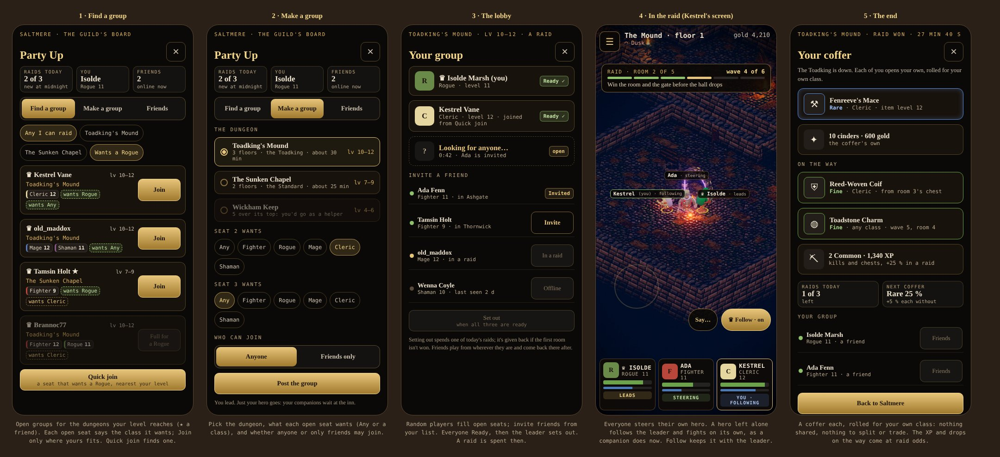
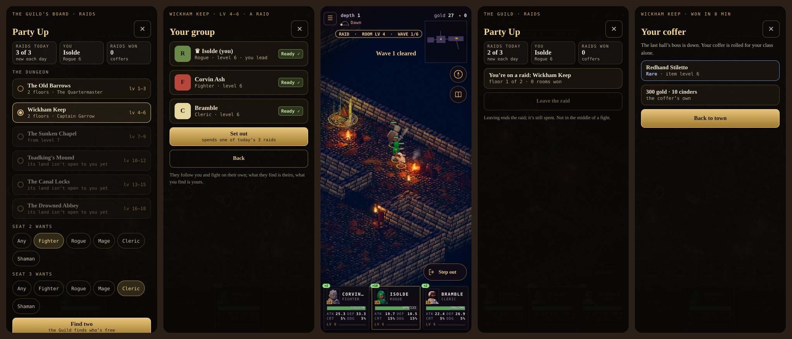

# Party Up and raids (a proposal)

**Status:** Decided, stage 1 built (2026-11-14; GDD §18 v1.97). The owner's decisions are in §11, what's built and
measured in §12; stages 2–4 (friends, live raids, polish) wait for accounts and a server.

**The owner, 2026-11-14:** *"Propose a party up and raid system.. higher chance of rewards but limited number per day.
Just the main character.. looking for groups to party up with 2 others. Can invite random or friends list. Can specify
what class you want filled. Can select which dungeon you want to tackle. All players can move freely but if a joined
companion decides not to move themself then they follow the party leader just like regular play."*

**The mockup:** [party-up-mockup.html](./party-up-mockup.html). The in-raid screen is drawn over a real frame of
Wickham Keep from the game.

---

## 0. In short

- **A raid** is a dungeon run by three players, each bringing only their main hero. Companions stay at home.
- **It has an end.** Each room holds a set number of waves. The dungeon's boss ends the run.
- **It pays better** than playing alone: about three times the gear odds on the way, +25 % XP and gold, and a
  personal coffer at the end.
- **Three a day.** A raid is spent when the group sets out.
- **Party Up finds the group.**
  - *Find a group:* a list of open groups with the class each seat wants, or *Quick join*.
  - *Make a group:* pick the dungeon and the class each of the two open seats wants. Open it to anyone or to friends
    only, and invite from your friends list.
- **Everyone steers their own hero.** A hero whose player isn't steering follows the leader in formation and fights on
  its own, exactly as a companion does today (GDD §3.4–3.5). So a player who just watches is never dead weight.
- **Loot is personal.** Each player's drops are rolled for them alone, on their own stream, for their own class. Nothing
  is split, argued over or traded. This matches the "loot is found" pillar and dev plan §2.12's rule of no trading.

## 1. What the player does

1. **Opens Party Up.** It sits on the Guild's board at a town's tavern (the Lantern Guild has a board in every town,
   world doc §4), and in ☰ anywhere outside a fight.
2. **Finds or makes a group** (screens 1 and 2).
3. **Waits in the lobby** (screen 3).
   - Random players fill the open seats. Invited friends get a card: *Isolde asks you to raid Toadking's Mound · Join /
     Not now*.
   - Everyone taps **Ready**, then the leader taps **Set out**.
4. **Is taken to the dungeon's door.** Everyone arrives in a copy of the dungeon of their own: the group's, not
   anyone's world. A player in the middle of a dungeon visit ends it, as walking out would.
5. **Runs the raid** (screen 4; §3, §4).
6. **Opens their coffer** (screen 5). Then *Back to …* returns them to where they set out from: a town, the overland,
   or a dungeon's door. Their companions are where they left them.

## 2. Who can go

- **Only your main hero.** It brings its gear, skills, loadout and stance. Companions draw no wage while you're away;
  the run is short.
- **A verified hero** (architecture §10, dev plan §2.13). The hero must be signed in with its sessions replayed; a guest
  or a dev game can't raid. The server writes the raid's results into the verified save.
- **Your level must reach the dungeon:** at least its band's base level (GDD §3.3: the Old Barrows 1–3, Wickham Keep
  4–6, the Sunken Chapel 7–9, Toadking's Mound 10–12, the Canal Locks 13–15, the Drowned Abbey 16–18). The foes are
  the band's, as always.
- **Helpers.** A hero four or more levels over the band's top may still join, to carry a friend. A helper gets the
  normal odds, no coffer, and spends no raid. So a high-level hero can help but can't farm a low dungeon for raid loot.
- **The group's spread.** There is no cap. *Quick join* prefers seats within three levels of you.

## 3. The run: a dungeon with an end

Farm play is waves forever, with a 20-wave gate before each hall (GDD §3.3, §3.3b). A raid needs an end, so the same
dungeon, floors and rooms run as follows.

- **The route** is each floor's rooms between its entrance and its hall. Offshoots stay open as a detour; they hold the
  chests and shrines.
- **A room holds six waves**, then it's won and goes quiet for the run.
  - The waves climb by 10 % a wave, from +0 % to +50 % at the sixth.
  - Wave size and archetypes come from the room's level as usual (§3.3).
- **The gate** before each hall drops when the room before it is won. It doesn't wait for 20 waves; the six are the
  test.
- **The halls:** each floor's boss and escort, as now (§3.3 Bosses). The band's boss, in the last hall, ends the run.
  When it falls, the raid is won.
- **Heroic.** Three geared heroes at level are likely stronger than one hero and two sellswords (heroes have born
  attributes, a trait, and the player's best gear). So a raid's foes run **one level over** the farm's, hall and boss
  included.
  - This is a starting number, to be measured (§9).
  - The target is that a same-level trio wins about four runs in five, in 20–35 minutes.
- **Down and back up.** A hero at 0 HP is **Downed** and rises in the lull at 20 % HP while any of the three stands,
  as the hero does today (§3.6). In a raid nobody is Slain and nobody walks as a ghost.
- **A wipe** (all three down) ends the run. Everyone wakes at the town they set out from (or the land's town), and is
  **Weakened** as after any wipe. **No gold is lost:** the Guild covers it. They keep everything that dropped.
- **Shrines** bless all three. **Chests** open once for the group, and each player gets their own roll from it (§5).

## 4. Moving together (the owner's rule)

- **You steer your own hero,** with the stick or a tap, as now.
- **Let go and your hero carries on.**
  - In a fight it autobattles after half a second, as now: it chases and strikes, and casts by its loadout and stance.
  - Out of a fight it walks back into the leader's formation (front, mid, back by class) and **follows the leader**,
    exactly as a companion does.
  - A player who never touches the screen is carried through the run by the same AI that runs companions today.
- **Follow** is a toggle on screen 4. With it on, your hero stays with the leader until you steer again. With it off,
  your hero holds where you left it and fights from there.
- **The leader** is whoever made the group; their card shows ♛. The leader's steering is what the followers follow.
  - Tap a card to **Make leader**.
  - If the leader drops, the lead passes to the next player.
- **One fight at a time.** A room's fight starts when any hero crosses its doorway; the others can walk in to join.
  While a fight is on, the other rooms' doorways are shut, so the group can't split over two fights. The room resets
  only if all three leave it.
- **Stairs:** only the leader takes the group down or up, and everyone goes. A member who taps the stairs is told
  *the leader takes the stairs*.
- **Focus:** your tap on a foe sets your own hero's focus. The leader's focus shows to the others as the leader's mark,
  and following heroes take it.
- **Say…:** a few set phrases (*Ready*, *Wait for me*, *Follow me*, *This way*, *Well fought*). There's no free chat at
  first: every line a player reads is authored (AGENTS.md rule 5), and there's nothing to moderate.
- **A player who drops** (signal lost, app closed): their hero follows the leader and fights on its own, the same rule
  again. If they reconnect before the run ends, they take their hero back and still get their coffer.

## 5. Rewards: better odds, three a day

**Three raids a day**, counted per account rather than per game slot, so a second slot doesn't double the bonus.

- The day is the real calendar day, counted by the server. It can't be the game's own day, which time away moves on.
- A raid is spent when the group **sets out**. It's given back if the group doesn't win its first room (someone
  dropped, or a wipe in room one). A raid can be given back like this once a day.
- With no raids left you can still join a group as a helper (§2): the normal odds, no coffer. You can always help a
  friend.

**The odds** (farm play from GDD §8; the raid odds are the proposal, to be measured):

| | Farm play | In a raid |
|---|---|---|
| Fine, per wave | 1 % | 3 % |
| Rare, per wave | 0.2 % | 0.6 % |
| A chest's gear chance | 15 % + 5 % a room level | 35 % + 5 % a room level, Fine or better 40 % of the time |
| A floor's boss | Fine or better on the first fall, then 1 in 20 | Fine or better every time, Rare 25 % |
| XP and gold | the room's | +25 % |
| Cinders | 1 an elite, 5 a boss | the same, plus 10 in the coffer |
| **The coffer**, each player's, at the end | — | 50 gold × the band's top level; 10 cinders; one piece for your class: Fine 70 %, Rare 27 %, Heirloom 3 % |

- **The coffer's heirloom** comes from the dungeon's own heirloom table. An heirloom you already have becomes a Rare.
- **Bad luck in coffers:** each coffer without a Rare adds 5 % to the next.
- **Personal loot:** every roll above is made for each player on their own stream (`streamSeed(seed, raid, seat)`), for
  that player's own class.
- **What it adds up to:** the aim is that one raid finds about what an hour of farming finds (GDD §8: about 3.4
  Common, 0.92 Fine and 0.17 Rare an hour), plus the coffer, in 25 minutes. Three a day is then worth more than a
  morning's farming, but not a week's. Raid gear is the same gear as everywhere else (dev plan §2.12: it never makes
  single-player progress pointless).

## 6. Party Up: finding a group

**Find a group** (screen 1)
- Lists the open groups for the dungeons your level reaches. Each shows:
  - the leader's hero name and level;
  - the dungeon and its band;
  - who's in, by class and level;
  - each open seat and the class it wants (*wants Rogue*, *wants Any*).
- Seats your class fits are lit; a group with none for you is greyed.
- Filters: a dungeon, or *wants my class*.
- **Quick join:** the matchmaker seats you in the best open group (fits your class, nearest your level, longest
  waiting). If none fits, it makes one for you with both seats open to Any.

**Make a group** (screen 2)
- Pick **the dungeon**. A row shows its band, floors, boss and roughly how long a run takes. A dungeon you're too high
  for says you'd go as a helper.
- Choose **what each open seat wants**: Any, or one of the five classes.
- Choose **who can join**: Anyone, or Friends only.
- **Post the group.** You lead.

**The lobby** (screen 3)
- Three seats. An open seat counts up how long it has waited.
- **Invite a friend** lists your friends: online or not, their class and level, and where they are (a town, in a raid).
- The leader can remove a player before setting out.
- **Set out** is lit once all three seats are filled and Ready.

**Friends**
- Add a friend by their **friend code** (short, e.g. `EMB-4K7Q`), or with *Add as friend* on the run's end screen
  for someone you raided with. They accept or decline.
- Each friend row shows online or offline, class and level, and where they are.
- **Block** a player and you're never matched with them again; **Report** sends the run's record to us.
- Names: players see each other's **hero names**, as the Bowl's board shows player names (§13 there). An account's
  display name is used only where a hero name doesn't fit.

## 7. How it's built

**The sim (headless, deterministic, as everything else)**
- **`sim/raid.js`**, pure and tested:
  - the run: the route, six waves a room, gates opening on a won room, the halls, won or lost;
  - the raid odds and the coffer;
  - each player's loot on a stream of their own.
- **A party of seats:**
  - Commands carry their seat (`by: 0 | 1 | 2`), and the sim checks that a seat only steers, focuses or toggles its own
    hero. Invalid commands do nothing (AGENTS.md rule 3).
  - `party[0]` is the leader; a `lead` command passes the lead.
  - A seat's hero follows the leader when its player isn't steering. That's the companion code's follow and autobattle,
    keyed on the seat rather than on "not the hero".
- **Each hero comes in as a snapshot** of its player's verified save: the member, its kit, its loadout. The run's result
  is a diff for each player (XP, gold, cinders, items), which the server writes back.
- **Replay.** A raid's seed and command log replay the whole run, as `replay.js` does a session.

**Online**
- **Supabase** (online-setup.md):
  - `friends` (pairs, status);
  - `raid_days` (account, day, raids spent), written only by the server;
  - RLS on both.
- **Colyseus** (architecture A8, already chosen for co-op and raids):
  - a lobby room lists the open groups and their seats (dungeon, classes wanted, friends only) and matches *Quick join*;
  - a `RaidRoom` runs `/sim` at 20 Hz with three seats. Clients send commands and get state deltas, as the architecture
    plans (§6);
  - a dropped player's reconnection token holds their seat until the run ends.
- **The client:**
  - `src/ui/partyup.js` holds find, make, the lobby and friends;
  - `src/net/raid.js` is the room client, behind `src/net/` so the web build runs without it;
  - the HUD's party cards show the three players, with LEADS, STEERING and FOLLOWING.

**What it waits on.** Raids are online by nature, so they need pieces that aren't built yet:
- accounts live (online-setup.md is the owner's checklist);
- the save validator (M6);
- a Colyseus server to host (Railway or Fly).

So the build is staged (§8), and stage 1 needs none of them.

## 8. In stages

1. **Raids offline, with stand-ins.** Only the run and its rewards change; it needs no server.
   - `sim/raid.js`, the party of seats, and Party Up's *Make a group*, with the two other seats filled by AI heroes
     generated like the Bowl's rivals (`rivals.js`).
   - Three raids a game day, offline and unverified, like all offline play.
   - It proves the run's length and difficulty, the follow rule and the odds, measured (§9), and it's playable on its
     own.
2. **Friends and accounts** (Supabase): friend codes, the list, invites as cards. A friend's hero can stand in for a
   stand-in, as a snapshot (the planned *hire a friend's hero*, GDD §12).
3. **Live raids** (Colyseus):
   - matchmaking and the lobby;
   - the raid room;
   - reconnection;
   - the server's count of raids;
   - the verified write-back.
4. **Polish:** *Say…*, block and report, *Add as friend*, a record of runs (best time each dungeon).

## 9. Measuring it (before it ships)

- **`tools/balance/raid.mjs`:**
  - three heroes (any classes) at a level run a dungeon's raid headless, over N seeds;
  - it reports runs won, the time, the lowest HP, downs, and loot found against `loot.mjs`'s hour.
- **Targets:**
  - the right trio (fighter, rogue, cleric) at the band's middle level wins 80 %+, in 20–35 minutes;
  - a trio two levels under the band wins under 30 %;
  - a raid finds about an hour of farming's gear before its coffer;
  - a trio with no healer is worn down in the halls (the balance contract's lesson, AGENTS.md rule 6).
- **The follow rule:** a run with two seats never steered (pure followers) wins as often as the stand-ins do. The
  watcher is carried, not a burden.
- **Network (stage 3):** a three-player run at 20 Hz on phones on mobile data (dev plan M15's acceptance), with a drop
  and reconnect mid-room.

## 10. For the owner to decide

1. **How many raids a day:** three (proposed), counted per account (proposed) or per hero?
2. **When a raid is spent:** on setting out, given back if the first room isn't won (proposed), or only on a win?
3. **Helpers past the limit,** or four levels over the band, with the normal odds (proposed)? Or no joining at all?
4. **Difficulty:** foes a level over the farm's (proposed, to be measured), or the dungeon as it is?
5. **Short-handed:** may a group set out with two if the third seat won't fill (say after five minutes)? Proposed: no.
   Two heroes face foes sized for three.
6. **A wipe:** Weakened and no gold lost (proposed), or the full wipe (25 % of carried gold)?
7. **Where you set out from:** anywhere outside a fight, coming back where you were (proposed), or only from a town?
8. **Stage 1 first,** offline with AI stand-ins (proposed), before the servers?
9. **Names:** *Party Up* for the screen and *raid* in the UI. In the world, the Guild could send three of its own on a
   **writ** pinned to its board: *a Lantern writ for Toadking's Mound*. Keep it plain, or use the writ?

## 11. Decided (the owner, 2026-11-14)

*"3 per hero, when set out, dungeon as is, no penalty for loss, start with what we have, use the term Raid"*:

1. **Three raids a hero** a day.
2. **Spent when the group sets out**, not given back.
3. **The dungeon as it is**: its own levels, not one over.
4. **No penalty for a loss**: no gold lost, nobody Weakened.
5. **Start with what we have**: stage 1, offline with AI stand-ins.
6. **"Raid"** is the word (no writ).

The rest stays as proposed where stage 1 needs it: anywhere out of a fight, back where you set out; helpers and
setting out short-handed wait for real players.

## 12. As built: stage 1 (2026-11-14, GDD §18 v1.97)

- **The rules:** `src/sim/raid.js`: three a hero a game day (the Bowl's day: an hour of play, since the sim can't read
  the calendar; the server's real day comes with stage 3), the band dungeons, the stand-ins (`standIns`: the classes
  asked for, an Any rounding the three out, at the hero's level and the Seasoned grade, named from made-up players),
  the coffer (`cofferOf`).
- **The run:** `core.js` takes the hero and the two stand-ins on a pocket trip as the Bowl does (the world and the
  company kept as they stood, given back as they were), and `battle.js` runs a raid's rooms: six waves on a +10 % tide
  (to +50 %), then won and quiet; the gate down for the run when its room is won; the boss always home and not the
  story's; nobody Fallen; a wipe without cost. Loot at the raid's odds for the hero's class (`loot.js` DROP raid*,
  `own`). A save made on a raid is the world it set out from. Save v48: `raid`.
- **The screens:** `src/ui/partyup.js`: ☰ → Party Up: Make a group (the dungeon, each seat's class), the lobby (the
  two the raid will field, found one by one), Set out; on a raid, Leave; the end's card (the coffer, or lost / left).
  The wave pill and the room's banner count a raid's waves (`render/renderer.js`). Find a group and Friends aren't on
  the screen yet: it says they come with online play.
- **Measured** (`tools/balance/raid.mjs`, six seeds each, a fighter with Any + Any): at the band's top won 5, 3, 5, 6,
  6 and 6 of 6 (Barrows to the Abbey), in 6.5–22 minutes; at the band's middle 3, 2, 4, 4, 6 and 4. Wickham Keep with a
  rogue leading a fighter and a cleric: 6 of 6. A run finds 1.0–3.7 Fine and 0–0.5 Rare before its coffer, against the
  farm's 0.92 Fine and 0.17 Rare an hour (GDD §18 has the table).
- **On screen** (2026-11-14, in the game: Make a group, the lobby, a raid's first room with its pill, the board on a raid, the coffer's card):
  
- **Tests:** `test/raid.test.mjs` (who may set out and the day's three, the seats, stand-ins kept out of the company's
  business, a room's six waves and the gate for the run only, a run played to a win and its coffer, a wipe without cost,
  a save made on a raid, the coffer's odds); the browser suite's 13d (the screens through to a wipe home).

