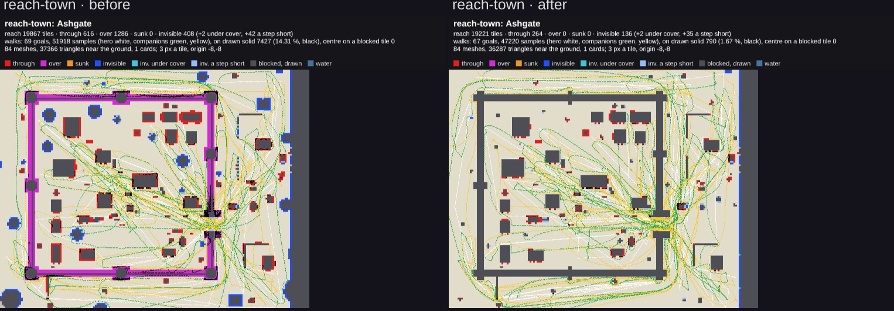
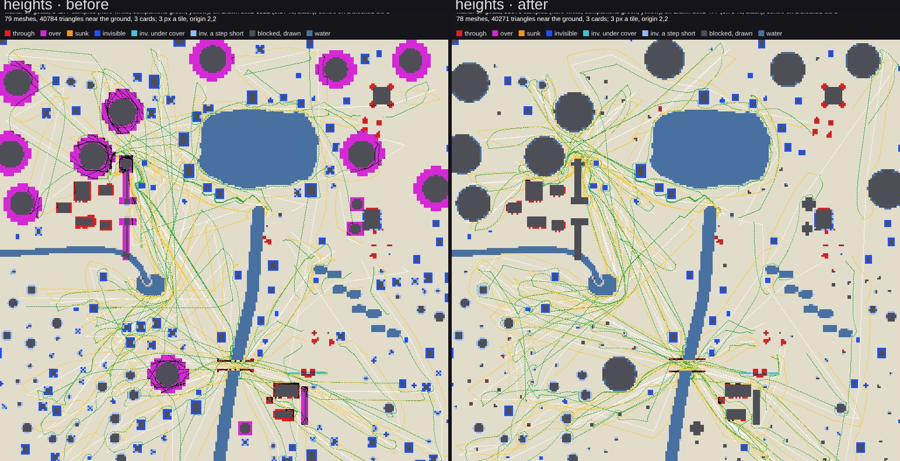
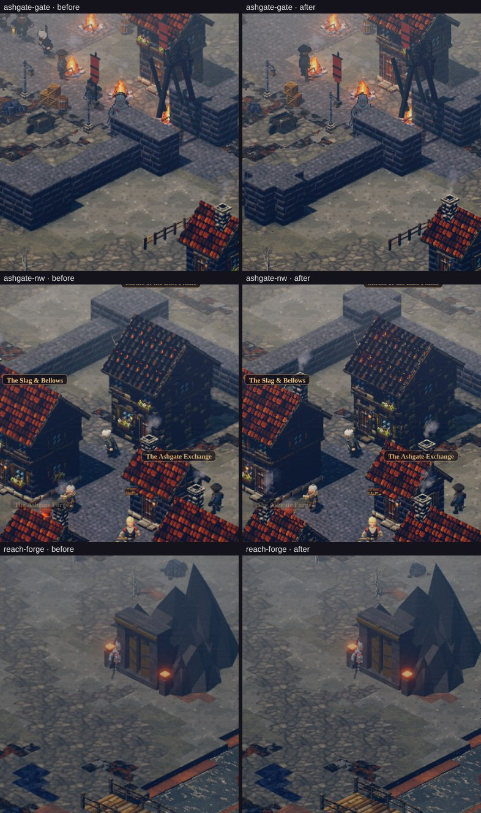

# Pathing audit: walled where it's drawn (2026-11-26)

**Status: Implemented (2026-11-26).** The owner: *"Ashgate.. characters often auto path and walk over or through walls..
eval all pathing and make sure it makes sense"*. Rule: [level-design-rules.md](./level-design-rules.md) §1.2. Tool:
`tools/capture/pathing.mjs`. Tests: `test/pathing.test.mjs`.

## 1. What was wrong

The sim walks its own grid (`world.js` `isWalkable`: `outdoor.js` footprints and walls, `level.js` cells and props), and
it keeps to it: replayed headless, the hero never stood on a blocked tile and companions only grazed them. What players
saw was the **drawn world not matching that grid**. Luminati draws a level converted from the sim's world
(`render3d/convert.js`), and in many places it drew its own sizes over the sim's walls:

| What | Drawn | Walled by the sim | Seen |
|---|---|---|---|
| A stone town's circuit (Ashgate, Frosthold, Tollhaven; the overlands' towns) | raised ground over the whole footprint, rounded out to Luminati's 2 × 2 cells: curtains **4 tiles thick**, towers 8 × 8, the gatehouse 10 wide | the curtain's **middle row**, a tower's circle, the gatehouse 3 wide | the party walked along **on top of** the walls, over the towers' and the gatehouse's corners (Ashgate: 1,286 walkable tiles drawn raised; 6,060 of 51,918 walk samples, 12 %, up on a wall) |
| Homes and services (Luminati's houses) | 82 % × 72 % of the footprint, never under 3 × 2.5 units | the footprint 12 % in from each side | walls a tile outside where the party stops; the small homes (drawn at Luminati's least house) worst |
| Mountains (the Reach, the Heights, the Tidemark) | a dome over the whole footprint, from a step at its edge | 65 % of the footprint | the party walked three and four steps up a mountain's flank (3,228 tiles on the Heights) |
| Trees where they're drawn bare (the Reach dead, the Heights leafless) | a trunk | 65 % of the baked crown | an invisible wall two to four tiles round a dead stick |
| Rocks | Luminati's boulder at 0.55 of the footprint (a leaning stone beside it) | the footprint 10 % in | boulders a tile past their wall; on the Heights' snow, small stones in a boulder's wall |
| Fences | on the footprint's middle line | the row under it | up to half a tile off, in the next row |
| Undergrowth bushes (`ug_bush`) | nothing (Luminati's ground cover) | a round wall | invisible walls |
| The Reach's kit pieces (`nofoot`: the Forgehall's hill and door, the Ninth Vault's, the Magma Vault's mouth, the Assay Yards' house, the furnace hall and stacks) | our kit's piece, its own size, over another piece's footprint | the host's footprint | the Forgehall's door hill is 22 × 22 tiles over the keep's 13 × 13 |
| Furnace Nine's slag heaps | 20 kit heaps round the yard, by the converter alone | nothing | walked through |
| Saltmere's stilt houses | decks on stilts to the footprint's edge, at chest height | 12 % in | walked under the decks |
| Crates, sacks; bridges; the Sunken Chapel's pews | two crates and a barrel, three sacks; rails at 2.8 tiles; a bench three tiles long | one or two tiles; a deck to 3 tiles out; the pew's one tile | walked through the pile, the rails, the bench's ends |
| Companions at ease (`battle.js` `moveVel`, `separate`) | | their middle only kept off a wall's tile | their bodies a third of a tile into the walls (the owner's 0.26–0.54) |

## 2. The measure

`tools/capture/pathing.mjs` loads each map in the game on Luminati and measures every mesh of the scene (not the people,
the effects, the sky, the ground cover) against the sim's grid, a tile at a time: **through** (something drawn between a
man's ankle and shoulder within a body's half-width of a walkable tile's middle, or a walkable tile shut in by what's
drawn), **over** (a walkable tile drawn more than a step up), **invisible** (a wall beside the walkable ground with nothing
drawn there). Then it walks the hero and two hired companions headless on the same map (every compass row, every
townsperson, 60 seeded random spots) and counts the samples that stand on what's drawn solid, and the companions' bodies
over a wall's tile. Sheets: `tools/capture/out/pathing/<map>.png` (this audit's in `before/` and `after/`; white the hero, green and yellow the companions, black
a sample on drawn solid).

## 3. What changed

| Where | Change |
|---|---|
| `src/sim/outdoor.js` | `wallCells`, `wallOn`, `cellPiece`: a circuit's curtains, towers and gatehouses (every land's, Thornwick's palisade too) walled on whole 2 × 2 cells, those the footprint covers half of; a tower's those its round holds; a gate's way through the cells of its ±3; `cells` on the struct. `homeWalls`, `isHome`, `HOME`: a home walled on the tiles the drawn house covers. `bareTree`, `TRUNK_R`: a bare tree walled at its trunk; a rock on snow too. `MOUNT_SHRINK`: a mountain walled to where it's drawn above a step (never over a road). A stilt house walled to its footprint. A bush not walled. `REACH_KIT`, `reachKitOf`: the Reach's site doors, furnace hall and stacks walled as the kit piece drawn there (`DRAWN_FOOT`). `furnaceHeaps`: Furnace Nine's heaps placed and walled by the sim. The Heights' peaks kept off its spawn points' ground (the Glass Keep's). |
| `src/render3d/convert.js` | Raises a wall piece's cells only where the sim walls all four tiles (`raiseCells`); a mountain above a step only where it does. Draws a house on `homeWalls`, a fence down its walled row, a rock no bigger than its wall, a crate and a sack pile on its wall, bridges 3.4 wide, a grove bare where trees are; the Reach's kit pieces by `reachKitOf`, the heaps from the sim's structs. |
| `src/sim/battle.js` | `BODY_R`, `bodyOn`: a companion at ease (`moveVel`, its stroll, the formation's shove, `lineOpen`) keeps its body off a wall's tile, as the hero does; one already in one steps out by its middle. Fights unchanged. |
| `src/sim/world.js` | A pew walled three tiles down x, as drawn (`dressPlanned` `pewAt`, the chancel's). |
| (looks) | Laid on whole tiles, the homes moved by under half a tile and Luminati drew their chimneys and doors afresh; a service's chimney is on its east end now (`chimneySide: 1`), Saltmere's chandlery's having stood in front of the Stilt House's door. |
| `src/sim/envfoot.js`, `tools/actor-lab/bake-env.cjs` | `DRAWN_FOOT`: the `nofoot` pieces' footprints, written beside `ENV_FOOT` (`bake-env.cjs --feet` rewrites the file from the atlases' JSON, no bake; `ENV_FOOT` unchanged). |

## 4. Before and after

Measured with the same tool on a copy of the commit before (61ca934) and after, seed 20260807, 60 random
walks a map plus every compass row and townsperson. **through**, **over**, **invisible**: tiles (§2). **Walk samples on
drawn solid**: the share of every party member's every tick standing on what's drawn solid. **Companions' bodies on a
wall**: their samples with a body (0.25 tiles round the middle) over a blocked tile; in the dungeons and at the overlands'
spawn points most of them are in fights, whose movement is the balance contract's and unchanged.

| Map | through | over | invisible | walk samples on drawn solid, % | companions' body on a wall (samples) |
|---|---|---|---|---|---|
| vale-town | 621 → 339 | 0 → 0 | 274 → 295 | 2.7 → 1.7 | 1205 → 0 |
| fens-town | 385 → 108 | 0 → 0 | 245 → 194 | 6.3 → 1.5 | 1285 → 0 |
| reach-town | 616 → 264 | 1286 → 0 | 408 → 136 | 14.3 → 1.7 | 1386 → 0 |
| tidemark-town | 623 → 250 | 1286 → 0 | 146 → 117 | 15.5 → 1.3 | 1131 → 0 |
| heights-town | 549 → 289 | 1286 → 0 | 477 → 223 | 14.7 → 1.4 | 1155 → 0 |
| vale | 1163 → 598 | 0 → 0 | 1203 → 1123 | 7.1 → 6.8 | 4805 → 1758 |
| fens | 723 → 459 | 0 → 0 | 621 → 506 | 3.2 → 3.1 | 1406 → 88 |
| reach | 1561 → 632 | 3628 → 0 | 411 → 394 | 8.3 → 1.8 | 2006 → 287 |
| tidemark | 3261 → 247 | 2113 → 0 | 377 → 371 | 7.3 → 1.4 | 2086 → 0 |
| heights | 383 → 262 | 3228 → 0 | 1366 → 615 | 9.4 → 0.8 | 2427 → 36 |
| barrows-f1 | 36 → 36 | 0 → 0 | 16 → 16 | 2.7 → 2.9 | 2664 → 1106 |
| keep-f1 | 25 → 25 | 0 → 0 | 17 → 17 | 2.0 → 2.1 | 2840 → 1478 |
| chapel-f1 | 155 → 106 | 0 → 0 | 7 → 7 | 16.8 → 10.8 | 10524 → 11401 |
| pens-f1 | 23 → 23 | 0 → 0 | 16 → 16 | 0.9 → 1.4 | 1981 → 1437 |
| mound-f1 | 12 → 12 | 0 → 0 | 44 → 44 | 0.0 → 0.0 | 1044 → 324 |
| abbey-f1 | 50 → 50 | 0 → 0 | 11 → 11 | 4.4 → 4.2 | 4008 → 3028 |
| seam-f1 | 26 → 26 | 0 → 0 | 24 → 24 | 1.1 → 1.4 | 1728 → 1390 |
| yards-f1 | 14 → 14 | 0 → 0 | 20 → 20 | 0.0 → 0.1 | 2809 → 745 |
| works-f1 | 26 → 26 | 0 → 0 | 18 → 18 | 0.7 → 0.7 | 3220 → 939 |
| inn-f1 | 240 → 240 | 0 → 0 | 8 → 8 | 0.6 → 0.9 | 889 → 430 |
| crypt-f1 | 209 → 209 | 0 → 0 | 10 → 10 | 0.7 → 0.3 | 704 → 390 |
| highmarch-f1 | 98 → 98 | 0 → 0 | 9 → 9 | 0.2 → 0.3 | 1236 → 176 |

In all: through 10799 → 4313 tiles, over 12827 → 0, invisible 5728 → 4174;
walk samples on drawn solid 111446 of 2789099 → 66108 of 2838355; companions' bodies on a wall 52539 → 25013.

Ashgate, the sim's grid against what's drawn, the walks over it (red walked through, magenta walked over, blue an
invisible wall; black a walk sample on drawn solid):

The Heights' overland (its mountains walked up, its rocks' and leafless trees' invisible walls):

In play (`tools/capture/rig.mjs`, day): Ashgate's gate and north-west quarter, the Forgehall's door. The walls and houses
look as they did (the circuit's towers a cell rounder); the hero no longer stands in the Forgehall's hill.

**Balance** (`tools/balance/roomlv.mjs 300 L L 1,3`, the right party; solo has no companions to move): level 3 and 6 the
same to the number (24 and 18 waves, lowest 86 % and 64 %); level 9 15 waves either way, the first ten waves' cost 17 → 20 %,
the lowest 44 → 32 %, downs 2 → 1 (the party's spacing between waves). `npm run check` passes (the smoke test's contract).
**Visibility** (`tools/capture/visibility.mjs`, the six maps it covers): 3 under half in view before and after, the same
three (the Vale's way to the Fens and its arrival, the Heights' Solmere road, all behind the outer forest).

## 5. Not fixed

- **The maps' edges.** A town's sim walls a ring past its forest at 16 tiles out (x 157 on the east, past the gate),
  inside the level's crop, with nothing drawn there; on the overlands, groves whose middles fall outside the crop aren't
  drawn but their walls reach into it (the Vale's 804 invisible tiles, the most of what's left there, along its top edge).
  Out of the way of play (past the gate you've already left), so left.
- **Trees in leaf.** An oak's, a carr's or a willow's wall (65 % of the baked crown) reaches a tile or two past
  Luminati's crown in the Fens and the Vale: an invisible wall under the edge of a tree (the Fens' 253 + 189 tiles).
- **Kit pieces' rims and small props.** The kit's buildings on the overlands (the Fens' lock hall, boat hall, vats, the
  priory, the ruins, the lumber mill) and carts, hay, the food stands: their edges at a man's height stand up to a tile
  past the sim's 12 % inset (30 to 100 tiles each). Fixing them wants each piece's footprint at a man's height from the
  bake (`bake-env.cjs` measures the whole model's box), a bake this checkout can't run.
- **Spawn points' dressing.** A camp's boulders, tents and the dead cow are drawn two to four tiles wide over the one
  tile `dressCamps` walls; in a camp's fight the party brushes them (the Vale's overland walks, 6.8 % on drawn solid, are
  mostly its camps' fights and two bridges' ends).
- **The dungeons' dressing and walls.** The inn's, the crypt's and Highmarch's furniture (209 to 240 tiles through,
  `TAVERN_3D`, `PALACE_3D`, the crypt's pieces) and a wall drawn on Luminati's 2 × 2 cells over the sim's single tiles
  (a step short of a wall, the "short" count). Small, and in rooms the dressing pass sized by hand.
- **Fights.** Companions' and foes' movement in a fight (`separate` with no body, `stepToward`) is the balance contract's
  and unchanged: the most of the dungeons' "bodies on a wall".
- **The measure.** A dungeon's headless walk differs from the page's world by 30 tiles (its shut gates and people), so a
  dungeon's walk numbers are close, not exact; the drawn-scene numbers are exact.

