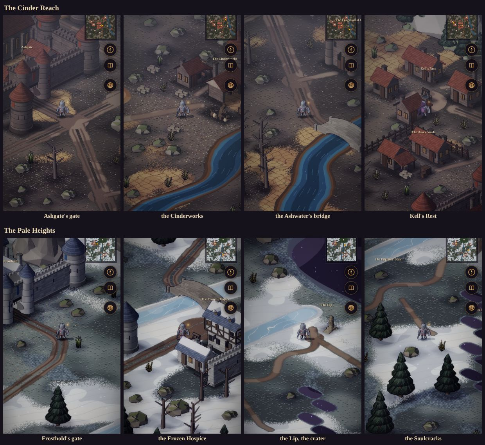
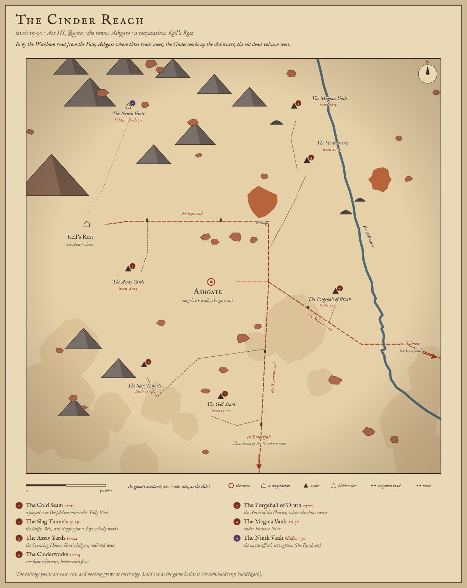
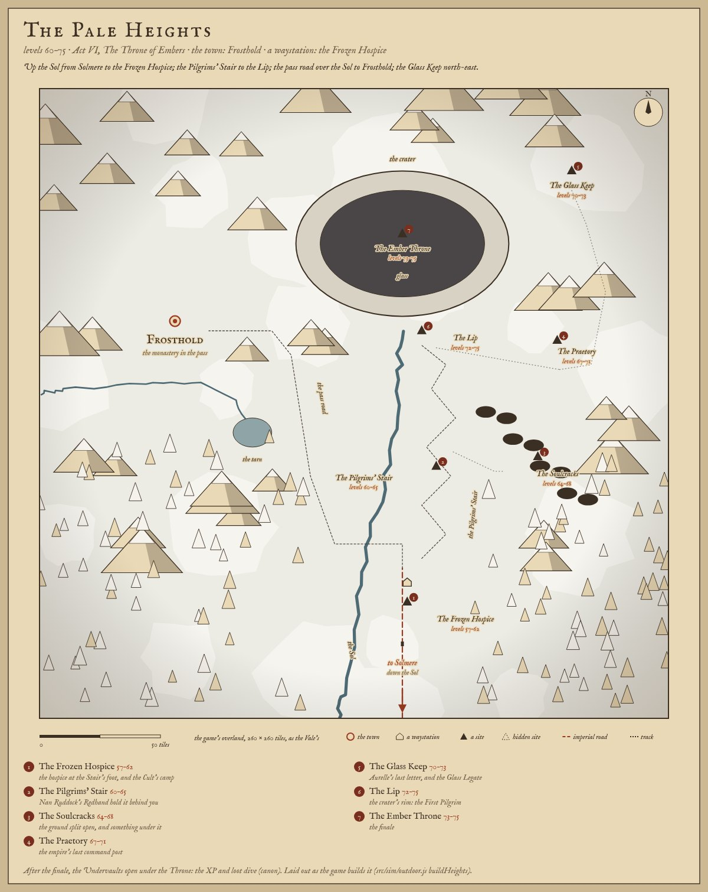

# The Cinder Reach's and the Pale Heights' overlands

**Implemented as previews, 2026-10-31.** The owner: *"design Reach and Heights now".* Until now
`createOutdoor(seed, 'overland', 'reach' | 'heights')` fell through to the Vale's builder and built the Hollow Vale under
another region's id. Each now has its own overland, built the way the Greywater Fens' is: its own builder, its own
random streams, its own name, ground, set pieces, exits, arrivals and labels.

- **Code:** `src/sim/outdoor.js` (`buildReach` and `REACH`, `buildHeights` and `HEIGHTS`, the `SCREE` and `SNOW`
  ground codes, `o.patches`, `beacons`, `joinRoads`); `src/render/outdoorpaint.js` (the new grounds' painters);
  `src/sim/core.js` (a road out that is `closed`); `test/reach-heights.test.mjs`.
- **Canon:** world doc v1.34, §3.3 and §3.4 (*The land*). **Design:** GDD v1.50, §10.
- **Sketches:** `tools/worldmap/overlands.mjs` (`reach`, `heights`), redrawn to the game's layout. The sketch and the
  game agree.
- **Preview:** `?scene=overland&region=reach` or `&region=heights`. Add `?dev` on localhost to get `globalThis.__sim`.

*Above: the game, day light held (`?dev&tod=day`), 390 × 844 at 2×. The Reach at Ashgate's gate, the Cinderworks, the
Ashwater's bridge and Kell's Rest; the Heights at Frosthold's gate, the Frozen Hospice, the Lip and the Soulcracks.*

| The Reach, sketch | The Heights, sketch |
|---|---|
|  |  |

## What they are, and aren't

Neither land is playable yet. `src/sim/regions.js` `LANDS` holds only the Vale and the Fens, and Acts III and VI
aren't written, so:

- **Previews only.** Nothing in the Vale or the Fens leads here. The sim's region stays `reach` or `heights`, which
  aren't lands, so nothing is saved as being there and no coach goes there.
- **Landmarks, not sites.** Every site is a building or ruin with a label. None has a door (no `to: 'dungeon'`
  exit). None is in `SITES`, and there are no quests, foes or dungeons.
- **Roads out are shut, each with a pre-written line.** These are `closed` exits. Walking into one emits the HUD's
  `landShut` line once, the same as the Vale's canal road before Act I, and you stay where you are:
  - the Wickham road (Reach, south): *"The Wickham road goes home to the Vale from here. Not yet: Ashgate's quota
    isn't met."*
  - the Solmere road (Reach, east): *"The Solmere road runs east, straight as the day it was laid, to the dead
    capital. Another day."*
  - down the Sol (Heights, south): *"The road down the Sol goes to Solmere. Nobody climbs this far to turn round."*
- **The towns are linked.** Each overland's gate takes you into the town scene (`buildTown`, Ashgate or Frosthold).
  The town's gate brings you back out on the road in front of it, at `arrivals.ashgate` or `arrivals.frosthold`. This
  is the same as Thornwick and the Vale's `thornwick` arrival.
- **Waystations are landmarks only.** Kell's Rest and the Frozen Hospice are a few of the region's own buildings
  round a yard, with a label. Only Saltmere has a waystation builder, so neither has a square or services yet.

## The Cinder Reach

All positions are in tiles. North is up, and the map is 260 × 260, the Vale's size. The ground is the palette's
`grass_reach` (ash-dusted scrub), with a quarter of it **cracked earth and red-rock flecks** (`SCREE`).

| Where | What stands there | From the sketch |
|---|---|---|
| **Ashgate** (box 98–132 × 114–166, gate 132, 140) | The town in small: slag-brick curtain and towers, the gate in the east wall, the temple, houses, a smithy and a workshop inside, the town's colours at the gate. | Moved 14 tiles west, so the three roads meet in front of the east gate. The town scene's road comes in from the east. |
| **The junction** (152, 140) | The Wickham road, up from the south edge. The Solmere road, east over the Ashwater's bridge at (224, 179) and out the east edge. The Kell road, north round the town's wall, then west at y 102 to Kell's Rest. | The sketch ran the Kell road straight through the town. Imperial roads run straight (§3.6), but not through a walled town. |
| **Kell's Rest** (38, 104) | A landmark: the Assay's depot round its yard (a longhouse, a house, a cottage, a workshop, the cistern), under the **dead volcano** (massif, 14, 64). | As sketched. |
| **The Assay Yards** (64, 132) | The counting house and the ore shed, in a rail fence with its gate east, crates and a cart. A track runs in off the Kell road. | As sketched. |
| **The Cinderworks** (176, 64) | The furnace hall (the region's smithy), the ore shed, two stacks, a wagon. Up a track from the junction among slag heaps (rocks C, D, E and stone piles). Two **tailings ponds**: (148, 90) and (222, 76). | The Ashwater runs 8–10 tiles east of the sketch's line, to clear the works. The ore rails aren't laid (no art). |
| **The Magma Vault** (168, 30) | A mound's mouth with Furnace Nine's stack over it, up a track from the works. | Moved to the river's west bank. The sketch's track crossed the river with no bridge. |
| **The Slag Tunnels** (74, 192) | The adit (`warren_0`) in the low hills south-west. Its track comes up to the mouth from below. | 24 tiles south. At (84, 166) the adit's spoil ran into Ashgate's south wall. |
| **The Cold Seam** (122, 212) | A played-out pithead (`mine_0`), off the Wickham road. | As sketched. |
| **The Forgehall of Oruth** (194, 146) | The region's keep, on the Ashwater's west bank below the Solmere road, a short track to its door. | As sketched. |
| **The Ninth Vault** (64, 30) | A ruin at the end of the old track up the volcano's flank. Hidden, so no label. | As sketched. |
| **The hills** | The black slag hills north-west (`mountain_A` and `B`), low hills round the Slag Tunnels, and a range past the north and west edges. No hill stands in a site's sightline, or in the view from where you arrive. | As sketched. |
| **Beacon-towers** | A dead tower beside every imperial road, 30 tiles in and then every 46 (§3.6, the sketch's spacing). There are six: three on the Wickham road, two on the Kell road, one on the Solmere road. | As sketched. |

## The Pale Heights

The ground is `grass_heights` (frost-bitten turf), with **snow** over 44 % of the map and **scree** over 11 %. The
water is frozen: the Sol and Frosthold's stream are painted as ice. They're still not walked, which keeps the bridge
meaningful. Their sound is still the river's (see the end).

| Where | What stands there | From the sketch |
|---|---|---|
| **Frosthold** (gate 74, 100) | No circuit (§3.4). The chapel and its bell tower, the hall, houses and cells sit with the crags behind them. One curtain stands each side of the gate across the pass road, the south one running down into the frozen stream. | As sketched. The gate faces east, as in the town scene. |
| **The Frozen Hospice** (152, 204) | A landmark: its court (the dormitory, the warming room, the cistern, a north and an east wall). The imperial road ends in it. The Stair leaves past the north wall's end. | As sketched. |
| **The Sol** | It runs from under the Lip, south past the Hospice, and out the south edge. | As sketched, but kept west of the imperial road all the way down. In the sketch they crossed. |
| **The pass road** | From the Hospice north, west over **the Sol's bridge** at (136, 188), then north-west to Frosthold's gate. | The bridge is new. The sketch's road crossed the river with no bridge. |
| **The tarn** (88, 142) | Frosthold's stream runs east below the town and ends here, under the pass road. | New, so the stream needn't cross the road. |
| **The Pilgrims' Stair** | A track in eight switchbacks from the Hospice to **the Lip** (158, 100), the one break in the crater's rim. A marker stone stands at the Lip. | As sketched. |
| **The crater** (150, 64) | A floor of **glass** (a pool painted black with cold glints, not walked), with **the Ember Throne** (the region's keep) half-sunk in it. A rim of crags and rocks surrounds it, open at the Lip. | 10 tiles north and a little smaller, so the Lip clears the Stair. |
| **The Soulcracks** (206, 152) | A chain of eight splits running south-east, glass-dark. A track goes from the Stair to their edge. | As sketched. |
| **The Praetory** (214, 104) | An imperial ruin between two posts, on a track from the Lip. | As sketched. |
| **The Glass Keep** (220, 34) | The region's keep, round the crater's east side by a track from the Praetory. | As sketched. |
| **Peaks and pines** | Peaks over the north (`mountain_A`, `B`, `massif_C`) and ranges past the north, west and east edges. Pines on the lower slopes south-west and south-east, and a pine ring round the map. | As sketched. |
| **Beacon-tower** | One, beside the imperial road below the Hospice. | As sketched. |

## How it's built

- **Streams.** All of these are new, and none is shared with any other system.

  | Stream | Use |
  |---|---|
  | 4441, 4442 | The Reach's and the Heights' scatter, ring and layout draws |
  | 4443, 4444 | Their hills and peaks |
  | 4445 | The Ashwater's meander |

  `meander()` takes its stream as a parameter, defaulting to the Vale's 4415. The undergrowth keeps its own stream
  (4409) per world, as in every overland. Its lists of kinds are a parameter now (dry grass and fern, bare stones),
  with the same draws whichever list.
- **Ground.**
  - `G.SCREE = 9` and `G.SNOW = 10` are appended, so the enum stays append-only. They're walked and scattered on.
  - `o.patches` lays them by a slow noise, the way `o.marsh` lays the Fens' peat.
  - Each region's own painters in `outdoorpaint.js` mix the palette's existing ramps: `earth`, `rock`, `lava`,
    `ember`, `sand`, `crag`, `ice`, `frost`, `bone`, `obsid`, `glacier`. The same functions paint:
    - the Reach's tailings, rust-red with an ochre scum;
    - the stained bare earth at their edge, where nothing grows;
    - the Heights' river ice, its snow, its scree, and the crater's and the Soulcracks' glass.
- **Art.** Only the existing baked sets: `env` (bare rocks A–E, dead trees, pines, mountains, `mine_0`, `warren_0`,
  `ruin`, `chapelruin_0`, `milestone_0`, the bridge, carts, crates) and each region's own town set
  (`town-reach`, `town-heights`, which the renderer already loads for a non-dungeon scene). The nature pack's rocks
  F–H read mossy green, so they're left out of both.
- **The minimap** colours the new grounds and the region's turf, and pins Ashgate and Frosthold in gold, as it does
  Thornwick and Saltmere.

## Measured

`createOutdoor(20260807, 'overland', …)`, best of three builds in Node. Ground shares are inside the 260 × 260 map;
"In the map" counts structs placed inside it.

| Overland | Structs | In the map: trees · rocks · mountains · undergrowth | Walkable | Ground | Build |
|---|---|---|---|---|---|
| The Hollow Vale | 755 | 100 · 25 · 0 · 137 | 81.4 % | grass 85 %, dirt 5.8 %, water 5.4 % | 164 ms |
| The Greywater Fens | 727 | 119 · 42 · 0 · 200 | 78.4 % | grass 48 %, marsh 33 %, pool 11 % | 265 ms |
| **The Cinder Reach** | 872 | 42 · 127 · 11 · 103 | 84.7 % | scrub 65 %, scree 25 %, dirt 5.1 %, water 3.5 %, tailings 0.6 % | 155 ms |
| **The Pale Heights** | 542 | 87 · 82 · 11 · 55 | 83.9 % | snow 44 %, turf 33 %, scree 11 %, glass 4.5 %, ice 2.2 % | 231 ms |

**Determinism.** A structural hash was taken before and after this change: name, structs, exits, arrivals, labels,
roads, rivers, pools, ground, blocked and occupancy grids, props and dungeon tiles. It covered three seeds (1,
20260807, 0xdeadbeef) of:

- `createOutdoor` for the Vale's and the Fens' overland and town;
- `createSim` for those scenes;
- every dungeon in `SITES`.

All 57 hashes are identical. The only scenes that changed are Ashgate's and Frosthold's towns, by one field: their
gate's exit now arrives at `ashgate` or `frosthold`, not `thornwick`. Thornwick's still arrives at `thornwick`.
`npm run check` passes, including the smoke test's replay to the recorded hash and every tamper case. Balance can't
move: no sim rule, foe, room or item changed, and the only new sim rule is the shut road out, which neither land
that's played has.

**Tests** (`test/reach-heights.test.mjs`, two seeds each):

- each overland builds the same twice and differs from the Vale's;
- each uses only its own town set;
- every exit and arrival is on walkable ground;
- the gate, every road out, every arrival and every landmark (except the Throne in its glass) is reachable by flood
  fill from where you arrive;
- no struct stands on any road;
- the preview builds it, each shut road says its line once and keeps you there, and the town's gate and the
  overland's agree both ways.

## Deliberately not built

- **Playable lands.** That needs `LANDS` rows, Acts III and VI, the Vale's or the Lamphall's road to them, the coach,
  saves, and the World map's land tab (`tools/worldmap/minimap.mjs` draws shipped scenes only, so neither is in
  `assets/maps/`; a preview's land tab simply has no map).
- **The sites as dungeons.** That needs doors, `SITES` rows, foes and bosses. The levels on the sketches are the
  world-map proposal's. The world doc's v1.32 cut to one dungeon a band is still to be made when the Reach is built.
- **The waystations' squares** (Kell's Rest, the Frozen Hospice). The plans are in `town-streets-proposal.md`.
- **Frosthold's town scene** keeps the walled hub every town shares. The canon's pass and single wall are on the
  overland only.
- **Without art:**
  - Ashgate's pithead wheel;
  - the Cinderworks' ore rails;
  - red rock (the bare rocks are grey; the red is in the ground's flecks);
  - the Cult's tents at the Hospice;
  - a frozen river's own sound (the Sol still sounds like a river).
