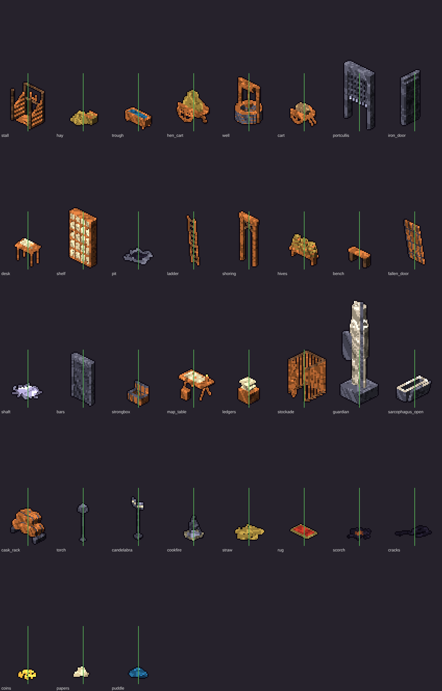
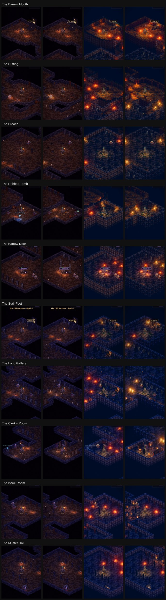
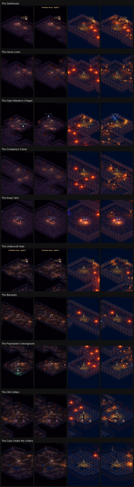
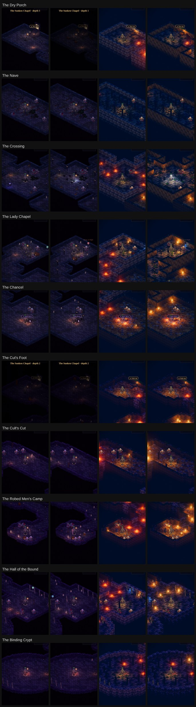
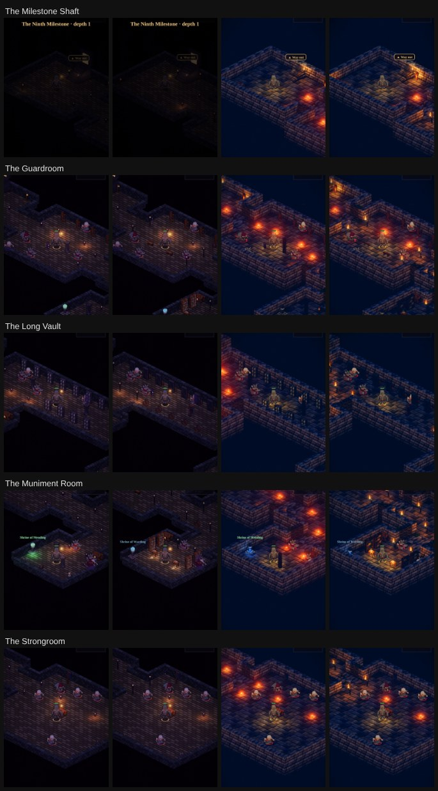
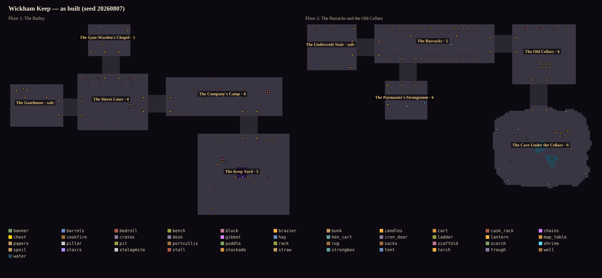

# The Hollow Vale's dungeons dressed: a critic pass and the dressing

**Implemented (2026-11-04).** The dressing pass that [vale-dungeons-plan.md](./vale-dungeons-plan.md) left open.
The code:
- the recipes: `src/sim/world.js` `dressPlanned`, `DOOR_LIGHT`, `FALLEN`, `DRESS_PIECES`;
- the pieces: `src/render/gsprite.js` (the dressing pass section);
- Luminati: `src/render3d/convert.js` (`DRESS_3D`, `DRESS_3D_MORE`, `DOOR_POOL`, the kit walls);
- the tools: `tools/dungeon/asbuilt.mjs` and `tools/capture/rig.mjs vale-rooms`.

The owner, 2026-11-04:

> "Go ahead with the dungeon dressing. Include and art and level design critic. Dungeons should have a theme and fit the
> specific dungeon type and quest. AAA level and art design"

## How it was looked at

- **Every space, both renderers.** All 35 spaces of the Vale's authored floors were shot on Emberlit and on Luminati, at
  dusk, the party in the room's middle. This is the rig's new `vale-rooms` preset (`at: "part:<id>"`).
- **The floors as the sim builds them.** `tools/dungeon/asbuilt.mjs` draws them top-down: every prop coloured by what it
  is, each room's open floor and its largest open square.
- **Close-ups.** Each new set piece was shot close, with the party beside it.

## The critique (before)

### Art

1. **Empty rooms.** The rooms were 97–99 % bare floor. The Keep Yard (52 × 46) held a font and two braziers; the Dry
   Porch held only its two door braziers. Nothing told you what a room had been.
2. **A field of fires.** In Luminati, every doorway had a brazier each side, and so did half the recipes. The screen was
   a scatter of identical orange blobs, and the light said nothing about the place. A crypt, a stable and a chapel were
   lit the same.
3. **Stand-ins that told the wrong story.** The pieces the plan named but the game lacked were mapped to whatever was
   nearest:
   - the Horse Lines' stalls were the legion's weapon racks;
   - the Keep Yard's well was the binding font, glowing violet in a castle yard;
   - the Clerk's desks were crates, and his rolls were candles;
   - the Company's cage for Ned Fallow was a gibbet;
   - the portcullis, the iron door, the broken floor, the bars, the hives and the Crossing's shaft of daylight were
     nowhere.
4. **One stone for every place.** In Luminati the crypt, the keep, the barracks and the chapel had the same stone-brick
   walls.
5. **Pieces against a west wall stood end-on.** Racks, niche shelves, standards and scaffolds were built to run along a
   north wall. On a west wall they stuck out of it like posts.

### Level design

1. **Tall pieces on the near walls.** Niche shelves taller than a man stood on the near walls, between the camera and the
   fight. On a phone they hid the party.
2. **No focal piece.** No room had a set piece on its axis to read the room by: no altar before the stair down, no
   guardians at the barrow door.
3. **Doors swallowed small rooms.** The keep-clear radius round a doorway (8 tiles) took most of a small room. The
   Clerk's Room and the Muniment Room are entered through their back wall, and they got no desks or shelves at all.
4. **The contract's arena was random.** The Breach is the balance contract's arena. Its fallen pillars came from shared
   random streams, so dressing *any* room before it on the floor reshuffled the arena, and with it the contract.

## The grammar (after)

### Where things stand

- **Back walls and near walls.** Each recipe places by the room's own axes. The **back wall** (north or west, the one the
  camera sees) takes the tall pieces: stalls, shelves, niches, racks, the portcullis, bars, cask racks. The **near
  wall** takes only low ones: urns and candles where the niches were, troughs, barrels, strongboxes.
- **A set piece on the axis.** Each room has a focal piece with a key light of its own:
  - the Barrow Door's two guardians either side of the stair down, placed after the stairwell, so they flank it;
  - the Chancel's altar behind the stair down, broken through, a candelabrum either side;
  - the Keep Yard's well, with a torch;
  - Garrow's map table, with its lamp and a rug;
  - the Crossing's shaft of daylight.
- **The middle stays open for the fight.** A room's own set piece out on the floor stands for one of its one or two
  obstacles. Flat pieces (straw, cracks, a rug, papers) are walked over, and they no longer crowd an obstacle out.
- **Pieces run with the wall.** A piece along a wall comes as `<kind>` and `<kind>_y`, picked by the wall it's on.

### How it's lit

- **Doorways lit by their place** (`DOOR_LIGHT`): lanterns on poles in the dig and the cellars, candles in the crypts
  and the cut, torches in the keep, the barracks and the vault, candelabra in the chapel.
- **Each way in is a sanctuary.** A floor's entrance keeps a brazier at each doorway, so the safe room reads warm and lit.
  The Barrow Mouth's camp keeps its fire-baskets.
- **Light where the story is.** Lights now gather at the pieces, not at every doorway.

### Floors and walls tell the story

Flat pieces you walk over:
- straw in the stalls and under the bunks;
- a fire's scorch round the cookfires;
- cracked flags in a ring where the Crossing's tower came down, and at the Breach's west end;
- spilled coin by the robbed sarcophagus;
- papers by the desks;
- puddles under the cave's drip.

Luminati's walls follow the place: the dig in raw earth, the crypts in dressed limestone, the chapel in pale sandstone
under moss, the keep in stone brick.

### The quests' places

- **The Horse Lines** (*Hens Under the Hill*): slatted stalls with hay racks, straw, troughs on the near wall, and Old
  Skarn's cart of coops with Luminati's chickens about it.
- **The Company's Camp:** cookfires, bedrolls by the tents, and Ned Fallow's stockade at the camp's end, broken open (he's
  at the gate now).
- **The Paymaster's Strongroom** (Brannoc's errand): the iron door hung open in its doorway, the paymaster's
  strongboxes, his desk.
- **The Old Cellars** (*The Diggers*): the floor broken through. Luminati sinks the tiles into a real hole; there are
  ladders and a lantern at its edge, and cask racks along the back.
- **The Cave Under the Cellars:** Garrow's table, Brannoc's chain post by a stone tooth, puddles under the drip.
- **The Clerk's Room and the Muniment Room:** pigeonholes of rolls down the back and end walls, desks to the front, papers.
- **The Robbed Tomb:** the sarcophagus with its lid off, coin, bones and papers about it.
- **The Dry Porch:** Hester Lowe's hives on a plank bench, the chapel doors off their hinges.
- **The Crossing:** a cold pool of daylight down the fallen tower's shaft. In Luminati it is a hard beam of #e4ecff
  with dust in it.
- **The Long Vault:** iron bars along the back wall, an empty strongbox behind each, and more strongboxes on the near
  wall.

## The pieces

35 new pieces as voxels (`gsprite.js`, both renderers), 28 standing and 7 laid flat. Twelve of them, and five of the old ones (racks, niche shelves, standards, banners, scaffolds), also come as `_y` for a west wall. Where Luminati
has the thing, it uses its own 3D:
- its well, bench, bookshelf, campfire and table;
- a stool at Garrow's table;
- a debris cart for the yard's carts;
- chickens about the hen cart;
- its wall torch's flame on our torch pole.

Our 100 kinds bake in about 100 ms. A big piece's footprint past its own tile is `block`: it stands in the way and draws
nothing.

*The new pieces, flat-lit at 3×, a green bar a hero's height.*

## Measured

**Brightness.** The mean of the world band (rig, 390 × 844, dusk, 40 frames settled, a warm-up shot first). All 35
spaces:

| | Before | After |
|---|---|---|
| Luminati | 27.1 | 27.8 |
| Emberlit | 15.5 | 15.3 |

- The dungeons were already "too dark" for the owner (2026-11-02), so the doorway lights that replaced the braziers were
  set to give the same light: `DOOR_POOL`.
- Emberlit's entrance shots include the floor's title card fading out, so they aren't comparable shot to shot (the Dry
  Porch reads 13.2 → 6.1 on it).

**The rig was under-exposing its first shot.** The first frame after the page loads came out dark: the Barrow Mouth
read 13 when shot first and 27 when shot again last, in the same run. `rig.mjs` now takes a warm-up shot and throws it
away. Earlier sheets' first shots were dark for this reason.

**The balance contract** (`smoke-test.mjs`, every gate passes). Before → after:

| Gate | Before | After |
|---|---|---|
| The right party at L3 / 6 / 9 (two seeds) | 22, 16, 14 · 23, 17, 13 | 21, 17, 14 · 23, 17, 13 |
| No healer at L6, worn down | at 283 s, 292 s | at 189 s, 236 s |
| The right party at L12 / 15 | 14, 10 · 11, 12 | 13, 13 · 14, 14 |
| A room three up defeats the right party | 4 and 7 waves | 8 and 4 waves |
| Gear at level vs a level-1 kit, two up | 9 vs 6 waves | 6 vs 5 waves |
| Companions: the same wave, XP a minute | 3/3, 420 vs 340 | 3/3, 404 vs 350 |

The Breach's columns:
- **Authored.** Two columns lie across the passage, either side of its middle, at (−0.3, +0.25) and (+0.3, −0.25) of
  its half-length and half-width.
- **Chosen.** Eight layouts were tried against every gate (a 3-second harness of the smoke test's room visit). Three
  passed; this one had the most margin.
- **Why it mattered.** With the columns random, the first pass failed two gates. The right party held 9 waves at level
  15, and the no-healer party held 18 waves without going down.
- **Each room on its own stream.** An authored room now draws its dressing from a random stream of its own, so a recipe
  changed in one room no longer moves another.

**The room-level harness** (`tools/balance/roomlv.mjs 300 L L [1,3] --src <previous checkout>`). Before → after:

| Level | Solo | Fighter, rogue and cleric |
|---|---|---|
| 3 | 6 → 5 waves | 24 → 24 |
| 6 | 1 → 1 | 17 → 17 |
| 9 | 0 → 0 | 13 → 13 |

**Replays.** The smoke test's honest session replays to its own hash, and every tamper case is still rejected.

**Tests.**
- `test/render3d.test.mjs`: each place in its own walls; Luminati's own well, bench, shelves, campfire, table and
  chickens; a footprint draws nothing; the broken floor sunk.
- `test/ways.test.mjs`: an authored set piece counts as a room's obstacle; every way stays open.
- npm test: 486 pass.

## The sheets

Each row is a space. The columns are Emberlit before and after, then Luminati before and after.

*Wickham Keep as the sim builds it (`tools/dungeon/asbuilt.mjs`): the stalls, the hen cart, the stockade, the well, the
broken floor, Garrow's table.*

## Left, and the critic's notes for the next pass

- **The phone frames a room's middle.** The set pieces at the walls are often just off a phone's screen at the room's
  centre. A camera that leans toward a room's focal piece as you enter would sell them.
- **Emberlit casts only the two nearest prop lights.** Its other lights show only as their own glow. The Crossing's
  shaft lights the floor in Emberlit only when it's one of the two nearest. Luminati shares 12 lights among a floor's
  lamps, nearest the camera first.
- **The halls are bare.** Halls take no props: the sim keeps them clear as safe ground. Dressing at their edges (timber
  shoring in the dig's rough halls, banners in the keep's) needs a rule for what may stand in a hall.
- **Pieces that could go further:**
  - the hen cart's coops read as clutter at in-game scale;
  - the iron door is a dark slab against a dark wall;
  - Luminati's haystack and statue weren't used. Its statue loads The Bells of Evermere's kit.
- **The other lands' dungeons** keep their generated dressing until the owner says the Vale is right.
