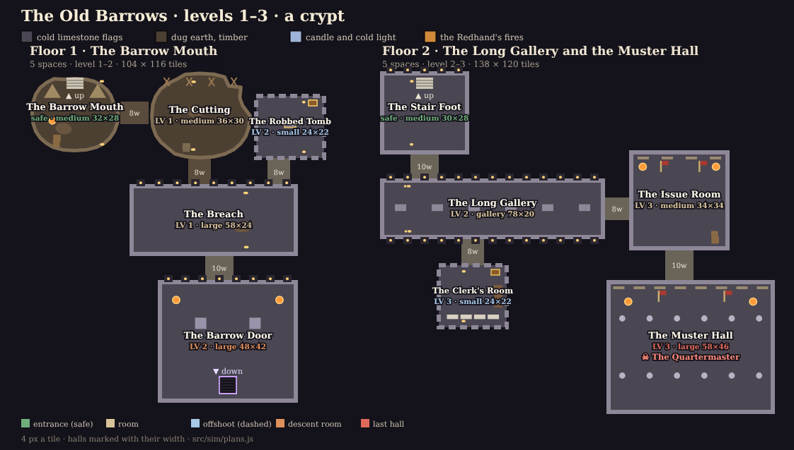
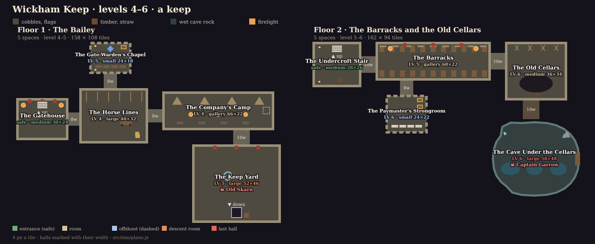
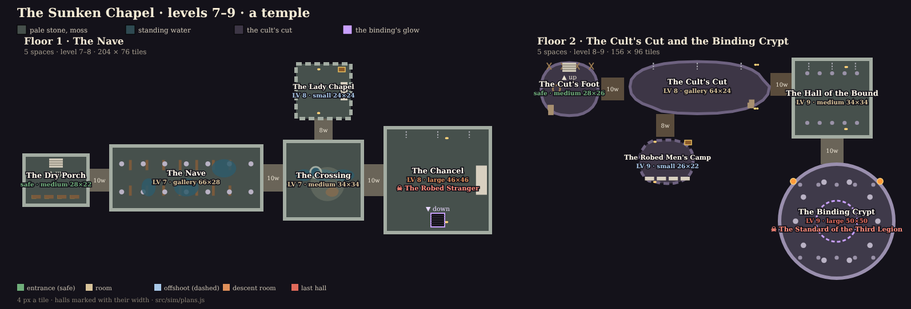
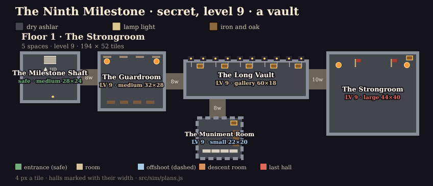

# The Hollow Vale's dungeons: a plan

**Proposal (2026-11-02), for the owner's sign-off.**

The owner, after playing the Luminati prototype's Old Barrows:

> "Lets do the halls. Each dungeon should still have a progression of rooms with higher level NPCs and maybe an
> offshoot. But no more than 5 rooms or large corridors total per floor. There can be hallways but perhaps at least 8
> wide. No more than 2 levels down. Dressing and even layout should fit to the dungeon type eg keep or castle vs a
> shrine or temple, including dressing. Cave dungeons can be more like the existing dungeons but no more than 2 floors
> for now. Spend time as a game level and art designer to plan the dungeons for the Hollow Vale area."

This plan covers:
- the Vale's three dungeons (the Old Barrows, Wickham Keep, the Sunken Chapel);
- its secret (the Ninth Milestone);
- for each, the floors drawn to scale with what stands in each room;
- what changes in the sim, the canon, the quests and the saves to build it, and in what order;
- the decisions left for the owner (the last section).

The other lands keep their dungeons as they are until the Vale is right.

The plans are data, not pictures alone: [`src/sim/plans.js`](../src/sim/plans.js). Its `checkPlan` holds every floor to
the owner's rules, and [`test/plans.test.mjs`](../test/plans.test.mjs) runs it. The drawings below come from that data
(`node tools/dungeon/vale-plans.mjs`). When this plan is signed off, the sim builds these floors from the same data.

## The rules

| | Today | The plan |
|---|---|---|
| Floors a dungeon | 3 | **2 at most** (the secret: 1) |
| Spaces a floor | 6 rooms | **5 at most**, the entrance counted. A large corridor (the Long Gallery, the Barracks, the Nave) counts as one. |
| The ways between | halls 6 wide, 8–12 long | **halls 8 wide or more** (8–12), 8–14 long. Still safe ground: nothing fights there. |
| A floor's shape | generated each visit from the seed | **authored**: the same rooms in the same places, named, as a level designer lays out a dungeon |
| Its progression | rooms ranked by walking order | **entrance → two rooms → the hall**, with **one offshoot** off the way: a dead end a level up, worth the detour (a chest, a Chronicle fragment, a shrine) |
| Layout by kind | halls (built) or caverns (dug) | **by what the place was**: the crypt an axis of galleries; the keep a gate, a yard and buildings round a curtain wall; the chapel a cross laid on its altar; the caves dug blobs, as the caverns are now |

Room sizes stay as GDD §3.1 has them:
- small 18–26 tiles a side (four foes at once at most);
- medium 28–38;
- large 40–62.

A new kind joins them, the **gallery**: 60–80 long and 18–28 across, a large corridor you fight down.

## The band over two floors

Today a dungeon's three levels are three floors, one level each. With two floors, they fall like this (`lv` in the
plan is a space's level above the band's base):

| | Floor 1 | Floor 2 |
|---|---|---|
| The first rooms | base | base + 1 |
| The rest | base + 1: the offshoot, and the hall with its boss | base + 2: the offshoot, the room before the hall, and the hall with the band's boss |

Each level of the band keeps rooms to grind in:
- base: 2 rooms;
- base + 1: 3 (floor 1's offshoot and hall, floor 2's first room);
- base + 2: 3.

The entrances stay sanctuaries.

Every boss keeps its level but one:

| Boss | Dungeon | Level |
|---|---|---|
| The Quartermaster | the Old Barrows | 3 |
| **Old Skarn** | Wickham Keep | **4 → 5**: he's floor 1's hall, a level up |
| Captain Garrow | Wickham Keep | 6 |
| The Robed Stranger | the Sunken Chapel | 8 |
| The Standard of the Third Legion | the Sunken Chapel | 9 |

## The Old Barrows (1–3): a crypt

**As a level.** The first dungeon teaches the rest.

**Floor 1** is the Redhand's dig into the mound:
- **The Barrow Mouth** (safe): a camp of tents and spoil at the door.
- **The Cutting** (1): the trench, shored with timbers, the diggers at work.
- **The Breach** (1): where the dig broke into the barrow's built passage. The floor turns from earth to dressed stone
  under your feet, and the first niches and the first of the dead stand up.
- **The Robbed Tomb** (offshoot, 2): what the Redhand looted first.
- **The Barrow Door** (2): the legion's sealed inner door, broken in, two great guardians either side of the stair down.

**Floor 2** is all built, one axis:
- **The Stair Foot** (safe), Tobin's candles at the landing.
- **The Long Gallery** (2), the large corridor the prototype showed: 78 × 20, niches every six paces down both walls,
  a skull and a candle in each. Maudry's errand and the bright-eyed officers are fought here.
- **The Clerk's Room** (offshoot, 3): the legion's rolls and the muster roll.
- **The Issue Room** (3): his racks, his ranks waiting to be re-armed.
- **The Muster Hall** (3): two colonnades, the Quartermaster.

**As art.** Cold limestone and candlelight below a warm, dirty dig.
- **Floor 1** goes from brown to grey as you walk it. The dig's earth, timber and the Redhand's orange fires give way
  to the barrow's pale flags at the Breach.
- **Floor 2** is cold blue-grey under candle points, with the braziers only in the Issue Room and the Muster Hall.
- **Pieces we have:**
  - the dig's spoil, crates, lanterns and tents;
  - the gallery's urns, candles and bones;
  - sarcophagi, racks, standards and pillars;
  - Luminati's timbers, rubble, bones and braziers, and its statues for the guardians.
- **New:**
  - **niches**: alcoves cut into a wall, a skull and a candle in each, as the prototype has them;
  - **desks and rolls** for the Clerk's Room: Luminati's table with our candles and papers.

## Wickham Keep (4–6): a keep, then a cave

**As a level.** A castle you walk the way an attacker would: gate, ward, camp, yard, keep. Then down through its cellars
into the cave they broke into.

**Floor 1, the Bailey:**
- **The Gatehouse** (safe): the gate passage, its portcullis rusted up.
- **The Horse Lines** (4): stalls, hay, troughs, and Old Skarn's cart of stolen hens.
- **The Gate-Warden's Chapel** (offshoot, 5): a shrine and the Gate-Warden's Note, as the Chronicle has it.
- **The Company's Camp** (4): a large corridor under the curtain wall, the Company's tents in a row, Ned Fallow caged
  at its end.
- **The Keep Yard** (5): cobbles, a well, **Old Skarn** haggling, drum and all. The keep's cellar stair goes down from
  the yard.

**Floor 2:**
- **The Undercroft Stair** (safe).
- **The Barracks** (5): a large corridor, bunks in a double row, the Redhand's sergeants.
- **The Paymaster's Strongroom** (offshoot, 6): behind an iron door, the paymaster's two chests for Brannoc's errand,
  and the Last Dispatch.
- **The Old Cellars** (6): casks, and the floor broken through where the Redhand dug, with scaffolds and ladders going
  down.
- **The Cave Under the Cellars** (6): still pools, stone teeth, the roof's water coming down. **Captain Garrow**'s
  table, and Brannoc chained to a stalagmite.

**As art.** Warm firelight on cobbles and timber above, wet green-grey rock below.
- **The castle** reads from straight, thick walls, the Redhand's red banners and the camp's clutter.
- **The cave** reads from its blob shape, its pools and spires, the drip, and a cold light.
- **Pieces we have:**
  - tents, bunks, bedrolls, racks, banners, crates, barrels and the cage;
  - scaffolds, stalagmites and boulders;
  - the still pools;
  - Luminati's well, hay, cart and bed.
- **New:**
  - **stalls and troughs** (low timber, from Luminati's furniture);
  - **the portcullis and the iron door** (pieces of wall);
  - **the broken floor**: a pit with a rim and a ladder, walked round.

## The Sunken Chapel (7–9): a temple, then a crypt

**As a level.** Floor 1 is a cross laid on its altar:
- **The Dry Porch** (safe): Hester Lowe's hives.
- **The Nave** (7): a large corridor between two rows of pillars, the pews in two blocks either side of the aisle,
  standing water over the flags.
- **The Crossing** (7): under the fallen tower, the font, daylight down the shaft. The south transept is fallen in.
- **The Lady Chapel** (offshoot, 8): the north transept, dry, with the Chaplain's Prayer.
- **The Chancel** (8): the altar broken through, the cult's cut going down beneath it, **the Robed Stranger** waiting.

Floor 2 goes down the cult's own work into the crypt the legion was put in:
- **The Cut's Foot** (safe): their windlass and ladders.
- **The Cult's Cut** (8): a rough large corridor sloping into the old stone.
- **The Robed Men's Camp** (offshoot, 9): bedrolls, and the ledgers of who was paid.
- **The Hall of the Bound** (9): built crypt again, the bound standing in rows.
- **The Binding Crypt** (9): round, a ring of pillars, the binding circle, and **the Standard of the Third Legion**
  over it.

**As art.** Pale stone and moss, standing water catching the light, a shaft of daylight at the crossing. Then the cut's
violet-dark rock, and the binding's glow.
- **The temple** reads from its symmetry: one axis porch to altar, the pews' rows, the colonnade.
- **The crypt** is the one round room in the Vale.
- **Pieces we have:**
  - pews, saints, the font, candles, urns, the altar, chains, gibbets;
  - the bound, the circle, the windlass, bedrolls;
  - the bog pools;
  - Luminati's god rays for the shaft (towns only today).
- **New:**
  - **the round room** (the level builder's third shape);
  - **hives** for the porch.

## The Ninth Milestone (secret, 9): a strongroom

One floor, all at 9:
- **The Milestone Shaft** (safe).
- **The Guardroom**.
- **The Long Vault**: a large corridor of barred alcoves, the pay-chests in them empty.
- **The Muniment Room** (offshoot): the legion's orders, and a chest.
- **The Strongroom**: the Last Order.

Dry ashlar, lamp light, iron and oak. New: **bars** across the alcoves.

## What else changes

| Where | What |
|---|---|
| **Canon** ([world doc](./emberfall-world.md) §3.1, first, by AGENTS.md) | The Vale's three keep their three named parts, as rooms now, not floors: two floors each. The new rooms' names (the Cutting, the Breach, the Robbed Tomb, the Barrow Door, the Clerk's Room, the Issue Room, the Horse Lines, the Gate-Warden's Chapel, the Company's Camp, the Keep Yard, the Undercroft, the Paymaster's Strongroom, the Cave Under the Cellars, the Dry Porch, the Crossing, the Lady Chapel, the Chancel, the Robed Men's Camp, the Hall of the Bound, the Milestone Shaft, the Guardroom, the Long Vault, the Muniment Room). Old Skarn at the Keep Yard. |
| **Design** ([GDD](./emberfall-gdd.md) §3.1, §3.3) | The rules above. A band of three over two floors. Authored floors for the Vale. Halls 8 wide or more. The gallery size. Old Skarn at 5. |
| **The sim** | `level.js` builds a Vale floor from its plan (cells, rooms, edges, spawn, entrance, descent: the shape `halls.js` returns now), with cave and round outlines. `sites.js`: the Vale's floors 2, levels and bosses from the plan, a boss in a named space. Rooms carry their plan id (`part`) and name. |
| **Quests** (`content/quests`) | An objective can name a space (`"part": "long_gallery"`) where it named a floor. Seven Vale objectives move to their room: the Barrow Mouth, the Long Gallery (×2), the Paymaster's Strongroom, the Old Cellars (`reach`), the Nave's last hall (now the Chancel), the Binding Crypt. The schema and its test follow. *Hens Under the Hill* pays at 5. |
| **Dialogue** (Ink) | Tobin's `tobin_floors` and anyone who names a floor say the rooms instead. |
| **Saves** (`persist/save.js`) | `SAVE_VERSION` + 1. A save inside a Vale dungeon wakes at that dungeon's floor 1 entrance (or floor 2's, from a third floor), with its visit's memory of chests let go. Quest progress keeps its counts. Old saves load or are refused cleanly. |
| **Replays** (`smoke-test.mjs`) | The recorded session's hash moves if it walks a Vale floor; recorded again, the tamper cases still refused. |
| **Dressing** (`world.js` `DRESS`, `convert.js`) | Each space's kit and its `dress` list place its pieces where the plan draws them, on both renderers. The new pieces above. |
| **Tools** | `tools/dungeon/plans.mjs`, `capture.mjs` and the rig's `vale-dungeons` preset learn the new floors. |

## Build order

1. **Sign-off on this plan** (and the open decisions below).
2. **Canon and design:** the world doc, then the GDD.
3. **The sim:** floors from plans (the halls and caverns stay for the other lands), sites, quests' `part`, the save
   migration, replays.
   - Tests for each:
     - a plan's floor has its rooms where drawn;
     - the walking order and levels hold;
     - every objective's room exists;
     - an old save loads.
   - Measured before and after:
     - **the balance contract**, which is unchanged, since its arenas are the harness's own;
     - **the farm** (`tools/balance/loot.mjs`): an hour at levels 2, 5 and 8;
     - **the walk**: tiles from entrance to hall, against today's 176 a six-room floor.
4. **Dressing**, kit by kit, with the new pieces. Captures on both renderers at the same rooms (the rig), contact
   sheets, an art critic pass.
5. **The other lands** when the owner says the Vale is right.

## Decisions for the owner

1. **Authored or seeded.** The plan makes every Vale floor the same each visit: its rooms are named, quests point at
   them, and a player learns them. The dressing, the foes and the chests' places still vary with the seed. *Recommended.*
   The other way: each visit picks one of two or three authored layouts a dungeon.
2. **Old Skarn at 5.** He stays in the Keep Yard, floor 1's hall, a level up. The other way: keep him at 4 in the Horse
   Lines, and leave the Yard without a boss.
3. **Hall widths.** 8 for the ways off to an offshoot, 10 for the main way (12 where a gate passage leads in).
   Wider (12 throughout) reads closer to the prototype, and the floors grow by about a tenth.
4. **The Ninth Milestone stays one floor**, five spaces, all at 9.
