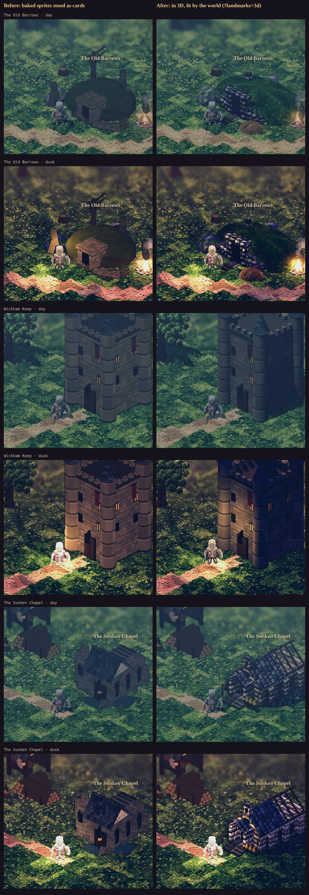
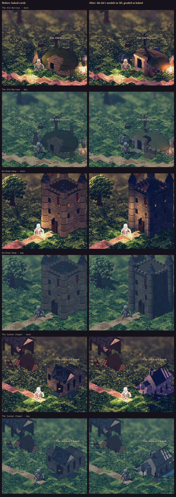
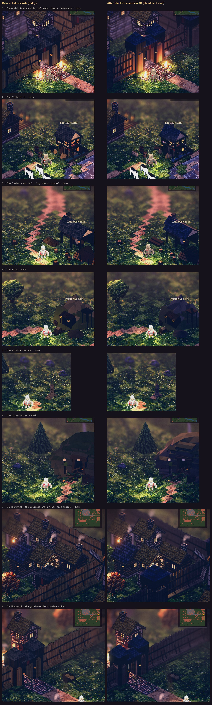

# The Vale's landmarks: the dungeon doors to the new art standard

**Status: Approved (2026-11-10); #1, #2 and #4 Implemented, #3 awaiting the owner's choice per piece** (§7, §8). The
owner: *"phone performance and looks are good. Let's continue to focus on the MVP with the Thornwick map, so we can
extend the same standards and criteria (world assets like trees, relative placements, dungeon entrances/art, etc.) to
other maps. First, the entrances to the dungeons dont look good and are not up to the new art standards (old barrow,
keep, sunken chapel) - propose updated art for these buildings."* Then, seeing the spike: *"the old design for the Keep
actually looks OK - can we keep this, and are those tile assets re-usable for our overall asset catalogue?"* Then, on
§6: *"Go with your recommendations on all four - but let me see your proposed changes to #3 before implementing - let
me choose before or after."*

*The proposal's spike (kept for the record; §7 has the shipped doors). Left: the game as it was. Right: the spike. The Keep is our own kit's model stood in 3D. The Barrows and the Chapel are
first passes at new designs. Captured in the game on the manual clock (`tools/capture/rig.mjs … --query landmarks=3d`).*

## 1. What's wrong now

All three doors are **our baked sprites stood up as flat cards** in Luminati's 3D world (`convert.js` keeps what Luminati
has no match for as a sprite). Next to Thornwick's houses, which Luminati builds in 3D, they show four problems:

- **No light.** The world's sun and lamps don't touch them: no warm side and shaded side at dusk, and no shadow on the ground.
- **The wrong grain.** Their pixels are Emberlit's, at another scale from the textures round them.
- **The Old Barrows reads as a hut:** a green dome with a plank shed for a door.
- **The Sunken Chapel reads as a dark lump.** It isn't sunken or half swallowed: just two puddles.

The Keep's design is right (the owner); what's wrong with it is only that it's a card.

## 2. The finding: the catalogue is already code, and it stands in 3D

Every piece the converter keeps as a sprite is a model built in code by our own building kit,
**`tools/actor-lab/buildkit.js`** (three.js, the same library Luminati draws with), and baked to a sprite by
`bake-env.cjs`. In the Vale that means:
- the Keep;
- the Barrows (`barrow`) and the Chapel ruin (`chapelruin`);
- the mine, the lumber mill, the Tithe Mill and the milestone;
- Thornwick's palisade, towers and gatehouse.

Every other region's town set is the same kind of model, in its own style (`town.json`: `vale`, `fens`, `reach`, `heights`).

**So the same model can stand in Luminati's world as itself.** The spike does this for the Keep:
`makeBuilding('keep', 'vale')` is scaled to Luminati's units (one kit unit is ten of our tiles, five of Luminati's) and
added to the scene with shadows on. That gives the same design (turrets, conical caps, crenels, banner, door, lit
windows) lit by the dusk sun, with its shadow on the grass: **952 triangles** (its 65 meshes merge to about 8 draws).

**To the owner's question: yes, the assets are reusable, as one catalogue.**
- **One model per piece**, in code, in one place (`buildkit.js`).
- **Many uses:** the 3D piece in the world, its baked sprite for anything 2D, every region's variant by style, and any
  map that places the id (`convert.js`).
- **Better for the standard:** a fix to a model fixes it everywhere. A new map's landmark is a new kit model, not a new
  drawing.

## 3. The landmark standard (for the Vale first, then every map)

1. **Built in 3D, never a card.** It takes the world's sun, lamps and shadows. It is a kit model (`buildkit.js`) stood
   in the world. Luminati's own builders (houses, trees, wells, bridges) stay where they're used.
2. **At the people's scale.** A figure stands 1.75 units. A door is 1.2–1.4× a figure. A landmark reads as itself at
   the game's camera on a phone (390 × 844).
3. **The door reads as a way down:** a dark opening with depth, on the side the sim's exit is. A lit marker (a lantern
   or torch) shows it at dusk and by night.
4. **The lore in the silhouette** (the world doc): the Legion's crypt, the Redhand's keep, the drowned chapel. The
   people who use it now show in the dressing: the dig, the camp, Tobin's lantern, Hester's bees.
5. **On the sim's footprint.** `envfoot.js` and the exits don't move, so nothing the sim walks, fights in or replays
   changes (no balance or save impact).
6. **The Vale's palette:** dusky, mossed, weathered stone and dark timber, graded as the bake grades it (gain,
   desaturation, tint from `town.json` / `env.json`).
7. **On a phone's budget:** under about 1,500 triangles and about 10 draw calls a landmark (merged by material). The
   spike's three are 774–981 triangles.
8. **Checked at dawn, day, dusk and night**, on a contact sheet before and after, with a critic pass (the art critic
   docs' format).

## 4. The three doors

### Wickham Keep: keep the design (the owner)
- **Spike:** the kit's own keep model, stood in 3D in place of its sprite.
- **To do:**
  - merge its meshes by material;
  - grade it as its bake is (gain 0.7, desaturation 0.12, the warm tint);
  - lit torches at the door (Luminati's wall torch, so it lights the ground at dusk);
  - optionally the Redhand's touches: fallen stones at a broken corner, their cloth.

### The Old Barrows: a new design, a long barrow
- **The design:**
  - a long, low barrow of the Third Legion's dead, turfed over, with kerbstones round its foot;
  - a portal of three rough megaliths (two uprights and a lintel), the Legion's shield cut in the lintel;
  - a dry-stone forecourt curving back into the mound;
  - the passage going down, dark;
  - the Redhand's dig at the door (shoring, a spoil heap, planks over the mud, their tent and fire);
  - Tobin's lantern on its post, lit at dusk.
- **Spike:** `tools/render3d/landmarks.js` `barrow` (774 triangles). The mound, kerb, portal, shoring, spoil and
  lantern are there.
- **To do:**
  - rough stone for the megaliths (the spike's well stone reads as brick);
  - the mound longer and lower;
  - the shield on the lintel;
  - the Redhand's tent;
  - author it **in `buildkit.js`** as the barrow's new model, so its sprite and its 3D piece are one model.

### The Sunken Chapel: a new design, half swallowed
- **The design:**
  - an imperial chapel standing in black marsh water to its sills and leaning;
  - the near end roofed in slate with an empty bell-cote, the far end fallen in to its rafters;
  - pale stone under a green water line of slime;
  - the dry porch up out of the water on its steps, Hester's skeps on a bench there and her lantern;
  - the robed men's cut: spoil and planks to a breach in the side wall.
- **Spike:** `landmarks.js` `chapel` (981 triangles). The nave, lean, sink, slate, rafters, bell-cote, porch, skeps,
  reeds and lantern are there.
- **To do:**
  - **the marsh as Luminati's own water.** The converter marks the tiles round the chapel as water (`~`), so the
    world draws real water with its shore, as the river is drawn. The spike's water disc reads as shadow.
  - paler stone;
  - the cut;
  - author it in `buildkit.js` as the chapel ruin's new model.

## 5. The work, if approved

1. **The kit in the world:** `world.js` stands every kit piece the converter keeps as a sprite as its 3D model (the
   spike's `KIT_PIECES`, for every kept id), merged by material and graded as baked. The Vale's sprite cards go: the
   Keep, Thornwick's palisade, towers and gatehouse, the mills, the mine, the milestone.
2. **The Barrows and the Chapel redesigned in `buildkit.js`** (§4). Re-bake `env.json`, so the minimap and anything 2D
   match. The chapel's marsh becomes water tiles in `convert.js`.
3. **Checks:**
   - a browser check that the Vale's landmarks stand as meshes, not cards, under the triangle and draw budget;
   - a capture sheet of the three doors at four hours;
   - the browser suite and `npm run check`.
4. **Docs:** this proposal Implemented; a short `docs/world-asset-standard.md` holding §3 for every map.

Cost: the kit-in-the-world step is small (the spike works). The two redesigns are a day's modelling each in
`buildkit.js`, including captures and a critic pass.

## 6. Questions for the owner

1. **One catalogue:** stand our kit's models in 3D everywhere a sprite card stands today, the Keep first (recommended),
   rather than building landmarks a second way?
2. **The Barrows and the Chapel:** go with the designs in §4, as the spike shows them, with the to-dos?
3. **The rest of the Vale's cards** (Thornwick's palisade, towers and gatehouse, the mills, the mine, the milestone)
   in the same pass (recommended), or the three doors only first?
4. **The chapel's marsh as real water tiles** (recommended)?

## 7. As built: the three doors (#1, #2, #4)

*Left: the baked cards the game had. Right: the kit's models stood in 3D, graded as baked, in the game on the manual
clock (`tools/capture/rig.mjs … --query landmarks=doors`).*

- **One catalogue** (`tools/render3d/world.js` `kitPiece`, `placeEnv`). A Vale kit piece the converter keeps is built
  from `tools/actor-lab/buildkit.js` and stood in the world: one kit unit to five of Luminati's, shadows cast and
  taken, lit windows in the world's lantern glass.
  - **Merged by material:** the Keep's 65 meshes draw as 8.
  - **One model an id a scene,** its geometry shared by every copy (Thornwick's palisade is the same few pieces many
    times).
  - **Graded as its card** (`env.json` / `town.json`): toward the luma by `desat`, the warm `tint`, in the shader. The
    bake's `gain` answers the bake's own bright lights, so in its place an albedo lift (`KIT_LIFT` 1.3). Wickham Keep
    at dusk, luma over the keep: the card 64.5, the model at the bake's gain 39.9, ungraded 45.1, lifted 51.0. By day
    the card is 63.5 and the lifted model 56.9.
  - **On the ground round it,** not the tile under its middle (the chapel stands in water).
  - **`?landmarks=doors|all|sprites`:** `doors` is the default (the three doors); `all` is every Vale kit piece (§8);
    `sprites` is every piece as its card, as before.
- **The Old Barrows** (`buildkit.js` `barrow`), as §4 designed it:
  - a long, low turfed mound with a kerb round its foot;
  - a portal of three rough faceted stones facing the exit, the Legion's shield on the lintel;
  - the dry-stone forecourt and the dark passage;
  - the Redhand's shoring, spoil and planks;
  - Tobin's lantern, standing stones and a dead tree.
  - Left out: the Redhand's tent (their fire by the mound is the sim's brazier).
- **The Sunken Chapel** (`buildkit.js` `chapelruin`):
  - sunk to its sills and leaning;
  - pale ashlar over a green slime line, tall dark windows;
  - the near end slate-roofed, an empty bell-cote on its gable, the far end open to its rafters (one fallen askew);
  - the dry porch on its steps before a dark door going down;
  - Hester's three skeps on a bench and her lantern;
  - the robed men's planks across the water to a breach in the side wall, their spoil on the bank.
- **The marsh as the world's water** (`src/render3d/convert.js`, `MARSH_FRONT`). The Sunken Chapel's footprint, up to 5
  tiles in front of its middle, is laid as Luminati's still water (its riverbed 0.6 under the bank). The porch and the
  approach stay dry. The sim never walks a footprint, so nobody wades, and nothing the sim walks, fights in or replays
  changes.
- **The budget** (§3.7), measured in the game's Vale:

  | Door | Triangles | Draws |
  |---|---|---|
  | Wickham Keep | 952 | 8 |
  | The Old Barrows | 1,346 | 10 |
  | The Sunken Chapel | 1,306 | 12 |

  `luminati.js` is 135 KB gzipped (108 before the kit).
- **Checks:**
  - the browser suite's new check that the three doors stand as kit meshes under 1,500 triangles and 12 draws, the
    chapel in the world's water;
  - `npm run check`.
- **Not done here:**
  - **The re-bake.** `bake-env.cjs` needs the nature pack's glTF, which this checkout lacks. So the barrow's and the
    chapel's 2D sprites (the minimap, `?landmarks=sprites`) are still the old designs, and `envfoot.js` keeps their old
    footprints. The next bake picks them up. The chapel's pool is `bakeOnly`, so its card keeps water.
  - **The Keep's door torches** (Luminati's wall torch). The door's own lit windows and the brazier light it for now.

## 8. #3: the rest of the Vale's cards, for the owner to choose

The owner: *"let me see your proposed changes to #3 before implementing - let me choose before or after."* Nothing
here is the default: `?landmarks=all` shows it.

([by day](img/landmarks/vale-kit-choices-day.jpg))

| # | Piece | Recommendation | Why |
|---|---|---|---|
| 1 | Thornwick from outside: the palisade, its towers and the gatehouse | **After** | The braziers light the gate's timbers and the posts take the light; it stands, where the card leans flat. The slate roofs still read blue at dusk, so a stronger desaturation goes on the roofs if chosen. |
| 2 | The Tithe Mill | After | The same design, lit; its wheel in the race reads |
| 3 | The lumber camp (the mill, the log stack, the stumps) | After | The log stack reads as logs and the stumps stand |
| 4 | The mine | After (marginal) | The hill and its shed are in shade either way; lit from the sun's side |
| 5 | The ninth milestone | Either | Small: the same stone |
| 6 | The Scrag Warren | After | The adit's timbers and the torn boards read as depth, not paint |
| 7 | Inside Thornwick: the palisade and a tower | **Before** | From inside, the wall's face to the camera is its shaded side, and the tower reads as a black block. The card shows the lit face. |
| 8 | Inside Thornwick: the gatehouse | **Before** | As 7 |

**The cost of `all`,** measured in the game (scene-wide, before the camera's culling):
- **The Vale overland:** 32 kit pieces, 37,514 triangles, 236 draws.
- **Thornwick:** 42 pieces, 43,700 triangles, 176 draws.

A screen holds a few of them at a time. Before any of it becomes the default, it gets checked on a phone.

## The spike, in the code

(The spike, superseded by §7: `tools/render3d/landmarks.js` built the Barrows and the Chapel a second way, with
Luminati's mesh builder; it is gone, and its designs live in the kit. `rig.mjs --query` stays.)
