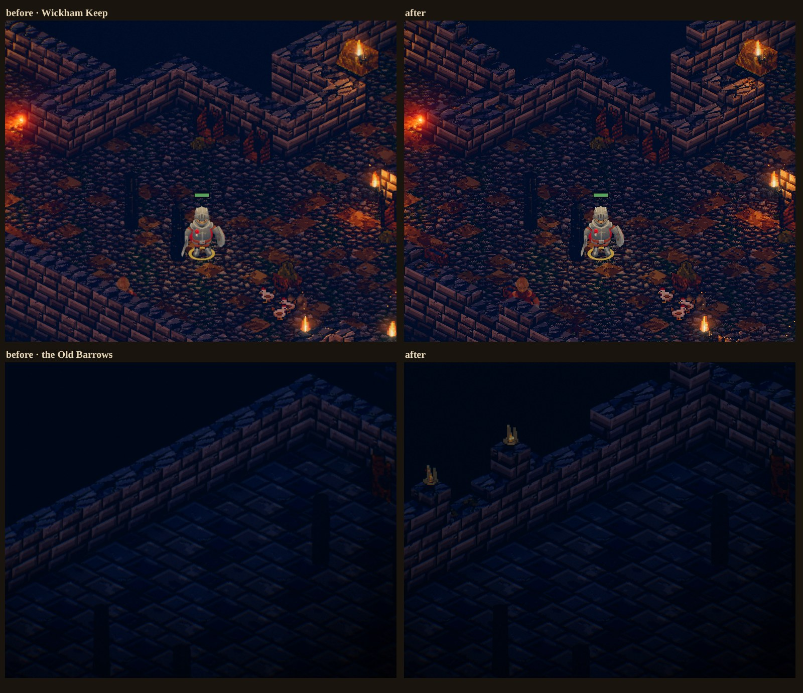

# Dungeon walls with a ragged top: a spike

**Status:** Implemented (2026-11-14, GDD §3.1 v1.98): the default in every dungeon; `?walls=plain` the level boxes as before.
The owner, on the spike: *"Implement the wall variations but no ribs"*: the bones on the tops are gone.

**The owner, 2026-11-14** (with a reference picture of an isometric dungeon, not kept in the repo): *"Look at this dungeon
dressing.. some height variations in walls, some minor dressing on top of walls. Prototype what this might look like for
this game.. show me"*.

## What it does

Every wall round a dungeon floor stood at one height, a level box (`src/render3d/convert.js` dungeon: heights `6`, the floor
`2`). Now (`ruinWalls` in the same file; it was the spike's `?walls=ruin`):

- **The back walls** (the faces the camera sees, the room south and east of them) rise and fall in runs of two or three
  tiles, a step under the old height to three over.
- **A pier**, about one back-wall tile in thirteen, stands a block taller, with a cluster of candles (our `candles` prop,
  as the rooms have) and a small flame on it. The flame casts no light of its own: Luminati shares twelve point lights
  among everything in view, and the rooms' own lamps need them.
- **The tops are dressed:** rubble and the odd fallen block (`rock`). The spike had a skull and ribs too (Luminati's `debris`
  bones); the owner wanted none.
- **The near walls** (between the camera and the floor) are broken down to a ragged ruin, 0.5–1.5 m (they were 2 m), with
  rubble here and there, so they frame the room rather than hide it. A wall with floor on both sides (between two rooms)
  only ever steps down.
- Every choice is a hash of the tile: a floor looks the same every visit. Nothing in the sim changes (the walls are where
  they were; only how tall they're drawn).

## How it looks

The rig's six Vale floors (`node tools/capture/rig.mjs vale-dungeons --dpr 2`, with `--query walls=plain` for the before), a
room at dusk:

Close up:

## What it adds

On a floor, a dozen or so pier flames, about 50 bits of rubble, a dozen rocks and about 10 candle clusters on the walls, all
Luminati's own small props or our one candles sprite, and no new lights. The frame (`tools/capture/figperf.mjs`, software GL
on the cloud box, the plain walls then these): in a Barrows fight, draws 107 → 113, triangles 210k → 239k (+14 %), the
median frame 350 → 367 ms (within that machine's noise); the town square unchanged (429 draws, 725k triangles). A phone's
numbers are still to take.

## Next

- Tune the amplitude and the dressing per kit (the keep's banners and arrow-slits, the chapel's candles and saints).
- Measure the frame on a phone, and run the visibility rule (`tools/capture/visibility.mjs`): nothing here should hide a
  person, since the walls in front only get lower.
- Further: moss or ivy down the faces, and the reference's carved arch and runes at a hall's door (the stairs' arches are
  there already).
