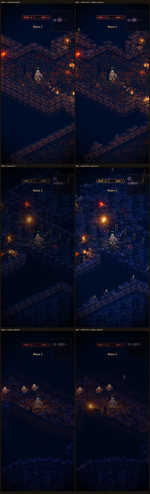

# Dungeon walls with a ragged top: a spike

**Status:** Spike (2026-11-14), behind `?walls=ruin`; the default is unchanged. For the owner to decide whether it ships,
and how far to take it.

**The owner, 2026-11-14** (with a reference picture of an isometric dungeon, not kept in the repo): *"Look at this dungeon
dressing.. some height variations in walls, some minor dressing on top of walls. Prototype what this might look like for
this game.. show me"*.

## What it does

Today every wall round a dungeon floor stands at one height, a level box (`src/render3d/convert.js` dungeon: heights `6`,
the floor `2`). With `?walls=ruin` (`ruinWalls` in the same file):

- **The back walls** (the faces the camera sees, the room south and east of them) rise and fall in runs of two or three
  tiles, a step under the old height to three over.
- **A pier**, about one back-wall tile in thirteen, stands a block taller, with a cluster of candles (our `candles` prop,
  as the rooms have) and a small flame on it. The flame casts no light of its own: Luminati shares twelve point lights
  among everything in view, and the rooms' own lamps need them.
- **The tops are dressed:** rubble, a skull and ribs (Luminati's `debris` bones), the odd fallen block (`rock`).
- **The near walls** (between the camera and the floor) are broken down to a ragged ruin, 0.5–1.5 m (they were 2 m), with
  rubble here and there, so they frame the room rather than hide it. A wall with floor on both sides (between two rooms)
  only ever steps down.
- Every choice is a hash of the tile: a floor looks the same every visit. Nothing in the sim changes (the walls are where
  they were; only how tall they're drawn).

## How it looks

The rig's six Vale floors (`node tools/capture/rig.mjs vale-dungeons --dpr 2`, then `--query walls=ruin`), a room at dusk:

Close up:

## What it adds

On the Sunken Chapel's first floor (node, `convertWorld`): 13 flames, 55 bits of debris, 11 rocks and 9 candle clusters on
the walls (Wickham Keep's: 14, 66, 16, 10). All are Luminati's own small props, or our one candles sprite, with no new
lights. The frame cost isn't measured yet (`tools/capture/figperf.mjs` would do it, before shipping).

## If it ships

- Make it the default, keeping `?walls=plain` for a before, and tune the amplitude and the dressing per kit (the crypt's
  bones, the keep's banners and arrow-slits, the chapel's candles and saints).
- Measure the frame on a phone, and run the visibility rule (`tools/capture/visibility.mjs`): nothing here should hide a
  person, since the walls in front only get lower.
- Further: moss or ivy down the faces, and the reference's carved arch and runes at a hall's door (the stairs' arches are
  there already).
