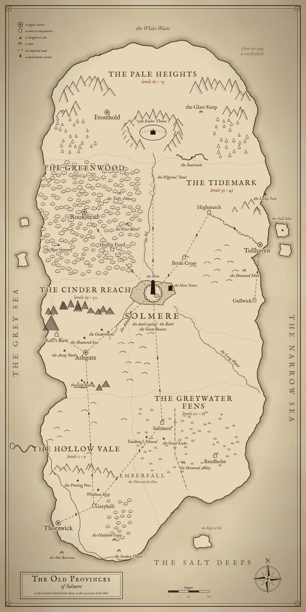

# The world map re-laid, and dungeon stars

*2026-11-23 · **Prototype, implemented** (GDD v1.143, world doc v1.63). The owner: "Replan and rearrange the world
map.. more visual progress feedback, lowest levels at the bottom and highest at the top. The mere tower and ember
throne can stay where they are. Lets also track dungeon completion.. one star completed, two stars if under a
reasonable time and 3 stars if completed quickly including the boss without dying. Show stars in the map next to the
dungeons. Prototype this."*

## 1. The layout: the lands climb the map

The Guild's wall map now reads as the game is played, from the foot of the map to its head:

| Land | Levels | Where on the map | Was |
|---|---|---|---|
| The Pale Heights, the Ember Throne | 61–75 (Throne 73–75) | the top, round the crater | the same |
| The Greenwood | 46–60 | north-west, under the Heights | the south-east |
| The Tidemark | 31–45 | the east coast | the same |
| Solmere, the Mere, the Mere Tower | from 15 | the middle | the same |
| The Cinder Reach | 19–30 | west, below the Mere | west, beside the Heights' foot |
| The Greywater Fens | 10–18 | north-east of the Vale | south of the Vale |
| The Hollow Vale | 1–9 | the island's foot, south-west | above the Fens |

The coast, the Heights, the Mere and the Throne are drawn as before. Inside the coast, every land's features moved
with it:

- the Greenwood's woods;
- the Reach's black hills and Kell's volcano;
- the Vale's north range and woods;
- the Fens' reeds;
- the downs between the Reach and the Vale;
- the rivers (the Ashwater now climbs from the Reach to the Mere);
- the province lines and the region names. Each now has its own band ("levels 1 – 9"), where Emberfall was one block
  of "1 – 15".

The Reach's dungeons are placed from its overland, as Emberfall's always were. The Guild's roads climb the same way:

- Solmere to Saltmere, then Greyholt, then Thornwick;
- the Wickham road from Greyholt up to Ashgate;
- Solmere to Hollin Ford, then Rookstead.

**Code:**

- `src/ui/wallmap.js`: `PLACES`, the `EMBERFALL` transforms (the Vale, the Fens, the Reach), `LAND_AREA`, `FOG_WORDS`,
  and the new `CLIMB`, the lands in climbing order with their bands.
- `tools/worldmap/draw.mjs`: redraws the map, and writes each dungeon's mark to `assets/maps/old-provinces.json`
  (`sites`) for the stars.
- `test/worldmap.test.mjs`: each town stands where its overland puts it, the Reach's included, and every land sits
  above the one before it.

## 2. Progress you can see on the World map

On the World tab (`src/ui/worldmap.js`):

- **Dungeon marks with their stars.** Every dungeon found in an open land has a small lozenge on its mark. It is plain
  until cleared, amber once cleared, and gold with a glow at three stars. Its stars sit beside it, ★★☆, with the empty
  ones faint, and its label carries the count for screen readers. A tap opens the dungeon's card.
- **Each land's progress under its name.** The label shows the stars won out of those possible and how many dungeons
  are cleared, for example "★ 5 / 12 · 2 of 4 cleared". A land with every dungeon cleared has a gold label marked
  "done". A land built but not yet open shows "opens from level 10". A land not yet built shows "the Guild's roads
  don't reach it yet".
- **The road climbed.** A red line runs town to town up the map in the order the lands are climbed. It is solid
  through the lands that are open and dotted beyond them, ending at the Throne.
- **The level rail.** A thin rail stands at the map's right edge and doesn't scroll with the map. It has one segment
  per land, the lowest at its foot:
  - each segment fills with the stars won there;
  - a green mark shows the hero's level within its land's band ("LV 7");
  - a tap on a segment scrolls the map to that land.
- **The dungeon's card** shows its stars, the best time (and whether that run was clean), and what the next star asks:
  "★ the end reached · ★★ inside 14 min · ★★★ inside 9 min with nobody down".
- **The land tab** shows each dungeon's stars beside its pin.
- **When a run ends,** a toast gives the dungeon's name, its stars and the time. A new best lights the map button's dot.

Captures, a phone at 390 × 844:

- the World tab with the Vale lit;
- a dungeon's card;
- the land tab.

They were taken by the probe in the commit's notes. All three were checked by eye.

## 3. Dungeon stars: the rule (`src/sim/stars.js`)

**A run** starts when you walk in at a site's door, which is a fresh visit (core.js `travel`). It ends at the site's
end without your leaving. The end is:

- the last floor's boss down; or
- for a secret, its vault opened; or
- for a one-floor site with no boss (the Haddow Crypt, the Shuttered Inn), its end room's chest opened.

The stairs between floors keep the run going. Leaving any other way ends it unfinished: stepping out, a scroll, the
coach, or a wipe to the temple. A run on a raid doesn't count, nor one in the Mere Tower or the Bowl (they have no
end).

| Stars | Asks |
|---|---|
| ★ | the end reached |
| ★★ | inside the site's reasonable time |
| ★★★ | inside its quick time, and nobody in the company went down on the way, the boss fight included |

**Par times** were measured with `tools/balance/pace.mjs`, 3 seeds per site. The harness plays the right company at
each floor's level from a new slot, every gate shut, resting between rooms. Quick is the median rounded up.
Reasonable is the median × 1.5, rounded up.

| Site | Median (min) | ★★★ quick | ★★ reasonable |
|---|---|---|---|
| The Old Barrows | 8.8 | 9 | 14 |
| Wickham Keep | 11.6 | 12 | 18 |
| The Sunken Chapel | 13.2 | 14 | 20 |
| Toadking's Mound | 13.2 | 14 | 20 |
| The Canal Locks | 13.5 | 14 | 21 |
| The Drowned Abbey | 14.5 | 15 | 22 |
| The Cold Seam | 14.0 | 14 | 21 |
| The Assay Yards | 15.0 | 15 | 23 |
| The Cinderworks (the Forgehall its first floor, v1.144) | 15.3 | 16 | 23 |
| The Haddow Crypt, the Shuttered Inn, the three secrets | not measured | 6 | 9 |

How the times play:

- **A first walk-through makes two stars at a steady pace.** Its gates have to be held down 20 waves each, and that
  is most of the harness's time.
- **Three stars want the gates already down** (they stay down for the slot, so on a second visit), or a sharp first
  run.
- **The five without a measured median** have estimates: a one-floor building is about a third of a two-floor
  dungeon's rooms. `pace.mjs` walks to a last boss, so it can't time them yet.
- **The Proving Pens are a trial,** so they have no stars.

**Fair play.** The stars are a record, never a reward: nothing is paid or granted for them, so a replay is the same
with or without them. They use only sim time and sim events.

**Saving.** The record and the run under way are saved (`state.stars`, `state.starRun`, save v57). A save from before
v57 has none (`starsFor57`). A reload in the middle of a dungeon keeps the run.

**Tests:** `test/stars.test.mjs`, 6 tests.

- the rules;
- a run to the Quartermaster;
- downs, with a rival's down not counted;
- the record keeping its best;
- the stairs keeping a run, and the way out ending it;
- a boss-less site's end-room chest, with a chest elsewhere not counted;
- the save and its migration.

## 4. What it doesn't do yet

- **No reward.** Stars only show. A reward for three stars (a title, a Guild mark, a cosmetic) would be a sim rule,
  and that is the owner's call.
- **No time shown during a run.** A small clock in the HUD while a run is on would make the quick time something to
  aim for. It's cheap, and it's the obvious next step.
- **Un-measured pars.** The five sites without a median need a `pace.mjs` that stops at the end room's chest or the
  vault.

## 5. The next step: the overlands' roads

The wall map is re-laid, but the overlands keep the sides their roads leave by:

- the Vale's canal road still leaves by its **south** edge for the Fens, which now lie north-east of it;
- the Fens' road to the Vale still comes in at their **north** edge.

The Wickham road (Vale north, then the Reach) already agrees with the new map.

Making the two agree means:

1. **The Vale** (`src/sim/outdoor.js`): its canal road and the exit to the Fens move to its north-east corner (on the
   map, the Vale's north-east corner meets the Fens' south-west one). Its verges, trees and camps get re-checked.
2. **The Fens:** the road from the Vale comes in at the south-west and runs up to Saltmere (its town stays where it is).
3. **Regenerate:** the minimaps and land pictures (`node tools/worldmap/minimap.mjs`), and the overlands' sketches.
4. **Tests:** the overland and visibility tests, and `test/worldmap.test.mjs` gets back its check that the two roads
   meet.
5. **Six player lines** that send the Fens south get rewritten in the owner's voice ([copy-voice.md](./copy-voice.md)):
   - Ilse's two directions in `content/dialogue/ilse.ink`;
   - *Fog on the Canal*'s summary and Journal line in `content/quests/ch2_fog_on_the_canal.json`;
   - and the world doc's §3.2 "south of the Vale".
